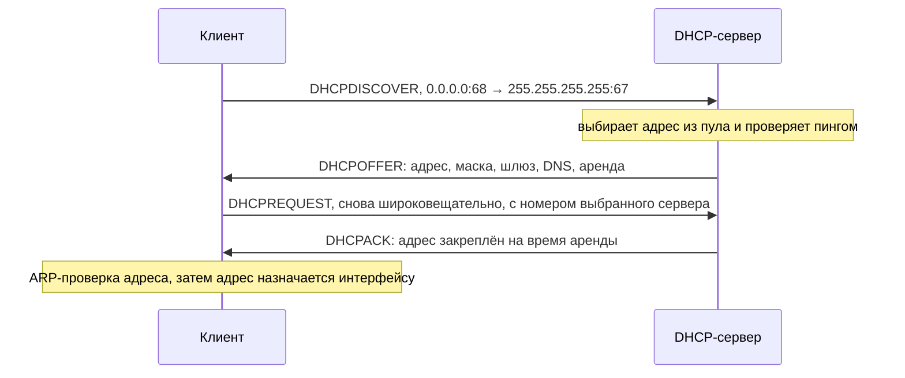
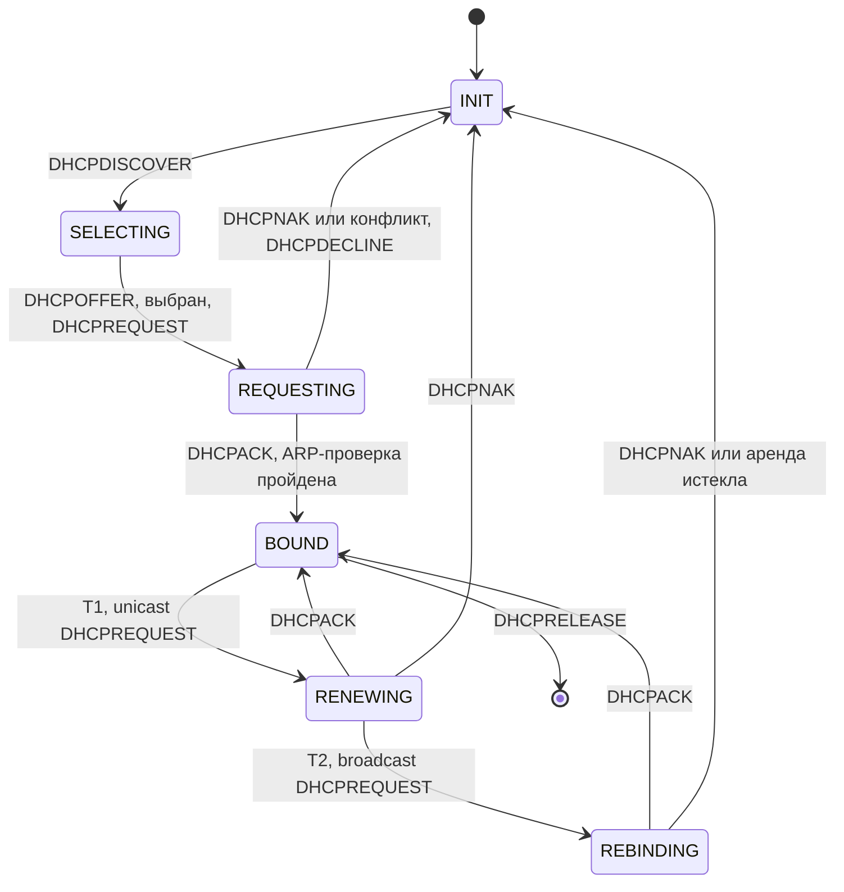

# Протокол DHCP

## Назначение и роли [52:37](https://www.youtube.com/watch?v=1XavYjeAaog&t=3157s)

> [!note] **DHCP** (Dynamic Host Configuration Protocol, протокол динамической конфигурации узла) раздаёт сетевые параметры хосту при подключении, без ручной настройки
> Участники — **DHCP-сервер**, хранящий пулы адресов и параметры, и **DHCP-клиент**. Описан в [[RFC]] 2131, работает поверх [[Протокол UDP|UDP]]: сервер слушает порт **67**, клиент — **68**

Настраивать вручную адрес, [[IP-адрес и маска подсети|маску]], шлюз и [[Протокол DNS|DNS]] на каждом компьютере, телефоне и принтере — ровно та работа, от которой DHCP избавляет. Серверам адреса по-прежнему стараются прописывать руками [53:38](https://www.youtube.com/watch?v=1XavYjeAaog&t=3218s)

DHCP вырос из **BOOTP** (Bootstrap Protocol, протокол начальной загрузки, RFC 951): формат сообщения и порты 67/68 унаследованы оттуда, добавились аренда и опции. А BOOTP в своё время сменил [[Proxy ARP и разновидности ARP|RARP]], умевший выдать только адрес

> [!info]- Формат сообщения унаследован от BOOTP
> | Поле | Размер | Что несёт |
> |---|---|---|
> | op | 1 байт | `1` — от клиента, `2` — от сервера |
> | htype, hlen | 1 + 1 байт | тип и длина аппаратного адреса, как [[Протокол ARP#Формат сообщения [08 09](https //www.youtube.com/watch?v=HxGsA6Ps-T8&t=489s)\|в ARP]] |
> | hops | 1 байт | сколько [[DHCP Relay и Option 82\|ретрансляторов]] прошло сообщение |
> | xid | 4 байта | идентификатор транзакции, связывает ответы с запросом |
> | secs, flags | 2 + 2 байта | время с начала попытки; флаг broadcast — "отвечай широковещательно" |
> | ciaddr | 4 байта | текущий адрес клиента, если он уже есть |
> | yiaddr | 4 байта | адрес, который сервер выдаёт клиенту |
> | siaddr | 4 байта | сервер следующего этапа загрузки |
> | giaddr | 4 байта | адрес ретранслятора — [[DHCP Relay и Option 82\|DHCP Relay]] |
> | chaddr | 16 байт | [[MAC-адресация\|MAC]] клиента |
> | sname, file | 64 + 128 байт | имя сервера и файла загрузки |
> | options | переменный | "магическое число" `99.130.83.99`, затем опции |

## DORA [54:11](https://www.youtube.com/watch?v=1XavYjeAaog&t=3251s)

Получение адреса — четыре сообщения, по первым буквам которых обмен и назван

| Шаг | Сообщение | Направление | Смысл |
|---|---|---|---|
| 1 | **D**iscover | клиент → broadcast | "есть тут DHCP-сервер? дайте адрес" — клиент не знает, есть ли сервер, один ли он |
| 2 | **O**ffer | сервер → клиент | "вот адрес, маска, шлюз, DNS" |
| 3 | **R**equest | клиент → broadcast | "беру предложение вот этого сервера" |
| 4 | **A**ck | сервер → клиент | подтверждение: параметры закреплены за клиентом на время аренды |

> [!tip] Request идёт широковещательно, хотя сервер уже известен
> Предложения могли прийти от нескольких серверов. В Request клиент указывает идентификатор выбранного (опция 54), и остальные, увидев его, возвращают предложенные адреса в свои пулы

У клиента до [[Подтверждение приёма|ACK]] адреса нет, поэтому Discover отправляется с `0.0.0.0`, а Offer и ACK сервер доставляет либо [[Типы адресации|unicast]] на MAC из поля chaddr, либо широковещательно, если клиент поднял флаг broadcast — не каждый стек готов принять IP-пакет на адрес, которого у него ещё нет

### Параметры и опции [56:21](https://www.youtube.com/watch?v=1XavYjeAaog&t=3381s)

Кроме адреса сервер отдаёт всё, что узлу нужно для работы в сети. Каждый параметр — **опция** со своим номером (RFC 2132), и отдаёт сервер те, которые клиент перечислил в опции 55 **Parameter Request List** [57:26](https://www.youtube.com/watch?v=1XavYjeAaog&t=3446s)

| Опция | Параметр |
|---|---|
| 1 | маска подсети |
| 3 | [[Статические маршруты и маршрут по умолчанию\|шлюз по умолчанию]] |
| 6 | DNS-серверы |
| 15 | доменное имя |
| 42 | серверы **NTP** (Network Time Protocol, протокол синхронизации времени) |
| 44 | серверы **WINS** (Windows Internet Name Service) — разрешение имён компьютеров в старых сетях Windows |
| 51 | время аренды |
| 53 | тип сообщения DHCP |
| 54 | идентификатор сервера |
| 58, 59 | T1 и T2 — моменты продления |
| 66, 67 | сервер **TFTP** (Trivial File Transfer Protocol, простейший протокол передачи файлов) и имя файла загрузки — для бездисковых станций и **PXE** (Preboot Execution Environment, загрузка по сети) |
| 82 | [[DHCP Relay и Option 82\|сведения от ретранслятора]] |
| 121 | дополнительные бесклассовые статические маршруты |
| 150 | адрес TFTP-сервера для IP-телефонов Cisco — откуда телефон берёт конфигурацию и адрес станции, где регистрироваться |

## Остальные сообщения [57:57](https://www.youtube.com/watch?v=1XavYjeAaog&t=3477s)

В RFC 2131 сообщений восемь, тип задаёт опция 53:

| Тип | Сообщение | Кто → кому | Когда |
|---|---|---|---|
| 1 | DHCPDISCOVER | клиент → все | поиск серверов |
| 2 | DHCPOFFER | сервер → клиент | предложение параметров |
| 3 | DHCPREQUEST | клиент → сервер | выбор предложения, продление, возврат к старому адресу |
| 4 | DHCPDECLINE | клиент → сервер | предложенный адрес уже занят |
| 5 | DHCPACK | сервер → клиент | подтверждение |
| 6 | DHCPNAK | сервер → клиент | отказ |
| 7 | DHCPRELEASE | клиент → сервер | досрочный отказ от адреса |
| 8 | DHCPINFORM | клиент → сервер | параметры без адреса |

- **DHCPRELEASE** — клиент уходит из сети и освобождает адрес сам: штатное выключение, смена интерфейса. Сервер возвращает адрес в пул и позже может выдать другому
- **DHCPNAK** — сервер отказывает на Request: адрес уже выдан другому, клиент переехал в подсеть, где этот адрес не валиден, или администратор меняет адресацию и плавно переводит клиентов в новый блок, больше не подтверждая старые адреса ни при возвращении, ни при продлении [59:00](https://www.youtube.com/watch?v=1XavYjeAaog&t=3540s). Получив DHCPNAK, клиент немедленно прекращает пользоваться адресом и начинает с Discover
- **DHCPDECLINE** — клиент отказывается от выданного адреса, обнаружив, что тот [[Протокол DHCP#Проверка занятости адреса [1 17 49](https //www.youtube.com/watch?v=1XavYjeAaog&t=4669s)|уже кем-то занят]] [1:00:05](https://www.youtube.com/watch?v=1XavYjeAaog&t=3605s)
- **DHCPINFORM** — у клиента адрес уже настроен вручную, а остальные параметры (DNS, домен) нужны от сервера [1:02:39](https://www.youtube.com/watch?v=1XavYjeAaog&t=3759s)
- **DHCPFORCERENEW** (RFC 3203, тип 9) — позднее расширение: сервер сам заставляет клиента продлить аренду досрочно. Требует поддержки на обеих сторонах и на практике почти не встречается

## Аренда и продление [1:14:39](https://www.youtube.com/watch?v=1XavYjeAaog&t=4479s)

Параметры выдаются не навсегда, а на **время аренды** (lease time, опция 51). Вместе с ним сервер сообщает два момента продления:

$$\boxed{T_1 = 0{,}5 \cdot \text{lease}, \qquad T_2 = 0{,}875 \cdot \text{lease}}$$

Это значения по умолчанию из RFC 2131; сервер вправе прислать свои в опциях 58 и 59

> [!summary] T1 — unicast своему серверу, T2 — broadcast любому
> - **T1 наступил** — состояние **RENEWING**: клиент шлёт unicast DHCPREQUEST тому серверу, от которого получил адрес, — IP сервера он знает с прошлого раза. DHCPACK — аренда продлена, таймеры сброшены. DHCPNAK — адрес сбрасывается немедленно, всё с Discover. Нет ответа — повтор через половину времени, оставшегося до T2, и так до T2 [1:16:47](https://www.youtube.com/watch?v=1XavYjeAaog&t=4607s)
> - **T2 наступил, сервер молчит** — состояние **REBINDING**: DHCPREQUEST уходит широковещательно, "кто угодно, подтвердите этот адрес". Ответить может любой DHCP-сервер сети, не обязательно прежний
> - **аренда истекла, ответа нет** — адрес освобождается, процедура начинается с Discover: возможно, в сети появился другой сервер или клиент незаметно переехал в другую подсеть [1:17:18](https://www.youtube.com/watch?v=1XavYjeAaog&t=4638s)[^lecturer-t2]

[^lecturer-t2]: Лектор описывает только первую часть: на половине срока Request, при молчании — повторы с делением оставшегося времени пополам вплоть до конца аренды. Деление пополам в RFC 2131 действительно есть (с нижней границей 60 секунд), но на T2 = 87,5 % срока клиент перестаёт ждать прежний сервер и переходит на широковещательный запрос

| Среда | Время аренды | Причина |
|---|---|---|
| Домашний маршрутизатор | около суток | стабильный небольшой набор устройств |
| Офис, корпоративная сеть | часы — сутки | компромисс между гибкостью конфигурации и DHCP-трафиком |
| Публичный и гостевой Wi-Fi | от 30 минут до нескольких часов | устройства быстро сменяются, адреса надо освобождать |
| Облако и виртуализация | короткая | быстро подхватывать изменения при пересоздании машин |

Чем стабильнее среда, тем длиннее аренда; чем динамичнее — тем короче

> [!tip] Досрочное обновление на практике делают руками
> Перед плановой сменой конфигурации администраторы заранее уменьшают время аренды, чтобы клиенты сами быстро перечитали параметры, либо дёргают клиентов вручную: `ipconfig /release` и `ipconfig /renew` в Windows, `dhclient -r` и `dhclient` в Linux

## Проверка занятости адреса [1:17:49](https://www.youtube.com/watch?v=1XavYjeAaog&t=4669s)

Адрес проверяют обе стороны, и ни одна проверка в одиночку не надёжна

**Сервер** перед Offer пингует кандидата [[Протокол ICMP#Эхо-запрос и ping [1 20 48](https //www.youtube.com/watch?v=HxGsA6Ps-T8&t=4848s)|эхо-запросом]]: ответ пришёл — адрес занят, берётся следующий из пула, и так до первого молчащего. ARP серверу не годится: при [[DHCP Relay и Option 82|DHCP Relay]] он стоит в другом сегменте, а ARP [[Протокол ARP#Граница сегмента [14 33](https //www.youtube.com/watch?v=HxGsA6Ps-T8&t=873s)|за маршрутизатор не выходит]] [1:18:19](https://www.youtube.com/watch?v=1XavYjeAaog&t=4699s)

> [!failure] Узел с межсетевым экраном, режущим эхо-запросы, выглядит для сервера свободным [1:19:23](https://www.youtube.com/watch?v=1XavYjeAaog&t=4763s)
> Пинг остаётся без ответа, и занятый адрес уходит клиенту в Offer

**Клиент** поэтому проверяет адрес сам, уже в своём сегменте, — [[Proxy ARP и разновидности ARP#Gratuitous ARP [1 00 35](https //www.youtube.com/watch?v=1XavYjeAaog&t=3635s)|gratuitous ARP]] о собственном будущем IP. На ARP отвечает сетевой стек любого узла, межсетевой экран уровня IP его не глушит. Ответили — конфликт, серверу уходит DHCPDECLINE и процедура начинается заново; тишина — адрес свободен [1:19:53](https://www.youtube.com/watch?v=1XavYjeAaog&t=4793s)[^decline-order]

[^decline-order]: У лектора проверка стоит между Offer и Request: занят — Decline, свободен — Request. По RFC 2131 клиент проверяет адрес **после** ACK, перед тем как назначить его интерфейсу, и Decline отправляет уже на подтверждённый адрес; так же поступают реальные клиенты
