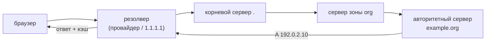

# Протокол DNS
> [!note] Система доменных имён (**DNS**, Domain Name System)
> Распределённая иерархическая база соответствий "имя → данные", в первую очередь "имя → [[IP-адрес и маска подсети|IP]]-адрес". Клиент задаёт вопрос коротким сообщением, обычно по [[Протокол UDP|UDP]], и получает запись. Хост в [[URL и адресация|URL]] превращается в адрес именно так

Материал не из лекций: источники — [[RFC]] из списка выше
## Устройство DNS

### Иерархия и зоны

Имя читается справа налево, иерархией: `www.example.org.` — корень `.`, затем зона `org`, домен `example`, поддомен `www`. Корень — вершина, выше него ничего нет, а поддомен не обязателен: без него имя называют apex-доменом. Серверы **TLD** (Top-Level Domain, домен верхнего уровня) отвечают за зоны верхнего уровня вроде `.com` и `.ru`

**Зона DNS** — часть дерева имён, которую ведёт один администратор: у неё есть авторитетные серверы, и она может делегировать поддерево другому владельцу записью `NS`

Делегирование — то, что делает базу распределённой: ни один сервер не хранит всё дерево. Корневых адресов 13 именованных (`a.root-servers.net` … `m.root-servers.net`), за каждым стоит множество машин по [[Типы адресации|anycast]]. Имена регистрируются у регистраторов и оптом живут в зонах стран (`ru`, `de`) и общего назначения (`com`, `org`, теперь и `pizza`)[^su]

[^su]: Советский домен `su` (Soviet Union) выдали в 1990, за год до распада СССР — он до сих пор работает и в нём до сих пор регистрируют сайты

### Рекурсивный и авторитетный сервер

Серверы делятся по роли, а не по программе:

| Роль | Что делает | Кому отвечает |
| --- | --- | --- |
| Авторитетный | Хранит записи своей зоны и отвечает только про неё | Резолверу |
| Рекурсивный (резолвер) | Проходит иерархию сам и кеширует результат | Клиенту |
| Stub-резолвер | Часть [[Операционная система\|ОС]] клиента: передаёт вопрос рекурсивному серверу и ждёт готовый ответ | Приложению |

Адрес рекурсивного резолвера клиент получает от [[Протокол DHCP|DHCP]], из [[Автоконфигурация адресов IPv6|анонса маршрутизатора IPv6]] или из ручной настройки. Публичные резолверы (Google 8.8.8.8, Cloudflare 1.1.1.1, Quad9 9.9.9.9) — тоже рекурсивные серверы, только для любого желающего

> [!tip] /etc/hosts перекрывает DNS
> Файл `/etc/hosts` проверяется до всякого DNS — классический трюк разработчика: направить домен на `127.0.0.1` или на новый сервер до переключения домена. Им же блокируют телеметрию и рекламу целыми списками

### Цепочка разрешения

Резолвер с пустым кешем разрешает `www.example.org`, спускаясь от корня. Адрес `192.0.2.10` взят из диапазона документации. Схема показывает, кто с кем говорит, а ниже по шагам видно, что спрашивают и что отвечают:

Каждый промежуточный ответ — **реферал**: сервер не знает ответа, но знает, кого спросить дальше. Резолвер кеширует и рефералы: следующий вопрос про `mail.example.org` пропустит корень и зону `org`. Живую цепочку показывает `dig +trace www.example.org`

> [!example] Смотреть руками
> `dig ya.ru +short` — адреса; `dig +trace ya.ru` — весь спуск по иерархии; `dig www.github.com +short` — живая цепочка `CNAME`

### Записи

| Тип | Что хранит |
| --- | --- |
| `A` / `AAAA` | IPv4- или IPv6-адрес имени |
| `CNAME` | Псевдоним (**CNAME**, Canonical Name): настоящее имя лежит под другим именем, резолвер идёт за ним сам, как у `www.github.com → github.com`. Запись `CNAME` не сочетается с другими записями того же имени |
| `NS` | Авторитетные серверы зоны (**NS**, name server), на ней держится делегирование |
| `CAA` | Какие центры сертификации вправе выпускать сертификаты для домена: центр сертификации обязан проверить запись перед выпуском ([[RFC]] 8659) |
| `MX` | Почтовые серверы домена (**MX**, Mail Exchange) с приоритетом: меньшее число пробуют раньше |
| `TXT` | Произвольный текст: проверка владения доменом, политики защиты почты от подделки отправителя |
| `SRV` | Сервис по имени вида `_minecraft._tcp.example.org`: целевое имя, порт, приоритет и вес ([[RFC]] 2782) |
| `PTR` | Обратное соответствие "адрес → имя" в зоне `in-addr.arpa`: для `192.0.2.10` вопрос задаётся про `10.2.0.192.in-addr.arpa`, октеты записаны наоборот |

### Кеш и TTL

Каждая запись несёт [[TTL]] — число секунд, сколько её можно держать в кеше. Пока срок не вышел, резолвер отвечает сам и авторитетный сервер не видит вопроса. Поэтому смена адреса "расползается" по миру до срока, оставшегося у самых свежих кешей, а перед плановой миграцией TTL понижают заранее

В кеш попадает и отрицательный ответ: "такого имени нет" помнится столько, сколько указано в записи `SOA` зоны. Кеш стоит в нескольких местах сразу: в приложении, в stub-резолвере ОС и в рекурсивном сервере. Промах во всех — единственный случай, когда ответ идёт по длинной цепочке выше

## Транспорт

Порт 53. Вопрос и ответ обычно умещаются в одну датаграмму [[Протокол UDP|UDP]], поэтому DNS работает без установления соединения, а потерю лечит повтор вопроса

Классический ответ по UDP ограничен 512 байтами. Если он не влезает, сервер ставит в ответе флаг `TC` (truncated), и клиент повторяет вопрос по [[Заголовок TCP и установление соединения|TCP]] на тот же порт 53 ([[Порты и сокеты]]). По TCP идут и переносы зон между авторитетными серверами

**EDNS** (Extension Mechanisms for DNS, [[RFC]] 6891) снимает потолок в 512 байт: клиент в псевдозаписи `OPT` объявляет, какой размер UDP-ответа готов принять, и вешает на сообщение дополнительные опции. Одна из них — Client Subnet, она ниже. Потолок реального размера ставит [[MTU и фрагментация|MTU]]: фрагментированная датаграмма теряется целиком

### DNS-over-TLS и DNS-over-HTTPS

Классический DNS не шифрован и не аутентифицирован: любой на пути между клиентом и резолвером читает все имена, которые клиент спрашивает, и может подменить ответ. Подпись ответов (**DNSSEC**, DNS Security Extensions) защищает целостность, но не скрывает вопросы

**DNS-over-TLS** (**DoT**, [[RFC]] 7858) — те же DNS-сообщения внутри [[HTTP|TLS]]-соединения по TCP на выделенном порту **853**. Клиент проверяет сертификат резолвера, наблюдатель на пути видит только "TCP-соединение на порт 853" и объём. Выделенный порт у DoT — одновременно слабость: сеть отличает DNS-трафик от остального и может заблокировать его целиком

**DNS-over-HTTPS** (**DoH**, [[RFC]] 8484) — то же внутри [[HTTP|HTTPS]] на порту 443. Он неотличим от обычного веба, поэтому его труднее заблокировать, но и администратор сети теряет возможность управлять DNS клиентов: браузеры включают DoH сами, мимо резолвера системы

Шифрование закрывает только плечо "клиент ↔ рекурсивный резолвер". Дальше резолвер сам спрашивает корень, серверы TLD и авторитетные серверы классическим DNS, и все они видят имя и адрес резолвера, но не клиента. Сам резолвер видит имена целиком

## EDNS Client Subnet

**ECS** (EDNS Client Subnet, [[RFC]] 7871) — опция EDNS, в которой рекурсивный резолвер передаёт авторитетному серверу префикс адреса клиента, а не весь адрес: обычно /24 для IPv4. Ответ несёт префикс, на который он действителен, и кеш резолвера дробится по подсетям

Зачем: сеть доставки контента ([[Кэширование и сеть глубже|CDN]]) выбирает ближайший к клиенту узел по адресу того, кто спросил. Авторитетному серверу CDN виден резолвер, а не клиент, и при дальнем публичном резолвере выбор получается неверным. ECS возвращает серверу информацию о клиенте. Цена: подсеть клиента утекает каждому авторитетному серверу на пути, а кеш хуже работает

| Резолвер | Передаёт ECS |
| --- | --- |
| Google, 8.8.8.8 | Да |
| Cloudflare, 1.1.1.1 | Нет |
| Quad9, 9.9.9.9 | Нет |
| Quad9, 9.9.9.11 | Да |

Проверка руками: `dig TXT o-o.myaddr.l.google.com` — авторитетный сервер Google отвечает адресом того, кто спросил, и строкой `edns0-client-subnet`, если ECS дошёл. Тот же вопрос через `kdig +tls` к конкретному резолверу показывает, что именно он передаёт
