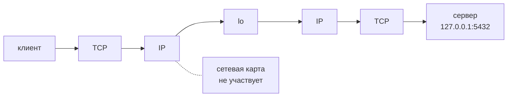

# Loopback и локальное взаимодействие

## Петлевой интерфейс

> [!note] **Loopback** — виртуальный интерфейс ядра `lo`, через который узел отправляет пакеты сам себе
> За ним закреплён весь блок `127.0.0.0/8`, хотя обычно используется один `127.0.0.1`, а в IPv6 — единственный адрес `::1`. Имя `localhost` указывает на эти адреса через `/etc/hosts`. [[MTU и фрагментация|MTU]] у `lo` в Linux — 65 536 байт: на проводе ограничений нет, так что и [[MTU и фрагментация|фрагментировать]] нечего

Трафик на `127.0.0.1` честно проходит весь стек: приложение пишет в [[Порты и сокеты#Сокет [1 11 49](https //www.youtube.com/watch?v=HxGsA6Ps-T8&t=4309s)|сокет]], ядро собирает [[Заголовок TCP и установление соединения|TCP-сегмент]] и [[IP-адрес и маска подсети|IP]]-пакет, отдаёт его `lo`, а тот сразу возвращает пакет на вход того же стека. До сетевой карты он не доходит, [[Протокол ARP|ARP]] и [[Кадр Ethernet|кадр Ethernet]] не нужны



> [!tip] Служба, слушающая `127.0.0.1`, недоступна из сети
> Адрес привязки сокета решает, с каких интерфейсов служба примет соединение: `127.0.0.1` — только с этого же узла, `0.0.0.0` — со всех. Поэтому базы данных, панели управления и отладочные порты по умолчанию слушают loopback, а наружу их выводят туннелем или прокси

### Свой адрес узла тоже уходит в loopback

Петля используется не только для `127.0.0.1`. В Linux кроме основной таблицы маршрутизации есть таблица `local`, и в неё ядро само заносит **все** адреса своих интерфейсов. Пакет, адресованный собственному адресу узла — даже публичному, висящему на внешней сетевой карте, — находит маршрут в этой таблице и отправляется через `lo`:

```bash
ip route show table local        # all local addresses of the host
ip route get <own-address>       # prints "local <own-address> dev lo table local"
```

На провод такой пакет не выходит, и снимать его надо на `lo`, а не на внешнем интерфейсе. Как это путает диагностику, когда кажется, что трафик идёт напрямую, — разбор с туннелем на узле VPN

> [!warning] Loopback-интерфейс маршрутизатора — другое понятие
> В сетевом оборудовании loopback — виртуальный интерфейс с обычным маршрутизируемым адресом, который никогда не опускается, пока жив сам маршрутизатор. Его адрес используют как стабильный идентификатор устройства, например router ID в [[Протокол OSPF|OSPF]], и как адрес для управления

## Взаимодействие процессов без TCP/IP

Если оба процесса живут на одном узле, сетевой стек им не обязателен. Механизмы межпроцессного взаимодействия (**IPC**, Inter-Process Communication) [[Операционная система|ОС]] передают данные между процессами, минуя TCP и IP:

| Механизм | Как работает |
|---|---|
| **анонимный канал** (pipe) | однонаправленный буфер в памяти ядра между родственными процессами — созданными через `fork`; оператор `\|` в shell |
| **именованный канал** (named pipe, он же [[FIFO]]) | тот же канал, но с именем в файловой системе, создаётся `mkfifo`; связывает любые процессы, знающие путь |
| **Unix Domain Socket** (`AF_UNIX`) | сокет, адресом которого служит путь к файлу; тот же [[Программный интерфейс приложения\|API]], что у сетевых сокетов, режимы потока и датаграмм |
| **разделяемая память** (shared memory) | общий участок памяти, отображённый в оба процесса; самый быстрый вариант, но синхронизировать доступ процессы должны сами |

> [!tip] Unix-сокет быстрее TCP на loopback
> Данные просто копируются между буферами двух сокетов. Нет номеров последовательности и подтверждений, [[Скользящее окно и управление потоком|окна]] и [[Оптимизации TCP#Управление перегрузкой [55 31](https //www.youtube.com/watch?v=6iEZOuH75cw&t=3331s)|управления перегрузкой]], контрольных сумм и маршрутизации
>
> Доступ к сокету регулируется правами на файл, а по сокету можно передать другому процессу открытый файловый дескриптор. Поэтому клиент Docker по умолчанию подключается к демону через `/var/run/docker.sock`, а `psql` на том же узле — через Unix-сокет PostgreSQL (в Debian и Ubuntu это `/var/run/postgresql/.s.PGSQL.5432`), а не через `127.0.0.1`
