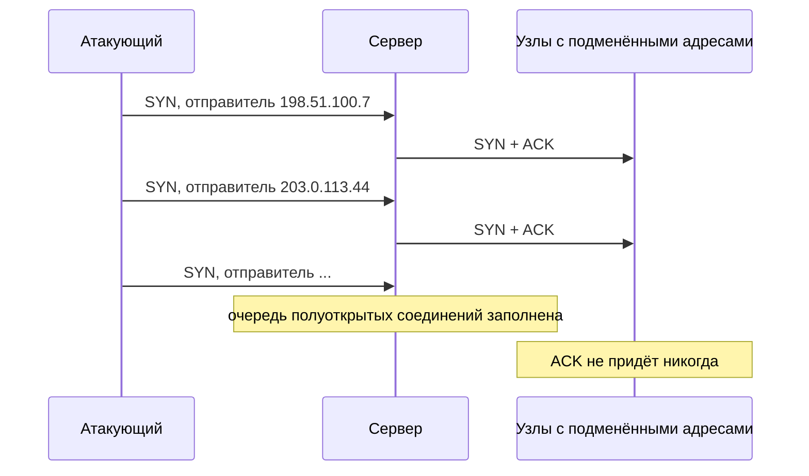
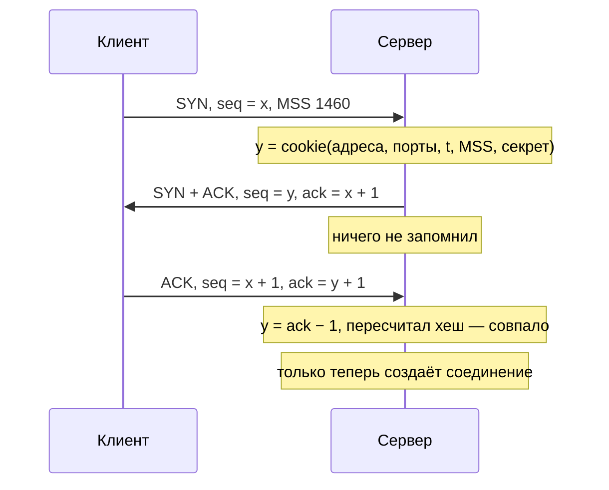
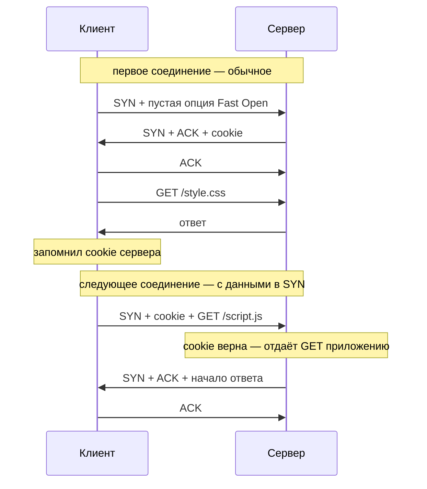

# SYN flood и защита соединения

## Цена рукопожатия [26:31](https://www.youtube.com/watch?v=1XavYjeAaog&t=1591s)

Прежде чем клиент отправит, например, [[HTTP|HTTP-запрос]] `GET`, должно пройти [[Заголовок TCP и установление соединения#Тройное рукопожатие [18 23](https //www.youtube.com/watch?v=6iEZOuH75cw&t=1103s)|тройное рукопожатие]] — целое [[Скользящее окно и управление потоком|RTT]], за которое пользователь не получает ничего [27:39](https://www.youtube.com/watch?v=1XavYjeAaog&t=1659s). У рукопожатия две проблемы: оно медленное, и оно заставляет сервер тратить ресурсы на ещё не проверенного клиента [28:11](https://www.youtube.com/watch?v=1XavYjeAaog&t=1691s)

## SYN flood [28:41](https://www.youtube.com/watch?v=1XavYjeAaog&t=1721s)

> [!note] **[[Заголовок TCP и установление соединения|SYN]] flood** — атака, заваливающая сервер сегментами SYN, на которые никто не собирается завершать рукопожатие
> На каждый SYN сервер резервирует память под соединение, отвечает SYN + [[Заголовок TCP и установление соединения|ACK]] и ждёт финального ACK [29:13](https://www.youtube.com/watch?v=1XavYjeAaog&t=1753s). Такое соединение — **полуоткрытое** (half-open), в терминах [[RFC|RFC]] 9293 оно в состоянии SYN-RECEIVED[^half-open]

Атака относится к классу **DoS** (Denial of Service, отказ в обслуживании): цель не украсть данные, а истощить ресурсы. Очередь полуоткрытых соединений ограничена — в Linux параметром `net.ipv4.tcp_max_syn_backlog`, — и когда она забита мусором, SYN настоящих клиентов отбрасываются. Вдобавок процессор тратит время сначала на создание структур, а потом на их вычистку по таймеру [29:46](https://www.youtube.com/watch?v=1XavYjeAaog&t=1786s)

> [!note] **[[IP-адрес и маска подсети|IP]] spoofing** — подмена адреса отправителя в IP-заголовке [28:41](https://www.youtube.com/watch?v=1XavYjeAaog&t=1721s)
> Для SYN flood она естественна: ответ атакующему не нужен, а случайные адреса источника не дают отфильтровать атаку по одному адресу и скрывают её автора. Когда те же SYN шлют тысячи заражённых машин, атака становится **DDoS** (Distributed Denial of Service, распределённый отказ в обслуживании)

SYN + ACK уходят не атакующему, а владельцам подменённых адресов. Существующий узел ответит на неожиданный SYN + ACK сбросом [[Заголовок TCP и установление соединения|RST]] и тем освободит место в очереди, поэтому атакующие выбирают адреса, по которым никто не отвечает

[^half-open]: Лектор говорит, что на каждый SYN сервер "открывает сокет" [29:13](https://www.youtube.com/watch?v=1XavYjeAaog&t=1753s). Полноценный сокет современные стеки создают только после финального ACK, а до того держат облегчённую запись в очереди SYN — в Linux это `request_sock` размером в сотни байт. Атака от этого не перестаёт работать: очередь всё равно ограничена, просто кончается она позже

## SYN cookies [30:17](https://www.youtube.com/watch?v=1XavYjeAaog&t=1817s)

Сервер замечает атаку по резкому росту соединений, которые висят полуоткрытыми до вычистки по таймеру [30:48](https://www.youtube.com/watch?v=1XavYjeAaog&t=1848s). В Linux (`net.ipv4.tcp_syncookies = 1`, значение по умолчанию) это конкретный момент — очередь SYN переполнилась

> [!note] **SYN cookies** — сервер не хранит ничего о полуоткрытом соединении, а кодирует всё нужное в свой номер последовательности в SYN + ACK [31:19](https://www.youtube.com/watch?v=1XavYjeAaog&t=1879s)
> Если клиент настоящий, его ACK вернёт этот номер плюс единицу, и сервер восстановит соединение по одному этому сегменту [34:27](https://www.youtube.com/watch?v=1XavYjeAaog&t=2067s). Если SYN был мусором, ACK не придёт, и вычищать нечего [33:56](https://www.youtube.com/watch?v=1XavYjeAaog&t=2036s)

Номер последовательности — 32 бита, которые сервер и так выбирает сам, причём [[Заголовок TCP и установление соединения#Тройное рукопожатие [18 23](https //www.youtube.com/watch?v=6iEZOuH75cw&t=1103s)|не случайно, а хешем от адресов, портов и секрета]]. SYN cookie делает этот хеш проверяемым [32:23](https://www.youtube.com/watch?v=1XavYjeAaog&t=1943s). Классическая схема Бернстайна, приведённая в [[RFC]] 4987:

| Биты номера | Что в них |
|---|---|
| старшие 5 | счётчик времени по модулю 32, растёт раз в 64 секунды |
| следующие 3 | номер одного из 8 типовых значений [[MTU и фрагментация#MSS и MSS clamping [1 14 36](https //www.youtube.com/watch?v=6iEZOuH75cw&t=4476s)\|MSS]], ближайшего к предложенному клиентом |
| младшие 24 | криптографический хеш от адресов и портов обеих сторон, того же счётчика и секрета сервера |

Секрет сервера общий для всех клиентов, а счётчик времени ограничивает срок, в течение которого cookie действительна: соединение по SYN + ACK часовой давности сервер уже не примет [34:58](https://www.youtube.com/watch?v=1XavYjeAaog&t=2098s). Хранит сервер только это общее число, а не состояние каждого клиента — лектор рисует его как значения $n_1$, $n_2$, $n_3$, сменяющиеся раз в две минуты [38:09](https://www.youtube.com/watch?v=1XavYjeAaog&t=2289s)[^counter]

[^counter]: Две минуты у лектора — пример, а не параметр механизма. В схеме Бернстейна счётчик растёт раз в 64 секунды, в Linux — раз в минуту, и сервер принимает cookie с несколькими последними значениями счётчика, чтобы клиент, ответивший на границе периода, не получил отказ

Проверка — обратный пересчёт: сервер вычитает единицу из номера подтверждения, берёт адреса и порты из пришедшего ACK, пробует текущее и недавние значения счётчика и сверяет хеш [38:43](https://www.youtube.com/watch?v=1XavYjeAaog&t=2323s). Совпал — клиент действительно получил SYN + ACK, значит его адрес не подменён. Вся инфраструктура соединения создаётся не при приёме SYN, а при приёме финального ACK [37:02](https://www.youtube.com/watch?v=1XavYjeAaog&t=2222s)

> [!warning] Цена — часть опций клиента [36:02](https://www.youtube.com/watch?v=1XavYjeAaog&t=2162s)
> В 32 бита не помещаются согласованные в SYN [[Оптимизации TCP#Масштабирование окна [05 59](https //www.youtube.com/watch?v=1XavYjeAaog&t=359s)|масштабирование окна]] и [[Оптимизации TCP#Выборочное подтверждение [02 47](https //www.youtube.com/watch?v=1XavYjeAaog&t=167s)|SACK]]. "Жить медленно, но жить": сервер выживает под атакой ценой скорости части соединений. Поэтому cookies и включаются только при переполнении очереди, а не всегда[^cookie-options]

[^cookie-options]: Лектор говорит, что при SYN cookies от клиента не сохраняются никакие опции — теряются MSS, масштабирование окна и SACK [36:02](https://www.youtube.com/watch?v=1XavYjeAaog&t=2162s). MSS сохраняется приблизительно: три бита cookie кодируют ближайшее из восьми типовых значений. Остальное Linux и FreeBSD умеют спасти, если клиент прислал опцию Timestamps: сервер прячет флаги SACK и [[Заголовок IPv4|ECN]] и сдвиг окна в младшие биты своей метки времени, и клиент возвращает их эхом в каждом сегменте. Кроме того, в хеш входят адреса обеих сторон, а не только адрес клиента, как в примере лектора [32:23](https://www.youtube.com/watch?v=1XavYjeAaog&t=1943s)

## TCP Fast Open [39:46](https://www.youtube.com/watch?v=1XavYjeAaog&t=2386s)

Браузер за одну страницу открывает к одному серверу много соединений за мелкими файлами — стилями, иконками, скриптами — и часто закрывает соединение, чтобы тут же открыть новое [40:18](https://www.youtube.com/watch?v=1XavYjeAaog&t=2418s). Каждое платит за рукопожатие целым RTT

> [!note] **[[Заголовок TCP и установление соединения|TCP]] Fast Open** (TFO, RFC 7413) — клиент, уже знакомый серверу, отправляет данные прямо в SYN и предъявляет cookie как доказательство знакомства [43:56](https://www.youtube.com/watch?v=1XavYjeAaog&t=2636s)
> Сервер проверяет cookie и отдаёт данные приложению сразу, не дожидаясь конца рукопожатия, а ответ может отправить уже в SYN + ACK. Рукопожатие никуда не девается, но идёт параллельно с обменом данными [45:29](https://www.youtube.com/watch?v=1XavYjeAaog&t=2729s)

- **первое соединение** не ускоряется: клиент запрашивает cookie пустой опцией Fast Open, сервер возвращает её в SYN + ACK, клиент запоминает [41:20](https://www.youtube.com/watch?v=1XavYjeAaog&t=2480s)
- **cookie** — число, которое сервер вычисляет по своим правилам и проверяет сам: RFC рекомендует код аутентификации IP-адреса клиента, например этот адрес, зашифрованный AES (Advanced Encryption Standard) секретным ключом сервера[^tfo-cookie]
- **следующие соединения** несут в SYN cookie и данные сразу; если cookie не подошла, сервер подтверждает только SYN, и клиент досылает данные обычным порядком

Разница с классикой в том, что SYN, SYN + ACK и ACK больше не пустые — их сразу нагружают пользовательскими данными [46:31](https://www.youtube.com/watch?v=1XavYjeAaog&t=2791s)

> [!warning] Данные из SYN могут дойти до приложения дважды
> В редких случаях — дубликат SYN, задержавшийся в сети, перезапуск сервера между повторами — данные из SYN получает приложение, хотя соединения так и не было, или получает их повторно. Поэтому TFO годится только для **идемпотентных** запросов — таких, повтор которых ничего не меняет, вроде `GET`
>
> RFC 7413 имеет статус экспериментального, и middlebox, режущие незнакомые опции, не дали ему широко распространиться: в Linux по умолчанию `net.ipv4.tcp_fastopen = 1` — разрешён только на стороне клиента, и лишь для приложений, явно запросивших его

[^tfo-cookie]: Лектор описывает cookie как хеш от адресов, портов, метки времени и, может быть, пароля [41:51](https://www.youtube.com/watch?v=1XavYjeAaog&t=2511s). Порты в неё входить не могут: следующее соединение клиент откроет с другого эфемерного порта, и cookie перестала бы подходить. RFC 7413 требует, чтобы cookie подтверждала только IP-адрес клиента, а срок жизни ей задают сменой ключа сервера
