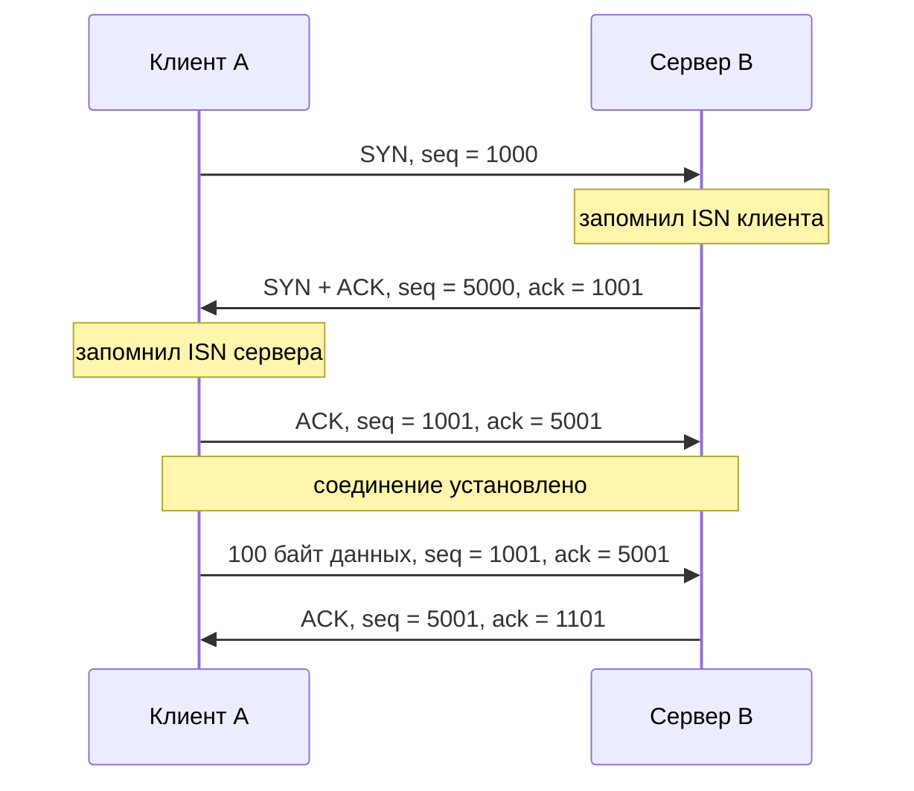
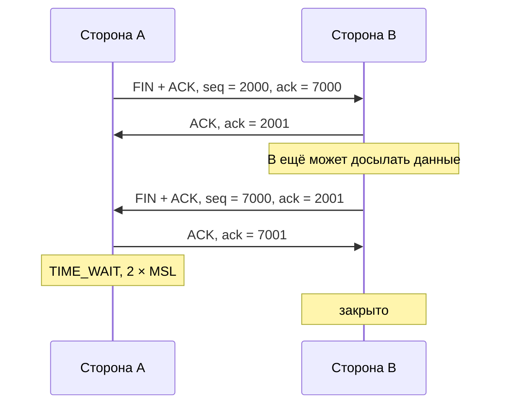

# Заголовок TCP и установление соединения

## Гарантированная доставка [00:10](https://www.youtube.com/watch?v=6iEZOuH75cw&t=10s)

> [!note] **TCP** (Transmission Control Protocol, протокол управления передачей) — транспортный протокол с установлением соединения, гарантированной доставкой и сохранением порядка
> Описан в [[RFC]] 793 (1981), с 2022 года сведён вместе со всеми поправками в RFC 9293. Идя по стеку снизу вверх, это первый протокол с гарантией доставки: у [[Кадр Ethernet|Ethernet]], [[IP-адрес и маска подсети|IP]] и [[Протокол UDP|UDP]] её нет [01:13](https://www.youtube.com/watch?v=6iEZOuH75cw&t=73s)

Гарантий две: данные дойдут, и дойдут в исходном порядке — перемешавшиеся по пути сегменты получатель расставит заново [01:43](https://www.youtube.com/watch?v=6iEZOuH75cw&t=103s). "Управление передачей" в названии значит, что скорость регулирует сам протокол, без помощи вышележащих уровней [00:41](https://www.youtube.com/watch?v=6iEZOuH75cw&t=41s)

Для приложения TCP — непрерывный **поток байт** без границ сообщений, а сегменты — лишь способ нарезать этот поток для передачи. Каждый байт потока имеет свой номер

## Формат заголовка [02:16](https://www.youtube.com/watch?v=6iEZOuH75cw&t=136s)

![[Раскладка заголовка TCP.png]]

| Поле | Размер | Что несёт |
|---|---|---|
| Source Port, Destination Port | по 16 бит | [[Порты и сокеты\|порты]] отправителя и получателя |
| Sequence Number | 32 бита | номер первого байта данных в этом сегменте |
| Acknowledgment Number | 32 бита | номер байта, который отправитель сегмента ждёт следующим |
| Data Offset | 4 бита | длина заголовка в 32-битных словах |
| Reserved | 4 бита | нули[^reserved] |
| Флаги | 8 бит | по биту на CWR, ECE, URG, ACK, PSH, RST, SYN, FIN |
| Window | 16 бит | [[Скользящее окно и управление потоком#Window Size и управление потоком [43 28](https //www.youtube.com/watch?v=6iEZOuH75cw&t=2608s)\|сколько байт получатель готов принять]] |
| Checksum | 16 бит | сумма по заголовку, данным и [[Порты и сокеты#Контрольная сумма и псевдозаголовок\|псевдозаголовку]]; в отличие от UDP, обязательна |
| Urgent Pointer | 16 бит | граница срочных данных, читается только при поднятом URG |
| Options | 0–40 байт | расширения протокола, выровненные нулями до кратного 4 |

[^reserved]: Лектор рисует 6 бит резерва и 6 флагов [04:55](https://www.youtube.com/watch?v=6iEZOuH75cw&t=295s) — это раскладка исходного RFC 793. В 2001 году RFC 3168 забрал два резервных бита под флаги CWR и ECE, и сегодня резерва 4 бита, а флагов 8. Лектор упоминает эти два бита позже, как [[Оптимизации TCP#Явное уведомление о перегрузке [1 08 21](https //www.youtube.com/watch?v=6iEZOuH75cw&t=4101s)|биты уведомления о перегрузке]]

### Номера последовательности и подтверждения [09:05](https://www.youtube.com/watch?v=6iEZOuH75cw&t=545s)

Именно эти два поля обеспечивают гарантию доставки [09:37](https://www.youtube.com/watch?v=6iEZOuH75cw&t=577s):

- **Sequence Number** (номер последовательности) — номер первого байта данных в сегменте
- **Acknowledgment Number** (номер подтверждения) — номер байта, который сторона ждёт следующим. Значит, всё до него получено без пропусков [21:32](https://www.youtube.com/watch?v=6iEZOuH75cw&t=1292s)

> [!warning] Номера считают байты, а не сегменты [25:16](https://www.youtube.com/watch?v=6iEZOuH75cw&t=1516s)
> Лектор повторяет это несколько раз: сегменты с номерами 1, 2, 3 на доске — только упрощение рисунка. В заголовке едет позиция байта в потоке

Нумерация у каждой стороны своя и растёт с разной скоростью: при скачивании с файлового сервера номер сервера убегает на гигабайты, а номер клиента почти стоит на месте [20:28](https://www.youtube.com/watch?v=6iEZOuH75cw&t=1228s)

### Переполнение номера последовательности [48:58](https://www.youtube.com/watch?v=1XavYjeAaog&t=2938s)

32 бита нумеруют $2^{32}$ байт — около 4 ГиБ, после чего счёт идёт по кругу. Путаницы старых и новых номеров обычно нет: окно много меньше этого диапазона, и получатель всегда понимает, к какому витку относится номер[^wrap]

На быстрых каналах круг проходится за секунды: при 10 Гбит/с

$$\frac{2^{32} \cdot 8 \text{ бит}}{10^{10} \text{ бит/с}} \approx 3{,}4 \text{ с}$$

а задержавшийся в сети дубликат живёт до **MSL** (Maximum Segment Lifetime, максимальное время жизни сегмента; стандарт принимает его за 2 минуты). Старый сегмент может прийти, когда номера уже сделали круг, и попасть в окно как новый

Защита — опция **Timestamps** (RFC 7323): каждый сегмент несёт метку времени, и механизм **PAWS** (Protection Against Wrapped Sequences, защита от переполнения номеров) отбрасывает сегменты с устаревшей меткой

[^wrap]: Лектор отвечает на вопрос, что неоднозначности "как правило не бывает", потому что окно меньше адресуемого диапазона [48:58](https://www.youtube.com/watch?v=1XavYjeAaog&t=2938s). Для одного витка это верно, но задержавшиеся дубликаты с прошлого витка окно не отсекает — на высоких скоростях для этого и нужен PAWS

### Длина заголовка [09:37](https://www.youtube.com/watch?v=6iEZOuH75cw&t=577s)

**Data Offset** нужен по той же причине, что [[Заголовок IPv4#Два поля длины [1 17 36](https //www.youtube.com/watch?v=5iMhAOFx38c&t=4656s)|IHL у IPv4]]: из-за опций заголовок переменной длины, и получателю надо знать, где начинаются данные. Поле считает 32-битные слова, поэтому

$$20 = 5 \cdot 4 \;\le\; \text{длина заголовка} = \text{Data Offset} \cdot 4 \;\le\; 15 \cdot 4 = 60 \text{ байт}$$

### Флаги [10:39](https://www.youtube.com/watch?v=6iEZOuH75cw&t=639s)

| Флаг | Имя | Смысл |
|---|---|---|
| **URG** | urgent | в сегменте срочные данные, поле Urgent Pointer значимо [11:09](https://www.youtube.com/watch?v=6iEZOuH75cw&t=669s) |
| **ACK** | acknowledgment | поле Acknowledgment Number значимо; после рукопожатия поднят во всех сегментах [11:42](https://www.youtube.com/watch?v=6iEZOuH75cw&t=702s) |
| **PSH** | push | не копить данные в буфере получателя, отдать приложению сразу [13:15](https://www.youtube.com/watch?v=6iEZOuH75cw&t=795s) |
| **RST** | reset | немедленный сброс соединения [13:15](https://www.youtube.com/watch?v=6iEZOuH75cw&t=795s) |
| **SYN** | synchronize | синхронизировать номера последовательности; только при установлении соединения [14:16](https://www.youtube.com/watch?v=6iEZOuH75cw&t=856s) |
| **FIN** | finish | данных от этой стороны больше не будет — штатное закрытие [13:45](https://www.youtube.com/watch?v=6iEZOuH75cw&t=825s) |
| **CWR** | Congestion Window Reduced, окно перегрузки уменьшено | отправитель отреагировал на сигнал о перегрузке |
| **ECE** | [[Заголовок IPv4\|ECN]]-Echo, эхо уведомления о перегрузке | получатель сообщает, что по пути отметили перегрузку |

Механика двух последних — в [[Оптимизации TCP#Явное уведомление о перегрузке [1 08 21](https //www.youtube.com/watch?v=6iEZOuH75cw&t=4101s)|ECN]]

> [!tip] RST в дампе — не обязательно авария [13:45](https://www.youtube.com/watch?v=6iEZOuH75cw&t=825s)
> В литературе FIN описан как штатное закрытие, а RST — как аварийное. На практике RST часто закрывает и вполне нормальные соединения: браузер обрывает ненужную больше загрузку, балансировщик сбрасывает простаивающих клиентов, приложение закрывает сокет с нулевым `SO_LINGER`. Разница в последствиях: после FIN все отправленные данные будут доставлены, после RST недоставленное просто выбрасывается

### Опции и классический TCP [15:18](https://www.youtube.com/watch?v=6iEZOuH75cw&t=918s)

Лектор делит TCP на **классический** — то, что описано выше, — и **современный** с расширениями в поле Options: [[MTU и фрагментация#MSS и MSS clamping [1 14 36](https //www.youtube.com/watch?v=6iEZOuH75cw&t=4476s)|MSS]], [[Оптимизации TCP#Выборочное подтверждение [02 47](https //www.youtube.com/watch?v=1XavYjeAaog&t=167s)|SACK]], [[Оптимизации TCP#Масштабирование окна [05 59](https //www.youtube.com/watch?v=1XavYjeAaog&t=359s)|масштабирование окна]] и другими. Опции согласуются в рукопожатии и дают скорость, меньше повторов при потерях и точнее реагируют на перегрузку [16:51](https://www.youtube.com/watch?v=6iEZOuH75cw&t=1011s)

Разделять их приходится потому, что до сих пор встречается оборудование, не понимающее расширений и рвущее такие соединения [15:49](https://www.youtube.com/watch?v=6iEZOuH75cw&t=949s). На классике соединение установится всегда

Явного переключателя "классический или современный" в [[Операционная система|ОС]] нет: поддержка каждой опции зависит от ОС, её версии и патчей [17:21](https://www.youtube.com/watch?v=6iEZOuH75cw&t=1041s). В Linux каждая включается отдельным параметром ядра — `net.ipv4.tcp_sack`, `net.ipv4.tcp_window_scaling`, `net.ipv4.tcp_timestamps`

## Тройное рукопожатие [18:23](https://www.youtube.com/watch?v=6iEZOuH75cw&t=1103s)

TCP ориентирован на соединение: сначала стороны устанавливают его, и только потом идут пользовательские данные. Установление занимает три сегмента, отсюда **тройное рукопожатие** (three-way handshake) [26:23](https://www.youtube.com/watch?v=6iEZOuH75cw&t=1583s)

1. **SYN** — A сообщает свой начальный номер: "нумерация моих байтов начинается отсюда" [18:54](https://www.youtube.com/watch?v=6iEZOuH75cw&t=1134s)
2. **SYN + ACK** — B сообщает свой начальный номер и подтверждает номер A [19:25](https://www.youtube.com/watch?v=6iEZOuH75cw&t=1165s)
3. **ACK** — A подтверждает номер B: "я с тобой синхронизирован" [22:35](https://www.youtube.com/watch?v=6iEZOuH75cw&t=1355s)

Два SYN — по одному в каждую сторону, и больше SYN в соединении не появляется [47:04](https://www.youtube.com/watch?v=6iEZOuH75cw&t=2824s). Пользовательских данных в классическом рукопожатии нет, летят пустые заголовки[^syn-data]

> [!note] Начальный номер **ISN** (Initial Sequence Number) выбирается непредсказуемо[^isn]
> RFC 9293 предписывает считать его как $M + F(\text{адреса}, \text{порты}, \text{секрет})$, где $M$ — счётчик, растущий раз в 4 мкс, а $F$ — криптографическая хеш-функция. Угадавший ISN посторонний мог бы, не видя трафика, вставить в чужое соединение поддельный сегмент. Та же идея "хеш от четвёрки и секрета" лежит в основе [[SYN flood и защита соединения#SYN cookies [30 17](https //www.youtube.com/watch?v=1XavYjeAaog&t=1817s)|SYN cookies]]

[^syn-data]: Лектор говорит, что при установлении соединения пользовательские данные не передаются [24:10](https://www.youtube.com/watch?v=6iEZOuH75cw&t=1450s). Для классического поведения это так, но стандарт данные в SYN не запрещает — он лишь не отдаёт их приложению до завершения рукопожатия. Использует эту возможность [[SYN flood и защита соединения#TCP Fast Open [39 46](https //www.youtube.com/watch?v=1XavYjeAaog&t=2386s)|TCP Fast Open]]

[^isn]: Лектор говорит лишь, что нумерация "может начинаться не с нуля, а с какого-то числа" [19:25](https://www.youtube.com/watch?v=6iEZOuH75cw&t=1165s). Не с нуля — это обязательное требование, а не допущение: предсказуемый ISN — известная уязвимость, из-за которой в 1990-х подделывали TCP-соединения

### Арифметика seq и ack [23:39](https://www.youtube.com/watch?v=6iEZOuH75cw&t=1419s)

Подтверждение — номер следующего ожидаемого байта, поэтому оно равно номеру сегмента плюс то, сколько номеров сегмент занял:

$$\boxed{\text{ack} = \text{seq} + d + [\text{SYN}] + [\text{FIN}]}$$

где $d$ — число байт данных, а $[\text{SYN}]$ и $[\text{FIN}]$ равны единице, если флаг поднят. Отсюда два частных случая:

- рукопожатие: данных нет, но SYN занимает один номер, $\text{ack} = n + 1$ [23:39](https://www.youtube.com/watch?v=6iEZOuH75cw&t=1419s)
- передача $d$ байт с номером $n$: $\text{ack} = n + d$[^n-d-1]

> [!tip] SYN и FIN расходуют по одному номеру последовательности
> Им, как и данным, нужны подтверждение и переотправка при потере, а подтвердить можно только то, у чего есть номер. Поэтому первый байт данных после SYN получает номер $\text{ISN} + 1$

[^n-d-1]: Лектор говорит, что после $d$ байт с номером $n$ подтверждение равно $n + d + 1$ [25:16](https://www.youtube.com/watch?v=6iEZOuH75cw&t=1516s). Это ошибка на единицу: сегмент занимает номера от $n$ до $n + d - 1$, следующий ожидаемый — $n + d$. Лишняя единица верна только для сегмента с SYN или FIN, как в рукопожатии. На диаграмме выше 100 байт с номером 1001 подтверждаются числом 1101, а не 1102

### Потерянный SYN

Пустой SYN тоже может потеряться, и повторяет его тот же таймер, что и данные: начальный [[Скользящее окно и управление потоком#Таймер и повторная передача [36 12](https //www.youtube.com/watch?v=6iEZOuH75cw&t=2172s)|RTO]] по RFC 6298 — 1 секунда, дальше каждый повтор ждёт вдвое дольше. В Linux по умолчанию шесть повторов SYN: соединение с молчащим адресом сдаётся примерно через 127 секунд

Если рукопожатие иногда занимает ровно на секунду больше обычного, почти наверняка потерялся первый SYN — так это и выглядело в замерах до узлов VPN

## Закрытие соединения [1:06:45](https://www.youtube.com/watch?v=6iEZOuH75cw&t=4005s)

Лектор оставил эту часть на самостоятельное изучение и предложил посмотреть в **Wireshark**, как закрывает соединения своя ОС: браузер на одной странице открывает и закрывает десятки соединений за стилями, скриптами и картинками [1:07:15](https://www.youtube.com/watch?v=6iEZOuH75cw&t=4035s)

Соединение полнодуплексное, и каждое направление закрывается отдельно своим FIN:

- **четыре сегмента** в общем случае. Между вторым и третьим соединение **полузакрыто** (half-close): A больше не пишет, но ещё читает то, что досылает B
- **три сегмента**, если B закрывается сразу и совмещает свой FIN с подтверждением чужого
- **один RST** — немедленный обрыв: ответа на RST не бывает, неотправленные данные пропадают[^close-count]

> [!info] **TIME_WAIT** — последнее состояние стороны, закрывшей соединение первой
> Она ждёт $2 \cdot \text{MSL}$: если последний ACK потеряется, B повторит FIN, и ответить на него должен кто-то, кто помнит соединение. Заодно старые сегменты этого соединения успевают умереть и не попадут в новое с той же четвёркой адресов и портов. В Linux это ожидание фиксировано и составляет 60 секунд

[^close-count]: Лектор говорит, что соединение закрывается "обменом четырьмя сообщениями или двумя" [1:06:45](https://www.youtube.com/watch?v=6iEZOuH75cw&t=4005s). Для закрытия через FIN сегментов четыре или три; двумя его завершить нельзя, потому что каждый из двух FIN требует подтверждения. Закрытие через RST — это один сегмент без ответа
