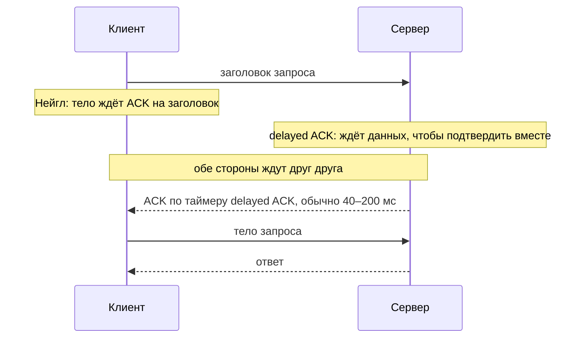
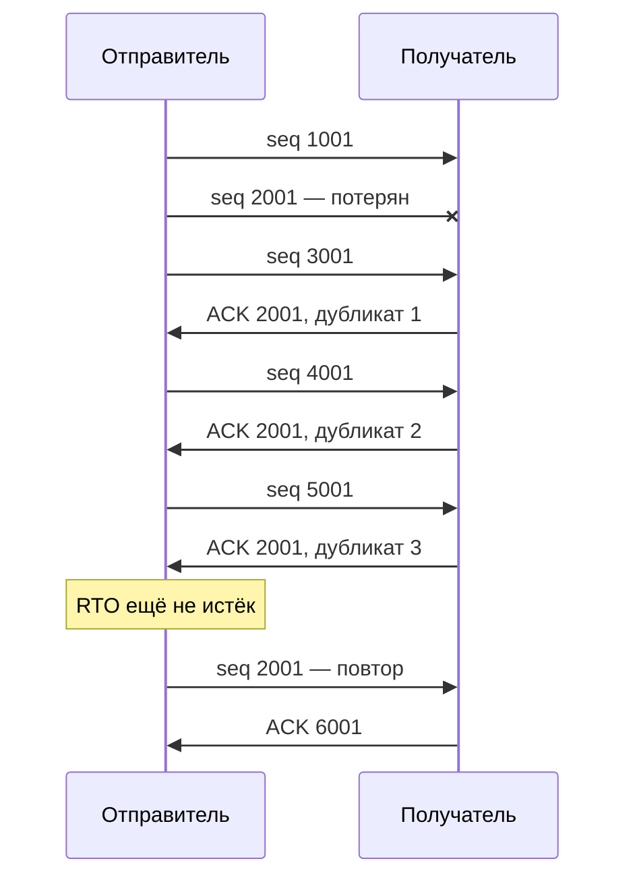

# Оптимизации TCP

## Меньше пустых сегментов [00:13](https://www.youtube.com/watch?v=1XavYjeAaog&t=13s)

Обе оптимизации ниже бьют в одну цель — долю служебных байт: каждый сегмент несёт заголовки [[Заголовок TCP и установление соединения|TCP]], [[Заголовок IPv4|IP]] и [[Кадр Ethernet|Ethernet]] и контрольную сумму кадра, а это минимум 58 байт — 14 + 20 + 20 байт заголовков и 4 байта [[Кадр Ethernet|FCS]] — независимо от объёма данных [01:45](https://www.youtube.com/watch?v=1XavYjeAaog&t=105s)

### Delayed ACK [1:00:40](https://www.youtube.com/watch?v=6iEZOuH75cw&t=3640s)

Без оптимизации получатель подтверждает каждый сегмент, даже если отвечать ему нечем: при скачивании файла клиент шлёт серверу поток пустых сегментов с одним лишь [[Заголовок TCP и установление соединения|ACK]] [1:01:11](https://www.youtube.com/watch?v=6iEZOuH75cw&t=3671s)

> [!note] **Delayed ACK** (задержанное подтверждение) — получатель без своих данных ненадолго придерживает пустое подтверждение [1:03:12](https://www.youtube.com/watch?v=6iEZOuH75cw&t=3792s)
> Расчёт на то, что за это время придёт ещё сегмент и одно подтверждение накроет оба. Это работает, потому что [[Скользящее окно и управление потоком#Буфер приёмника и кумулятивный ACK [40 22](https //www.youtube.com/watch?v=6iEZOuH75cw&t=2422s)|ACK кумулятивный]]: подтвердив третий сегмент, получатель подтвердил и второй [1:02:11](https://www.youtube.com/watch?v=6iEZOuH75cw&t=3731s)
>
> Есть свои данные в обратную сторону — подтверждение уезжает в их заголовке сразу, без задержки. Это называется **piggybacking** [1:03:42](https://www.youtube.com/watch?v=6iEZOuH75cw&t=3822s)

Пределы задержки задают [[RFC]] 1122 и RFC 5681: не дольше 500 мс, и хотя бы каждый второй полноразмерный сегмент подтверждается сразу. Сегмент, пришедший не по порядку, подтверждается немедленно — дубликаты ACK нужны отправителю как можно раньше. Реальные таймеры короче предела: Linux ждёт от 40 до 200 мс, Windows — 200 мс

### Алгоритм Нейгла [1:04:43](https://www.youtube.com/watch?v=6iEZOuH75cw&t=3883s)

Обратная ситуация: приложение отдаёт данные крошечными порциями, по байту-два, и на каждый байт пришлось бы навесить десятки байт заголовков [1:05:14](https://www.youtube.com/watch?v=6iEZOuH75cw&t=3914s)

> [!note] **Алгоритм Нейгла** (Nagle's algorithm, RFC 896) — пока в сети есть неподтверждённые данные, мелкие порции копятся в буфере отправителя
> Накопленное уходит одним сегментом, как только придёт подтверждение или наберётся полный сегмент. Если неподтверждённых данных нет, мелкая порция уходит сразу[^nagle-timer]

Отключается опцией сокета `TCP_NODELAY` — её ставят интерактивные протоколы, где каждое нажатие клавиши должно уйти немедленно: [[SSH]], игры, терминалы

> [!bug] Нейгл и delayed ACK вместе дают паузу на ровном месте
> Приложение пишет запрос в два приёма, заголовок и тело, и ждёт ответа. Первая часть уходит сразу, вторую Нейгл держит до подтверждения первой. Получатель же ничего не отвечает, пока не придёт весь запрос, и держит подтверждение по delayed ACK
>
> Обе стороны ждут друг друга, пока не истечёт таймер задержанного подтверждения — до 200 мс на каждый запрос. Лечится записью запроса одним вызовом или `TCP_NODELAY`

[^nagle-timer]: Лектор описывает алгоритм как "чуть-чуть придержать отправку в расчёте, что сверху придёт ещё" [1:05:44](https://www.youtube.com/watch?v=6iEZOuH75cw&t=3944s), будто задержка отмеряется таймером. Таймера у Нейгла нет: отправку разрешает пришедшее подтверждение или набравшийся полный сегмент, поэтому на быстром канале задержка почти нулевая, а на медленном — порядка [[Скользящее окно и управление потоком|RTT]]

## Опции и их согласование [10:27](https://www.youtube.com/watch?v=1XavYjeAaog&t=627s)

Опции предлагаются в [[Заголовок TCP и установление соединения|SYN]]: инициатор перечисляет всё, что умеет, ответная сторона возвращает в SYN + ACK то, что поддерживает сама. Не вернула — опция в этом соединении не используется, и стороны работают по классическим правилам [10:58](https://www.youtube.com/watch?v=1XavYjeAaog&t=658s). Отсюда обратная совместимость: старая система просто не отвечает на незнакомую опцию [51:37](https://www.youtube.com/watch?v=1XavYjeAaog&t=3097s)

| Kind | Опция | Когда передаётся |
|---|---|---|
| 0, 1 | конец списка и пустая опция для выравнивания | где нужно |
| 2 | [[MTU и фрагментация#MSS и MSS clamping [1 14 36](https //www.youtube.com/watch?v=6iEZOuH75cw&t=4476s)\|MSS]] | только в SYN |
| 3 | Window Scale | только в SYN |
| 4 | SACK-permitted | только в SYN |
| 5 | SACK | в любом сегменте после рукопожатия |
| 8 | [[Заголовок TCP и установление соединения#Переполнение номера последовательности [48 58](https //www.youtube.com/watch?v=1XavYjeAaog&t=2938s)\|Timestamps]] | в SYN и затем во всех сегментах |
| 34 | [[SYN flood и защита соединения#TCP Fast Open [39 46](https //www.youtube.com/watch?v=1XavYjeAaog&t=2386s)\|TCP Fast Open]] | в SYN и SYN + ACK |

Поменять смысл старых полей вместо опций было бы нельзя: пришлось бы переписать сетевой стек всех старых [[Операционная система|ОС]], и совместимость пропала бы [50:34](https://www.youtube.com/watch?v=1XavYjeAaog&t=3034s)

> [!warning] Опции должен понимать не только собеседник, но и всё по дороге [11:58](https://www.youtube.com/watch?v=1XavYjeAaog&t=718s)
> Межсетевые экраны и системы безопасности, разбирающие TCP, — так называемые **middlebox** — тоже обязаны знать опции. Устаревший экран может вырезать незнакомые опции или вовсе заблокировать сессию. Итог обидный: новые серверы, свежее ядро, оптимизированный стек — а всё медленно, потому что по пути стоит старый firewall [12:28](https://www.youtube.com/watch?v=1XavYjeAaog&t=748s)

## Выборочное подтверждение [02:47](https://www.youtube.com/watch?v=1XavYjeAaog&t=167s)

Классический ACK подтверждает только непрерывный поток: пропал сегмент — всё, что пришло за ним, подтвердить нельзя [03:19](https://www.youtube.com/watch?v=1XavYjeAaog&t=199s)

> [!note] **SACK** (Selective Acknowledgment, выборочное подтверждение, RFC 2018) — получатель дополнительно перечисляет в опции диапазоны, пришедшие за дырой [03:51](https://www.youtube.com/watch?v=1XavYjeAaog&t=231s)
> Отправитель повторяет только недостающее, а не всё окно [04:55](https://www.youtube.com/watch?v=1XavYjeAaog&t=295s). Поддержку стороны объявляют опцией **SACK-permitted** в рукопожатии

Пусть получены байты 1–1000 и 2001–4000, а 1001–2000 потерялись:

| Что уходит отправителю | Значение |
|---|---|
| Acknowledgment Number | 1001 — классический кумулятивный ACK, как и без SACK |
| SACK-блок | левый край 2001, правый край 4001 — первый байт **после** блока |

Каждый блок занимает 8 байт — два 32-битных номера. В 40 байт опций помещается 4 блока, а вместе с Timestamps — 3[^nack]

[^nack]: Лектор описывает рядом с SACK ещё и **NACK** (Negative Acknowledgment, отрицательное подтверждение), где получатель явно называет, откуда докуда данные не пришли [04:23](https://www.youtube.com/watch?v=1XavYjeAaog&t=263s). Такой опции в TCP нет: дыру отправитель вычисляет сам — между кумулятивным ACK и SACK-блоками. NACK существует в других протоколах, например в транспорте видеозвонков **RTCP** (RTP Control Protocol; **RTP** — Real-time Transport Protocol, [RFC 3550](https://www.rfc-editor.org/rfc/rfc3550.html)) и в многоадресной доставке

## Масштабирование окна [05:59](https://www.youtube.com/watch?v=1XavYjeAaog&t=359s)

На широком и длинном канале — **LFN** (long fat network) — RTT велик по сравнению со временем отправки. Классическое окно в 65 535 байт на 40, 100 или 400 Гбит/с улетает мгновенно, и дальше канал простаивает до подтверждения [06:31](https://www.youtube.com/watch?v=1XavYjeAaog&t=391s)[^window-max]

[^window-max]: Лектор называет предел классического окна "2 в степени 16, то есть 65 килобайт" [50:34](https://www.youtube.com/watch?v=1XavYjeAaog&t=3034s). В 16 бит помещается число не больше $2^{16} - 1 = 65\,535$, так что окно — 65 535 байт, почти 64 КиБ

> [!note] **Window Scaling** (масштабирование окна, RFC 7323) — опция, задающая сдвиг $n$, на который умножается поле Window [08:15](https://www.youtube.com/watch?v=1XavYjeAaog&t=495s)
> $$\boxed{\text{окно} = \text{Window} \cdot 2^{n}, \qquad 0 \le n \le 14}$$
> Сдвиг объявляется только в SYN, и каждая сторона объявляет свой — для окна, которое она сама будет присылать. Если опцию не прислала хотя бы одна сторона, масштабирования нет ни в одном направлении. Предел $n = 14$ даёт окно до $65\,535 \cdot 2^{14} \approx 1$ ГиБ

Сколько окна нужно, считают через **произведение полосы на задержку**: всё, что успело уйти за одно RTT, ещё не подтверждено. Канал 1 Гбит/с с RTT 100 мс:

$$10^{9} \text{ бит/с} \cdot 0{,}1 \text{ с} = 10^{8} \text{ бит} = 12{,}5 \text{ МБ}, \qquad \frac{12{,}5 \cdot 10^{6}}{65\,535} \approx 191 \;\Rightarrow\; n = 8$$

Сдвиг 8 — ровно пример лектора: окно в $2^8 = 256$ раз больше классического [09:20](https://www.youtube.com/watch?v=1XavYjeAaog&t=560s)

> [!warning] Огромное окно без SACK опасно [09:51](https://www.youtube.com/watch?v=1XavYjeAaog&t=591s)
> При потере в классическом TCP под угрозой повтора оказываются мегабайты данных. Поэтому масштабирование окна включают вместе с выборочным подтверждением

## Быстрая повторная передача [13:29](https://www.youtube.com/watch?v=1XavYjeAaog&t=809s)

Оптимизация обходится без опций и поэтому работает даже через старый firewall [13:59](https://www.youtube.com/watch?v=1XavYjeAaog&t=839s)

> [!note] **Fast Retransmit** (быстрая повторная передача) — получив три [[Скользящее окно и управление потоком#Буфер приёмника и кумулятивный ACK [40 22](https //www.youtube.com/watch?v=6iEZOuH75cw&t=2422s)|дубликата ACK]] подряд, отправитель повторяет недостающий сегмент, не дожидаясь [[Скользящее окно и управление потоком|RTO]] [15:34](https://www.youtube.com/watch?v=1XavYjeAaog&t=934s)
> Дубликаты рождаются сами: каждый сегмент, пришедший за дырой, заставляет получателя немедленно повторить тот же номер подтверждения. Три одинаковых подряд значат: до этого места всё дошло, дальше потеря, а данные за дырой при этом продолжают приходить[^fast-retransmit]

Один дубликат ещё не значит потерю: сегменты могли просто прийти не по порядку. Порог в три — компромисс между ложными повторами и скоростью реакции. Насколько быстро сработает механизм, зависит от RTT линии и загруженности получателя: подтверждения через 20 мкс и через 10 мс дают совсем разную картину [18:15](https://www.youtube.com/watch?v=1XavYjeAaog&t=1095s)

[^fast-retransmit]: Лектор описывает механизм иначе: получатель, "понимая, что до этого места данные дошли, а дальше потеряны", намеренно шлёт подряд три одинаковых ACK [14:30](https://www.youtube.com/watch?v=1XavYjeAaog&t=870s), а отправитель переотправляет "всё с этого места" [15:34](https://www.youtube.com/watch?v=1XavYjeAaog&t=934s). По RFC 5681 получатель ничего не решает: он отвечает немедленным ACK на каждый внеочередной сегмент, и дубликатов выходит столько, сколько сегментов пришло за дырой. Отправитель повторяет один недостающий сегмент, а не весь хвост окна. Отсюда и ответ на вопрос из зала о порядке подтверждений [19:38](https://www.youtube.com/watch?v=1XavYjeAaog&t=1178s): придумывать, когда слать обычный ACK, а когда три дубликата, реализации не нужно — это следствие порядка прихода сегментов

## Управление перегрузкой [55:31](https://www.youtube.com/watch?v=6iEZOuH75cw&t=3331s)

[[Скользящее окно и управление потоком#Window Size и управление потоком [43 28](https //www.youtube.com/watch?v=6iEZOuH75cw&t=2608s)|Окно получателя]] защищает получателя, но ничего не знает о сети между сторонами. Сеть защищает второе окно, которое отправитель ведёт сам и никому не сообщает

> [!note] **Окно перегрузки** (congestion window, **cwnd**) — оценка отправителем того, сколько данных сеть выдержит без потерь
> Отправитель шлёт не больше $\min(\text{cwnd}, \text{окно получателя})$. Признак перегрузки в классическом подходе один — потеря сегмента

### Медленный старт и пила [55:31](https://www.youtube.com/watch?v=6iEZOuH75cw&t=3331s)

- **slow start** (медленный старт): cwnd начинается с нескольких сегментов и растёт на один сегмент за каждое подтверждение — то есть удваивается за каждое RTT: 1, 2, 4, 8… [56:04](https://www.youtube.com/watch?v=6iEZOuH75cw&t=3364s)[^slow-start-name]
- **congestion avoidance** (предотвращение перегрузки): после порога **ssthresh** рост линейный — плюс один сегмент за RTT
- **потеря по таймауту**: ssthresh становится половиной отправленного, cwnd падает до одного сегмента, и снова медленный старт

Отсюда характерная **пила** на графике загрузки канала: экспоненциальный разгон, потеря, падение, снова разгон [56:34](https://www.youtube.com/watch?v=6iEZOuH75cw&t=3394s). Примерно половину времени передача идёт намного ниже доступной полосы [24:25](https://www.youtube.com/watch?v=1XavYjeAaog&t=1465s)

![[Окно перегрузки Tahoe и Reno.png]]

**TCP Tahoe** (1988) после любой потери начинает с медленного старта. **TCP Reno** (1990) при потере, обнаруженной тремя дубликатами ACK, медленный старт не повторяет (**Fast Recovery**, быстрое восстановление). Линейный рост и уменьшение вдвое называют **AIMD** (additive increase, multiplicative decrease)[^classic]

[^slow-start-name]: В лекции 8 лектор объясняет название так: "в самом начале рост медленный, окно растёт достаточно долго" [23:55](https://www.youtube.com/watch?v=1XavYjeAaog&t=1435s). Рост на этом этапе самый быстрый из всех — экспонента. "Медленным" старт назван по сравнению с тем, что было до него: отправитель сразу выпускал всё окно получателя

[^classic]: Лектор приписывает сброс окна до одного сегмента "классическому TCP" [55:31](https://www.youtube.com/watch?v=6iEZOuH75cw&t=3331s). В исходном RFC 793 управления перегрузкой не было вовсе — окно определял только получатель. Медленный старт добавил Ван Якобсон в 1988 году, после того как в 1986-м интернет пережил **коллапс перегрузки**: пропускная способность между узлами упала в тысячу раз из-за бесконечных повторов

### Глобальная синхронизация [57:04](https://www.youtube.com/watch?v=6iEZOuH75cw&t=3424s)

Роутеру всё равно, чьи пакеты в очереди: у выходного интерфейса есть буфер, и всё, что в него не влезло, отбрасывается — это **tail drop** [59:05](https://www.youtube.com/watch?v=6iEZOuH75cw&t=3545s). Когда буфер переполняется, потери получают сразу многие TCP-потоки, одновременно сбрасывают окна и одновременно разгоняются заново до следующего переполнения [57:34](https://www.youtube.com/watch?v=6iEZOuH75cw&t=3454s)

> [!note] **Глобальная синхронизация** — пилы многих TCP-потоков через общий узел совпадают по фазе [58:04](https://www.youtube.com/watch?v=6iEZOuH75cw&t=3484s)
> Канал то перегружен, то наполовину пуст. Против неё придуман **RED** (Random Early Detection, случайное раннее обнаружение): роутер начинает случайно отбрасывать отдельные пакеты ещё до переполнения, по мере роста очереди. Потоки теряют сегменты в разные моменты и перестают идти в ногу

### Современные алгоритмы [22:53](https://www.youtube.com/watch?v=1XavYjeAaog&t=1373s)

Современные реализации не сбрасывают окно в ноль, а уменьшают, например вдвое — вместо пилы до нуля на графике разгон до полосы и небольшие колебания около неё [25:31](https://www.youtube.com/watch?v=1XavYjeAaog&t=1531s). Канал делят и другие пользователи, так что потери случаются и до выхода на полную полосу [26:01](https://www.youtube.com/watch?v=1XavYjeAaog&t=1561s)

| Алгоритм | Реакция на потерю | Где |
|---|---|---|
| Reno | окно вдвое, потом линейный рост | классика учебников |
| **CUBIC** | окно до 0,7 от прежнего, рост по кубической кривой, быстро возвращающей окно к прежнему уровню | по умолчанию в Linux, Windows и macOS |
| BBR | потерю сигналом не считает: измеряет полосу и RTT и держит темп по модели, поэтому не паникует на канале со случайными потерями | Google, опционально в Linux |

### Явное уведомление о перегрузке [1:08:21](https://www.youtube.com/watch?v=6iEZOuH75cw&t=4101s)

Промежуточный роутер не участвует в соединении, и в классике сообщить о перегрузке может только потерей сегмента — то есть той самой пилой с низким [[Золотое правило механики. КПД|КПД]] [1:09:23](https://www.youtube.com/watch?v=6iEZOuH75cw&t=4163s). Предупредить заранее, без потерь, позволяет [[Заголовок IPv4#Байт качества обслуживания [1 10 20](https //www.youtube.com/watch?v=5iMhAOFx38c&t=4220s)|ECN]] (RFC 3168):

1. в рукопожатии стороны договариваются об ECN флагами [[Заголовок TCP и установление соединения|ECE]] и [[Заголовок TCP и установление соединения|CWR]]
2. их пакеты идут с пометкой "умею ECN" в двух битах ECN IP-заголовка
3. роутер с растущей очередью не отбрасывает такой пакет, а ставит в тех же битах отметку **CE** (Congestion Experienced, перегрузка обнаружена)
4. получатель, увидев CE, поднимает в своих TCP-сегментах флаг **ECE** — эхо уведомления
5. отправитель уменьшает cwnd, как при потере, и поднимает флаг **CWR** — "окно уже уменьшил"

Сегмент при этом не теряется и повторять ничего не надо[^qos]. В Linux ECN по умолчанию принимается, если его предложит собеседник, но сам не предлагается: `net.ipv4.tcp_ecn = 2`

[^qos]: Лектор относит эти два бита к **QoS** (Quality of Service, качество обслуживания) и обещает разобрать их на отдельной лекции про QoS [1:08:21](https://www.youtube.com/watch?v=6iEZOuH75cw&t=4101s). ECN — механизм управления перегрузкой, а не классификации трафика: он одинаково работает для всех пакетов, тогда как QoS решает, кого обслуживать в первую очередь. Отдельной лекции о QoS в курсе так и не было
