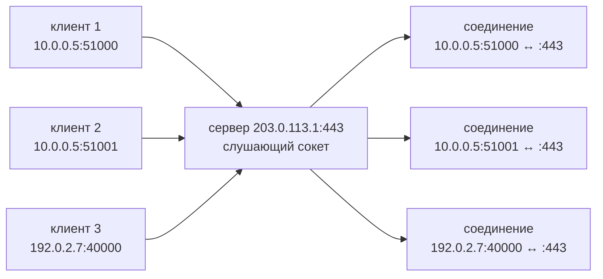

# Порты и сокеты

## Порт [1:08:08](https://www.youtube.com/watch?v=HxGsA6Ps-T8&t=4088s)

> [!note] **Порт** — 16-битный номер, по которому транспортный уровень узла находит процесс-получатель
> Процесс просит у [[Операционная система|ОС]] открыть порт, и ОС связывает этот номер с процессом [1:08:40](https://www.youtube.com/watch?v=HxGsA6Ps-T8&t=4120s). Поле порта занимает 2 байта, значит номеров $2^{16}=65\,536$: от 0 до 65 535[^port-zero]

[^port-zero]: Лектор называет диапазон "от 1 до 65 535" [1:08:08](https://www.youtube.com/watch?v=HxGsA6Ps-T8&t=4088s) — на практике так и есть, но сам номер 0 в поле существует. Он зарезервирован: назначением быть не может, а в вызове `bind()` означает "ОС, выбери порт сама". В [[Протокол UDP|UDP]] нулевой порт отправителя значит "ответ не нужен"

Адресация в стеке идёт сверху вниз по точности: [[MAC-адресация|MAC-адрес]] указывает сетевую карту в сегменте, [[IP-адрес и маска подсети|IP-адрес]] — узел в мире, порт — процесс на этом узле [1:13:25](https://www.youtube.com/watch?v=HxGsA6Ps-T8&t=4405s)

> [!warning] Порты [[Заголовок TCP и установление соединения|TCP]] и порты UDP — разные пространства номеров [1:08:08](https://www.youtube.com/watch?v=HxGsA6Ps-T8&t=4088s)
> Нумерация и диапазоны одинаковые, но TCP-порт 53 и UDP-порт 53 — два разных порта: их могут держать два разных процесса. Протокол уточняет [[Заголовок IPv4#Поле Protocol [1 15 35](https //www.youtube.com/watch?v=5iMhAOFx38c&t=4535s)|поле Protocol]] IP-заголовка, и только потом номер порта

### Мультиплексирование по номеру порта [06:30](https://www.youtube.com/watch?v=6iEZOuH75cw&t=390s)

И [[Заголовок TCP и установление соединения|TCP]], и UDP позволяют на один IP-адрес слать данные разным приложениям, а узел разбирает их по порту. Отправитель **мультиплексирует** потоки многих приложений в один сетевой интерфейс, получатель **демультиплексирует** их обратно[^mux-homonym]

> [!warning] В заголовках TCP и UDP нет IP-адресов
> Там только Source Port и Destination Port плюс служебные поля своего протокола. Адреса живут строго в L3-заголовке, и связать их с портами — работа [[Порты и сокеты#Сокет [1 11 49](https //www.youtube.com/watch?v=HxGsA6Ps-T8&t=4309s)|сокета]]

[^mux-homonym]: Не путать с [[Мультиплексирование каналов|мультиплексированием каналов]] на физическом уровне: там делится среда передачи, а здесь один поток пакетов разводится между процессами

### Диапазоны портов [1:09:12](https://www.youtube.com/watch?v=HxGsA6Ps-T8&t=4152s)

Реестр номеров ведёт **IANA** (Internet Assigned Numbers Authority, администрация адресного пространства интернета), деление закреплено в [[RFC]] 6335:

| Диапазон | Название | Кто пользуется |
|---|---|---|
| 0–1023 | **System Ports**, они же **well-known** | стандартные службы; в Unix-подобных ОС открыть такой порт может только привилегированный процесс |
| 1024–49151 | **User Ports**, они же **Registered** | службы, зарегистрированные в IANA по заявке: базы данных, игровые серверы, прокси |
| 49152–65535 | **Dynamic Ports**, они же **Private** или **ephemeral** | никогда не регистрируются; из них ОС выдаёт порты клиентам |

Лектор описывает первую группу как "первую тысячу портов"[^thousand], за каждым из которых уже закреплена служба [1:09:45](https://www.youtube.com/watch?v=HxGsA6Ps-T8&t=4185s):

| Порт | Служба |
|---|---|
| UDP 53, TCP 53 | [[Протокол DNS#Транспорт\|DNS]]: короткие запросы клиентов идут по UDP, крупные ответы и перенос зоны — по TCP [1:10:15](https://www.youtube.com/watch?v=HxGsA6Ps-T8&t=4215s) |
| UDP 67, 68 | [[Протокол DHCP\|DHCP]]: сервер и клиент |
| UDP 69 | [[Протокол DHCP\|TFTP]] |
| TCP 80, 443 | [[HTTP]] и [[HTTP\|HTTPS]] [07:02](https://www.youtube.com/watch?v=6iEZOuH75cw&t=422s) |
| UDP 123 | [[Протокол DHCP\|NTP]] |

[^thousand]: В лекции 7 лектор уточняет, что well-known порты идут "до 1024" [07:02](https://www.youtube.com/watch?v=6iEZOuH75cw&t=422s). Точная граница — 1023 включительно: номеров в группе ровно $2^{10}=1024$

> [!tip] Порт своей службы сначала проверяют по реестру [08:03](https://www.youtube.com/watch?v=6iEZOuH75cw&t=483s)
> Переназначить стандартную службу на другой порт можно, но номер для новой службы стоит выбирать так, чтобы он не был занят известным приложением — иначе при переносе на другой сервер служба столкнётся с чужим демоном. Локальная выписка из реестра лежит в `/etc/services`

### Порт принадлежит одному процессу [1:11:17](https://www.youtube.com/watch?v=HxGsA6Ps-T8&t=4277s)

В каждый момент времени порт привязан к одному процессу, обратное неверно: приложение может держать сразу несколько портов. Второй процесс, запросивший уже занятый порт, получает от ОС отказ `Address already in use` — конфликта портов между приложениями поэтому не бывает [1:30:43](https://www.youtube.com/watch?v=HxGsA6Ps-T8&t=5443s)[^reuseport]

[^reuseport]: Правило "один порт — один процесс" — умолчание, а не закон. Сокет, открытый до `fork()`, делят родитель и потомки — так работают pre-fork-серверы вроде nginx. Опция `SO_REUSEPORT` (Linux 3.9+, [[BSD]]) явно разрешает нескольким процессам слушать один порт, и ядро распределяет между ними входящие соединения

## Выбор портов клиентом [1:14:32](https://www.youtube.com/watch?v=HxGsA6Ps-T8&t=4472s)

- **порт назначения** задаёт сервер: к DNS клиент обращается на 53, к веб-серверу на 443
- **порт источника** выбирает ОС клиента — свободный, из диапазона эфемерных портов[^ephemeral] [1:15:03](https://www.youtube.com/watch?v=HxGsA6Ps-T8&t=4503s)

Диапазон зависит от ОС:

| ОС | Эфемерные порты |
|---|---|
| рекомендация IANA | 49152–65535 |
| Linux | 32768–60999, настраивается `net.ipv4.ip_local_port_range` |
| Windows начиная с Vista | 49152–65535; в XP было 1025–5000 |

[^ephemeral]: Лектор говорит, что ОС выбирает порт "рандомно, большой — больше тысячи точно, а то и больше 10 000", и приводит пару $10000 \to 53$ [1:15:35](https://www.youtube.com/watch?v=HxGsA6Ps-T8&t=4535s). Граница "больше тысячи" неточна: ни одна распространённая ОС не выдаёт эфемерные порты ниже 1025, а современные берут их из диапазонов в таблице — порт 10000 клиенту по умолчанию не достанется. В лекции 7 он называет "больше 10 000, иногда около 50 000" [08:33](https://www.youtube.com/watch?v=6iEZOuH75cw&t=513s) — это ближе к реальности

Порт сервера клиент узнаёт тремя способами [1:17:06](https://www.youtube.com/watch?v=HxGsA6Ps-T8&t=4626s): стандартную службу ОС знает заранее, порт игрового или иного собственного сервера зашит в клиентское приложение, а в остальных случаях пользователь указывает его явно

> [!info]- Бывают протоколы с фиксированным портом с обеих сторон [1:16:05](https://www.youtube.com/watch?v=HxGsA6Ps-T8&t=4565s)
> Серверы времени NTP между собой: `ntpd` исторически и шлёт, и принимает на UDP 123[^ntp]. Тот же приём в [[Протокол DHCP|DHCP]]: клиент на 68, сервер на 67 — у клиента ещё нет адреса, ответ ему нередко шлют широковещательно, и порт получателя обязан быть известен заранее

[^ntp]: Лектор говорит, что у NTP source и destination порты "по-хорошему должны быть одинаковые" [1:16:05](https://www.youtube.com/watch?v=HxGsA6Ps-T8&t=4565s). Это верно для обмена между серверами, но не обязательно для клиента: простые клиенты, вроде SNTP-клиента (Simple Network Time Protocol) в телефоне, обычно отправляют запрос с эфемерного порта на 123, и сервер отвечает на этот порт

## Сокет [1:11:49](https://www.youtube.com/watch?v=HxGsA6Ps-T8&t=4309s)

> [!note] **Сокет** (socket) — пара "IP-адрес + порт", глобальный указатель на процесс [1:13:25](https://www.youtube.com/watch?v=HxGsA6Ps-T8&t=4405s)
> IP-адрес указывает узел, на котором процесс выполняется, порт — сам процесс. Бывают TCP-сокеты и UDP-сокеты, по протоколу порта

В литературе определения расходятся: сокетом называют и пару "адрес + порт", и четвёрку "два адреса + два порта" [1:12:20](https://www.youtube.com/watch?v=HxGsA6Ps-T8&t=4340s). На курсе принято первое — оно же у RFC 9293: соединение TCP определяется **парой сокетов**. Четвёрка вместе с номером протокола называется **5-tuple** и однозначно задаёт соединение

Второе значение слова — **объект ядра**: через интерфейс **Berkeley sockets** (сокеты BSD, от которых произошли [[Программный интерфейс приложения|API]] всех современных ОС) приложение получает дескриптор, а ОС сама собирает и разбирает заголовки. В этом смысле сокет и связывает сетевой и транспортный уровни — вопрос из чата [1:18:07](https://www.youtube.com/watch?v=HxGsA6Ps-T8&t=4687s)

| Режим | Откуда ОС берёт адрес назначения |
|---|---|
| UDP без `connect` (`sendto`) | приложение передаёт IP и порт прямо в вызове; ОС сама упаковывает датаграмму и IP-пакет |
| TCP или UDP после `connect` | целевая пара "IP + порт" заранее сохранена в структуре сокета, `send()` берёт её оттуда |
| приём | пакет поднимается Ethernet → IP → TCP/UDP; ОС снимает адрес отправителя из IP-заголовка, порт отправителя из транспортного и отдаёт их приложению вместе с данными |

> [!example]- UDP-сервер на Python достаёт адрес отправителя
> ```python
> import socket
>
> server_socket = socket.socket(socket.AF_INET, socket.SOCK_DGRAM)
> server_socket.bind(("0.0.0.0", 12345))
>
> try:
>     while True:
>         # client_address is an (ip, port) tuple built by the OS from the IP and UDP headers
>         data, (client_ip, client_port) = server_socket.recvfrom(1024)
>         print(f"[+] {client_ip}:{client_port} → {data.decode('utf-8', errors='ignore')}")
>         server_socket.sendto(b"ok", (client_ip, client_port))
> finally:
>     server_socket.close()
> ```

### Как ядро находит сокет для пришедшего сегмента

Правило поиска различается у двух протоколов, и от этого зависит, сколько клиентов выдерживает один серверный порт:

- **UDP** ищет сокет по адресу и порту назначения. Все клиенты, пишущие на `сервер:53`, попадают в один и тот же сокет, а отличает их приложение — по адресу из `recvfrom`
- **TCP** ищет установленное соединение по всей четвёрке. Слушающий сокет на `сервер:443` порождает на каждое соединение отдельный сокет, и тысячи клиентов на одном порту сервера не мешают друг другу — у них разные адреса или порты источника



Отсюда же предел для одного клиента: к одному `сервер:порт` с одного своего адреса он откроет не больше соединений, чем у него эфемерных портов — в Linux по умолчанию около 28 тысяч. На том же ограничении живёт и [[PAT и проброс портов|PAT]], где за одним внешним адресом прячется целая сеть

## Контрольная сумма и псевдозаголовок

Контрольная сумма TCP и UDP считается так: все 16-битные слова псевдозаголовка, заголовка и данных складываются с циклическим переносом (перенос из старшего разряда прибавляется к младшему), и результат поразрядно инвертируется — в терминах RFC это **ones' complement sum**. Тот же алгоритм, что у [[Заголовок IPv4#Контрольная сумма заголовка [1 16 05](https //www.youtube.com/watch?v=5iMhAOFx38c&t=4565s)|контрольной суммы IPv4]], только покрывает не один заголовок, а весь сегмент

> [!note] **Псевдозаголовок** (pseudo-header) — адресные поля IP, которые ОС временно подставляет перед транспортным заголовком при расчёте контрольной суммы
> По кабелю он **не передаётся**: получатель собирает его заново из пришедшего IP-заголовка. Если пакет доставлен не тому узлу или не тому протоколу, сумма не сойдётся — от этого псевдозаголовок и защищает

| Поле IPv4-псевдозаголовка | Размер |
|---|---|
| адрес отправителя | 4 байта |
| адрес получателя | 4 байта |
| нули | 1 байт |
| Protocol: 6 для TCP, 17 для UDP | 1 байт |
| длина TCP- или UDP-сегмента вместе с заголовком | 2 байта |

Итого 12 байт. У IPv6 псевдозаголовок 40 байт: два адреса по 16 байт, 32-битная длина, три нулевых байта и Next Header

> [!tip] Транспортная контрольная сумма зависит от IP-адресов
> Устройство, переписывающее адрес в IP-заголовке, обязано пересчитать и сумму TCP или UDP — иначе получатель отбросит сегмент. Поэтому [[Статический и динамический NAT|NAT]], формально работающий на сетевом уровне, всё равно разбирает транспортный заголовок

## Что ещё работает на транспортном уровне

| Протокол | Суть |
|---|---|
| [[Эталонная модель OSI\|SCTP]] | надёжность TCP плюс границы сообщений UDP; **multi-homing** — несколько IP-адресов у одного соединения. IP-телефония, ядро сетей 4G и 5G |
| [[Протокол UDP#QUIC поверх UDP\|QUIC]] | основа HTTP/3: работает поверх UDP в пространстве пользователя, но выполняет работу транспорта — надёжную доставку, управление перегрузкой, шифрование [[HTTP\|TLS]] 1.3 |
| **DCCP** (Datagram Congestion Control Protocol, протокол датаграмм с управлением перегрузкой) | UDP с управлением перегрузкой — для потокового аудио и видео |
| **RSVP** (Resource Reservation Protocol, протокол резервирования ресурсов) | резервирование полосы по пути под гарантии качества обслуживания; пользовательских данных не переносит, только сигнализацию |
