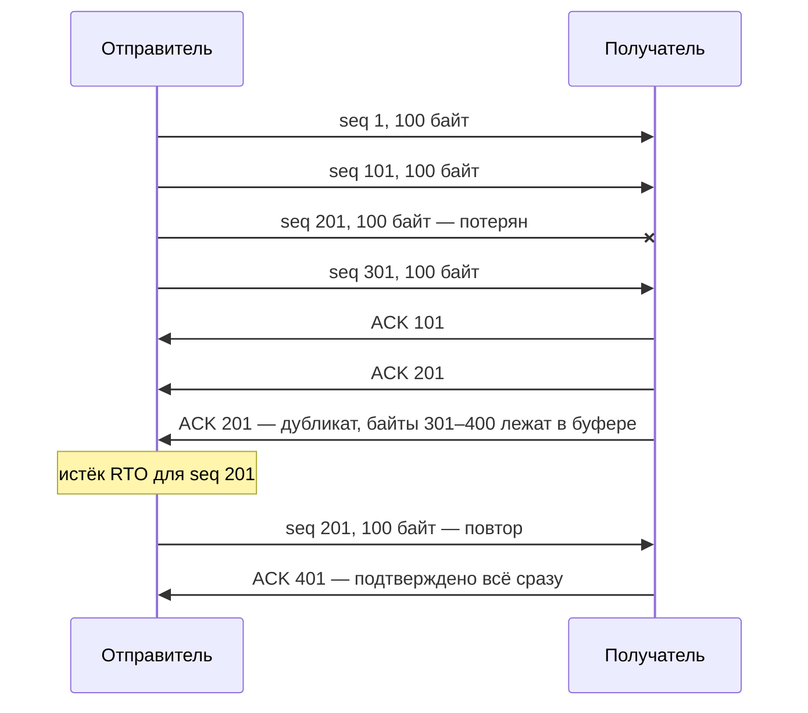

# Скользящее окно и управление потоком

## Отправка по одному сегменту [27:25](https://www.youtube.com/watch?v=6iEZOuH75cw&t=1645s)

Простейшая схема надёжной доставки — **stop-and-wait** (остановка с ожиданием): поток данных нарезан на сегменты, отправили один, дождались подтверждения, отправили следующий [28:26](https://www.youtube.com/watch?v=6iEZOuH75cw&t=1706s)

> [!failure] На длинном широком канале stop-and-wait простаивает [30:00](https://www.youtube.com/watch?v=6iEZOuH75cw&t=1800s)
> **RTT** (Round Trip Time, время приёма-передачи) — сколько идут данные от A до B и подтверждение обратно. Сегмент улетает за доли миллисекунды, а ответа ждать всё RTT, и всё это время канал, который мог бы нести данные, пуст

Порядок величин: канал 1 Гбит/с между континентами с RTT 100 мс. Сегмент в 1460 байт передаётся за 12 мкс, после чего отправитель 100 мс ждёт — загрузка канала около $0{,}012\,\%$

## Скользящее окно [31:02](https://www.youtube.com/watch?v=6iEZOuH75cw&t=1862s)

> [!note] **Скользящее окно** (sliding window) — диапазон потока, который отправитель вправе передать, не дожидаясь подтверждений
> Все сегменты, попавшие в окно, уходят подряд [32:04](https://www.youtube.com/watch?v=6iEZOuH75cw&t=1924s). Пришло подтверждение — левый край окна сдвигается за подтверждённые байты, справа в окно попадают новые, и они сразу отправляются [34:08](https://www.youtube.com/watch?v=6iEZOuH75cw&t=2048s)

Получатель проверяет контрольную сумму каждого сегмента и, если он не побит, подтверждает его [33:05](https://www.youtube.com/watch?v=6iEZOuH75cw&t=1985s). Подтверждение может прийти, пока отправитель ещё не выпустил всё окно, — тогда отправка и сдвиг идут параллельно [33:37](https://www.youtube.com/watch?v=6iEZOuH75cw&t=2017s)

Отправитель в каждый момент делит свой поток на четыре участка — так их рисует и [[RFC]] 9293:

| Подтверждено | Отправлено, ждёт [[Заголовок TCP и установление соединения\|ACK]] | Можно отправить | Пока нельзя |
|---|---|---|---|
| байты, которые получатель подтвердил, — их можно забыть | копии хранятся до подтверждения на случай повтора | свободная часть окна | за правым краем окна |

Левый край окна — первый неподтверждённый байт, правый — левый край плюс размер окна. По ленте данных окно движется только в одну сторону, слева направо [54:56](https://www.youtube.com/watch?v=6iEZOuH75cw&t=3296s)

## Таймер и повторная передача [36:12](https://www.youtube.com/watch?v=6iEZOuH75cw&t=2172s)

Сегмент может потеряться, прийти побитым и быть отброшенным получателем по контрольной сумме, или дойти, но потерять по дороге своё подтверждение. Отправителю причина неважна: он видит только, что подтверждения нет [37:45](https://www.youtube.com/watch?v=6iEZOuH75cw&t=2265s)

> [!note] **Retransmission** (повторная передача) — отправка заново данных, подтверждение которых не пришло за время **RTO** (Retransmission Timeout, таймаут повторной передачи) [38:17](https://www.youtube.com/watch?v=6iEZOuH75cw&t=2297s)
> После повтора таймер запускается заново, и подтверждение сдвигает окно дальше [39:19](https://www.youtube.com/watch?v=6iEZOuH75cw&t=2359s). Повторять можно многократно — до предела, после которого соединение считается разорванным[^timer-per-segment]

RTO не константа: RFC 6298 вычисляет его из измеренных RTT

$$\text{RTO} = \text{SRTT} + 4 \cdot \text{RTTVAR}$$

где **SRTT** — сглаженное среднее RTT, а **RTTVAR** (round-trip time variation) — сглаженное среднее отклонение. Нижняя граница по RFC — 1 секунда, Linux использует 200 мс. После каждого истечения таймера RTO удваивается. RTT по повторно отправленным сегментам не измеряют: непонятно, на какую из копий пришло подтверждение (**алгоритм Карна**)

> [!info]- Когда повторы исчерпаны [52:19](https://www.youtube.com/watch?v=6iEZOuH75cw&t=3139s)
> Разорвать соединение может любая сторона. Предел задаётся по-разному: в одних [[Операционная система|ОС]] временем, в других числом повторов. RFC 9293 требует после порога сообщить приложению об ошибке и закрыть соединение, причём порог должен соответствовать не меньше чем 100 секундам. В Linux это `net.ipv4.tcp_retries2 = 15`: с удвоением RTO выходит примерно 15 минут молчания до обрыва[^rst-on-timeout]

[^timer-per-segment]: Лектор рисует отдельный таймер на каждый отправленный сегмент, $t_1$, $t_2$, $t_3$ [37:14](https://www.youtube.com/watch?v=6iEZOuH75cw&t=2234s). Как модель это верно, но RFC 6298 рекомендует один таймер на соединение: он запущен, пока есть неподтверждённые данные, отсчитывает время для самого старого из них и перезапускается при каждом подтверждении, сдвигающем окно. Держать таймер на каждый сегмент дорого, а результат почти тот же

[^rst-on-timeout]: Лектор говорит, что сторона, которой надоело ждать, "скорее всего отправит сегмент с флагом [[Заголовок TCP и установление соединения|RST]]" [52:50](https://www.youtube.com/watch?v=6iEZOuH75cw&t=3170s). Стандарт этого не требует, и смысла в таком RST мало: собеседник, на которого исчерпаны все повторы, скорее всего его не получит. Обычно стек просто освобождает соединение и возвращает приложению ошибку таймаута

## Буфер приёмника и кумулятивный ACK [40:22](https://www.youtube.com/watch?v=6iEZOuH75cw&t=2422s)

Получатель складывает пришедшие сегменты в **приёмный буфер** [40:55](https://www.youtube.com/watch?v=6iEZOuH75cw&t=2455s). Пусть сегменты 1 и 2 пришли, 3 потерялся, а 4, 5 и 6 пришли

> [!note] [[Заголовок TCP и установление соединения|ACK]] кумулятивный: он указывает на первый недостающий байт, а не на последний пришедший [41:58](https://www.youtube.com/watch?v=6iEZOuH75cw&t=2518s)
> Подтверждение значит "всё до этого байта получено целиком, без разрывов". Сегменты 4–6 лежат в буфере, но подтвердить их нельзя — можно только ещё раз подтвердить первые два. Подтвердить часть сегмента тоже нельзя: сегмент проверяется контрольной суммой целиком и при повреждении отбрасывается полностью

Это ограничение классического [[Заголовок TCP и установление соединения|TCP]] [42:58](https://www.youtube.com/watch?v=6iEZOuH75cw&t=2578s): отправитель не знает, что 4–6 дошли, и может повторить их зря. Снимает его [[Оптимизации TCP#Выборочное подтверждение [02 47](https //www.youtube.com/watch?v=1XavYjeAaog&t=167s)|SACK]]. Тот же общий порядок байтов виноват в [[Протокол UDP#QUIC поверх UDP|head-of-line blocking]]: пока дыра не закрыта, приложение не получит и то, что уже лежит за ней

**Дубликат ACK** — повторное подтверждение того же номера. В нём нет ничего страшного: пришли два сегмента с одинаковым номером — получатель вправе дважды подтвердить одно и то же, а отправитель лишь дважды узнает, что до этого места всё дошло [50:41](https://www.youtube.com/watch?v=6iEZOuH75cw&t=3041s). Чаще дубликаты порождает дыра, как на диаграмме выше, — и на подсчёте таких дубликатов построен [[Оптимизации TCP#Быстрая повторная передача [13 29](https //www.youtube.com/watch?v=1XavYjeAaog&t=809s)|fast retransmit]]

Если приходят данные, которые уже лежат в буфере, получатель их не использует повторно; перезапишет ли он буфер или просто отбросит копию — дело реализации стека[^overwrite] [51:49](https://www.youtube.com/watch?v=6iEZOuH75cw&t=3109s)

[^overwrite]: Лектор говорит, что стандарт этот случай "не оговаривает" [51:49](https://www.youtube.com/watch?v=6iEZOuH75cw&t=3109s). Для уже подтверждённых данных RFC 9293 оговаривает: из сегмента обрабатывается только новая часть, повтор отбрасывается. Свободу реализации оставлен лишь случай, когда копия совпадает с ещё не подтверждёнными данными, лежащими в буфере за дырой

## Window Size и управление потоком [43:28](https://www.youtube.com/watch?v=6iEZOuH75cw&t=2608s)

Размер окна не фиксирован: чем оно больше, тем меньше простоев и выше скорость [43:58](https://www.youtube.com/watch?v=6iEZOuH75cw&t=2638s). Но получатель может не успевать: вечером операторы разом заливают видео на один сервер, буфер в памяти кончается, а дисковая подсистема не успевает его разгружать [44:28](https://www.youtube.com/watch?v=6iEZOuH75cw&t=2668s)

> [!note] **Управление потоком** (flow control) — получатель ограничивает скорость отправителя размером своего свободного буфера [46:02](https://www.youtube.com/watch?v=6iEZOuH75cw&t=2762s)
> Поле **Window** (Window Size) в каждом сегменте сообщает, сколько байт, начиная с номера подтверждения, отправитель сегмента готов принять. Больше окно — отправитель шлёт быстрее, меньше — медленнее

> [!important] Window Size — это не размер сегмента
> - [[MTU и фрагментация#MSS и MSS clamping [1 14 36](https //www.youtube.com/watch?v=6iEZOuH75cw&t=4476s)|MSS]] — предел полезной нагрузки **одного** сегмента, около 1460 байт на Ethernet
> - Window Size — сколько байт можно отправить подряд без подтверждения; окно вмещает много сегментов

> [!warning] Window Size в исходящем сегменте говорит о **своём** приёмном буфере
> Соединение полнодуплексное, и каждая сторона задаёт окно соседу [48:35](https://www.youtube.com/watch?v=6iEZOuH75cw&t=2915s): поле значит "сколько я готов принять", а не "сколько я собираюсь отправить"

Отправитель обязан уложиться в объявленное окно, но вправе слать и меньше — например, если сам упирается в канал 100 Мбит/с, а сервер объявил окно под терабитный [49:06](https://www.youtube.com/watch?v=6iEZOuH75cw&t=2946s). Меньше можно, больше нельзя. Второе ограничение отправитель накладывает сам себе — [[Оптимизации TCP#Управление перегрузкой [55 31](https //www.youtube.com/watch?v=6iEZOuH75cw&t=3331s)|окно перегрузки]], и реально он шлёт не больше минимума из двух окон[^congestion-vs-flow]

Поле занимает 16 бит, значит окно не больше 65 535 байт — на быстрых каналах это мало, и его расширяет [[Оптимизации TCP#Масштабирование окна [05 59](https //www.youtube.com/watch?v=1XavYjeAaog&t=359s)|масштабирование окна]]

[^congestion-vs-flow]: Лектор говорит, что на хорошей линии окошко постепенно увеличивают, а на линии с потерями сокращают, чтобы повторять меньше [54:25](https://www.youtube.com/watch?v=6iEZOuH75cw&t=3265s). Это описание окна перегрузки, а не поля Window Size: объявленное окно зависит только от свободного места в буфере получателя, о потерях в сети он не знает. Реакцией на потери управляет отправитель, через отдельную переменную cwnd

### Нулевое окно [46:33](https://www.youtube.com/watch?v=6iEZOuH75cw&t=2793s)

**Zero Window** — окно, равное нулю: "стоп, погоди, переварим то, что есть". Это явная команда получателя, а не признак потерь в сети. Когда место освободится, получатель пришлёт сегмент с ненулевым окном, и отправка возобновится [47:04](https://www.youtube.com/watch?v=6iEZOuH75cw&t=2824s)[^zero-window]

[^zero-window]: Лектор описывает возобновление только сегментом получателя с новым окном [47:04](https://www.youtube.com/watch?v=6iEZOuH75cw&t=2824s). Этого мало: такой сегмент пустой, его никто не подтверждает, и при его потере обе стороны ждали бы друг друга вечно. Поэтому отправитель, получив нулевое окно, запускает **persist timer** и периодически шлёт получателю **window probe** — крошечный сегмент, на который тот обязан ответить текущим размером окна
