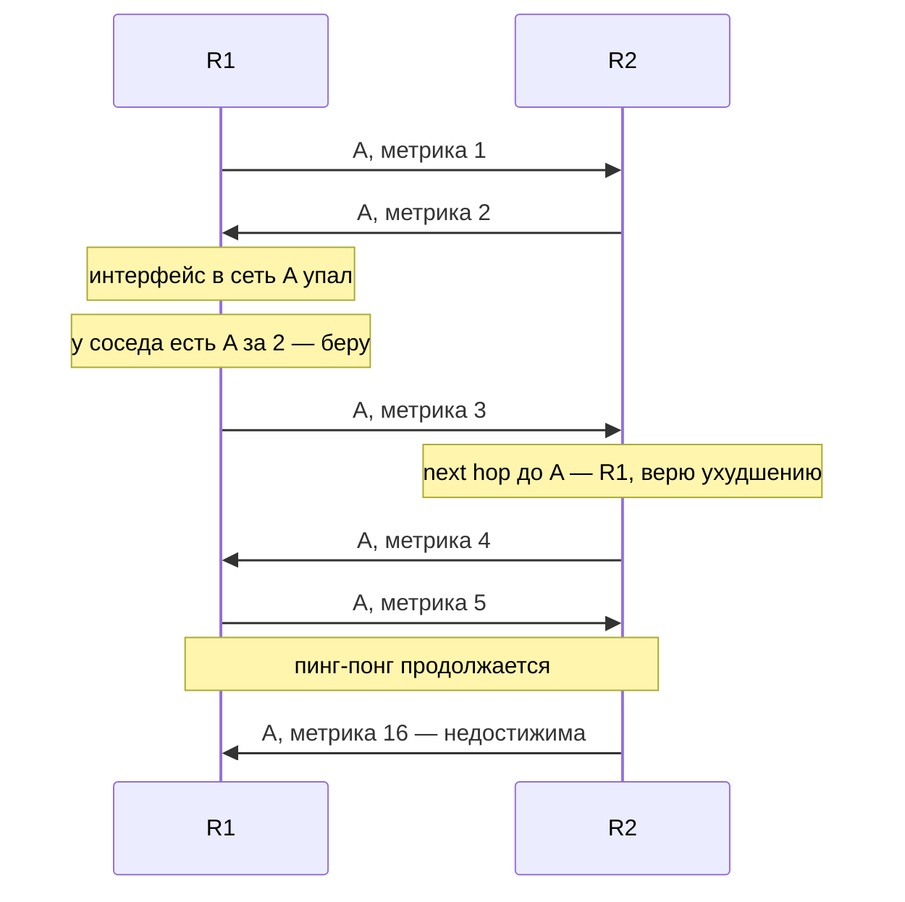
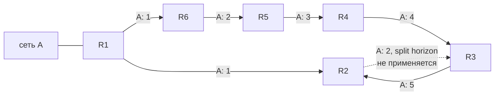

# Борьба с петлями в distance-vector

[[Классификация протоколов маршрутизации#Distance-vector [16 42](https //www.youtube.com/watch?v=oOFuvP3JxUM&t=1002s)|Distance-vector]]-роутер не видит топологию и верит соседу на слово. В эксплуатации [[Протокол RIP|RIP]], живущий строго по исходным правилам и таймерам, оказался склонен к очень долгой сходимости, и поверх протокола появился набор оптимизаций [45:08](https://www.youtube.com/watch?v=oOFuvP3JxUM&t=2708s)

## Счёт до бесконечности [44:35](https://www.youtube.com/watch?v=oOFuvP3JxUM&t=2675s)

Два роутера: за R1 сеть A, за R2 сеть B. R1 объявляет A с метрикой 1, R2 запоминает и объявляет её всем соседям с метрикой 2 — в том числе обратно R1. Пока у R1 сеть A connected, чужое объявление ему неинтересно [46:42](https://www.youtube.com/watch?v=oOFuvP3JxUM&t=2802s)

Затем у R1 падает интерфейс в сторону A [47:47](https://www.youtube.com/watch?v=oOFuvP3JxUM&t=2867s):

> [!note] **Count to infinity** (счёт до бесконечности) — рост метрики, когда роутер объявляет соседу, увеличив на единицу, префикс, полученный от этого же соседа [50:21](https://www.youtube.com/watch?v=oOFuvP3JxUM&t=3021s)
> Роутеры перекидывают друг другу несуществующий маршрут, пока метрика не дорастёт до 16. Только тогда [[Протокол RIP#Метрика [21 52](https //www.youtube.com/watch?v=oOFuvP3JxUM&t=1312s)|"бесконечность"]] признана и сеть сходится, но каждый шаг ждёт очередного обновления, и это очень долго [49:51](https://www.youtube.com/watch?v=oOFuvP3JxUM&t=2991s). Всё это время трафик в A ходит по [[TTL, маршрутные петли и traceroute|петле]] между R1 и R2

> [!tip] Маленькая бесконечность — плата за быстрый счёт
> Потолок 16 выбран низким именно для того, чтобы счёт до бесконечности кончался быстро. Обратная сторона — предельный диаметр RIP-сети в 15 переходов

## Split horizon [50:53](https://www.youtube.com/watch?v=oOFuvP3JxUM&t=3053s)

> [!note] **Split horizon** (расщепление горизонта) — роутер не отправляет обновление о префиксе обратно через тот интерфейс, через который узнал его, если сам этот маршрут использует
> В примере выше R2 просто не рассказал бы R1 про сеть A, и принимать при отказе R1 было бы нечего

Условие "если сам использует" важно, когда информация приходит с разных сторон. Кольцо из шести роутеров, сеть A за R1 [51:24](https://www.youtube.com/watch?v=oOFuvP3JxUM&t=3084s):

R2 получает A от R1 с метрикой 1 и по кольцу от R3 с метрикой 5, использует путь через R1. В сторону R1 он про A молчит — здесь split horizon работает. В сторону R3 он объявляет A с метрикой 2: полученный от R3 маршрут R2 не использует, и запрет на него не распространяется [52:27](https://www.youtube.com/watch?v=oOFuvP3JxUM&t=3147s)

### Poison reverse [54:00](https://www.youtube.com/watch?v=oOFuvP3JxUM&t=3240s)

> [!note] **Poison reverse** — усиленный split horizon: вместо молчания роутер отправляет префикс обратно, в сторону источника своего лучшего маршрута, но с метрикой 16
> R2 в сторону R1 объявляет сеть A с метрикой 16. Split horizon умалчивает о сети, poison reverse явно говорит источнику "через меня недостижимо" [55:03](https://www.youtube.com/watch?v=oOFuvP3JxUM&t=3303s)

Явный отказ надёжнее молчания: если у двух роутеров маршруты уже указывают друг на друга, отравленная запись разрывает петлю сразу, а не по таймеру. Платой служит размер обновлений — в них едут и все отравленные записи. [[RFC]] 2453 со ссылкой на требования к роутерам (RFC 1812) делает split horizon обязательным, а poison reverse рекомендованным, с возможностью отключения

> [!warning] Split horizon ловит только петли из двух роутеров
> Если A верит, что маршрут идёт через B, B — через C, а C — через A, запрет "не отдавать обратно" не срабатывает ни на одном линке, и такая петля доживает до метрики 16. Это ограничение прямо названо в RFC 2453; против него работают [[Протокол RIP#Holddown [31 49](https //www.youtube.com/watch?v=oOFuvP3JxUM&t=1909s)|holddown]] и триггерные обновления ниже

## Route poisoning [55:33](https://www.youtube.com/watch?v=oOFuvP3JxUM&t=3333s)

> [!note] **Route poisoning** (отравление маршрута) — сеть пропала, и роутер не просто перестаёт её объявлять, а рассылает всем соседям обновление о ней с метрикой 16
> У R1 физически упал интерфейс в сеть A — R1 сразу убирает её из таблицы маршрутизации и вместо прежней метрики 1 рассылает A с метрикой 16 [56:04](https://www.youtube.com/watch?v=oOFuvP3JxUM&t=3364s). Соседям не нужно ждать 180 секунд [[Протокол RIP#Invalid [28 39](https //www.youtube.com/watch?v=oOFuvP3JxUM&t=1719s)|invalid-таймера]]

> [!warning] Poison reverse и route poisoning — разные вещи [56:39](https://www.youtube.com/watch?v=oOFuvP3JxUM&t=3399s)
> - **poison reverse**: метрика 16 уходит **одному** соседу — тому, от кого маршрут получен и используется; сама сеть при этом жива
> - **route poisoning**: метрика 16 уходит **всем** соседям о префиксе, который у тебя пропал

## Triggered updates [57:47](https://www.youtube.com/watch?v=oOFuvP3JxUM&t=3467s)

> [!note] **Triggered update** (триггерное обновление) — обновление по событию, сразу, не дожидаясь конца 30-секундного интервала
> На R1 поднялся интерфейс с новой сетью C — обновление о ней уходит немедленно. Остальные префиксы в такое обновление, как правило, не включаются: едет только изменение [58:47](https://www.youtube.com/watch?v=oOFuvP3JxUM&t=3527s)

По RFC 2453 следующее триггерное обновление после отправленного ждёт случайные 1–5 секунд, и изменения за это время уходят одной пачкой — так каскад событий не заливает сеть служебным трафиком

> [!important] RIP медленно сходится только на пропадании сети [59:17](https://www.youtube.com/watch?v=oOFuvP3JxUM&t=3557s)
> **Появление** сети расходится по RIP-домену каскадом триггерных обновлений: каждый следующий роутер сразу шлёт своё, и скорость ограничена лишь тем, как быстро роутеры их обрабатывают. **Пропадание** канала или сети упирается в invalid и holddown — вот там RIP действительно долог [1:00:56](https://www.youtube.com/watch?v=oOFuvP3JxUM&t=3656s)

### Triggered extensions [1:01:31](https://www.youtube.com/watch?v=oOFuvP3JxUM&t=3691s)

> [!warning] **Triggered extensions** — не triggered updates
> Похожее имя, другая задача: RIP поверх **каналов по требованию** (demand circuit), например dial-up. Такой канал поднимается, когда есть трафик, и разрывается, когда его нет, а платят оператору за время, пока линия поднята [1:02:02](https://www.youtube.com/watch?v=oOFuvP3JxUM&t=3722s)

Периодические обновления каждые 30 секунд не дали бы такому каналу опуститься никогда. Поэтому при установлении соединения через такой интерфейс первое обновление несёт всю RIP-базу, а дальше периодических обновлений нет вовсе — только по событию, например при появлении новой сети [1:03:05](https://www.youtube.com/watch?v=oOFuvP3JxUM&t=3785s)

Раз обновление теперь единственное, его нельзя потерять: RFC 2091, описывающий расширение, добавляет к RIP подтверждения и повторную передачу. В современных сетях встречается редко [1:04:06](https://www.youtube.com/watch?v=oOFuvP3JxUM&t=3846s)

## Две терминологические ловушки [1:05:16](https://www.youtube.com/watch?v=oOFuvP3JxUM&t=3916s)

| Механизм | Что уходит | Кому | Когда |
|---|---|---|---|
| Split horizon | ничего | соседу, от которого маршрут получен | всегда |
| Poison reverse | префикс с метрикой 16 | соседу, от которого маршрут получен | всегда |
| Route poisoning | префикс с метрикой 16 | всем соседям | сеть пропала |
| Triggered updates | только изменившиеся префиксы | всем соседям | сразу по событию |
| Triggered extensions | вся база, дальше только изменения | соседу за каналом по требованию | при установлении канала и по событию |
