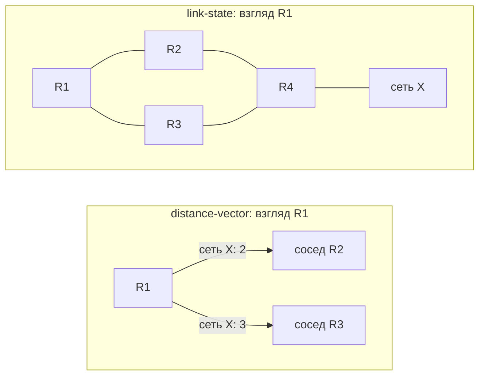

# Классификация протоколов маршрутизации

**Протокол динамической маршрутизации** — механизм, которым роутеры сами сообщают друг другу о достижимых префиксах и сами заполняют [[Таблица маршрутизации|таблицу маршрутизации]], вместо того чтобы администратор прописывал каждый [[Статические маршруты и маршрут по умолчанию|статический маршрут]] руками. Если одну сеть предлагают несколько источников, в таблицу попадает один — по [[Административная дистанция|административной дистанции]]

## Метрика и сходимость [19:16](https://www.youtube.com/watch?v=oOFuvP3JxUM&t=1156s)

> [!note] **Метрика** — число, которым протокол оценивает удалённость префикса: чем она больше, тем путь хуже
> Метрика **аддитивна**: метрика составного пути равна сумме метрик участков [25:02](https://www.youtube.com/watch?v=oOFuvP3JxUM&t=1502s). Из чего складывается участок, решает протокол: у [[Протокол RIP|RIP]] это переход через роутер, у [[Протокол OSPF|OSPF]] — стоимость канала по его полосе, у [[Протокол EIGRP|EIGRP]] — формула из полосы и задержки

> [!note] **Сходимость** (convergence) — переход сети после изменения в стабильное состояние, где таблицы всех роутеров снова согласованы [45:08](https://www.youtube.com/watch?v=oOFuvP3JxUM&t=2708s)
> Пока сеть не сошлась, часть роутеров шлёт трафик по устаревшим маршрутам — в [[TTL, маршрутные петли и traceroute|петлю]] или в никуда. Скорость сходимости — главная характеристика, по которой протоколы сравнивают между собой

## Distance-vector и link-state [16:42](https://www.youtube.com/watch?v=oOFuvP3JxUM&t=1002s)

Сеть для протокола — [[Пути, циклы и связность#Пути и цепи [26 15](https //www.youtube.com/watch?t=1575&v=goTc0e1vsKw)|граф]], где надо найти кратчайший путь. Два класса протоколов расходятся в том, какую часть графа видит каждый роутер

### Distance-vector [16:42](https://www.youtube.com/watch?v=oOFuvP3JxUM&t=1002s)

> [!note] **Distance-vector** (дистанционно-векторный) протокол — роутер сообщает соседям пары "префикс + метрика", то есть вектор расстояний от себя до известных сетей
> Топологии нет: роутер знает только соседей и то, насколько далеко через каждого до каждого префикса. Что находится за соседом, он не знает и знать не должен [17:13](https://www.youtube.com/watch?v=oOFuvP3JxUM&t=1033s)

Математически это распределённый **алгоритм Беллмана — Форда** (Bellman-Ford): метрика до сети через соседа — это объявленная соседом метрика плюс стоимость линка до него, и роутер берёт минимум по соседям. Отсюда врождённая беда класса — роутер верит соседу на слово и не может отличить путь, который идёт через него самого: [[Борьба с петлями в distance-vector|счёт до бесконечности]]

Представители — [[Протокол RIP|RIP]] и [[Протокол EIGRP|EIGRP]]

### Link-state [17:13](https://www.youtube.com/watch?v=oOFuvP3JxUM&t=1033s)

> [!note] **Link-state** (протокол состояния каналов) — каждый роутер описывает свои каналы и соседей, описания рассылаются всем, и каждый строит у себя полную топологию
> Базы описаний у всех роутеров одинаковы, поэтому все независимо друг от друга получают одну и ту же карту сети и один и тот же результат расчёта [23:52](https://www.youtube.com/watch?v=hW8YoPG8NMc&t=1432s). У [[Протокол OSPF|OSPF]] эти описания называются [[Типы LSA в OSPF|LSA]]

По готовой карте кратчайшие пути до всех сетей считает **SPF** (Shortest Path First) — **алгоритм Дейкстры**, запущенный от самого роутера как от корня [26:56](https://www.youtube.com/watch?v=hW8YoPG8NMc&t=1616s). Цена полной картины — память под базу и процессор под пересчёт, поэтому link-state-протоколы требовательнее к железу, чем RIP [19:42](https://www.youtube.com/watch?v=hW8YoPG8NMc&t=1182s)

Представители — [[Протокол OSPF|OSPF]] и **IS-IS** (Intermediate System to Intermediate System)

### Гибриды [07:04](https://www.youtube.com/watch?v=hW8YoPG8NMc&t=424s)

Слово **гибридный** применяют к протоколам, которые в чистую классификацию не укладываются, и применяют к разным протоколам по разным причинам

- **OSPF** лектор называет гибридным[^hybrid]: внутри одной [[Протокол OSPF|зоны]] он честный link-state, а через границу зон передаёт уже не топологию, а готовые "префикс + метрика" — как distance-vector [24:53](https://www.youtube.com/watch?v=hW8YoPG8NMc&t=1493s)
- **EIGRP** гибридом называют в литературе, иногда даже link-state — из-за соседств, надёжной доставки и сложной метрики. Лектор просит в это не верить [37:46](https://www.youtube.com/watch?v=nhHfMoZoevI&t=2266s): топологию EIGRP не строит, Дейкстру не запускает и знает только соседей и сети за ними. Сложная метрика делает его distance-vector со сложной метрикой, а не link-state [39:18](https://www.youtube.com/watch?v=nhHfMoZoevI&t=2358s)

> [!tip] Класс протокола определяет одно: строит ли роутер топологию
> Не метрика, не соседство и не способ доставки обновлений, а ответ на вопрос "есть ли у роутера граф всей сети" [38:17](https://www.youtube.com/watch?v=nhHfMoZoevI&t=2297s)

[^hybrid]: В лекции [07:35](https://www.youtube.com/watch?v=hW8YoPG8NMc&t=455s) OSPF "если быть совсем корректным" отнесён к гибридным. Это авторская трактовка, а не общепринятая классификация: RFC 2328 и вся литература называют OSPF link-state-протоколом, а межзонное поведение описывают как distance-vector-подобное лишь по характеру. Ярлык "гибридный" (balanced hybrid, позже advanced distance vector) исторически маркетинговый термин Cisco для EIGRP, а сама спецификация EIGRP, [[RFC]] 7868, называет его протоколом "based on Distance Vector technology"

## IGP и EGP

> [!note] **Автономная система** (AS, Autonomous System) — сети и роутеры под одним административным управлением с единой политикой маршрутизации
> Провайдер, крупная компания, дата-центр. В интернете у автономной системы есть глобальный номер

По границе автономной системы протоколы делятся на два класса:

- **IGP** (Interior Gateway Protocol) — маршрутизация внутри одной AS. Метрики отражают свойства каналов, цель — кратчайший путь. Все протоколы курса — IGP: [[Протокол RIP|RIP]], [[Протокол OSPF|OSPF]], IS-IS, [[Протокол EIGRP|EIGRP]]. Именно IGP поднимают на стыке с оператором, который берётся маршрутизировать любые клиентские префиксы [11:04](https://www.youtube.com/watch?v=nhHfMoZoevI&t=664s)
- **EGP** (Exterior Gateway Protocol) — маршрутизация между автономными системами[^egp]. Кратчайший путь здесь вторичен, главное — политика: кому какие маршруты отдавать и через кого предпочитать выходить. Сегодня этот класс — один протокол, **BGP** (Border Gateway Protocol, RFC 4271)

BGP — **path-vector**: анонс несёт не число-метрику, а список автономных систем, через которые прошёл маршрут. Петля отсекается по этому списку — AS, увидевшая в нём свой номер, анонс отбрасывает. В курсе BGP не разбирается, а его [[Административная дистанция#Типовые значения [45 12](https //www.youtube.com/watch?v=l9F567JS-5o&t=2712s)|административные дистанции]] стоят в общей таблице

[^egp]: EGP — одновременно имя класса и имя конкретного протокола: Exterior Gateway Protocol (RFC 904) — предшественник BGP, на опыте которого BGP и строился

## Протоколы курса рядом [34:30](https://www.youtube.com/watch?v=nhHfMoZoevI&t=2070s)

| Свойство | [[Протокол RIP\|RIP]] | [[Протокол OSPF\|OSPF]] | IS-IS | [[Протокол EIGRP\|EIGRP]] |
|---|---|---|---|---|
| Класс | distance-vector | link-state | link-state | distance-vector |
| Метрика | число переходов, потолок 15 | сумма стоимостей каналов | сумма стоимостей каналов | полоса и задержка по формуле |
| Обновления | вся база каждые 30 с | по изменению, после установления соседства | по изменению, после установления соседства | по изменению, после установления соседства |
| Открытость | открытый | открытый | открытый | Cisco, спецификация частично открыта |
| Где встречается | везде, но не рекомендуется | корпоративные сети, стандарт де-факто | крупные провайдеры и компании | сети на оборудовании Cisco |

Лектор приводит свою оценку: OSPF открыт и быстро сходится, но требует больше памяти и процессора, чем RIP; IS-IS по памяти и процессору чуть скромнее OSPF, но мало кто из инженеров его знает, поэтому в корпоративных сетях обычно ограничиваются OSPF [35:32](https://www.youtube.com/watch?v=nhHfMoZoevI&t=2132s)
