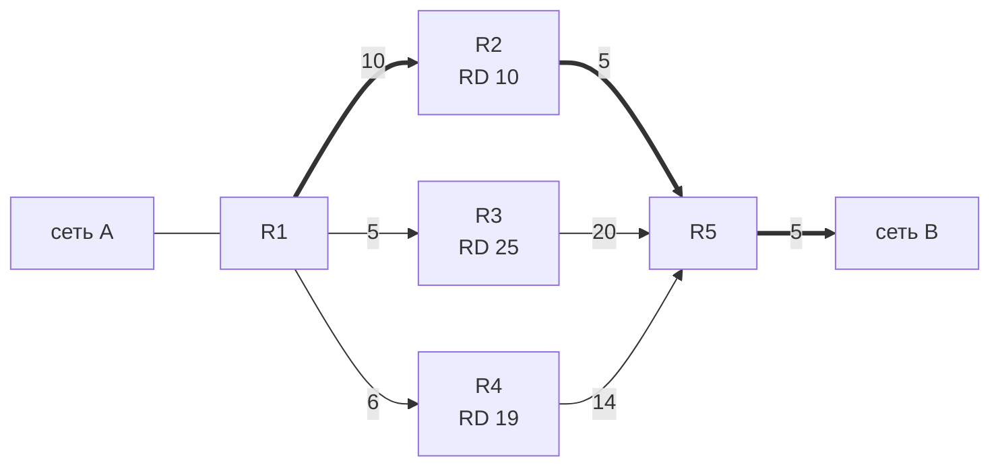

# Протокол EIGRP

$$\boxed{\text{RD}_{\text{соседа}} < \text{FD} \implies \text{путь через соседа без петли}}$$

На этом неравенстве держится мгновенное переключение на резервный путь и балансировка по путям разной стоимости

## Происхождение [33:59](https://www.youtube.com/watch?v=nhHfMoZoevI&t=2039s)

**EIGRP** (Enhanced Interior Gateway Routing Protocol) — развитие **IGRP** (Interior Gateway Routing Protocol); оба протокола созданы Cisco как проприетарные. EIGRP по-прежнему используется: у него ряд преимуществ перед соседями по [[Классификация протоколов маршрутизации#Протоколы курса рядом [34 30](https //www.youtube.com/watch?v=nhHfMoZoevI&t=2070s)|сравнению]] [34:30](https://www.youtube.com/watch?v=nhHfMoZoevI&t=2070s)

Позже Cisco открыла часть спецификации, и формально любой вендор может написать свою реализацию. На практике лектор реализаций EIGRP у других вендоров не встречал, а по разговорам открыто не всё [1:15:38](https://www.youtube.com/watch?v=nhHfMoZoevI&t=4538s). Открытая часть — информационный [[RFC]] 7868 (2016); функции stub routing в нём, например, нет

## Distance-vector, а не link-state [37:46](https://www.youtube.com/watch?v=nhHfMoZoevI&t=2266s)

EIGRP — [[Классификация протоколов маршрутизации#Distance-vector [16 42](https //www.youtube.com/watch?v=oOFuvP3JxUM&t=1002s)|distance-vector]], как [[Протокол RIP|RIP]]. Топологию он не строит и Дейкстру не запускает: знает соседей и сети за ними, но не то, кто с кем связан. Команда `show ip eigrp topology` существует, но показывает таблицу маршрутов от соседей, а не [[Графы#^graph|граф]] [38:47](https://www.youtube.com/watch?v=nhHfMoZoevI&t=2327s). Почему его всё же называют гибридом — [[Классификация протоколов маршрутизации#Гибриды [07 04](https //www.youtube.com/watch?v=hW8YoPG8NMc&t=424s)|в классификации]]

## Соседство и надёжная доставка [40:31](https://www.youtube.com/watch?v=nhHfMoZoevI&t=2431s)

В отличие от RIP, который раз в 30 секунд рассылал всё во все интерфейсы, EIGRP сначала устанавливает **соседство** и только потом обменивается маршрутной информацией — не периодически, а по изменениям. Сходится он быстро

Объявления доставляет **RTP** (Reliable Transport Protocol) — собственный надёжный транспорт EIGRP с подтверждениями [41:06](https://www.youtube.com/watch?v=nhHfMoZoevI&t=2466s)[^rtp]

- EIGRP едет прямо в [[IP-адрес и маска подсети|IP]] с [[Заголовок IPv4#Поле Protocol [1 15 35](https //www.youtube.com/watch?v=5iMhAOFx38c&t=4535s)|номером протокола]] 88, служебные пакеты шлёт на [[Типы адресации|multicast]] 224.0.0.10
- Hello на обычных линках по умолчанию раз в 5 секунд, hold time — втрое больше, 15 секунд: не услышав соседа за это время, роутер считает его пропавшим
- Маршруты от всех соседей хранятся в **topology table**, лучшие из неё уходят в таблицу маршрутизации с [[Административная дистанция#Типовые значения [45 12](https //www.youtube.com/watch?v=l9F567JS-5o&t=2712s)|административной дистанцией]] 90 для внутренних и 170 для внешних

[^rtp]: Не путать с одноимённым RTP — Real-time Transport Protocol, транспортом голоса и видео поверх [[Протокол UDP|UDP]]. Общее у них только сокращение

## Successor и feasible successor [42:14](https://www.youtube.com/watch?v=nhHfMoZoevI&t=2534s)

Опорная схема: от R1 к сети B три пути через соседей R2, R3 и R4. Разбиение стоимостей по линкам — иллюстрация, лекция задаёт только итоги: 20 через R2, 30 через R3, 25 через R4 и объявленные R4 19 [52:52](https://www.youtube.com/watch?v=nhHfMoZoevI&t=3172s)

### Successor [43:30](https://www.youtube.com/watch?v=nhHfMoZoevI&t=2610s)

> [!note] **Successor** — сосед, через которого путь до префикса короче всего
> Метрика [[Классификация протоколов маршрутизации#Метрика и сходимость [19 16](https //www.youtube.com/watch?v=oOFuvP3JxUM&t=1156s)|аддитивна]]: через R2 — 20, через R3 — 30, через R4 — 25, successor для сети B — R2 [44:03](https://www.youtube.com/watch?v=nhHfMoZoevI&t=2643s). Successor определяется для конкретного префикса и направления: для обратного пути ответ может быть другим [44:33](https://www.youtube.com/watch?v=nhHfMoZoevI&t=2673s)

Если у двух соседей метрика одинаковая и наименьшая, successor'ов два, и трафик делится между ними — это [[Расчёт подсетей и VLSM#Автоматическая суммаризация [1 05 48](https //www.youtube.com/watch?v=oOFuvP3JxUM&t=3948s)|ECMP]], который умеют и RIP, и [[Протокол OSPF|OSPF]], и другие протоколы [54:29](https://www.youtube.com/watch?v=nhHfMoZoevI&t=3269s)

### Feasible distance и reported distance [46:35](https://www.youtube.com/watch?v=nhHfMoZoevI&t=2795s)

> [!note] **FD** (feasible distance) — метрика пути через successor; в примере FD = 20
> **RD** (reported distance, в другой литературе advertised distance) — метрика, которую сосед объявляет от **себя** до префикса. Оба названия означают одно и то же [47:05](https://www.youtube.com/watch?v=nhHfMoZoevI&t=2825s)

> [!warning] Сокращение AD здесь не административная дистанция
> Advertised distance и [[Административная дистанция|administrative distance]] сокращаются одинаково, поэтому в EIGRP надёжнее говорить RD

### Feasibility condition [48:09](https://www.youtube.com/watch?v=nhHfMoZoevI&t=2889s)

> [!summary] **Feasibility condition** — объявленная соседом метрика строго меньше нашей FD
> $$\boxed{\text{RD}_{\text{соседа}} < \text{FD}}$$
> Сосед, выполняющий условие, — **feasible successor** (FS): резервный сосед, путь через которого гарантированно не проходит через нас самих [45:04](https://www.youtube.com/watch?v=nhHfMoZoevI&t=2704s)[^fs]
>
> > [!success]- Почему неравенство исключает петлю [49:41](https://www.youtube.com/watch?v=nhHfMoZoevI&t=2981s)
> > Если сосед ходит к B через нас, его путь — это расстояние до нас плюс весь наш лучший путь, то есть $\text{RD} = d(\text{сосед}, \text{мы}) + \text{FD} > \text{FD}$. Значит, при $\text{RD} < \text{FD}$ сосед заведомо идёт не через нас [50:12](https://www.youtube.com/watch?v=nhHfMoZoevI&t=3012s) $\blacksquare$

> [!warning] Условие достаточное, но не необходимое [50:45](https://www.youtube.com/watch?v=nhHfMoZoevI&t=3045s)
> Сосед может объявлять $\text{RD} > \text{FD}$ и при этом идти к B не через нас. Но уверенности в этом нет, и такого соседа FS не считают. Выполнилось неравенство — уверенность стопроцентная [51:48](https://www.youtube.com/watch?v=nhHfMoZoevI&t=3108s)

> [!example] Проверка соседей из опорной схемы [52:20](https://www.youtube.com/watch?v=nhHfMoZoevI&t=3140s)
> - R4: $\text{RD} = 19 < \text{FD} = 20$ — условие выполнено, **R4 — feasible successor** [53:25](https://www.youtube.com/watch?v=nhHfMoZoevI&t=3205s)
> - R3: $\text{RD} = 25 > 20$ — условие не выполнено. И это не перестраховка: из R3 путь $5 + 20 = 25$ через R1 ровно так же короток, как свой через R5, так что R3 вполне может гнать трафик к B через нас

[^fs]: Лектор определяет FS как соседа со **вторым** лучшим путём, который вдобавок выполняет условие, — будто FS один [45:34](https://www.youtube.com/watch?v=nhHfMoZoevI&t=2734s). По RFC 7868 feasible successor — **любой** сосед, выполнивший feasibility condition, и их может быть несколько; при отказе successor'а используется лучший из них. Там же уточнено, что FD — не текущая метрика, а наименьшая с тех пор, как маршрут последний раз перешёл в пассивное состояние

### Мгновенное переключение [53:25](https://www.youtube.com/watch?v=nhHfMoZoevI&t=3205s)

Отказал successor — EIGRP сразу переключается на FS: ни пересчёта, ни запросов соседям. Путь хуже, но гарантированно без петли, трафик к нам не вернётся. Пара successor + feasible successor и даёт EIGRP самую быструю реакцию на изменения [54:03](https://www.youtube.com/watch?v=nhHfMoZoevI&t=3243s)

## Когда feasible successor нет [56:13](https://www.youtube.com/watch?v=nhHfMoZoevI&t=3373s)

Если никто из оставшихся соседей условие не выполняет, быстрого пути нет. Роутер рассылает соседям **query** — "не знаешь ли маршрута до такого префикса"; соседи, которым нечего ответить сразу, спрашивают дальше своих, и запрос расходится по сети диффузной волной[^query]. Ответы **reply** — "не знаем" или "знаем, префикс за нами" — возвращаются обратно [56:45](https://www.youtube.com/watch?v=nhHfMoZoevI&t=3405s)

Сбор всех ответов занимает миллисекунды, десятки и сотни миллисекунд, а в большой сети со старыми роутерами и узкими каналами — до секунды. В любом случае это заметно дольше переключения на FS [58:20](https://www.youtube.com/watch?v=nhHfMoZoevI&t=3500s)

[^query]: В лекции [57:16](https://www.youtube.com/watch?v=nhHfMoZoevI&t=3436s) запрос пересылает дальше всякий сосед, "не отвечающий за префикс сам". По RFC 7868 сосед, чей successor к этому префиксу — не спрашивающий роутер, или у которого есть свой feasible successor, отвечает reply сразу, и волна на нём останавливается. Дальше query уходит только от тех, кто сам ходил к префиксу через спрашивающего и без него остался без беспетлевого пути

### DUAL [1:13:23](https://www.youtube.com/watch?v=nhHfMoZoevI&t=4403s)

Лектор называет алгоритм и дальше в него не идёт, спрашивать не собирается

> [!note] **DUAL** (Diffusing Update Algorithm) — алгоритм EIGRP, который выбирает successor и FS по feasibility condition, а без FS запускает диффузное вычисление через query и reply
> Маршрут, по которому всё в порядке, находится в состоянии **passive**. Маршрут, по которому ушли query и ждут ответов, — в **active**: пользоваться им нельзя, пока не соберутся все reply. Если ответ не пришёл за отведённое время (у Cisco 3 минуты, с промежуточной проверкой соседа SIA-query на половине), маршрут объявляется **stuck in active** (SIA), и соседство с молчащим соседом сбрасывается

## Метрика [58:53](https://www.youtube.com/watch?v=nhHfMoZoevI&t=3533s)

Метрика может учитывать четыре характеристики канала: **полосу пропускания** (bandwidth), **задержку** (delay), **загрузку** (load) и **надёжность** (reliability)[^mtu]. Load и reliability выражаются числом от 1 до 255 [1:02:30](https://www.youtube.com/watch?v=nhHfMoZoevI&t=3750s)

[^mtu]: В лекции [40:31](https://www.youtube.com/watch?v=nhHfMoZoevI&t=2431s) параметров названо пять — пятым вспомнен [[MTU и фрагментация|MTU]]. MTU действительно едет в обновлениях вместе с остальными характеристиками пути, но в формулу метрики не входит: RFC 7868 прямо говорит "MTU is not an attribute for calculating the composite metric". Пять — это число коэффициентов K1–K5, а не характеристик

### Общая формула [59:28](https://www.youtube.com/watch?v=nhHfMoZoevI&t=3568s)

Вклад характеристик регулируют пять коэффициентов **K1–K5** (K-values):

$$\text{metric} = 256\cdot\left(K_1\cdot\text{BW} + \frac{K_2\cdot\text{BW}}{256-\text{load}} + K_3\cdot\text{delay}\right)\cdot\frac{K_5}{\text{reliability}+K_4}$$

где $\text{BW} = \left\lfloor\dfrac{10^{7}}{\text{минимальная полоса на пути, кбит/с}}\right\rfloor$, а delay — сумма задержек интерфейсов на пути. При $K_5 = 0$ последний множитель не обнуляет всё, а считается равным 1 [1:08:27](https://www.youtube.com/watch?v=nhHfMoZoevI&t=4107s)

### Метрика по умолчанию [1:02:52](https://www.youtube.com/watch?v=nhHfMoZoevI&t=3772s)

По умолчанию $K_1 = K_3 = 1$, $K_2 = K_4 = K_5 = 0$ — записывается подряд как 1 0 1 0 0: полоса и задержка учитываются, загрузка и надёжность нет [1:07:25](https://www.youtube.com/watch?v=nhHfMoZoevI&t=4045s)

$$\boxed{\text{metric} = 256\cdot\left(\left\lfloor\frac{10^{7}}{\text{BW}_{\min},\ \text{кбит/с}}\right\rfloor + \sum\text{delay},\ \text{десятки мкс}\right)}$$

> [!warning] Задержка в формуле — в **десятках микросекунд** [1:04:43](https://www.youtube.com/watch?v=nhHfMoZoevI&t=3883s)
> Лектор просит пометить это отдельно. Полоса — в килобитах в секунду

> [!warning] K-values у соседей должны совпадать [1:07:55](https://www.youtube.com/watch?v=nhHfMoZoevI&t=4075s)
> Иначе соседство не установится: роутеры с разными коэффициентами считали бы метрики в несопоставимых единицах

> [!example] Расчёт пути R1 → R2 → R5 [1:04:13](https://www.youtube.com/watch?v=nhHfMoZoevI&t=3853s)
> Пусть R1 — R2 гигабитный (задержка интерфейса 10 мкс), а R2 — R5 Fast Ethernet (100 мкс). Числа в примере свои, в лекции расчёт шёл по доске
> $$\text{BW}_{\min} = 100\,000 \text{ кбит/с} \implies \frac{10^{7}}{100\,000} = 100$$
> $$\sum\text{delay} = \frac{10}{10} + \frac{100}{10} = 1 + 10 = 11$$
> $$\text{metric} = 256\cdot(100 + 11) = 256\cdot 111 = 28\,416$$

### Wide metrics [1:05:17](https://www.youtube.com/watch?v=nhHfMoZoevI&t=3917s)

Метрики EIGRP "космические": складывать и сравнивать их в уме, как хопы RIP или cost OSPF, неудобно. Результат деления в формуле — целое число[^trunc]. Классическая метрика — 32-битное целое, новая **wide metrics** — 64-битная, с немного другой формулой, но той же логикой [1:06:36](https://www.youtube.com/watch?v=nhHfMoZoevI&t=3996s)

Wide metrics нужны быстрым каналам: в классической формуле все интерфейсы от 10 Гбит/с дают $\lfloor 10^7/\text{BW}\rfloor \leqslant 1$ и одинаковую задержку 10 мкс, то есть неразличимы — та же беда, что с [[Протокол OSPF#Проблема быстрых каналов [45 45](https //www.youtube.com/watch?v=hW8YoPG8NMc&t=2745s)|reference bandwidth в OSPF]]

[^trunc]: В лекции [1:06:36](https://www.youtube.com/watch?v=nhHfMoZoevI&t=3996s) результат деления "округляется". RFC 7868 уточняет: дробная часть отбрасывается, округления к ближайшему нет

## Балансировка по путям разной стоимости [1:08:59](https://www.youtube.com/watch?v=nhHfMoZoevI&t=4139s)

> [!important] **Unequal cost load balancing** — трафик делится и между путями с **разной** метрикой
> Среди протоколов курса так умеет только EIGRP[^igrp]. Пример: два пути с метрикой 20 и третий с 25. Любой другой протокол взял бы только два пути по 20 и делил трафик поровну [1:09:30](https://www.youtube.com/watch?v=nhHfMoZoevI&t=4170s)

[^igrp]: Лектор называет EIGRP "единственным протоколом", который так умеет [1:08:59](https://www.youtube.com/watch?v=nhHfMoZoevI&t=4139s). Тем же `variance` умел и его предшественник IGRP — документация Cisco описывает команду сразу для IGRP и EIGRP. Среди живых [[Классификация протоколов маршрутизации|IGP]] утверждение верно

### Variance [1:10:40](https://www.youtube.com/watch?v=nhHfMoZoevI&t=4240s)

Путь участвует в балансировке, только если выполнены оба условия:

1. сосед выполняет **feasibility condition** (FC) — иначе трафик может вернуться к нам. Проверка обязательна всегда: даже с огромным variance через соседа без FC балансировки не будет [1:12:22](https://www.youtube.com/watch?v=nhHfMoZoevI&t=4342s)
2. метрика пути меньше, чем FD, умноженная на **variance** — множитель, задающий предел метрик, допущенных к балансировке [1:11:17](https://www.youtube.com/watch?v=nhHfMoZoevI&t=4277s)

$$\boxed{\text{RD} < \text{FD} \quad\text{и}\quad \text{metric} < \text{variance}\cdot\text{FD}}$$

При FD = 20 и variance 2 допускаются пути с метрикой меньше 40[^variance]. Трафик распределяется **обратно пропорционально метрике**: чем путь дороже, тем меньше на него уходит, например $x$ через каждый из двух путей и $x/2$ через третий [1:12:53](https://www.youtube.com/watch?v=nhHfMoZoevI&t=4373s). По умолчанию variance = 1, то есть балансировка только по равным путям, ECMP [1:15:05](https://www.youtube.com/watch?v=nhHfMoZoevI&t=4505s)

[^variance]: В лекции [1:11:50](https://www.youtube.com/watch?v=nhHfMoZoevI&t=4310s) диапазон назван "от 20 до 40", будто 40 включается. Граница строгая: команда `variance n` у Cisco включает маршруты с метрикой "less than n times the minimum metric", и в разборе документации путь с метрикой ровно 40 при FD 20 и variance 2 в балансировку не попадает
