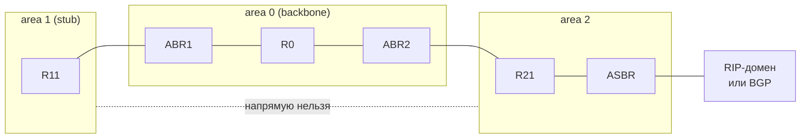

# Протокол OSPF

**OSPF** (Open Shortest Path First) — открытый [[Классификация протоколов маршрутизации#Link-state [17 13](https //www.youtube.com/watch?v=oOFuvP3JxUM&t=1033s)|link-state]]-протокол; из-за межзонного поведения лектор относит его к [[Классификация протоколов маршрутизации#Гибриды [07 04](https //www.youtube.com/watch?v=hW8YoPG8NMc&t=424s)|гибридам]] [07:04](https://www.youtube.com/watch?v=hW8YoPG8NMc&t=424s). Спецификация OSPFv2 для IPv4 — [[RFC]] 2328

## Соседство и транспорт

OSPF не пользуется ни [[Заголовок TCP и установление соединения|TCP]], ни [[Протокол UDP|UDP]]: пакеты едут прямо в [[IP-адрес и маска подсети|IP]] с [[Заголовок IPv4#Поле Protocol [1 15 35](https //www.youtube.com/watch?v=5iMhAOFx38c&t=4535s)|номером протокола]] 89. Каждый роутер опознаётся **Router ID** — 32-битным числом в записи IP-адреса: задан вручную или взят с интерфейса

- **Hello** рассылаются на [[Типы адресации|multicast]] 224.0.0.5 (все OSPF-роутеры). На broadcast- и point-to-point-линках Cisco по умолчанию шлёт их раз в 10 секунд — **hello interval**, а соседа объявляет мёртвым после 40 секунд тишины — **dead interval**. Эти интервалы, номер зоны и её тип должны совпадать у соседей, иначе соседство не поднимется
- В сегменте со множественным доступом, где за одним коммутатором несколько роутеров, выбираются **DR** (Designated Router) и резервный **BDR** (Backup Designated Router). Остальные синхронизируют базу только с ними, а не каждый с каждым, и шлют им обновления на 224.0.0.6. DR же представляет сегмент в топологии [[Типы LSA в OSPF|псевдоузлом]]
- Обмен описаниями каналов идёт после установления соседства и по изменениям, а не периодической рассылкой всей базы, как у [[Протокол RIP|RIP]]

## Зоны [07:35](https://www.youtube.com/watch?v=hW8YoPG8NMc&t=455s)

> [!note] **Зона** (area) — часть OSPF-домена: роутеры, у которых сконфигурирован один номер зоны
> Объединяет их обычно расположение или назначение — ядро сети отдельно, филиалы отдельно [08:08](https://www.youtube.com/watch?v=hW8YoPG8NMc&t=488s)

> [!important] Зоне принадлежит интерфейс, а не роутер [11:13](https://www.youtube.com/watch?v=hW8YoPG8NMc&t=673s)
> У одного роутера один интерфейс может быть в area 0, другой — в area 1, ещё два — в area 3

### Area 0 [08:39](https://www.youtube.com/watch?v=hW8YoPG8NMc&t=519s)

**Area 0** — магистральная зона (backbone), особая по номеру. Все остальные зоны подключаются только к ней, соединять две ненулевые зоны напрямую нельзя. Отсюда картинка-"ромашка": area 0 в центре, остальные зоны лепестками [09:10](https://www.youtube.com/watch?v=hW8YoPG8NMc&t=550s)

Обойти запрет позволяет **virtual link** — логическое продолжение area 0 через ненулевую зону до оторванного роутера. В курсе не разбирается [09:42](https://www.youtube.com/watch?v=hW8YoPG8NMc&t=582s)

### Зачем делить домен на зоны [26:26](https://www.youtube.com/watch?v=hW8YoPG8NMc&t=1586s)

- **Меньше расчётов**: топологию и [[Классификация протоколов маршрутизации#Link-state [17 13](https //www.youtube.com/watch?v=oOFuvP3JxUM&t=1033s)|SPF]] роутер считает только для своей зоны; ABR считает топологию каждой зоны, к которой подключён [27:27](https://www.youtube.com/watch?v=hW8YoPG8NMc&t=1647s)
- **Меньше памяти и процессора**: не нужно хранить описания каналов всего домена [27:58](https://www.youtube.com/watch?v=hW8YoPG8NMc&t=1678s)
- **Локальная реакция на изменения**: пересчитывают топологию только роутеры зоны, где случилось изменение; остальные получают готовый результат — префиксы и метрики [28:28](https://www.youtube.com/watch?v=hW8YoPG8NMc&t=1708s)

Внутри зоны OSPF — честный link-state с одинаковой у всех базой, а через границу передаются уже [[Типы LSA в OSPF|префиксы с метриками]], и топология соседней зоны неизвестна [24:53](https://www.youtube.com/watch?v=hW8YoPG8NMc&t=1493s)

## Типы маршрутизаторов [10:43](https://www.youtube.com/watch?v=hW8YoPG8NMc&t=643s)

| Роль | Определение |
|---|---|
| **Internal router** | все интерфейсы в одной зоне, не обязательно в area 0 |
| **ABR** (Area Border Router) | интерфейсы в area 0 и хотя бы в одной другой зоне; передаёт информацию между зонами[^abr] |
| **ASBR** (Autonomous System Boundary Router)[^asbr] | стык OSPF-домена с чем-то внешним: [[Классификация протоколов маршрутизации\|BGP]], RIP- или [[Протокол EIGRP\|EIGRP]]-доменом, другим OSPF-доменом [12:49](https://www.youtube.com/watch?v=hW8YoPG8NMc&t=769s) |

Роли совмещаются: один роутер может быть одновременно ABR и ASBR [13:54](https://www.youtube.com/watch?v=hW8YoPG8NMc&t=834s). Число пограничных роутеров не ограничено — ABR между area 0 и зоной может быть несколько, ASBR может не быть вовсе или быть много в разных зонах [14:27](https://www.youtube.com/watch?v=hW8YoPG8NMc&t=867s)

[^abr]: Лектор [12:18](https://www.youtube.com/watch?v=hW8YoPG8NMc&t=738s) формулирует жёстче: роутер с интерфейсами только в area 2 и area 3 "не является ABR", потому что информацию между зонами не передаёт. По определению RFC 2328 ABR — любой роутер, подключённый к нескольким зонам. Поведение, описанное лектором, закреплено в RFC 3509 и реализациях Cisco и Juniper: роутер действует как ABR, только если активно подключён к backbone, а без него межзонные маршруты не передаёт

[^asbr]: В лекции [13:22](https://www.youtube.com/watch?v=hW8YoPG8NMc&t=802s) расшифровка звучит как Autonomous System **Border** Router. В RFC 2328 роль называется [[Классификация протоколов маршрутизации|AS]] **boundary** router, и в документации Cisco расшифровка та же

## Классы маршрутов [17:01](https://www.youtube.com/watch?v=hW8YoPG8NMc&t=1021s)

- **intra-area** — сети своей зоны
- **inter-area** — сети того же OSPF-домена из другой зоны
- **external** — сети, попавшие в OSPF извне: из BGP, RIP, [[Протокол EIGRP|EIGRP]], статики или connected [17:31](https://www.youtube.com/watch?v=hW8YoPG8NMc&t=1051s). Передача маршрутов одного источника в другой протокол называется **редистрибуцией** (команда `redistribute`), и роутер, который её делает, по определению ASBR

## Типы зон [15:28](https://www.youtube.com/watch?v=hW8YoPG8NMc&t=928s)

Area 0 — backbone, любая ненулевая зона без особой настройки — **стандартная**. Тупиковые типы урезают то, что ABR пропускает внутрь зоны: OSPF требует заметно больше памяти и процессора, чем RIP, а слабый роутер филиала может не вместить базу большого домена [19:42](https://www.youtube.com/watch?v=hW8YoPG8NMc&t=1182s)

### Stub area [16:29](https://www.youtube.com/watch?v=hW8YoPG8NMc&t=989s)

> [!note] **Stub area** (тупиковая зона) — ABR не пропускает в неё внешние маршруты
> Выход наружу домена роутеры зоны находят по маршруту по умолчанию, который объявляет ABR[^stub-default]. Раз внешних маршрутов в зоне нет, ASBR в ней не бывает — он там не нужен [18:01](https://www.youtube.com/watch?v=hW8YoPG8NMc&t=1081s)

[^stub-default]: В лекции [21:13](https://www.youtube.com/watch?v=hW8YoPG8NMc&t=1273s) генерация маршрута по умолчанию названа только для totally stubby area. По RFC 2328 (раздел 3.6) ABR объявляет default и в обычную stub-зону: без него роутерам зоны нечем было бы добираться до внешних сетей, которые в неё не пропущены

### Totally stubby area [18:36](https://www.youtube.com/watch?v=hW8YoPG8NMc&t=1116s)

> [!note] **Totally stubby area** (полностью тупиковая зона) — ABR не пропускает ни внешние, ни inter-area маршруты
> Внутри остаются только intra-area маршруты и маршрут по умолчанию от ABR, через который уходит всё остальное [21:13](https://www.youtube.com/watch?v=hW8YoPG8NMc&t=1273s)

Типовой сценарий — штаб-квартира и филиалы со слабыми роутерами: вместо огромного числа маршрутов домена филиалу достаются свои сети и один default [20:13](https://www.youtube.com/watch?v=hW8YoPG8NMc&t=1213s). Сама "полная тупиковость" — расширение Cisco (`area … stub no-summary`); стандарт знает лишь stub-зоны, в которые можно не импортировать межзонные маршруты

### NSSA и totally NSSA [22:17](https://www.youtube.com/watch?v=hW8YoPG8NMc&t=1337s)

Лектор только называет эти типы и откладывает их до пятого курса

> [!note] **NSSA** (Not-So-Stubby Area, RFC 3101) — тупиковая зона, в которой всё же может стоять свой ASBR
> Внешние маршруты этого ASBR распространяются по зоне особым [[Типы LSA в OSPF|LSA типа 7]], а ABR на выходе в area 0 переводит их в обычный тип 5. Чужие внешние маршруты внутрь по-прежнему не пускаются. **Totally NSSA** дополнительно отсекает inter-area маршруты и получает от ABR default

| Тип зоны | Внутрь пропускаются LSA | Не пропускаются | ASBR внутри |
|---|---|---|---|
| Стандартная | 1, 2, 3, 4, 5 | — | можно |
| Stub | 1, 2, 3 и default | 4, 5 | нельзя |
| Totally stubby | 1, 2 и default | 3, 4, 5 | нельзя |
| NSSA | 1, 2, 3, 7 | 4, 5 | можно, через тип 7 |
| Totally NSSA | 1, 2, 7 и default | 3, 4, 5 | можно, через тип 7 |

Номера типов расшифрованы в [[Типы LSA в OSPF]]. Default приходит как LSA типа 3, поэтому в полностью тупиковых зонах тип 3 отсекается весь, кроме него

## Метрика [42:30](https://www.youtube.com/watch?v=hW8YoPG8NMc&t=2550s)

Метрика пути — сумма **стоимостей** (cost) выходных интерфейсов на пути [43:00](https://www.youtube.com/watch?v=hW8YoPG8NMc&t=2580s). Cost можно задать руками командой `ip ospf cost`, но на каждом интерфейсе всей сети это не масштабируется [43:30](https://www.youtube.com/watch?v=hW8YoPG8NMc&t=2610s)

### Cost по умолчанию [44:06](https://www.youtube.com/watch?v=hW8YoPG8NMc&t=2646s)

$$\boxed{\text{cost} = \left\lfloor\frac{\text{reference bandwidth}}{\text{полоса интерфейса}}\right\rfloor,\qquad \text{cost}\geqslant 1}$$

**Reference bandwidth** — константа, одинаковая на всех роутерах домена, у Cisco по умолчанию 100 Мбит/с [44:36](https://www.youtube.com/watch?v=hW8YoPG8NMc&t=2676s). Чем шире канал, тем меньше cost. Дробь округляется вниз, а cost меньше 1 не бывает

| Канал | Cost при 100 Мбит/с | Cost при 400 Гбит/с |
|---|---|---|
| 10 Мбит/с | 10 | 40 000 |
| 100 Мбит/с | 1 | 4000 |
| 1 Гбит/с | 1 | 400 |
| 10 Гбит/с | 1 | 40 |
| 100 Гбит/с | 1 | 4 |
| 400 Гбит/с | 1 | 1 |

Два 100-мегабитных перехода подряд дают метрику $1+1=2$, один 10-мегабитный — 10 [45:09](https://www.youtube.com/watch?v=hW8YoPG8NMc&t=2709s)

### Проблема быстрых каналов [45:45](https://www.youtube.com/watch?v=hW8YoPG8NMc&t=2745s)

> [!failure] При умолчании 100 Мбит/с каналы 100 Мбит/с, 1, 10, 25, 40, 100 и 400 Гбит/с неразличимы — у всех cost 1
> OSPF выберет путь с меньшим числом переходов, как [[Протокол RIP#Скорость каналов не учитывается [25 35](https //www.youtube.com/watch?v=oOFuvP3JxUM&t=1535s)|RIP]], и гигабит проиграет десяти гигабитам только на лишнем переходе

Поэтому reference bandwidth меняют сразу (`auto-cost reference-bandwidth` в Мбит/с) — **на всех роутерах домена** и не меньше скорости самого быстрого канала, включая ожидаемые в будущем [46:16](https://www.youtube.com/watch?v=hW8YoPG8NMc&t=2776s). Менять значение в работающей сети — целый проект с окнами обслуживания и простоем, поэтому закладываются с запасом: ждёте переход со 100 Гбит/с на 400 — ставьте сразу 400 [46:46](https://www.youtube.com/watch?v=hW8YoPG8NMc&t=2806s)

> [!warning] Роутер с другим reference bandwidth считает пути в других единицах
> Разные значения в одном домене не ломают соседство, но стоимости перестают быть сравнимыми, и выбор путей становится непредсказуемым

### Пределы [47:19](https://www.youtube.com/watch?v=hW8YoPG8NMc&t=2839s)

Cost — целое число: не больше $2^{16}-1=65\,535$ на интерфейс и не больше $2^{24}-1$ на весь путь. Полосу OSPF берёт **текущую**: гигабитный порт, из-за плохого кабеля поднявшийся на 100 Мбит/с, получит cost как 100-мегабитный [47:51](https://www.youtube.com/watch?v=hW8YoPG8NMc&t=2871s)
