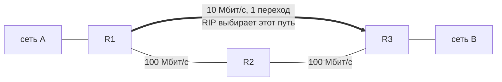

# Протокол RIP

**RIP** (Routing Information Protocol) — первый протокол [[Классификация протоколов маршрутизации|динамической маршрутизации]] курса, [[Классификация протоколов маршрутизации#Distance-vector [16 42](https //www.youtube.com/watch?v=oOFuvP3JxUM&t=1002s)|distance-vector]]. Один из старейших, простейших и самых медленных: сходится долго, использовать его не рекомендуется, но его поддерживает оборудование практически любого вендора, поэтому он до сих пор встречается [15:38](https://www.youtube.com/watch?v=oOFuvP3JxUM&t=938s)

## Версии [17:43](https://www.youtube.com/watch?v=oOFuvP3JxUM&t=1063s)

| Свойство | RIPv1 | RIPv2 | RIPng |
|---|---|---|---|
| Стандарт | [[RFC]] 1058 | RFC 2453 | RFC 2080 |
| Семейство адресов | IPv4 | IPv4 | [[Адресация IPv6\|IPv6]] |
| Маска в обновлении | нет, [[Классовая адресация и CIDR\|классовый]] | есть, бесклассовый | есть, длина префикса |
| Куда шлёт обновления | [[Типы адресации\|broadcast]] 255.255.255.255 | broadcast или, чаще, multicast 224.0.0.9 | multicast FF02::9 |
| Порт [[Протокол UDP\|UDP]] | 520 | 520 | 521 |
| Аутентификация | нет | есть | нет своей, полагается на [[DMVPN и front door VRF\|IPsec]] |

Подход у RIPv2 и RIPng одинаковый: тот же distance-vector, та же метрика и тот же её потолок; разница в семействе адресов и портах [18:46](https://www.youtube.com/watch?v=oOFuvP3JxUM&t=1126s). В IPv6 широковещания нет как класса, его работу делают multicast-рассылки [21:21](https://www.youtube.com/watch?v=oOFuvP3JxUM&t=1281s)

Бесклассовый RIPv2 при этом сохранил [[Классовая адресация и CIDR#Классовые замашки RIPv2 [1 12 11](https //www.youtube.com/watch?v=oOFuvP3JxUM&t=4331s)|классовые замашки]], и главная из них — [[Суммаризация маршрутов|автосуммаризация]] на границе классовых сетей

> [!tip] Классовый RIPv1 всё же переносил подсети [1:23:17](https://www.youtube.com/watch?v=oOFuvP3JxUM&t=4997s)
> Маски в обновлении нет, но маску получатель достраивает сам: смотрит на **свои** интерфейсы из той же классовой сети и применяет их маску к полученным префиксам. Сеть 10.0.0.0/8, порезанная на /24 за R1 и R2, работала [1:24:49](https://www.youtube.com/watch?v=oOFuvP3JxUM&t=5089s). Ломается схема на [[Расчёт подсетей и VLSM#VLSM [1 25 52](https //www.youtube.com/watch?v=oOFuvP3JxUM&t=5152s)|масках переменной длины]] — ради них и нужен RIPv2

## Метрика [21:52](https://www.youtube.com/watch?v=oOFuvP3JxUM&t=1312s)

> [!note] Метрика RIP — **hop count**, число роутеров (L3-переходов) между роутером и сетью назначения
> Нормальные значения — от 1 до 15. **Метрика 16 означает "сеть недостижима"** [23:57](https://www.youtube.com/watch?v=oOFuvP3JxUM&t=1437s)

Цепочка R1 — R2 — R3, сеть A подключена к R3: на R2 метрика до A равна 1, на R1 — 2 [22:22](https://www.youtube.com/watch?v=oOFuvP3JxUM&t=1342s). Считаются переходы через любое L3-устройство — роутер или [[L3-коммутаторы и SVI|L3-коммутатор]] [23:26](https://www.youtube.com/watch?v=oOFuvP3JxUM&t=1406s)

Потолок 15 задаёт **диаметр** сети — самую длинную последовательную цепочку, а не общее число роутеров. Та часть сети, где работает RIP, называется **RIP-доменом** [1:04:37](https://www.youtube.com/watch?v=oOFuvP3JxUM&t=3877s). 15 переходов не так мало, как кажется: [[TTL, маршрутные петли и traceroute|traceroute]] до произвольного узла в интернете часто показывает меньше [24:30](https://www.youtube.com/watch?v=oOFuvP3JxUM&t=1470s)

### Скорость каналов не учитывается [25:35](https://www.youtube.com/watch?v=oOFuvP3JxUM&t=1535s)

RIP не видит ни полосы каналов, ни мощности роутеров — только переходы. R1 и R3 соединены напрямую каналом 10 Мбит/с, а обход через R2 состоит из двух каналов Fast Ethernet по 100 Мбит/с [26:05](https://www.youtube.com/watch?v=oOFuvP3JxUM&t=1565s):

Трафик между A и B пойдёт по медленному прямому линку, потому что там на переход меньше. Протоколы, которые учитывают полосу, — [[Протокол OSPF|OSPF]] и [[Протокол EIGRP|EIGRP]]

## Таймеры [27:37](https://www.youtube.com/watch?v=oOFuvP3JxUM&t=1657s)

Вся работа RIP держится на таймерах; значения ниже — умолчания Cisco

![[Таймеры RIP после последнего апдейта.png]]

### Update [27:37](https://www.youtube.com/watch?v=oOFuvP3JxUM&t=1657s)

> [!note] **Update timer** — 30 секунд: с таким периодом RIP рассылает соседям **всю** свою базу, а не только изменения
> Этим RIP отличается от всех протоколов, что будут дальше. На современных каналах объём не страшен, а на старых линках в единицы килобит в секунду регулярная пачка была ощутимой [28:39](https://www.youtube.com/watch?v=oOFuvP3JxUM&t=1719s)

В одно сообщение помещается 25 префиксов, большая база уходит несколькими датаграммами. Часть из них может потеряться, и тогда в базе одновременно окажутся свежие и устаревающие записи [29:39](https://www.youtube.com/watch?v=oOFuvP3JxUM&t=1779s)

### Invalid [28:39](https://www.youtube.com/watch?v=oOFuvP3JxUM&t=1719s)

> [!note] **Invalid timer** — 180 секунд: если за это время по префиксу не пришло ни одного обновления, префикс помечается недостижимым и получает метрику 16
> Таймер свой у каждого префикса и срабатывает только для тех, по которым обновление не пришло. Из таблицы маршрутизации префикс при этом не удаляется, а остаётся с метрикой 16 и пометкой possibly down [31:16](https://www.youtube.com/watch?v=oOFuvP3JxUM&t=1876s)

> [!failure] Три минуты чёрной дыры [30:12](https://www.youtube.com/watch?v=oOFuvP3JxUM&t=1812s)
> Отказал линк или сосед молча — и все 180 секунд роутер считает сеть достижимой и продолжает слать туда трафик. Сеть не перестраивается, а пакеты пропадают в **black hole**

### Holddown [31:49](https://www.youtube.com/watch?v=oOFuvP3JxUM&t=1909s)

> [!note] **Holddown timer** — 180 секунд "заморозки" маршрута после срабатывания invalid
> Не часть базового RIP, а добавление Cisco[^rfc-timers]. Всё это время маршрут остаётся в таблице, не используется, и роутер с каждым обновлением сообщает соседям, что через него префикс недостижим

Смысл — не поймать [[Борьба с петлями в distance-vector|петлю]] в переходный момент сходимости. Если и после заморозки кто-то из соседей продолжает объявлять маршрут, значит это не эхо старой информации, а реальный путь, и маршрут размораживают [32:53](https://www.youtube.com/watch?v=oOFuvP3JxUM&t=1973s)

[^rfc-timers]: В RFC 2453 holddown действительно нет. Стандарт описывает два таймера на маршрут: timeout 180 секунд, после которого маршрут получает метрику 16, и garbage-collection 120 секунд, по истечении которого маршрут удаляется, — то есть через 300 секунд после последнего обновления. Схема 180/180/240 — реализация Cisco, и лекция разбирает именно её

### Flush [33:24](https://www.youtube.com/watch?v=oOFuvP3JxUM&t=2004s)

> [!note] **Flush timer** — 240 секунд от последнего полученного обновления, после чего префикс удаляется из RIP-базы и из таблицы маршрутизации
> Таймер перезапускается каждым обновлением по префиксу

### Как таймеры накладываются [33:57](https://www.youtube.com/watch?v=oOFuvP3JxUM&t=2037s)

Последнее обновление перезапускает сразу и invalid, и flush. Invalid истекает на 180-й секунде и запускает holddown ещё на 180, так что holddown закончился бы на 360-й — но flush срабатывает уже на 240-й

> [!important] Со стандартными таймерами Cisco holddown никогда не дотикивает до конца [36:00](https://www.youtube.com/watch?v=oOFuvP3JxUM&t=2160s)
> Итог: три минуты маршрут используется как обычный, около минуты он заморожен, затем удаляется. Значения оставлены такими, чтобы администратор мог играть соотношением flush и holddown

## Что анонсируется [36:31](https://www.youtube.com/watch?v=oOFuvP3JxUM&t=2191s)

Роутер рассылает соседям только **лучшие** маршруты — те, что сам поставил в таблицу маршрутизации и сам использует[^rip-connected]. Префикс, полученный по RIP, но проигравший в таблице другому источнику, дальше не анонсируется — пример со статикой разобран в [[Административная дистанция|административной дистанции]] [37:34](https://www.youtube.com/watch?v=oOFuvP3JxUM&t=2254s)

После срабатывания invalid префикс уже нельзя объявлять достижимым: роутер рассылает его **с метрикой 16** — "раньше через меня сеть была достижима, теперь нет, трафик сюда не слать". Рассылка идёт, пока не сработает flush или не истечёт holddown, смотря что раньше [39:58](https://www.youtube.com/watch?v=oOFuvP3JxUM&t=2398s)

[^rip-connected]: В лекции [39:58](https://www.youtube.com/watch?v=oOFuvP3JxUM&t=2398s) это сформулировано как "анонсируете соседям только то, что изучили через RIP сами". Буквально так не бывает: сосед R1 узнаёт о connected-сетях R1 именно потому, что RIP анонсирует и их — сети интерфейсов, включённых в RIP командой `network`, а также маршруты, переданные в RIP через `redistribute`. Точное правило — первое: анонсируется то, что стоит в таблице маршрутизации и относится к RIP-процессу

## Транспорт [41:30](https://www.youtube.com/watch?v=oOFuvP3JxUM&t=2490s)

Обновления RIP едут в датаграммах [[Протокол UDP|UDP]]: RIPv1 и RIPv2 на [[Порты и сокеты|порт]] 520, RIPng на 521 [42:00](https://www.youtube.com/watch?v=oOFuvP3JxUM&t=2520s). Доставку не гарантирует ни [[IP-адрес и маска подсети|IP]], ни UDP, ни сам RIP: подтверждений нет, роутер раз в 30 секунд отправляет датаграмму и ничего не ждёт [42:32](https://www.youtube.com/watch?v=oOFuvP3JxUM&t=2552s)

> [!warning] RIP не знакомится с соседями
> Процедуры обнаружения соседей нет: RIP включён на интерфейсе — обновления уходят туда каждые 30 секунд, даже если по ту сторону никого нет [42:32](https://www.youtube.com/watch?v=oOFuvP3JxUM&t=2552s)

Минута заморозки компенсирует ненадёжность: за неё роутер по умолчанию трижды повторяет соседям, что префикс недостижим, и потеря одного обновления ничего не ломает [43:03](https://www.youtube.com/watch?v=oOFuvP3JxUM&t=2583s). После flush запись удалена, и пришедшее следом обновление от другого соседа принимается как новое [43:33](https://www.youtube.com/watch?v=oOFuvP3JxUM&t=2613s)

## Где RIP уместен сегодня [1:27:55](https://www.youtube.com/watch?v=oOFuvP3JxUM&t=5275s)

Для IPv4 — RIPv2, для IPv6 — RIPng, но лектор настойчиво советует смотреть на [[Протокол OSPF|OSPF]] и [[Протокол EIGRP|EIGRP]]. RIPng наследует всё: ту же логику и метрику, потолок 16, те же таймеры и все те же проблемы [1:28:28](https://www.youtube.com/watch?v=oOFuvP3JxUM&t=5308s)
