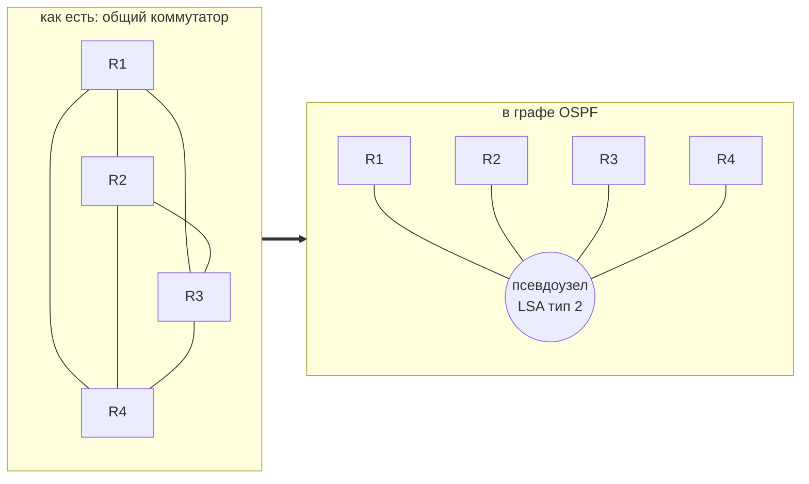
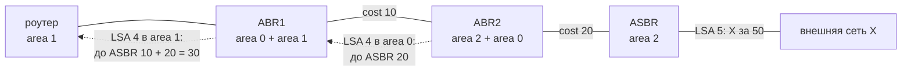

# Типы LSA в OSPF

## LSA и LSDB [22:49](https://www.youtube.com/watch?v=hW8YoPG8NMc&t=1369s)

> [!note] **LSA** (Link State Advertisement) — описание, которое роутер [[Протокол OSPF|OSPF]] генерирует о себе, своих каналах или известных ему маршрутах
> Все LSA зоны вместе образуют **LSDB** (Link State Database). LSA рассылаются лавиной по зоне, поэтому LSDB у всех роутеров зоны одинакова, и каждый строит по ней одну и ту же топологию [23:52](https://www.youtube.com/watch?v=hW8YoPG8NMc&t=1432s)

Каждый LSA помнит своего автора и живёт, пока его обновляют: автор переиздаёт LSA при изменении и не реже чем раз в 30 минут даже без изменений (LSRefreshTime в [[RFC]] 2328)

Типы делятся на две группы: по одним строится топология зоны, другие несут через границу зоны только "префикс + метрика"

## Топологические LSA [29:31](https://www.youtube.com/watch?v=hW8YoPG8NMc&t=1771s)

### Тип 1 [29:31](https://www.youtube.com/watch?v=hW8YoPG8NMc&t=1771s)

> [!note] **Router LSA** — роутер описывает себя: свой [[Протокол OSPF#Соседство и транспорт|Router ID]], интерфейсы, куда они подключены и каких OSPF-соседей через них видно
> Собрав Router LSA со всех роутеров зоны, можно состыковать, какой интерфейс какого роутера с каким соединён, и построить [[Графы#^graph|граф]] [30:31](https://www.youtube.com/watch?v=hW8YoPG8NMc&t=1831s). Не выходит за пределы своей зоны

### Тип 2 [31:01](https://www.youtube.com/watch?v=hW8YoPG8NMc&t=1861s)

В сегменте со множественным доступом несколько OSPF-роутеров висят на одном коммутаторе в одной подсети. Описывать это рёбрами "каждый с каждым" для расчёта [[Графы#^graph|графа]] неудобно [31:32](https://www.youtube.com/watch?v=hW8YoPG8NMc&t=1892s)

> [!note] **Network LSA** — описание **псевдоузла** (pseudonode): виртуального роутера, которым представлен весь сегмент и к которому "подключены" все реальные роутеры сегмента
> Генерирует его [[Протокол OSPF#Соседство и транспорт|DR]] сегмента[^dr-lsa]. Не выходит за пределы своей зоны [32:03](https://www.youtube.com/watch?v=hW8YoPG8NMc&t=1923s)

LSA типов 1 и 2 достаточно, чтобы построить полную топологию зоны и посчитать кратчайшие пути [32:33](https://www.youtube.com/watch?v=hW8YoPG8NMc&t=1953s)

[^dr-lsa]: Лектор связывает тип 2 только с псевдоузлом и DR не упоминает; кто именно создаёт LSA, в лекции не сказано. По RFC 2328 Network LSA создаёт Designated Router сегмента и только когда полностью синхронизирован хотя бы с одним соседом

## Межзоновые LSA [33:06](https://www.youtube.com/watch?v=hW8YoPG8NMc&t=1986s)

### Тип 3 [33:06](https://www.youtube.com/watch?v=hW8YoPG8NMc&t=1986s)

> [!note] **Summary LSA** — [[Протокол OSPF#Типы маршрутизаторов [10 43](https //www.youtube.com/watch?v=hW8YoPG8NMc&t=643s)|ABR]] рассчитал топологию своей зоны и сообщает в соседнюю зону её сети как "префикс + метрика от меня"
> LSA типов 1 и 2 в соседнюю зону ABR не отдаёт — их заменяют LSA типа 3, по одному на inter-area префикс или [[Суммаризация маршрутов|агрегат]] [33:36](https://www.youtube.com/watch?v=hW8YoPG8NMc&t=2016s)

По LSA типа 3 топологию не построить — известно лишь, что от такого-то ABR до такой-то сети такая-то метрика. Именно из-за этого поведения лектор и относит OSPF к [[Классификация протоколов маршрутизации#Гибриды [07 04](https //www.youtube.com/watch?v=hW8YoPG8NMc&t=424s)|гибридам]] [34:06](https://www.youtube.com/watch?v=hW8YoPG8NMc&t=2046s). Маршрут по умолчанию, который ABR объявляет в тупиковую зону, тоже едет LSA типа 3

### Тип 5 [34:37](https://www.youtube.com/watch?v=hW8YoPG8NMc&t=2077s)

> [!note] **[[Классификация протоколов маршрутизации|AS]] External LSA** — [[Протокол OSPF#Типы маршрутизаторов [10 43](https //www.youtube.com/watch?v=hW8YoPG8NMc&t=643s)|ASBR]] вносит в OSPF внешний маршрут, и LSA расходится по всему домену, переходя между зонами
> Внутри: какой ASBR его создал, сам префикс и метрика от ASBR до сети — метрика снаружи домена, а не внутри него [35:12](https://www.youtube.com/watch?v=hW8YoPG8NMc&t=2112s). В тупиковые зоны не попадает

Внешняя метрика бывает двух видов. **E2** (умолчание Cisco) — на всём пути используется только внешняя метрика, будто внутренний путь до ASBR ничего не стоит. **E1** — к внешней метрике прибавляется стоимость пути внутри OSPF до ASBR, и из двух ASBR выигрывает реально ближний

### Тип 4 [36:14](https://www.youtube.com/watch?v=hW8YoPG8NMc&t=2174s)

LSA типа 5 говорит "от ASBR до сети столько-то", но как дойти до самого ASBR? Роутеры его зоны знают топологию и находят его сами. Роутер из другой зоны топологию чужой зоны не строит и где этот ASBR, не знает [37:17](https://www.youtube.com/watch?v=hW8YoPG8NMc&t=2237s)

> [!note] **ASBR Summary LSA** — ABR сообщает: "от меня до такого-то ASBR есть путь с такой-то метрикой; как он идёт — не скажу" [38:19](https://www.youtube.com/watch?v=hW8YoPG8NMc&t=2299s)
> ABR между зоной с ASBR и area 0 генерирует его в area 0, и роутеры backbone понимают, что трафик во внешнюю сеть нужно вести к этому ABR

В следующую зону LSA типа 4 не пересылается как есть: ABR на её границе **перегенерирует** его, сложив полученную метрику со своей, посчитанной по топологии area 0, до первого ABR [39:55](https://www.youtube.com/watch?v=hW8YoPG8NMc&t=2395s). Числа ниже — иллюстрация, в лекции их не было:

### Тип 7

Лектор до него не доходит: тип нужен зоне **[[Протокол OSPF|NSSA]]** из [[Протокол OSPF#NSSA и totally NSSA [22 17](https //www.youtube.com/watch?v=hW8YoPG8NMc&t=1337s)|тупиковых типов зон]]

> [!note] **NSSA External LSA** — внешний маршрут, внесённый ASBR внутри NSSA-зоны (RFC 3101)
> Распространяется только по этой зоне. ABR на выходе в area 0 переводит его в обычный LSA типа 5, дальше по домену маршрут едет уже как тип 5

## Сводка типов

| Тип | Имя | Кто создаёт | Где распространяется | Что несёт |
|---|---|---|---|---|
| 1 | Router LSA | каждый роутер | своя зона | роутер, его интерфейсы и соседи |
| 2 | Network LSA | DR сегмента | своя зона | псевдоузел сегмента и подключённые роутеры |
| 3 | Summary LSA | ABR | соседняя зона | inter-area префикс или default и метрика |
| 4 | ASBR Summary LSA | ABR | соседняя зона | путь и метрика до ASBR |
| 5 | AS External LSA | ASBR | весь домен, кроме тупиковых зон | внешний префикс, ASBR и внешняя метрика |
| 7 | NSSA External LSA | ASBR в NSSA | только эта NSSA | внешний префикс, на ABR переводится в тип 5 |
