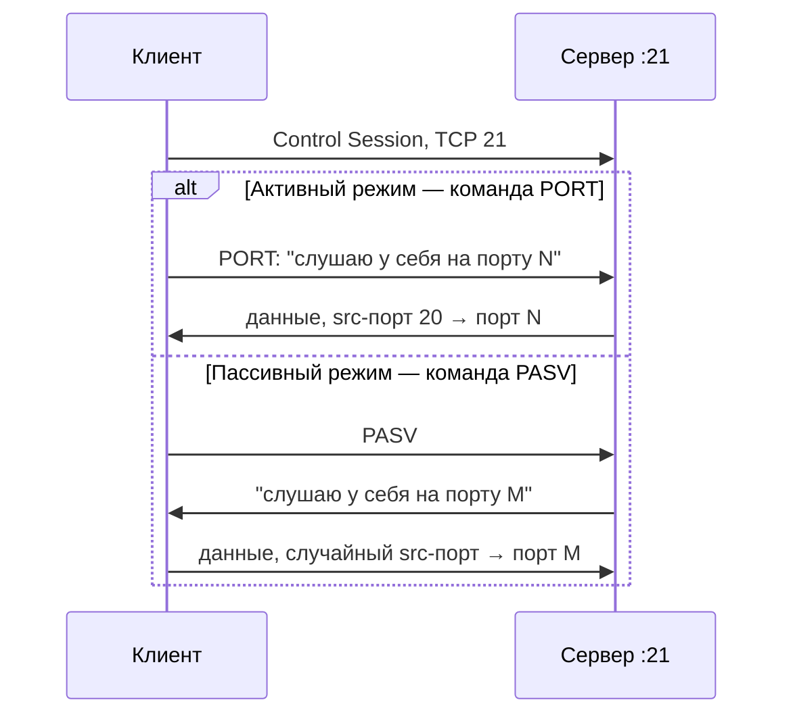

# ALG и UPnP

## Активный FTP спотыкается о PAT [68:45](https://www.youtube.com/watch?v=b4WWXd9Uu0k&t=4125s)

### FTP: несколько соединений на одно приложение [68:45](https://www.youtube.com/watch?v=b4WWXd9Uu0k&t=4125s)

Большинство протоколов работает через одно [[Заголовок TCP и установление соединения|TCP]]- или [[Протокол UDP|UDP]]-соединение, но не все: **FTP** (File Transfer Protocol, протокол передачи файлов) держит **Control Session** (управляющую сессию, TCP-порт 21) отдельно от сессии данных — запрос списка файлов или скачивание открывает **новое** соединение поверх уже установленной управляющей сессии

### Активный и пассивный режим [70:19](https://www.youtube.com/watch?v=b4WWXd9Uu0k&t=4219s)

Control Session в обоих режимах устанавливает клиент. Разница — кто инициирует сессию **данных**:

В **активном** режиме клиент командой `PORT` сообщает серверу, на каком своём порту он ждёт данные, и сессию данных открывает **сервер** — со своего порта 20 в сторону указанного порта клиента

В **пассивном** режиме клиент шлёт `PASV`, сервер в ответ называет случайный порт, на котором сам будет слушать, а сессию данных открывает уже сам **клиент** — обычным исходящим соединением, как и Control Session

### Почему активный FTP ломается за PAT [71:58](https://www.youtube.com/watch?v=b4WWXd9Uu0k&t=4318s)

Пассивный режим [[PAT и проброс портов|PAT]] не задевает — обе сессии клиент открывает исходящими, PAT заводит на каждую свою запись обычным образом. Активный — ломается: клиент в команде `PORT` называет серверу свой **внутренний** адрес и порт, а сервер видит подключение с внешнего адреса роутера и пытается открыть вторую сессию именно туда

На роутере это входящее соединение никто не ждёт — в таблице PAT нет записи под него, и за одним внешним адресом может стоять несколько внутренних узлов, так что роутеру и адресовать входящую сессию было бы некому

## Как открыть порт в обход разбора трафика [75:46](https://www.youtube.com/watch?v=b4WWXd9Uu0k&t=4546s)

### Application Layer Gateway [75:46](https://www.youtube.com/watch?v=b4WWXd9Uu0k&t=4546s)

> [!note] **ALG** (Application Layer Gateway, шлюз уровня приложений) — механизм на роутере, разбирающий трафик седьмого уровня, чтобы заранее подготовить трансляцию под протокол вроде активного FTP
> ALG следит за Control Session, ловит в ней команду `PORT` с номером порта, который клиент только что назвал серверу, и **заранее** создаёт под него динамическую трансляцию — раньше, чем придёт сам входящий пакет данных. Аналогично разбираются и другие протоколы, передающие адреса или порты внутри своей полезной нагрузки

### Ограничения ALG и удар шифрования [77:53](https://www.youtube.com/watch?v=b4WWXd9Uu0k&t=4673s)

- Разбор седьмого уровня — вычислительно затратная операция на каждый пакет управляющей сессии
- Годится не для всех протоколов: часть из них передаёт в теле собственные [[IP-адрес и маска подсети|IP]]-адреса и порты, которые ALG не подменяет, а сервер откажется принимать соединение с адреса, не совпадающего с указанным в теле
- Современный и самый жёсткий предел — шифрование. Переход [[HTTP]] на [[HTTP#HTTPS|HTTPS]] и аналогичное шифрование других протоколов[^encrypted-alg] прячет от роутера содержимое управляющей сессии: команду `PORT` внутри [[HTTP|TLS]]-потока ALG прочитать не может, и весь механизм перестаёт работать именно там, где он нужнее всего

[^encrypted-alg]: Лектор называет FTP и почтовые протоколы ([[Эталонная модель OSI|POP3]], IMAP) как параллельные примеры того же эффекта шифрования — деталь курса не разбирает, ограничиваюсь общей формулировкой

### UPnP, NAT-PMP и PCP как решение для шифрованных протоколов [79:57](https://www.youtube.com/watch?v=b4WWXd9Uu0k&t=4797s)

Если роутер не может подсмотреть нужный порт в трафике, о нём можно просто **попросить**. Три протокола одного семейства решают эту задачу для клиента за [[Статический и динамический NAT|NAT]]:

| Протокол | Расшифровка | На чём стандартизован |
|---|---|---|
| **UPnP** IGD | Universal Plug and Play, профиль Internet Gateway Device (IGD, устройство-шлюз) | форум UPnP, не [[RFC\|IETF]] |
| **NAT-PMP** | NAT Port Mapping Protocol | [[RFC]] 6886 |
| **PCP**[^pcp] | Port Control Protocol | RFC 6887, преемник NAT-PMP на тех же портах UDP 5350/5351 |

Механика во всех трёх одна: клиентское приложение, открывшее у себя порт, само сообщает об этом роутеру, и тот заводит соответствующую трансляцию — без разбора чужого трафика на седьмом уровне, каким бы он ни был зашифрован. Типичный потребитель — торрент-клиенты, которые просят открыть порт на время раздачи и закрывают его по завершении [81:29](https://www.youtube.com/watch?v=b4WWXd9Uu0k&t=4889s)

> [!warning] Работает только на один хоп — свой роутер, не дальше
> Запрос понимает только ближайший роутер, между которым и клиентом он отправлен
>
> Два NAT подряд (домашний роутер плюс NAT провайдера) уже ломают схему: домашний роутер откроет порт у себя, но второй, провайдерский NAT об этой договорённости не узнает никогда — UPnP, NAT-PMP и PCP как просьба именно к своему роутеру и есть тот самый механизм, которым Tailscale пытается пробить NAT для прямого соединения

Поддержка распространена неравномерно: мало приложений её вообще реализуют, и не каждый роутер умеет отвечать на такие запросы — по наблюдению лектора, **SOHO**[^soho]-класс — как правило да, корпоративные маршрутизаторы — как правило нет[^cisco-home-note]

[^soho]: **SOHO** (Small Office/Home Office) — класс сетевого оборудования для дома и малого офиса, в противовес операторскому и корпоративному уровню

[^cisco-home-note]: Лектор буквально говорит "SOHO-коробки да, Cisco домой — нет"; здесь это раскрыто как противопоставление домашнего/малоофисного оборудования корпоративному классу тех же производителей, а не конкретно бренду Cisco

[^pcp]: Омоним: [[VLAN и стандарт 802.1Q#Формат тега 802.1Q [16 44](https //www.youtube.com/watch?v=eC3UwwTFCbg&t=1004s)|PCP в теге 802.1Q]] — три бита приоритета кадра, другое понятие со своим владельцем
