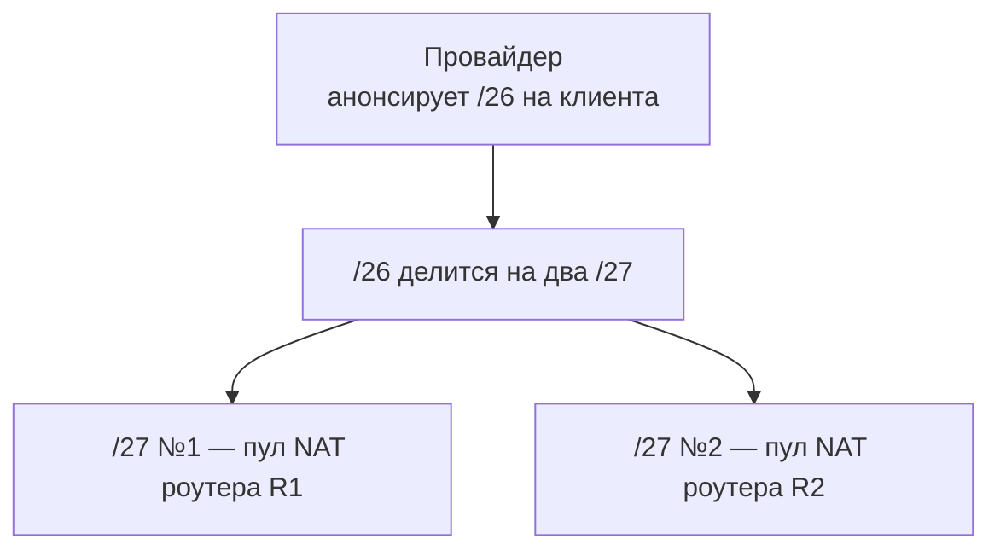

# Маршрутизация NAT-пула

## Симметрия с ARP: пул тоже должен быть виден в сети [50:30](https://www.youtube.com/watch?v=b4WWXd9Uu0k&t=3030s)

При статическом [[Статический и динамический NAT|NAT]] транслирующий роутер обязан [[Статический и динамический NAT#Статический NAT на примере [08 00](https //www.youtube.com/watch?v=b4WWXd9Uu0k&t=480s)|отвечать на ARP-запросы]] о подставленном адресе — иначе тот существует только в таблице трансляций, а L2-инфраструктура о нём не знает

На уровне L3 у пула трансляций та же проблема: если внешний адрес выбирается из целого блока, этот блок должен **маршрутизироваться** в сети провайдера — без этого входящий трафик физически не дойдёт до роутера, которому есть что транслировать

## Анонс провайдерского префикса [52:01](https://www.youtube.com/watch?v=b4WWXd9Uu0k&t=3121s)

"Провайдер выделил блок" — это документальное разрешение использовать адреса, а не автоматическая доставка трафика к ним: маршрут до блока должен появиться в таблицах провайдерской сети отдельно. Два способа:

| Способ | Кто настраивает |
|---|---|
| [[Статические маршруты и маршрут по умолчанию\|Статический маршрут]] на выделенный блок с next hop = внешний адрес клиентского роутера | Провайдер у себя, дальше сам распространяет его по своей сети |
| Сессия [[Классификация протоколов маршрутизации\|IGP]] ([[Протокол RIP\|RIP]], [[Протокол OSPF\|OSPF]], [[Протокол EIGRP\|EIGRP]]) или [[Классификация протоколов маршрутизации\|BGP]] между клиентским роутером и роутером провайдера | Клиент сам анонсирует свой блок |

Чаще эту работу берёт на себя провайдер, но границу ответственности стоит уточнять у оператора явно — по умолчанию она нигде не прописана

## Разбиение /26 на два /27 [55:38](https://www.youtube.com/watch?v=b4WWXd9Uu0k&t=3338s)

Более сложный случай: два клиентских роутера R1 и R2, за каждым своя локальная сеть, а провайдер выдал один блок /26 на обоих. Блок делится пополам на два /27 — по одному NAT-пулу на роутер:

Провайдер должен знать только то, что весь /26 маршрутизируется к клиенту; какой из /27 обслуживает какой роутер — забота исключительно внутренней сети клиента

## Агрегированный маршрут в Null0 [57:44](https://www.youtube.com/watch?v=b4WWXd9Uu0k&t=3464s)

Ни у R1, ни у R2 нет интерфейса с маской ровно /27 — адреса пула не сидят ни на одном физическом линке, а значит нет и connected-записи, которую можно было бы анонсировать дальше

Решение то же самое, что и для любого агрегата без совпадающего интерфейса: [[Статические маршруты и маршрут по умолчанию#Маршрут в Null0 [57 44](https //www.youtube.com/watch?v=b4WWXd9Uu0k&t=3464s)|статический маршрут на свой /27 в Null0]] на каждом роутере, дальше — `redistribute static` в IGP, чтобы агрегат дошёл до соседа и до провайдера

## Свободные адреса пула тоже нужно дропать [65:00](https://www.youtube.com/watch?v=b4WWXd9Uu0k&t=3900s)

В /27 — 32 адреса ($2^5$); адрес сети и broadcast здесь не расходуются впустую, как на интерфейсе подсети — это пул трансляций, а не адресация линка, и оба крайних значения пула так же годны под трансляцию, как и остальные

Пусть из 32 занято 2 — пакет на любой из 30 свободных не находит записи в таблице NAT, не транслируется и идёт по обычной таблице маршрутизации. Там для него нет ничего точнее агрегата на Null0[^null0-drop] — и такой "ошмёток" отбрасывается на границе, а не улетает дальше в сеть

[^null0-drop]: Механика самого Null0 и почему он не создаёт петель, в отличие от направления агрегата в реальный интерфейс, — в [[Статические маршруты и маршрут по умолчанию#Маршрут в Null0 [57 44](https //www.youtube.com/watch?v=b4WWXd9Uu0k&t=3464s)|заметке о статических маршрутах]]
