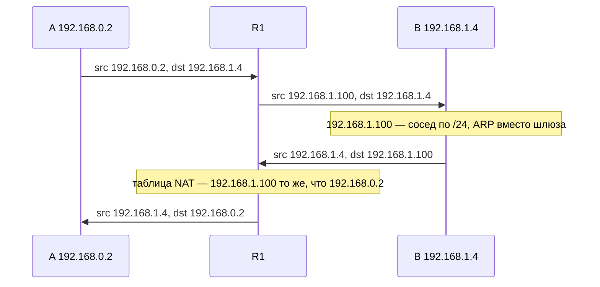

# Статический и динамический NAT

## Что такое NAT [01:46](https://www.youtube.com/watch?v=b4WWXd9Uu0k&t=106s)

> [!note] **NAT** (Network Address Translation, трансляция сетевых адресов) — подмена [[IP-адрес и маска подсети|IP]]-адреса отправителя, получателя или обоих сразу в заголовке пакета, проходящего через устройство
> Реализация гибкая по трём осям: **статический** NAT (жёсткое соответствие адрес-в-адрес) против **динамического** (группа адресов отображается в группу без фиксированной привязки); с пулом адресов или без; трансляция source-адреса или destination-адреса

NAT работает с адресами **третьего** уровня [[Эталонная модель OSI|OSI]] целиком — сам номер порта его не касается; трансляция, которая лезет и в порт, разбирается отдельно в [[PAT и проброс портов|PAT]]

## Статический NAT на примере [08:00](https://www.youtube.com/watch?v=b4WWXd9Uu0k&t=480s)

> [!example] Узел B потерял default gateway, а починить его удалённо нечем
> Роутер R1 стоит между двумя сетями: 192.168.0.0/24 слева (узел A — 192.168.0.2) и 192.168.1.0/24 справа (узел B — 192.168.1.4). Администратор настраивал B удалённо, маску задал верно, но случайно стёр [[Статические маршруты и маршрут по умолчанию#Маршрут по умолчанию [12 27](https //www.youtube.com/watch?v=l9F567JS-5o&t=747s)|шлюз по умолчанию]]. Трафик A → B доходит, обратный — нет: B видит A чужаком не из своей подсети и без шлюза не знает, куда его слать
>
> Прошлая лекция чинила симметричную задачу (неверная маска у B) через [[Proxy ARP и разновидности ARP|Proxy ARP]][^same-family]; здесь маска верна, а решение — статический NAT: на R1 прописывается соответствие 192.168.0.2 → 192.168.1.100 — адрес из **той же** подсети, что и B

[^same-family]: Оба приёма из одного семейства — заставить одну сторону считать другую соседом, не трогая её настройки. Proxy ARP подменяет ответ на уровне L2, статический NAT — адрес на уровне L3

192.168.1.100 лежит в подсети B — тот решает, что отправитель достижим напрямую, шлюз не нужен, и шлёт [[Протокол ARP|ARP-запрос]] про 192.168.1.100. На него обязан ответить сам R1: **устройство, выполняющее трансляцию, отвечает на ARP-запросы о транслируемых им адресах** — иначе адрес существует только в таблице NAT, а L2-инфраструктура о нём не знает

Обратный пакет идёт до R1 обычной коммутацией, декапсулируется, и уже там таблица NAT находит запись для 192.168.1.100 и подменяет **IP Destination** на 192.168.0.2 — только после этого пакет уходит в [[Таблица маршрутизации|таблицу маршрутизации]]. Трансляция симметрична: в одну сторону подменяется отправитель, в обратную — получатель, по одной и той же записи

## Терминология: inside/outside, local/global

Cisco называет четыре роли адреса в паре трансляции; в разобранном примере трансляции подвергается только сторона A:

| Термин | Значение | В примере |
|---|---|---|
| Inside local | Адрес внутреннего узла, как его видят внутри его собственной сети | 192.168.0.2 |
| Inside global | Тот же узел, каким его видит внешняя сторона — то, во что NAT его превращает | 192.168.1.100 |
| Outside local | Внешний узел, как его видят изнутри внутренней сети | 192.168.1.4 |
| Outside global | Тот же внешний узел таким, какой он есть на самом деле | 192.168.1.4 |

Outside local и outside global здесь совпадают, потому что B не транслируется — они разойдутся, если NAT применить и к нему тоже (двусторонняя трансляция, например при пересекающихся частных диапазонах по обе стороны туннеля)

## Динамический NAT и приватные адреса [15:29](https://www.youtube.com/watch?v=b4WWXd9Uu0k&t=929s)

Типовой сценарий — не единичное соответствие, а выпуск целой локальной сети в интернет через граничный роутер: группа адресов слева отображается в группу справа без жёсткой привязки конкретного адреса к конкретному

Три блока для таких сетей зарезервированы [[RFC]] 1918 и глобально не маршрутизируются [16:31](https://www.youtube.com/watch?v=b4WWXd9Uu0k&t=991s):

> [!note] Приватные блоки IPv4 и их размер
> | Блок | Маска | Адресов |
> |---|---|---|
> | 10.0.0.0 | /8 | ~16,8 млн |
> | 172.16.0.0 | /12 | ~1 млн |
> | 192.168.0.0 | /16 | 65 536 |
>
> Пакет с таким адресом отправителя, попав в интернет, дойдёт до цели, но ответ никто не сможет доставить обратно — магистральные роутеры эти сети в таблицах не держат. Отсюда обязательность NAT на выходе: приватный адрес должен смениться на глобально маршрутизируемый прежде, чем пакет покинет локальную сеть

> [!tip] Отдельный резерв для самого NAT — RFC 6598, 100.64.0.0/10
> RFC 1918 рассчитан на частные сети конечных пользователей. Провайдерам для **carrier-grade NAT** (**CGNAT**, Carrier-Grade NAT — NAT на стороне провайдера, за которым сидят уже сами домашние NAT абонентов) нужен диапазон, который точно не пересечётся ни с чьей домашней сетью 192.168.0.0/16 — иначе один слой NAT после другого не различит адреса
>
> Для этого зарезервирован отдельный блок **100.64.0.0/10** — Shared Address Space, который провайдер использует только на линке между CGNAT и оборудованием абонента, и который абонентские сети занимать не должны

Провайдерский пул часто меньше локальной сети — блок /26 на подсеть /24 означает адресов в четыре раза меньше, чем узлов. Расчёт на то, что не все узлы активны одновременно: динамическая трансляция создаётся только под тех, кто прямо сейчас шлёт трафик, а не резервируется заранее под каждого

## Жизненный цикл динамической трансляции [19:05](https://www.youtube.com/watch?v=b4WWXd9Uu0k&t=1145s)

Исходящий пакет — подменяется IP Source; входящий — по IP Destination находится запись, подменяется IP Destination. Запись живёт, пока идёт трафик, и снимается по таймауту после того, как узел замолкает — адрес возвращается в пул свободных и может достаться другому абоненту: закрепления за конкретным узлом здесь нет, в отличие от статического NAT

> [!info] Таймаут динамической трансляции на Cisco IOS — 24 часа по умолчанию[^cisco-timeout]
> `ip nat translation timeout` управляет временем жизни динамических записей, которые не идут через отдельный [[PAT и проброс портов#Таймауты записей|протокол-специфичный TCP- или UDP-счётчик]]. Значение по умолчанию — 86400 секунд

[^cisco-timeout]: Значение сверено с командной документацией Cisco IOS (`ip nat translation {timeout | udp-timeout | dns-timeout | tcp-timeout | finrst-timeout}`), не с живым устройством

На практике живая NAT-таблица линуксового роутера устроена аналогично, только на другом наборе счётчиков: потолок conntrack и таймаут established-записи там на порядки больше 24 часов курсового значения
