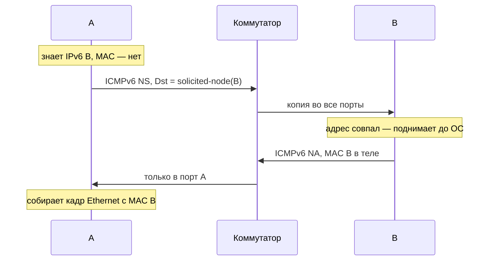

# NDP и ICMPv6

## ICMPv6 занимает место ARP [46:06](https://www.youtube.com/watch?v=uouz0egxAT8&t=2766s)

В IPv6 [[Протокол ARP|ARP]] отсутствует как класс: преобразование сетевого адреса в канальный делает **ICMPv6** — то же семейство сообщений, что несёт [[Протокол ICMP|ICMP]]-ошибки вроде Time Exceeded, только для IPv6 и с добавленными функциями поиска соседей и маршрутизаторов

Ключевое отличие от ARP не в протоколе, а в адресе назначения запроса. ARP-запрос [[Протокол ARP#Запрос и ответ [03 02](https //www.youtube.com/watch?v=HxGsA6Ps-T8&t=182s)|широковещателен]] — доходит до всех, и решение "мой это запрос или нет" принимает операционная система, то есть запрос **обязан подняться до процессора**

Broadcast-адресов в IPv6 нет, а ICMPv6-запрос уходит не на общий multicast-адрес, а на узко нацеленную **solicited-node** группу — сетевая карта отбрасывает чужой запрос **до** подъёма по стеку, не тратя на него процессор [48:43](https://www.youtube.com/watch?v=uouz0egxAT8&t=2923s). Выигрыш есть даже на самом простом оборудовании — хабе, где среда и так доставляет кадр всем [50:45](https://www.youtube.com/watch?v=uouz0egxAT8&t=3045s)

> [!warning] Блокировать ICMP по привычке из IPv4 в IPv6 нельзя
> Администраторы IPv4 привыкли глухо резать ICMP файрволами и access-листами. В IPv6 NDP целиком держится на ICMPv6: заблокировал протокол — сломал разрешение адресов и поиск маршрутизаторов, то есть саму связность сегмента [89:17](https://www.youtube.com/watch?v=uouz0egxAT8&t=5357s)

## Solicited-node multicast [47:08](https://www.youtube.com/watch?v=uouz0egxAT8&t=2828s)

**Solicited-node** адрес формируется из [[Адресация IPv6|unicast- или anycast-адреса]] узла, чей [[MAC-адресация|MAC]] ищут: младшие 24 бита адреса дописываются к фиксированному префиксу

$$\text{FF02::1:FF}\underbrace{XX:XXXX}_{\text{младшие 24 бита адреса}}$$

Так Destination запроса зависит от искомого адреса, а не общий для всех, как ARP-broadcast [48:13](https://www.youtube.com/watch?v=uouz0egxAT8&t=2893s). Multicast-адреса такого рода лектор делит на **assigned** (назначенные заранее, вроде all-nodes и all-routers ниже) и **solicited-node** (вычисляемые на лету из unicast-адреса) [47:08](https://www.youtube.com/watch?v=uouz0egxAT8&t=2828s)

> [!info] Совпадение solicited-node групп у разных узлов — не проблема [54:59](https://www.youtube.com/watch?v=uouz0egxAT8&t=3299s)
> Из-за общих младших 24 бит несколько узлов сегмента иногда попадают в одну solicited-node группу и лишний раз поднимают до процессора чужой запрос — но подавляющее большинство узлов сегмента этот трафик всё равно не тронет вовсе. Multicast-адреса существуют и на канальном уровне (MAC), и коммутатор способен разбирать канальные multicast-адреса отдельно от прочего трафика[^multicast-depth]

[^multicast-depth]: Лектор прямо оговаривает, что в multicast намеренно не углублялся — презентация готовилась для пятого курса, а тема на третьем курсе обходится стороной и в IPv4, и в IPv6 [92:55](https://www.youtube.com/watch?v=uouz0egxAT8&t=5575s)

## Пример: A ищет MAC узла B [52:19](https://www.youtube.com/watch?v=uouz0egxAT8&t=3139s)

Source ICMPv6-сообщения — IPv6-адрес A, Destination — solicited-node группа, вычисленная из адреса B [53:56](https://www.youtube.com/watch?v=uouz0egxAT8&t=3236s). Ровно тот же обмен под другими именами устроен в [[Протокол ARP#Запрос и ответ [03 02](https //www.youtube.com/watch?v=HxGsA6Ps-T8&t=182s)|ARP request/reply]] — разница только в адресации запроса

## Четыре сообщения NDP [88:47](https://www.youtube.com/watch?v=uouz0egxAT8&t=5327s)

**NDP** (Neighbor Discovery Protocol, протокол обнаружения соседей) решает две задачи четырьмя сообщениями ICMPv6, определёнными [[RFC]] 4861:

| Сообщение | Тип ICMPv6 | Роль | Аналог в IPv4 |
|---|---|---|---|
| **Neighbor Solicitation** (**NS**) | 135 | "чей это IPv6-адрес" | [[Протокол ARP\|ARP request]] |
| **Neighbor Advertisement** (**NA**) | 136 | ответ с MAC-адресом | [[Протокол ARP\|ARP reply]] |
| **Router Solicitation** (**RS**) | 133 | "есть ли тут маршрутизаторы" | — |
| **Router Advertisement** (**RA**) | 134 | адрес роутера, префикс сети, флаги | ближе к рассылке [[Протокол DHCP#DORA [54 11](https //www.youtube.com/watch?v=1XavYjeAaog&t=3251s)\|DHCPOFFER]], хотя механизм другой |
| Redirect | 137 | лучший next hop в этом же сегменте | [[Протокол ICMP#Типы сообщений [1 20 48](https //www.youtube.com/watch?v=HxGsA6Ps-T8&t=4848s)\|Redirect]] в ICMP |

NS/NA закрывают ту же задачу, что ARP — разрешение адреса соседа, только адресуясь через solicited-node multicast вместо broadcast. RS/RA новой задачи для IPv4 не было вообще: узел явно спрашивает "кто здесь маршрутизатор", если не хочет ждать периодического анонса [73:46](https://www.youtube.com/watch?v=uouz0egxAT8&t=4426s) — что делает роутер в ответ и что именно он сообщает, разбирает [[Автоконфигурация адресов IPv6]]

**RS** отправляется на групповой адрес **all-routers**, **RA** — на **all-nodes** [92:21](https://www.youtube.com/watch?v=uouz0egxAT8&t=5541s):

| Групповой адрес | Кто слушает |
|---|---|
| `FF02::1` | все узлы сегмента (all-nodes) — компьютеры и роутеры |
| `FF02::2` | все маршрутизаторы сегмента (all-routers) |
| `FF02::9` и далее | узлы конкретного протокола динамической маршрутизации |

RA чаще всего уходит именно multicast-адресом all-nodes, хотя RFC 4861 §6.2.6 не запрещает роутеру ответить unicast прямо спросившему — просто на практике так почти не делают

Кроме NDP, ICMPv6 несёт и обычные сообщения об ошибках. Пример — **Packet Too Big**: маршрутизатор шлёт его вместо [[MTU и фрагментация#Path MTU Discovery [1 11 29](https //www.youtube.com/watch?v=6iEZOuH75cw&t=4289s)|молчаливого отброса]] пакета, превысившего [[MTU и фрагментация|MTU]] линка — ровно там, где [[MTU и фрагментация#Фрагментация в IPv6|заголовок IPv6 отказался от фрагментации по пути]]

В ICMP для IPv4 то же место в [[Протокол ICMP#Fragmentation Needed и PMTUD [1 21 50](https //www.youtube.com/watch?v=HxGsA6Ps-T8&t=4910s)|PMTUD]] занимает Fragmentation Needed and [[MTU и фрагментация|DF]] Set — тот же механизм под другим именем в другой версии протокола
