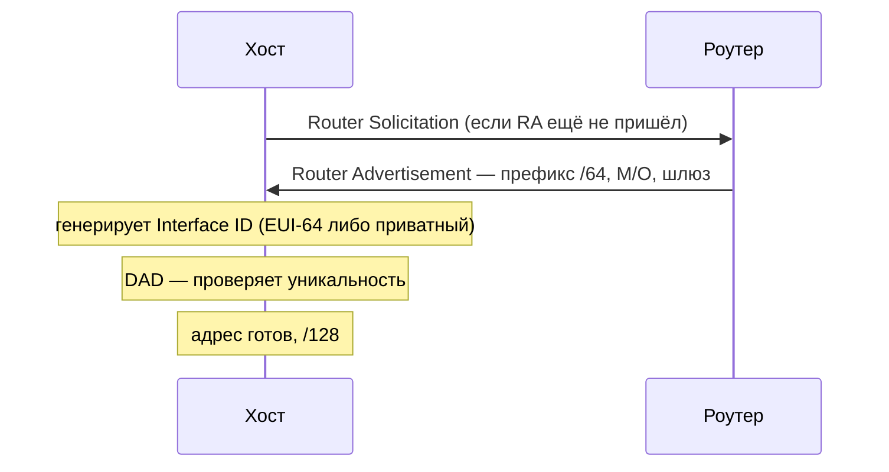
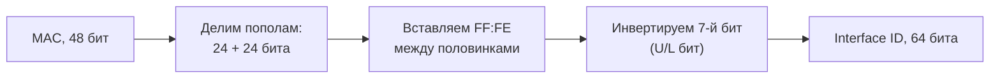
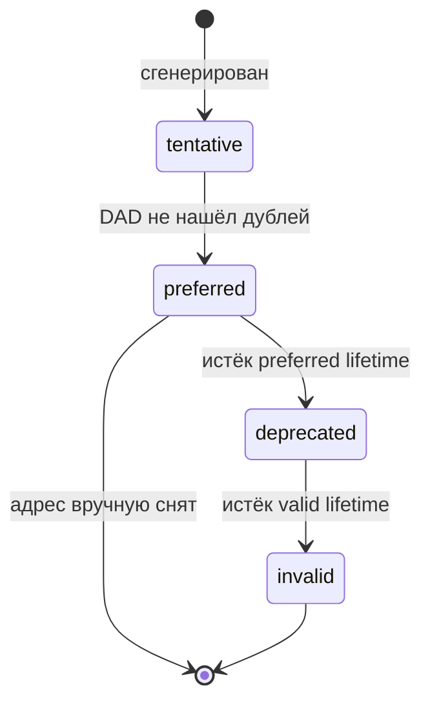

# Автоконфигурация адресов IPv6

## Три способа назначить адрес [71:39](https://www.youtube.com/watch?v=uouz0egxAT8&t=4299s)

Кроме ручной настройки, у IPv6 два механизма: **stateful DHCPv6** (аналог привычного [[Протокол DHCP|DHCP]]) и **SLAAC** (Stateless Address Autoconfiguration, автоконфигурация без хранения состояния) — узел собирает себе маршрутизируемый [[Адресация IPv6|адрес]] вообще без сервера

## SLAAC [72:42](https://www.youtube.com/watch?v=uouz0egxAT8&t=4362s)

### Половина адреса от роутера

Роутер сегмента периодически рассылает [[NDP и ICMPv6#Четыре сообщения NDP [88 47](https //www.youtube.com/watch?v=uouz0egxAT8&t=5327s)|Router Advertisement]] — из него узел узнаёт префикс сети (первые 64 бита будущего адреса) и адрес шлюза. Если объявления ещё не было, узел сам шлёт [[NDP и ICMPv6#Четыре сообщения NDP [88 47](https //www.youtube.com/watch?v=uouz0egxAT8&t=5327s)|Router Solicitation]], и роутер отвечает [[NDP и ICMPv6|RA]] немедленно, не дожидаясь таймера [73:46](https://www.youtube.com/watch?v=uouz0egxAT8&t=4426s)

Оставшиеся 64 бита — **Interface ID** — узел обязан получить сам [74:16](https://www.youtube.com/watch?v=uouz0egxAT8&t=4456s). В RA заодно едут два флага[^m-o-flags]: **M** (Managed Address Configuration) — "адрес бери через DHCPv6", **O** (Other Configuration) — "прочие параметры бери через DHCPv6"

[^m-o-flags]: Лектор упоминает флаг обобщённо — "надо ли использовать DHCP" [91:19](https://www.youtube.com/watch?v=uouz0egxAT8&t=5479s), не называя M и O по отдельности; имена и точный смысл флагов — [[RFC]] 4861 §4.2

### EUI-64: собрать Interface ID из MAC-адреса [75:16](https://www.youtube.com/watch?v=uouz0egxAT8&t=4516s)

**EUI-64** (Extended Unique Identifier, 64 бита) строит Interface ID на основе [[MAC-адресация|MAC-адреса]] интерфейса:

Инвертируемый 7-й бит — это **U/L бит** (Universal/Local): он различает MAC, назначенный производителем, и MAC, заданный вручную. Если карточку никто не перенастраивал, это сводится к простому "переверни 7-й бит и не думай" [76:55](https://www.youtube.com/watch?v=uouz0egxAT8&t=4615s). Префикс из RA плюс собранный EUI-64 дают готовый 128-битный адрес — это и есть SLAAC целиком: ни сервера, ни ручной настройки [77:25](https://www.youtube.com/watch?v=uouz0egxAT8&t=4645s)

### Приватность: почему не всегда EUI-64 [78:28](https://www.youtube.com/watch?v=uouz0egxAT8&t=4708s)

MAC глобально уникален, а значит и EUI-64 не меняется при переезде: подключился ноутбуком в одном городе, потом в другом — префикс другой, а последние 64 бита те же самые, и устройство можно **трекать по IPv6-адресу** через смену сетей

Современные [[Операционная система|ОС]] решают это иначе, не через EUI-64: **Privacy Extensions** генерируют вместо него **временный** или **псевдослучайный стабильный** Interface ID, разный для разных сетей. Строго это два разных механизма:

- **RFC 4941** — временные адреса: интерфейс держит основной адрес и вдобавок периодически меняющийся случайный, используемый как Source для исходящих соединений
- **RFC 7217** — стабильные приватные адреса: Interface ID — детерминированная хеш-функция от префикса сети и секрета узла, поэтому в одной сети адрес не меняется, а в другой отличается целиком

Трекать по cookies браузера при этом всё равно можно [79:29](https://www.youtube.com/watch?v=uouz0egxAT8&t=4769s)

## Зачем при SLAAC всё же нужен DHCPv6 [81:02](https://www.youtube.com/watch?v=uouz0egxAT8&t=4862s)

Ценность SLAAC — в том, что **никакой сервер не хранит состояние**, кому и когда какой адрес выдан. Но SLAAC даёт только адрес, стандартную маску `/64` и шлюз

Остальные параметры — [[Протокол DNS|DNS]]-сервер, адрес сервера регистрации для [[IP-адрес и маска подсети|IP]]-телефона, откуда грузиться бездисковой станции — отдаёт **stateless DHCPv6**: он возвращает одинаковые параметры всем и, в отличие от привычного [[Протокол DHCP|DHCP]] для IPv4, **не запоминает**, кому что отдал [83:08](https://www.youtube.com/watch?v=uouz0egxAT8&t=4988s)

> [!tip] RDNSS избавляет от DHCPv6 в типовом случае
> **RDNSS** (Recursive DNS Server, опция RA из RFC 8106) позволяет передать адрес DNS-сервера прямо в Router Advertisement. Обычному пользовательскому устройству тогда хватает одного SLAAC — DHCPv6 остаётся для особых случаев вроде IP-телефона или бездисковой загрузки

## Время жизни адреса [84:09](https://www.youtube.com/watch?v=uouz0egxAT8&t=5049s)

Вручную назначенный адрес живёт бессрочно. Сгенерированный автоматически проходит стадии[^dad-not-covered]:

- **tentative** — адрес ещё проверяется на уникальность и не используется для трафика
- **preferred** — обычный рабочий адрес: годится и как Source для новых соединений, и как адрес назначения
- **deprecated** — устарел, узел уже сгенерировал новый preferred-адрес; старые установленные соединения по нему продолжают работать, новые уже идут с нового адреса
- **invalid** — адрес не годится ни для новых, ни для существующих соединений; их придётся переустанавливать с нового

[^dad-not-covered]: Лектор называет стадии preferred/deprecated/invalid, но не упоминает предшествующую проверку уникальности по имени; **DAD** (Duplicate Address Detection, обнаружение дублирующихся адресов, RFC 4862 §5.4) — механизм [[NDP и ICMPv6|NDP]], которым узел перед вводом адреса в работу шлёт [[NDP и ICMPv6#Четыре сообщения NDP [88 47](https //www.youtube.com/watch?v=uouz0egxAT8&t=5327s)|Neighbor Solicitation]] с целью — самим же новым адресом; если приходит хоть один ответный Neighbor Advertisement, адрес занят, и узел его не берёт

> [!note] На интерфейсе нормально иметь несколько адресов одной подсети одновременно [85:41](https://www.youtube.com/watch?v=uouz0egxAT8&t=5141s)
> Для IPv4 это немыслимо — там либо один адрес интерфейса, либо явный алиас. В IPv6 preferred и deprecated адреса одной подсети сосуществуют на время перехода, и так происходит постепенная **ротация адресов** без разрыва существующих соединений

Интервалы измеряются часами, чаще днями — соединение обычно и так успевает разорваться и переустановиться по причинам более высокого уровня раньше, чем адрес дойдёт до invalid [88:15](https://www.youtube.com/watch?v=uouz0egxAT8&t=5295s)
