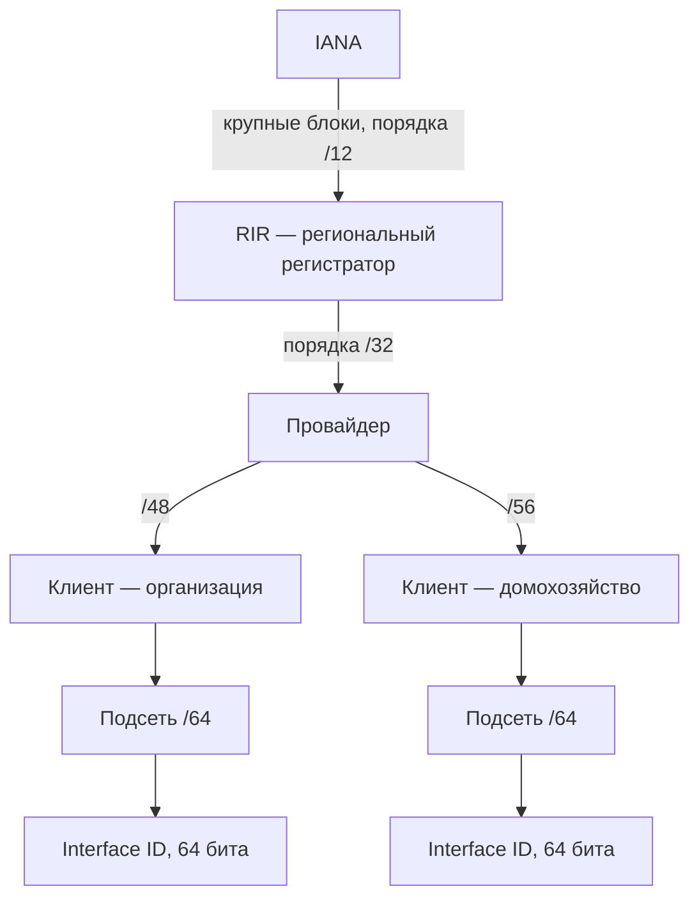

# Адресация IPv6

## Причины перехода на IPv6 [01:10](https://www.youtube.com/watch?v=uouz0egxAT8&t=70s)

Адресное пространство [[IP-адрес и маска подсети|IPv4]] исчерпано: у **RIR** (Regional Internet Registry, региональный интернет-регистратор) уже нельзя получить валидный блок, остатки размазаны по провайдерам и локальным регистраторам. **IPv6** отвечает длиной адреса в **128 бит** — вчетверо длиннее 32-битного IPv4

Остальные меры против истощения — [[Классовая адресация и CIDR|CIDR]], [[Статический и динамический NAT|NAT]] и [[PAT и проброс портов|PAT]], [[Протокол DHCP|DHCP]] — лектор делит на **краткосрочные** (снижают скорость расхода адресов) и **долгосрочные**: только IPv6 меняет саму адресацию, остальное — паллиативы поверх [03:16](https://www.youtube.com/watch?v=uouz0egxAT8&t=196s)

> [!tip] Вторая причина — упрощённый заголовок ускоряет маршрутизацию [07:00](https://www.youtube.com/watch?v=uouz0egxAT8&t=420s)
> Идея географической агрегации адресных блоков (континент, страна) не прижилась. Прижилось другое — [[Заголовок IPv6|заголовок без опций и контрольной суммы]]

Миграция небыстрая: обновить нужно программное обеспечение всех узлов сети, а магистральные маршрутизаторы пересылают трафик не центральным процессором, а [[VLAN и стандарт 802.1Q#Шасси как набор логических коммутаторов [07 50](https //www.youtube.com/watch?v=eC3UwwTFCbg&t=470s)|линейными картами]] на специализированных [[L3-коммутаторы и SVI|микросхемах ASIC]] — старые не умеют IPv6, и апгрейда прошивки недостаточно, нужно менять железо [05:53](https://www.youtube.com/watch?v=uouz0egxAT8&t=353s)

## Запись адреса [08:34](https://www.youtube.com/watch?v=uouz0egxAT8&t=514s)

Адрес пишется в шестнадцатеричной форме (IPv4 — в десятичной): 128 бит делятся на **8 групп по 2 байта** (4 hex-цифры), группы разделены двоеточием

```
2001:0db8:0000:0042:0000:8a2e:0370:7334
```

Незапоминаемость такого адреса и сдвинула IPv6-мир к более активному использованию [[Протокол DNS|DNS]] — держать адреса в голове перестали пытаться [09:39](https://www.youtube.com/watch?v=uouz0egxAT8&t=579s)

## Сокращение записи [10:13](https://www.youtube.com/watch?v=uouz0egxAT8&t=613s)

Два правила, применяются вместе:

1. **Лидирующие нули группы** убираются — `0042` → `42`, `0000` → `0`. Нельзя убирать нули в конце или середине группы, только начальные [12:18](https://www.youtube.com/watch?v=uouz0egxAT8&t=738s)
2. **Подряд идущие нулевые группы** заменяются на `::`, и только **один раз** за весь адрес — иначе длину каждой свёрнутой последовательности не восстановить однозначно. [[RFC]] 5952 к тому же запрещает сворачивать **одну-единственную** нулевую группу: технически адрес разворачивается и так, но канонической записью это не считается [13:55](https://www.youtube.com/watch?v=uouz0egxAT8&t=835s)

```
2001:0db8:0000:0042:0000:8a2e:0370:7334
→ 2001:db8:0:42:0:8a2e:370:7334      (шаг 1 — лидирующие нули)
→ 2001:db8::42:0:8a2e:370:7334       (шаг 2 — три нулевые группы после db8)
```

> [!warning] Типичные ошибки сокращения [14:26](https://www.youtube.com/watch?v=uouz0egxAT8&t=866s)
> - Два `::` в одном адресе — развернуть однозначно нельзя
> - В группе вида `7a00` убран последний (не лидирующий) ноль — так нельзя, это не начало группы

`::` ставится не только в середине, но и в начале или конце адреса, если там подряд идут нулевые группы — адрес [[Адресация IPv6#Почему стандартная маска /64 [28 25](https //www.youtube.com/watch?v=uouz0egxAT8&t=1705s)|подсети со стандартной маской /64]] заканчивается 64 нулевыми битами, и его можно сократить как `2001:db8:42:1::` [17:59](https://www.youtube.com/watch?v=uouz0egxAT8&t=1079s)

> [!info] Если сворачиваемых последовательностей одинаковой длины несколько — сворачивают первую [16:29](https://www.youtube.com/watch?v=uouz0egxAT8&t=989s)
> И `2001:db8::1:0:0:1`, и `2001:db8:0:0:1::1` разворачиваются однозначно — счёт групп с обеих сторон `::` сам восстанавливает пропуск. RFC 5952 всё же требует сворачивать именно первую последовательность и писать hex-цифры строчными — не потому что другой выбор двусмыслен, а ради единообразной **канонической формы**: предсказуемого вида адреса для сравнения строк и поиска логов[^tie-break]

[^tie-break]: Лектор описывает выбор первой последовательности как необязательную практику ("технически можно любую"); RFC 5952 §4.2.3 формулирует это как **MUST** для канонической текстовой записи — расхождение в силе правила, а не в его содержании

## Специальные адреса [15:29](https://www.youtube.com/watch?v=uouz0egxAT8&t=929s)

**`::`** (128 нулевых бит) называется **unspecified address**[^unspecified-vs-default] — адрес-заглушка, означающий отсутствие адреса, а не конкретный узел или маршрут

[^unspecified-vs-default]: Лектор называет `::` "маршрутом по умолчанию" и "префиксом, который описывает любые адреса" [15:29](https://www.youtube.com/watch?v=uouz0egxAT8&t=929s) — это смешивает два разных объекта. `::` (он же `::/128`) — **unspecified address** из RFC 4291 §2.5.2, аналог `0.0.0.0` в IPv4: заглушка в поле Source, пока узел не знает свой адрес, и она никогда не бывает адресом назначения. [[Статические маршруты и маршрут по умолчанию#Маршрут по умолчанию [12 27](https //www.youtube.com/watch?v=l9F567JS-5o&t=747s)|Маршрут по умолчанию]] — это отдельная запись таблицы маршрутизации с маской нулевой длины, `::/0`, действительно подходящая под любой адрес назначения — но записывается она с явным `/0`, а не голым `::`

**`::1`** — [[Loopback и локальное взаимодействие|loopback]], аналог IPv4-адреса `127.0.0.1`

## Типы адресов [18:29](https://www.youtube.com/watch?v=uouz0egxAT8&t=1109s)

> [!tip] Широковещания в IPv6 нет как класса
> [[Типы адресации|Broadcast]] упразднён целиком, его работу берёт на себя [[NDP и ICMPv6|multicast]]: то, что раньше рассылалось всем в сегменте, теперь адресуется конкретной группе

| Тип | Префикс | RFC |
|---|---|---|
| **Global Unicast** | `2000::/3` | глобально маршрутизируемые адреса, аналог публичных IPv4 |
| **Unique Local** (**ULA**, Unique Local Address) | `FC00::/7` | RFC 4193 |
| **Link-Local** | `FE80::/10` | RFC 4291 |
| **Multicast** | `FF00::/8` | RFC 4291, разбор — [[NDP и ICMPv6]] |
| **Loopback** | `::1/128` | RFC 4291 |
| **Unspecified** | `::/128` | RFC 4291 |
| **Документационный префикс** | `2001:db8::/32` | RFC 3849 |

**Global Unicast** [19:29](https://www.youtube.com/watch?v=uouz0egxAT8&t=1169s) — "белые", валидные в интернете адреса

**Unique Local** [20:00](https://www.youtube.com/watch?v=uouz0egxAT8&t=1200s) — для сетей без выхода в интернет, аналог [[Статический и динамический NAT#Динамический NAT и приватные адреса [15 29](https //www.youtube.com/watch?v=b4WWXd9Uu0k&t=929s)|частных диапазонов]] IPv4 (RFC 1918). Восьмой бит префикса — флаг **L**: `L=1` даёт диапазон `FD00::/8`, который и используют в реальных локальных сетях; `L=0` (`FC00::/8`) зарезервирован RFC 4193 на будущее и в текущей практике не встречается

**Anycast** отдельного префикса не получает: адрес анонсируется из нескольких точек сети и на уровне записи неотличим от обычного [[Типы адресации|unicast]] — вся механика в маршрутизации, а не в адресе

### Link-Local и zone index [21:36](https://www.youtube.com/watch?v=uouz0egxAT8&t=1296s)

`FE80::/10` — тип, которого в IPv4 не было вообще. Устройство назначает такой адрес себе **само**, без сервера и ручной настройки, и такие адреса **вообще не маршрутизируются** — не "не выходят за пределы своей сети", а не проходят через маршрутизатор в принципе. Нужны для служебного трафика протоколов динамической маршрутизации и для общения внутри сегмента, когда глобального адреса ещё нет

> [!important] Один и тот же Link-Local адрес может висеть на нескольких интерфейсах одновременно [23:41](https://www.youtube.com/watch?v=uouz0egxAT8&t=1421s)
> Для глобальных адресов это запрещено — они обязаны быть уникальны на узле. Следствие: отправляя пакет на Link-Local адрес, недостаточно назвать сам адрес — нужно ещё явно назвать интерфейс, через который его слать (**zone index**) — иначе непонятно, к какому из одинаковых адресов на разных интерфейсах он относится

## Иерархия распределения адресов [25:16](https://www.youtube.com/watch?v=uouz0egxAT8&t=1516s)



Провайдер запрашивает у RIR блок порядка `/32` — не жёсткое правило [25:48](https://www.youtube.com/watch?v=uouz0egxAT8&t=1548s), — а домашнему пользователю отдаёт не один адрес, а блок `/56`, компании покрупнее — `/48` [27:21](https://www.youtube.com/watch?v=uouz0egxAT8&t=1641s). Клиент нарезает полученный диапазон на подсети по `/64` [27:52](https://www.youtube.com/watch?v=uouz0egxAT8&t=1672s)

Блоки принято отдавать с масками, **кратными четырём**: граница проходит по границе hex-цифры, и её не нужно пересчитывать в двоичную [26:18](https://www.youtube.com/watch?v=uouz0egxAT8&t=1578s). Биты между границей провайдера и `/64` обычно кодируют географию площадки, назначение сети или номер [[VLAN и стандарт 802.1Q|VLAN]]

### Почему стандартная маска /64 [28:25](https://www.youtube.com/watch?v=uouz0egxAT8&t=1705s)

Другая маска технически маршрутизируется, но ломает вспомогательные функции — прежде всего [[Автоконфигурация адресов IPv6|SLAAC]]: она делит 128-битный адрес ровно пополам, 64 бита на **префикс сети** и 64 бита на **Interface ID**, и опирается на это деление

## Зарезервированные диапазоны и сосуществование с IPv4 [36:12](https://www.youtube.com/watch?v=uouz0egxAT8&t=2172s)

`2001:db8::/32` зарезервирован под документацию (RFC 3849) — как приватные диапазоны IPv4, только для примеров, а не для частных сетей

IPv4 и IPv6 не понимают трафик друг друга по умолчанию: узел без поддержки протокола просто отбрасывает чужой фрейм [37:13](https://www.youtube.com/watch?v=uouz0egxAT8&t=2233s). Пока оба сосуществуют, для перевода трафика между ними ставят транслирующие системы, и **IPv4-mapped IPv6 address** — способ адресовать IPv4-узел в IPv6-пространстве: младшие 32 бита несут сам IPv4-адрес, а адрес целиком выглядит как `::ffff:a.b.c.d` (формально `::ffff:0:0/96`, RFC 4291 §2.5.5.2) [39:14](https://www.youtube.com/watch?v=uouz0egxAT8&t=2354s)
