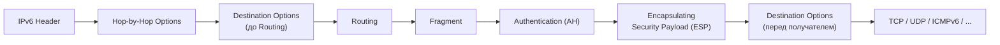

# Заголовок IPv6

## Раскладка заголовка [58:36](https://www.youtube.com/watch?v=uouz0egxAT8&t=3516s)

Заголовок IPv6 больше [[Заголовок IPv4|заголовка IPv4]] по размеру — только за счёт длины адресов, — но **структурно проще**: опции, вторую длину и контрольную сумму из него убрали совсем

![[Раскладка заголовка IPv6.png]]

- **Version** — 4 бита, значение `6`
- **Traffic Class** — 8 бит, аналог байта [[Заголовок IPv4#Байт качества обслуживания [1 10 20](https //www.youtube.com/watch?v=5iMhAOFx38c&t=4220s)|ToS]] из IPv4: те же поля [[Заголовок IPv4|DSCP]] и [[Заголовок IPv4|ECN]], только собранные в одном заголовке нового протокола
- **Flow Label** — новое 20-битное поле, метка потока: разбор — [[Заголовок IPv6#Flow Label и поток [66 26](https //www.youtube.com/watch?v=uouz0egxAT8&t=3986s)|ниже]]
- **Payload Length** — 16 бит, длина данных **после** заголовка (расширенные заголовки считаются частью payload, а не заголовка)
- **Next Header** — 8 бит, тот же набор значений, что и поле [[Заголовок IPv4#Поле Protocol [1 15 35](https //www.youtube.com/watch?v=5iMhAOFx38c&t=4535s)|Protocol]] в IPv4, но с дополнительной ролью — сцепление [[Заголовок IPv6#Цепочка расширенных заголовков [63 11](https //www.youtube.com/watch?v=uouz0egxAT8&t=3791s)|расширенных заголовков]] [65:14](https://www.youtube.com/watch?v=uouz0egxAT8&t=3914s)
- **Hop Limit** — 8 бит, аналог [[Заголовок IPv4#Время жизни пакета [1 14 02](https //www.youtube.com/watch?v=5iMhAOFx38c&t=4442s)|TTL]], только без унаследованной от IPv4 путаницы с секундами — сразу задуман как счётчик хопов

## Чем заголовок IPv6 лучше [60:07](https://www.youtube.com/watch?v=uouz0egxAT8&t=3607s)

**Фиксированная длина.** В IPv4 длина заголовка плавала из-за [[Заголовок IPv4#Адреса и опции [1 16 05](https //www.youtube.com/watch?v=5iMhAOFx38c&t=4565s)|опций]], и роутер не мог заранее выделить под него буфер известного размера. Заголовок IPv6 всегда 40 байт — поле [[Заголовок IPv4#Два поля длины [1 17 36](https //www.youtube.com/watch?v=5iMhAOFx38c&t=4656s)|IHL]] ему просто не нужно

> [!success] Контрольной суммы в заголовке нет вообще [60:38](https://www.youtube.com/watch?v=uouz0egxAT8&t=3638s)
> [[Заголовок IPv4#Контрольная сумма заголовка [1 16 05](https //www.youtube.com/watch?v=5iMhAOFx38c&t=4565s)|Контрольная сумма заголовка IPv4]] покрывала только заголовок и требовала пересчёта на каждом хопе — TTL уменьшался, значит менялся заголовок, значит сумма переставала сходиться. В IPv6 то же самое поле, Hop Limit, тоже декрементируется на каждом хопе, но пересчитывать нечего: тройное дублирование контрольной суммы (канальный уровень, [[IP-адрес и маска подсети|IP]], транспортный уровень) сочли избыточным и оставили её только в [[Заголовок TCP и установление соединения|TCP]] и [[Протокол UDP|UDP]] [61:08](https://www.youtube.com/watch?v=uouz0egxAT8&t=3668s)

Итог — меньше работы на каждый хоп: не надо ни пересчитывать сумму, ни разбирать переменную длину. Плата за это на другой стороне: адреса длиннее, и таблице маршрутизации требуется больше **TCAM**[^tcam] для тех же объёмов [64:12](https://www.youtube.com/watch?v=uouz0egxAT8&t=3852s)

[^tcam]: **TCAM** (Ternary Content-Addressable Memory, троично-адресуемая память) — специализированная память маршрутизатора и коммутатора для аппаратного поиска по таблице за одну операцию, без последовательного перебора строк; ей и оплачивается более длинный IPv6-адрес

## Фрагментация только отправителем [62:10](https://www.youtube.com/watch?v=uouz0egxAT8&t=3730s)

В заголовке нет ни Identification, ни флагов More Fragment / Don't Fragment из [[Заголовок IPv4#Разбор полей [1 09 15](https //www.youtube.com/watch?v=5iMhAOFx38c&t=4155s)|IPv4]] — но выражение "в IPv6 нет фрагментации" неточно: она возможна, только теперь её **не может выполнять маршрутизатор по пути**, а исключительно отправитель, добавляющий отдельный **Fragment Header**

Минимальный [[MTU и фрагментация|MTU]] линка в IPv6 — **1280 байт** ([[RFC|RFC]] 8200 §5): узел не обязан фрагментировать пакеты меньше этого размера ни при каких условиях, а на превышение MTU по дороге маршрутизатор отвечает не тихим дроппом, а сообщением [[NDP и ICMPv6#Четыре сообщения NDP [88 47](https //www.youtube.com/watch?v=uouz0egxAT8&t=5327s)|ICMPv6 Packet Too Big]] — это разворачивает [[MTU и фрагментация#Path MTU Discovery [1 11 29](https //www.youtube.com/watch?v=6iEZOuH75cw&t=4289s)|PMTUD]] из необязательной оптимизации в единственный рабочий механизм фрагментации по пути. Более подробно — в [[MTU и фрагментация#Фрагментация в IPv6|соседней заметке]]

## Цепочка расширенных заголовков [63:11](https://www.youtube.com/watch?v=uouz0egxAT8&t=3791s)

Все бывшие опции IPv4 вынесены из единственного заголовка в отдельные **расширенные заголовки** (**Extension Header**), идущие один за другим между основным заголовком и данными — **Header Chain**. Next Header в каждом из них называет тип следующего, ровно как в основном заголовке

Порядок закреплён [[RFC]] 8200 §4.1 как рекомендация для отправителя, а не жёсткое требование для получателя: узел обязан уметь разобрать заголовки в любом порядке и любое число раз, кроме **Hop-by-Hop Options** — тот допустим только сразу за основным заголовком

Промежуточные маршрутизаторы читают Hop-by-Hop Options и **Routing Header**, остальные заголовки — **Destination Options Header** и Fragment Header включительно — обычно проходят до получателя без изменений

## Flow Label и поток [66:26](https://www.youtube.com/watch?v=uouz0egxAT8&t=3986s)

**Поток** — пара (IPv6-адрес отправителя, значение Flow Label); тот же отправитель с другой меткой — уже другой поток. Первый пакет потока роутер разбирает полностью через процессор: смотрит расширенные заголовки, выбирает next hop, готовит заранее собранную структуру для инкапсуляции — [[MAC-адресация|MAC]] отправителя и получателя под конкретный [[Кадр Ethernet|кадр Ethernet]]

Все следующие пакеты того же потока в течение нескольких секунд обрабатываются по готовой структуре без повторного разбора; типовое значение — **6 секунд**[^flow-cache-time], после чего кэш сбрасывается и первый новый пакет снова анализируется с нуля. Оптимизация не в объёме работы на пакет, а в том, что она не повторяется на каждый пакет потока — только на первый

[^flow-cache-time]: Лектор называет 6 секунд типовым значением, а не стандартом: срок хранения информации о потоке настраивается на конкретном маршрутизаторе [68:29](https://www.youtube.com/watch?v=uouz0egxAT8&t=4109s)
