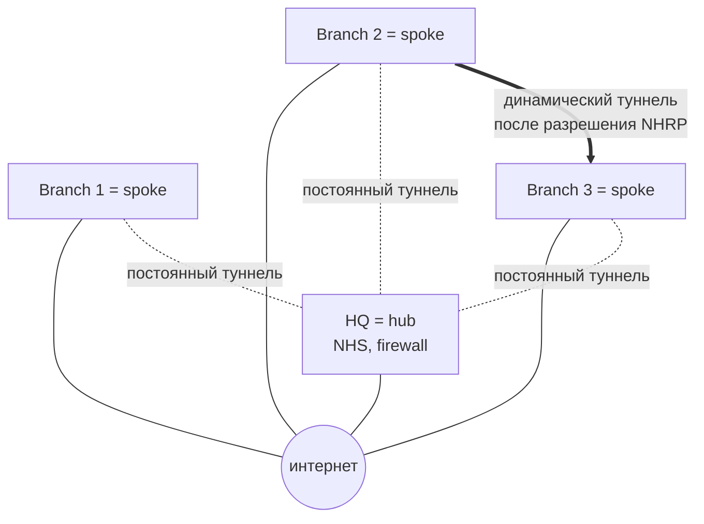
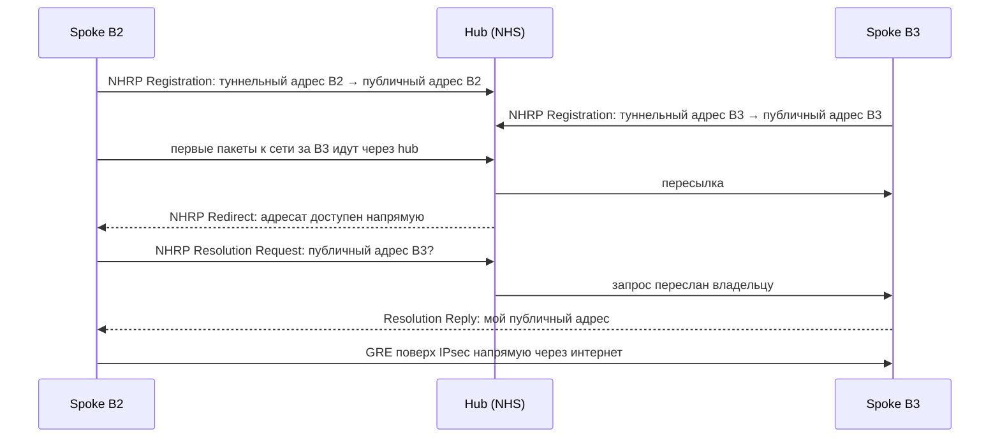
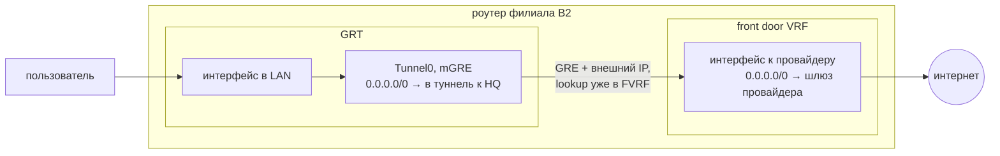

# DMVPN и front door VRF

## Штаб-квартира и филиалы [22:03](https://www.youtube.com/watch?v=nhHfMoZoevI&t=1323s)

Клиентский, а не провайдерский сценарий: к интернету подключены штаб-квартира — **HQ** (headquarters) — и филиалы Branch 1, Branch 2 и так далее [22:34](https://www.youtube.com/watch?v=nhHfMoZoevI&t=1354s). Связывать их нужно туннелями через интернет, причём адреса филиалов заранее могут быть неизвестны

## DMVPN [23:06](https://www.youtube.com/watch?v=nhHfMoZoevI&t=1386s)

> [!note] **DMVPN** (Dynamic Multipoint [[IP-in-IP и GRE|VPN]]) — схема [[IP-in-IP и GRE#Туннельный интерфейс [58 15](https //www.youtube.com/watch?v=hW8YoPG8NMc&t=3495s)|туннелей]] Cisco, в которой филиалы подключаются к центру динамически, с любых адресов, а между собой строят прямые туннели по требованию[^proto]
> Центральная точка называется **hub**, остальные — **spoke** [23:36](https://www.youtube.com/watch?v=nhHfMoZoevI&t=1416s). Задача, ради которой всё строится: два spoke должны обмениваться трафиком напрямую через интернет, не гоняя его через HQ. У других вендоров аналоги называются иначе, суть та же — например, **DSVPN** у Huawei

[^proto]: Лектор [23:06](https://www.youtube.com/watch?v=nhHfMoZoevI&t=1386s) называет DMVPN проприетарным протоколом Cisco. Отдельного протокола DMVPN нет: это цисковское название конфигурации из открытых стандартов — многоточечного [[IP-in-IP и GRE|GRE]], NHRP ([[RFC]] 2332) и IPsec. Проприетарны название и детали реализации, а сами части открыты, поэтому DSVPN Huawei и Linux-демон OpenNHRP с DMVPN совместимы



### Из чего собран

- **mGRE** (multipoint GRE) — один туннельный интерфейс без фиксированного [[IP-in-IP и GRE#Tunnel endpoints [55 38](https //www.youtube.com/watch?v=hW8YoPG8NMc&t=3338s)|tunnel destination]]: адрес назначения внешнего заголовка подставляется для каждого пакета отдельно. На hub один интерфейс обслуживает всех spoke, сколько бы их ни было
- **NHRP** (Next Hop Resolution Protocol, RFC 2332) — отвечает, какой публичный адрес стоит за туннельным адресом соседа. Интернет для него — [[Proxy ARP и разновидности ARP|NBMA]]-сеть, публичный адрес — NBMA-адрес. Hub работает сервером, **NHS** (Next Hop Server), каждый spoke — клиентом, **NHC** (Next Hop Client). Поднимаясь, spoke регистрирует у NHS пару "туннельный адрес → текущий публичный адрес"; это [[Протокол ARP|ARP]] для туннелей с центральным справочником
- **IPsec** (IP Security) — шифрование и аутентификация поверх GRE: сам GRE трафик не защищает, а через интернет его везти открытым нельзя. Ключи с новым соседом согласуются автоматически в момент постройки туннеля

### Как spoke находит spoke



Шаги Redirect и shortcut появились не сразу, и схемы DMVPN различают по **фазам**:

| Фаза | Трафик spoke–spoke | Что нужно от маршрутизации |
|---|---|---|
| Phase 1 | только через hub | spoke хватает маршрута по умолчанию на hub |
| Phase 2 | прямой туннель; spoke сам запрашивает NHRP, увидев в таблице next hop другого spoke | hub не суммаризирует и не подменяет next hop: каждому spoke нужны точные маршруты до сетей всех остальных |
| Phase 3 | прямой туннель по NHRP Redirect от hub; spoke ставит поверх маршрута **NHRP shortcut** | hub может отдавать суммарный маршрут или просто default — масштабируется лучше всех |

## Два маршрута по умолчанию [24:09](https://www.youtube.com/watch?v=nhHfMoZoevI&t=1449s)

Из HQ через DMVPN анонсируется [[Статические маршруты и маршрут по умолчанию#Маршрут по умолчанию [12 27](https //www.youtube.com/watch?v=l9F567JS-5o&t=747s)|маршрут по умолчанию]] `0.0.0.0/0`: пользователи филиалов должны ходить в интернет через головной офис. Там стоит дорогой [[Сетевое оборудование по уровням|firewall]], например **NGFW** (Next-Generation Firewall) — с антивирусными проверками и различением пользователей. Трафик идёт по туннелю до HQ, разворачивается на firewall и уходит в интернет [24:39](https://www.youtube.com/watch?v=nhHfMoZoevI&t=1479s)

> [!failure] Одновременно роутеру филиала нужен default прямо в интернет [25:10](https://www.youtube.com/watch?v=nhHfMoZoevI&t=1510s)
> Туннели к hub и к другим spoke строятся на их публичные адреса, а адрес B3 роутер B2 заранее не знает — значит, дойти до него можно только по маршруту по умолчанию в сторону провайдера
>
> Нужны два default для разных целей: пользователям — в туннель, самому туннелю — в интернет. В одной таблице двух `0.0.0.0/0` с разными смыслами не бывает, а default через туннель, заменив провайдерский, увёл бы в туннель и пакеты к endpoint-ам — это [[IP-in-IP и GRE#Рекурсивная маршрутизация|рекурсивная маршрутизация]]

## Front door VRF [25:41](https://www.youtube.com/watch?v=nhHfMoZoevI&t=1541s)

> [!success] **Front door VRF** (FVRF) — отдельная [[VRF]], в которую кладётся только интерфейс в сторону провайдера, со своим default на провайдера
> Этот default используется, чтобы строить туннели: до hub и напрямую до других филиалов [26:13](https://www.youtube.com/watch?v=nhHfMoZoevI&t=1573s). Туннельный интерфейс DMVPN при этом остаётся в [[VRF#Overlay поверх underlay [15 47](https //www.youtube.com/watch?v=nhHfMoZoevI&t=947s)|глобальной таблице]] вместе с пользователями, и их default смотрит в туннель к HQ [26:44](https://www.youtube.com/watch?v=nhHfMoZoevI&t=1604s)

VRF, где живут пользователи, если это не [[VRF|GRT]], называют **IVRF** (inside VRF)



### Где какой интерфейс [27:14](https://www.youtube.com/watch?v=nhHfMoZoevI&t=1634s)

Туннель задают два адреса — local и remote [[IP-in-IP и GRE#Tunnel endpoints [55 38](https //www.youtube.com/watch?v=hW8YoPG8NMc&t=3338s)|endpoint]] [27:45](https://www.youtube.com/watch?v=nhHfMoZoevI&t=1665s). Local задаётся [[IP-адрес и маска подсети|IP]]-адресом или именем интерфейса своего роутера. Без VRF local — адрес физического интерфейса, remote (tunnel destination) — адрес интерфейса на той стороне [28:15](https://www.youtube.com/watch?v=nhHfMoZoevI&t=1695s)

> [!important] Туннельный интерфейс — в GRT, а интерфейс его local endpoint — в FVRF [28:45](https://www.youtube.com/watch?v=nhHfMoZoevI&t=1725s)

### Ход пакета [29:17](https://www.youtube.com/watch?v=nhHfMoZoevI&t=1757s)

1. Пакет пользователя попадает в GRT, default отправляет его в туннель
2. Роутер инкапсулирует: добавляет GRE-заголовок и внешний IP-заголовок. Получатель внешнего заголовка — публичный адрес HQ, если пакет идёт в головной офис, или публичный адрес другого филиала, если напрямую к нему [30:49](https://www.youtube.com/watch?v=nhHfMoZoevI&t=1849s)
3. Local endpoint лежит в FVRF, поэтому готовый пакет перекладывается из GRT в FVRF, и [[IP-in-IP и GRE#Двойной просмотр таблицы маршрутизации [59 16](https //www.youtube.com/watch?v=hW8YoPG8NMc&t=3556s)|второй просмотр]] идёт по её таблице, а не по глобальной [29:48](https://www.youtube.com/watch?v=nhHfMoZoevI&t=1788s)
4. Default FVRF отдаёт пакет в физический интерфейс к провайдеру [30:19](https://www.youtube.com/watch?v=nhHfMoZoevI&t=1819s)


На Cisco IOS связку задаёт команда `tunnel vrf`: туннельный интерфейс остаётся в глобальной таблице, а поиск маршрута к endpoint-ам уходит в названную VRF

```text
ip vrf INTERNET
!
interface GigabitEthernet0/0
 ip vrf forwarding INTERNET
 ip address 203.0.113.2 255.255.255.252
!
ip route vrf INTERNET 0.0.0.0 0.0.0.0 203.0.113.1
!
interface Tunnel0
 ip address 172.16.0.2 255.255.255.0
 ip nhrp network-id 1
 ip nhrp nhs 172.16.0.1 nbma 198.51.100.1 multicast
 ip nhrp shortcut
 tunnel source GigabitEthernet0/0
 tunnel mode gre multipoint
 tunnel vrf INTERNET
```

## Front door VRF как best practice [31:20](https://www.youtube.com/watch?v=nhHfMoZoevI&t=1880s)

DMVPN работает и без VRF, но тогда на роутере возможен только один default. Современная рекомендация — всегда делать front door VRF, "чтобы развязаться с провайдером": провайдерская маршрутизация живёт в своей таблице и не пересекается с маршрутами, которые приходят через туннель [31:51](https://www.youtube.com/watch?v=nhHfMoZoevI&t=1911s)
