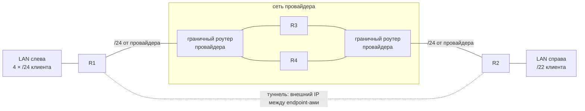
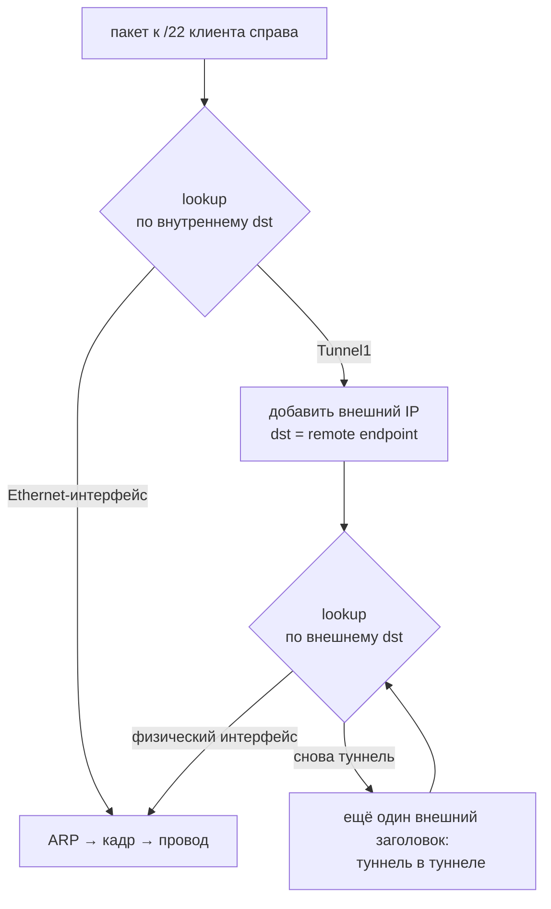

# IP-in-IP и GRE

## Инкапсуляция не обязана идти сверху вниз [48:55](https://www.youtube.com/watch?v=hW8YoPG8NMc&t=2935s)

До сих пор [[Инкапсуляция и заголовки#Слоёный пирог [45 46](https //www.youtube.com/watch?v=PHgnSnlxmLk&t=2746s)|слоёный пирог]] складывался строго по уровням: данные в сегмент или датаграмму, их в [[IP-адрес и маска подсети|IP]]-пакет, пакет в кадр, кадр в биты. На деле сетевой протокол можно вложить в сетевой, кадр — в [[Протокол UDP|UDP]]-датаграмму, а инкапсуляцию выполнить дважды и трижды [49:56](https://www.youtube.com/watch?v=hW8YoPG8NMc&t=2996s)

> [!note] **Туннель** — доставка пакета одного протокола в качестве полезной нагрузки другого протокола того же или более низкого уровня между двумя точками, которые его упаковывают и распаковывают
> Промежуточные узлы видят только внешнюю обёртку. Лектор называет туннели, **VPN** (Virtual Private Network, виртуальная частная сеть) и overlay-сети одним явлением под разными именами — "название много, суть одна" [06:34](https://www.youtube.com/watch?v=hW8YoPG8NMc&t=394s). Строго VPN — туннель, построенный ради обособленной сети клиента, часто с шифрованием, а [[VXLAN и EVPN#Underlay и overlay [1 15 00](https //www.youtube.com/watch?v=hW8YoPG8NMc&t=4500s)|overlay]] — вся сеть, растянутая поверх туннелей

## IP-in-IP [50:26](https://www.youtube.com/watch?v=hW8YoPG8NMc&t=3026s)

> [!note] **IP-in-IP** ([[RFC]] 2003) — перед заголовком исходного IPv4-пакета ставится ещё один, внешний IPv4-заголовок
> Внутренний пакет целиком, со своим заголовком, становится полезной нагрузкой внешнего. Порядок на проводе: Ethernet → внешний IP → внутренний IP → [[Заголовок TCP и установление соединения|TCP]], UDP или [[Протокол ICMP|ICMP]] → данные [50:56](https://www.youtube.com/watch?v=hW8YoPG8NMc&t=3056s). В поле [[Заголовок IPv4#Поле Protocol [1 15 35](https //www.youtube.com/watch?v=5iMhAOFx38c&t=4535s)|Protocol]] внешнего заголовка стоит 4 — "внутри IPv4"

![[Заголовки IP-in-IP и GRE.png]]

### Два офиса через сеть провайдера [51:59](https://www.youtube.com/watch?v=hW8YoPG8NMc&t=3119s)

Провайдер обещает связать два офиса клиента и выдаёт на границе своей сети по `/24` на каждую площадку. Клиенту достаточно поставить коммутаторы, прописать хостам шлюз в сторону провайдера — и трафик пойдёт [52:30](https://www.youtube.com/watch?v=hW8YoPG8NMc&t=3150s)

Беда в размере: `/24` — это 254 узла, а у клиента слева, скажем, тысяча компьютеров [53:01](https://www.youtube.com/watch?v=hW8YoPG8NMc&t=3181s). Решение без участия провайдера:

1. Вместо коммутаторов клиент ставит свои роутеры R1 и R2, их внешние интерфейсы получают адреса из провайдерских `/24` [53:31](https://www.youtube.com/watch?v=hW8YoPG8NMc&t=3211s)
2. На R1 — [[Статические маршруты и маршрут по умолчанию|статический маршрут]] в правый провайдерский `/24` через роутер провайдера, на R2 — зеркальный. R1 и R2 теперь пингуют друг друга [54:34](https://www.youtube.com/watch?v=hW8YoPG8NMc&t=3274s)
3. Собственные сети клиента — хоть четыре `/24` слева и `/22` справа — прячутся за R1 и R2 [55:06](https://www.youtube.com/watch?v=hW8YoPG8NMc&t=3306s)
4. Между R1 и R2 поднимается туннель, по которому ходят клиентские сети

### Tunnel endpoints [55:38](https://www.youtube.com/watch?v=hW8YoPG8NMc&t=3338s)

> [!note] **Tunnel endpoints** (конечные точки туннеля) — два IP-адреса, между которыми поднят туннель: адрес на R1 и адрес на R2
> Именно они стоят отправителем и получателем во **внешнем** заголовке [56:42](https://www.youtube.com/watch?v=hW8YoPG8NMc&t=3402s). В конфигурации это **tunnel source** (local endpoint — адрес или имя своего интерфейса) и **tunnel destination** (remote endpoint)

Провайдер видит обычный IP-пакет между двумя своими же адресами и маршрутизирует его как угодно — через R3 или через R4 [57:12](https://www.youtube.com/watch?v=hW8YoPG8NMc&t=3432s). Внутренние заголовки с адресами клиента он не читает. Хосты и серверы клиента тоже ничего не знают: для них туннель полностью прозрачен [57:42](https://www.youtube.com/watch?v=hW8YoPG8NMc&t=3462s)

## Туннельный интерфейс [58:15](https://www.youtube.com/watch?v=hW8YoPG8NMc&t=3495s)

В [[Таблица маршрутизации|таблице маршрутизации]] R1 правый `/22` указывает на интерфейс `Tunnel1` — виртуальный, логический, но видный в `show ip interface brief` рядом с физическими [58:46](https://www.youtube.com/watch?v=hW8YoPG8NMc&t=3526s). Для L3-логики роутера это интерфейс как любой другой: его включают и выключают, назначают ему IP-адрес, применяют на нём [[Статический и динамический NAT|NAT]] и вешают access-list

### Двойной просмотр таблицы маршрутизации [59:16](https://www.youtube.com/watch?v=hW8YoPG8NMc&t=3556s)

> [!important] Разница с физическим интерфейсом — только в момент отправки
> - Выход через **Ethernet**: [[Протокол ARP#ARP-кэш [32 10](https //www.youtube.com/watch?v=HxGsA6Ps-T8&t=1930s)|ARP-таблица]] → кадр → в провод
> - Выход через **туннель**: инкапсуляция не в кадр, а в новый IP-пакет с адресатом remote endpoint. Получился новый пакет — и роутер **снова** идёт в ту же таблицу маршрутизации искать, через какой интерфейс достичь уже внешнего адресата [59:47](https://www.youtube.com/watch?v=hW8YoPG8NMc&t=3587s)

### Туннель в туннеле [1:01:19](https://www.youtube.com/watch?v=hW8YoPG8NMc&t=3679s)

Если по внешнему адресату таблица снова отправляет пакет в туннельный интерфейс, процедура повторяется: третий IP-заголовок, ещё один просмотр. Так строится туннель в туннеле — работает без проблем, если аккуратно проделать всё один раз руками

### Рекурсивная маршрутизация

> [!warning] Маршрут до remote endpoint не должен вести в сам туннель
> Второй lookup ищет путь к адресу endpoint-а. Если этот адрес вдруг стал доступен **через тот же туннель** — например, протокол динамической маршрутизации, поднятый поверх туннеля, анонсировал провайдерский `/24` с лучшей метрикой, — пакет бесконечно заворачивается сам в себя. Cisco IOS ловит это и гасит интерфейс с сообщением `%TUN-5-RECURSDOWN: … temporarily disabled due to recursive routing`
>
> Лекарство одно по сути: маршрут к endpoint-ам должен жить отдельно от маршрутов, которые ходят через туннель. Не анонсировать underlay-адреса внутрь туннеля, прибить к endpoint-у статический host-маршрут через физический интерфейс — или развести таблицы целиком, как [[DMVPN и front door VRF|front door VRF]]

## Один тип нагрузки на туннель [1:02:19](https://www.youtube.com/watch?v=hW8YoPG8NMc&t=3739s)

IP-in-IP везёт только IPv4: вложить в него [[Адресация IPv6|IPv6]] нельзя [1:02:50](https://www.youtube.com/watch?v=hW8YoPG8NMc&t=3770s). Что внутри, говорит поле Protocol внешнего заголовка: 4 — IPv4 (RFC 2003), 41 — IPv6, и IPv6-трафику через IPv4-сеть нужен **отдельный** туннель IPv6-in-IPv4, он же 6in4 (RFC 4213) [1:03:24](https://www.youtube.com/watch?v=hW8YoPG8NMc&t=3804s)

Каждый новый тип трафика — ещё один независимый туннель между теми же роутерами. Неудобно, поэтому у IP-in-IP применение ограниченное [1:03:54](https://www.youtube.com/watch?v=hW8YoPG8NMc&t=3834s)

## GRE [1:03:54](https://www.youtube.com/watch?v=hW8YoPG8NMc&t=3834s)

> [!success] **GRE** (Generic Routing Encapsulation, RFC 2784) — между внешним IP-заголовком и нагрузкой вставляется 4-байтный заголовок GRE с типом вложенного протокола [1:04:28](https://www.youtube.com/watch?v=hW8YoPG8NMc&t=3868s)
> Раз тип нагрузки назван внутри туннеля, один туннель везёт всё сразу: IPv4, IPv6, [[VRF#MPLS у реальных провайдеров [20 32](https //www.youtube.com/watch?v=nhHfMoZoevI&t=1232s)|MPLS]], даже кадры Ethernet [1:05:00](https://www.youtube.com/watch?v=hW8YoPG8NMc&t=3900s). Во внешнем IPv4-заголовке Protocol = 47

### Заголовок GRE

Базовые 4 байта — флаги и тип протокола; опциональные поля добавляются только при поднятых флагах, по 4 байта каждое

| Поле | Размер | Назначение |
|---|---|---|
| C | 1 бит | есть поля Checksum и Reserved1 |
| K, S (RFC 2890) | по 1 биту | есть поле Key, есть поле Sequence Number |
| Reserved0 | 9 бит | нули |
| Ver | 3 бита | версия, всегда 0 |
| Protocol Type | 16 бит | тип нагрузки значениями [[Кадр Ethernet#Поле Type/Length [17 07](https //www.youtube.com/watch?v=wQhMAl--_r0&t=1027s)\|EtherType]]: `0x0800` IPv4, `0x86DD` IPv6, `0x8847` MPLS, `0x6558` кадр Ethernet |
| Checksum + Reserved1 | 16 + 16 бит | контрольная сумма заголовка GRE и нагрузки |
| Key | 32 бита | метка потока: различает несколько туннелей между одной парой endpoint-ов |
| Sequence Number | 32 бита | номер пакета, чтобы получатель заметил перестановку и потерю |

### Накладные расходы и MTU

Единственный минус GRE, по лектору, — лишние 4 байта и чуть меньший [[Золотое правило механики. КПД|КПД]] [1:05:00](https://www.youtube.com/watch?v=hW8YoPG8NMc&t=3900s). Считать их удобнее от [[MTU и фрагментация#MTU линка [1 04 26](https //www.youtube.com/watch?v=l9F567JS-5o&t=3866s)|MTU линка]], по которому идёт внешний пакет:

| Туннель | Добавляет к IP-пакету | IP-MTU внутри туннеля при MTU 1500 |
|---|---|---|
| IP-in-IP | внешний IPv4, 20 байт | 1480 |
| GRE | 20 + 4 = 24 байта | 1476 |
| GRE с Key | 20 + 8 = 28 байт | 1472 |
| IPv6-in-IPv4 | внешний IPv4, 20 байт | 1480 |

Пакет в 1500 байт на входе в туннель либо фрагментируется, либо, с битом [[MTU и фрагментация|DF]], отбрасывается с ICMP-уведомлением, и дальше всё держится на [[MTU и фрагментация#Path MTU Discovery [1 11 29](https //www.youtube.com/watch?v=6iEZOuH75cw&t=4289s)|Path MTU Discovery]]. Поэтому на туннельных интерфейсах обычно сразу снижают `ip mtu` и подрезают [[MTU и фрагментация#MSS и MSS clamping [1 14 36](https //www.youtube.com/watch?v=6iEZOuH75cw&t=4476s)|MSS]] проходящих TCP-соединений

### Туннели поверх UDP

IP-in-IP и GRE едут прямо в IP со своими номерами протокола, портов у них нет. Отсюда две беды на реальном пути: [[PAT и проброс портов|PAT]] не может различить два GRE-туннеля за одним адресом, а [[Сетевое оборудование по уровням|firewall-ы]] часто пропускают только TCP и UDP

Туннели, которым нужно пройти через интернет, поэтому кладут нагрузку в [[Протокол UDP|UDP-датаграмму]]: так устроены [[VXLAN и EVPN|VXLAN]] и WireGuard. UDP заодно даёт [[VXLAN и EVPN#ECMP и порт отправителя [1 16 37](https //www.youtube.com/watch?v=hW8YoPG8NMc&t=4597s)|энтропию в порту отправителя]] для балансировки

Ни IP-in-IP, ни GRE ничего не шифруют: провайдер при желании прочтёт внутренние заголовки. Конфиденциальность добавляют сверху IPsec, как в [[DMVPN и front door VRF|DMVPN]]
