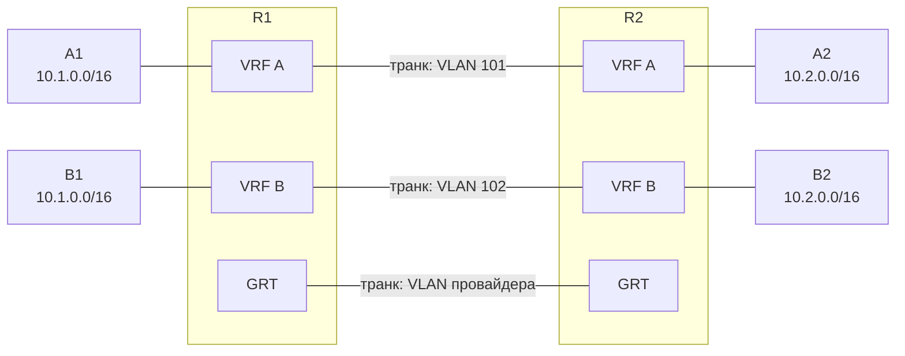

# VRF

## Виртуальный роутер внутри физического [06:12](https://www.youtube.com/watch?v=nhHfMoZoevI&t=372s)

> [!note] **VRF** (Virtual Routing and Forwarding) — логический роутер внутри физического, со своей таблицей маршрутизации и своими интерфейсами
> Аналог [[VLAN и стандарт 802.1Q|VLAN]] на третьем уровне: VLAN делит физический коммутатор на несколько логических, VRF — физический роутер [06:45](https://www.youtube.com/watch?v=nhHfMoZoevI&t=405s). В VRF кладут интерфейсы любого сорта — физический, [[L3-коммутаторы и SVI|субинтерфейс]], [[Loopback и локальное взаимодействие|loopback]], [[IP-in-IP и GRE#Туннельный интерфейс [58 15](https //www.youtube.com/watch?v=hW8YoPG8NMc&t=3495s)|туннель]]. Сколько VRF поместится — 1, 3, 20 — зависит только от ресурсов устройства [07:16](https://www.youtube.com/watch?v=nhHfMoZoevI&t=436s)

Конструкция открытая, не только цисковская. У других вендоров она зовётся **[[IP-in-IP и GRE|VPN]] instance** или **routing instance** [1:16:17](https://www.youtube.com/watch?v=nhHfMoZoevI&t=4577s)

### Что у каждой VRF своё [07:47](https://www.youtube.com/watch?v=nhHfMoZoevI&t=467s)

- **таблица маршрутизации**: своя [[Таблица маршрутизации#Колонка источника маршрутной информации [28 16](https //www.youtube.com/watch?v=l9F567JS-5o&t=1696s)|RIB]] и собранная из неё **FIB** (Forwarding Information Base) — таблица, по которой пересылаются пакеты
- **[[Протокол ARP#ARP-кэш [32 10](https //www.youtube.com/watch?v=HxGsA6Ps-T8&t=1930s)|ARP-таблица]]**
- **протоколы маршрутизации**: процесс [[Протокол OSPF|OSPF]] можно оставить в глобальной таблице, а можно привязать к конкретной VRF
- **[[Статический и динамический NAT|NAT]]** настраивается отдельно [08:21](https://www.youtube.com/watch?v=nhHfMoZoevI&t=501s)

Всё конфигурируется так, будто это отдельное выделенное устройство, но работает на уже стоящем в сети железе

> [!important] Одинаковые префиксы в разных VRF роутер не сравнивает
> Для него это разные таблицы и никак не связанные записи. `10.1.0.0/16` в VRF A и `10.1.0.0/16` в VRF B живут рядом и не конфликтуют [32:54](https://www.youtube.com/watch?v=nhHfMoZoevI&t=1974s)

## Пересечение клиентских адресов у провайдера [08:57](https://www.youtube.com/watch?v=nhHfMoZoevI&t=537s)

Сеть провайдера из нескольких роутеров, по краям — роутеры клиента A1 и A2. L3-провайдер выделяет клиенту адреса на point-to-point линки и небольшие подсети из своего блока, не занятые ни им самим, ни другими клиентами; эти префиксы попадают в таблицу провайдера [10:00](https://www.youtube.com/watch?v=nhHfMoZoevI&t=600s)

### Туннель силами клиента [10:30](https://www.youtube.com/watch?v=nhHfMoZoevI&t=630s)

Провайдер дал по `/24`, а у клиента с каждой стороны `/16`. Прошлое решение — [[IP-in-IP и GRE#Два офиса через сеть провайдера [51 59](https //www.youtube.com/watch?v=hW8YoPG8NMc&t=3119s)|туннель между A1 и A2]] и собственная маршрутизация внутри него, прячущая реальные адреса от провайдера. Эта задача лежит на клиенте

### Маршрутизация силами оператора [11:34](https://www.youtube.com/watch?v=nhHfMoZoevI&t=694s)

Гибче, когда задачу берёт оператор: он не назначает клиенту адреса, а обещает маршрутизировать любые. На стыке с клиентом поднимается [[Классификация протоколов маршрутизации#IGP и EGP|IGP]]: A1 анонсирует левые префиксы клиента, A2 — правые, провайдер возит трафик между ними [12:08](https://www.youtube.com/watch?v=nhHfMoZoevI&t=728s)

Но те же адреса могут оказаться у самого провайдера или у следующего клиента B с роутерами B1 и B2 [12:40](https://www.youtube.com/watch?v=nhHfMoZoevI&t=760s). Два клиента с `10.1.0.0/16` в одной таблице — неразрешимая коллизия

### VRF на пограничных роутерах [13:11](https://www.youtube.com/watch?v=nhHfMoZoevI&t=791s)

На граничных роутерах провайдера — по терминологии [[RFC]] 4364 **PE** (Provider Edge); роутер клиента — **CE** (Customer Edge), внутренние роутеры провайдера — **P** — создаётся `VRF A`, и в неё кладётся интерфейс в сторону A1. На дальнем PE — своя `VRF A` с интерфейсом к A2. Для клиента B — `VRF B` на обоих концах [13:41](https://www.youtube.com/watch?v=nhHfMoZoevI&t=821s)

Между PE лектор берёт учебную модель, оговариваясь, что современные провайдеры так не делают [14:12](https://www.youtube.com/watch?v=nhHfMoZoevI&t=852s): линк R1–R2 внутри сети провайдера — [[VLAN и стандарт 802.1Q#Trunk [15 06](https //www.youtube.com/watch?v=eC3UwwTFCbg&t=906s)|транк]], на нём с каждой стороны по субинтерфейсу на клиента

Один субинтерфейс кладётся в `VRF A`, другой — в `VRF B`. На каждом PE получается маленький виртуальный роутер, к которому подключены клиентский интерфейс и субинтерфейс магистрали [14:43](https://www.youtube.com/watch?v=nhHfMoZoevI&t=883s). Такое разделение хоп за хопом, без MPLS и [[Классификация протоколов маршрутизации|BGP]], называют **VRF-lite**

### Overlay поверх underlay [15:47](https://www.youtube.com/watch?v=nhHfMoZoevI&t=947s)

Поверх [[VXLAN и EVPN#Underlay и overlay [1 15 00](https //www.youtube.com/watch?v=hW8YoPG8NMc&t=4500s)|underlay]] провайдера строится обособленная overlay-сеть, которая маршрутами с глобальной таблицей провайдера не обменивается. Префиксы клиента A живут в одной VRF, клиента B — в другой, и не смешиваются [16:19](https://www.youtube.com/watch?v=nhHfMoZoevI&t=979s)

> [!note] **GRT** (Global Routing Table) — глобальная таблица маршрутизации, в которую попадает всё, что ни в какую VRF не положено [16:49](https://www.youtube.com/watch?v=nhHfMoZoevI&t=1009s)
> Та самая таблица, с которой курс работал весь семестр. На R1 из примера три несмешивающиеся таблицы: VRF A, VRF B и GRT

## Разделение по плоскостям [17:21](https://www.youtube.com/watch?v=nhHfMoZoevI&t=1041s)

Функции современного роутера делят на три **плоскости** [17:53](https://www.youtube.com/watch?v=nhHfMoZoevI&t=1073s):

| Плоскость | Что делает | Что в неё входит |
|---|---|---|
| **Management plane** | управление устройством администратором | консоль, Telnet, [[SSH]], веб-интерфейс, диагностические команды и перенастройка [18:25](https://www.youtube.com/watch?v=nhHfMoZoevI&t=1105s) |
| **Control plane** | строит таблицы, по которым потом пересылается трафик | [[Классификация протоколов маршрутизации\|протоколы маршрутизации]] и другие служебные протоколы, RIB, ARP-таблицы [18:55](https://www.youtube.com/watch?v=nhHfMoZoevI&t=1135s) |
| **Data plane** (forwarding plane) | пересылает пользовательский трафик по готовым структурам | FIB, коммутация и пересылка пакетов [19:26](https://www.youtube.com/watch?v=nhHfMoZoevI&t=1166s) |

Control plane работает на центральном процессоре роутера, data plane у производительных устройств выгружен в специализированные микросхемы — [[L3-коммутаторы и SVI|ASIC]]

> [!summary] VRF разделяет control plane и data plane, но не management plane
> - **control plane**: маршрутную информацию клиентов A и B передают разные процессы в разных таблицах, пересечения нет
> - **data plane**: трафик A идёт в одном VLAN, B — в другом, на R2 они приходят в разные субинтерфейсы и обрабатываются раздельно
> - **management plane** общий: администратор провайдера подключается к устройству целиком и управляет сразу и GRT, и всеми VRF [19:59](https://www.youtube.com/watch?v=nhHfMoZoevI&t=1199s)

## MPLS у реальных провайдеров [20:32](https://www.youtube.com/watch?v=nhHfMoZoevI&t=1232s)

> [!note] **MPLS** (Multiprotocol Label Switching) — пересылка по коротким меткам, которые вставляются между канальным и [[IP-адрес и маска подсети|IP]]-заголовком
> Метка — 4 байта: сама метка 20 бит, класс трафика 3 бита, признак дна стека 1 бит и [[Заголовок IPv4#Время жизни пакета [1 14 02](https //www.youtube.com/watch?v=5iMhAOFx38c&t=4442s)|TTL]] 8 бит. Меток может быть несколько подряд — **стек меток**. Внутренние роутеры провайдера коммутируют пакет по верхней метке, в IP-заголовок не заглядывая

Логика та же, что с транком: там клиенту соответствовала своя метка 802.1Q, здесь — своя MPLS-метка[^labels] [21:02](https://www.youtube.com/watch?v=nhHfMoZoevI&t=1262s). Вся конструкция называется **MPLS L3VPN** (BGP/MPLS IP VPN, RFC 4364). MPLS, MP-BGP, **L2VPN** (Layer 2 VPN, виртуальная сеть канального уровня) и L3VPN лектор откладывает до пятого курса [21:32](https://www.youtube.com/watch?v=nhHfMoZoevI&t=1292s)

[^labels]: У лектора [21:02](https://www.youtube.com/watch?v=nhHfMoZoevI&t=1262s) клиенту соответствует одна MPLS-метка — упрощение. По RFC 4364 у пакета клиента **две** метки: внешняя транспортная ведёт его через P-роутеры до нужного PE и меняется на каждом хопе, внутренняя VPN-метка выдаётся выходным PE через MP-BGP и говорит ему, в какую VRF и к какому префиксу отдать пакет. P-роутеры видят только внешнюю и о клиентских маршрутах ничего не знают

### MP-BGP [21:02](https://www.youtube.com/watch?v=nhHfMoZoevI&t=1262s)

Поднимать между PE по отдельному IGP-процессу на каждую VRF не нужно. Работает один **MP-BGP** (Multiprotocol BGP, RFC 4760), и одна его сессия несёт маршруты сразу всех VRF

> [!note] MP-BGP — расширение [[Классификация протоколов маршрутизации#IGP и EGP|BGP]], в котором каждый анонс помечен семейством адресов **AFI/SAFI** (Address Family Identifier и Subsequent Address Family Identifier)
> Обычный BGP умел только IPv4-префиксы. С AFI/SAFI по той же сессии едут IPv6, VPNv4 (AFI 1, SAFI 128), VPNv6 и даже [[MAC-адресация|MAC]]-адреса [[VXLAN и EVPN#EVPN [1 24 50](https //www.youtube.com/watch?v=hW8YoPG8NMc&t=5090s)|EVPN]]

### Route distinguisher и route target [1:16:48](https://www.youtube.com/watch?v=nhHfMoZoevI&t=4608s)

Лектор сознательно не рассказывает про RD и RT на третьем курсе[^rdrt]: для этого нужен MP-BGP, а "префикс" в курсе — только IPv4 или IPv6 [1:17:19](https://www.youtube.com/watch?v=nhHfMoZoevI&t=4639s). Сами понятия короткие:

- **RD** (route distinguisher) — 8 байт (2 байта типа и 6 байт значения, обычно в виде `AS:число` с номером [[Классификация протоколов маршрутизации#IGP и EGP|автономной системы]] провайдера), которые PE приписывает к клиентскому префиксу. Получается **VPNv4-префикс** в 12 байт: `65000:1:10.1.0.0/16` и `65000:2:10.1.0.0/16` для BGP уже разные маршруты, и одинаковые адреса клиентов A и B не затирают друг друга
- **RT** (route target) — метка-сообщество BGP (extended community), которое решает, **в какие VRF** маршрут попадёт. VRF при экспорте навешивает свои export RT, а на другом PE маршрут импортируется в каждую VRF, чей import RT совпал

RD отвечает только за уникальность, членство в VPN задаёт RT. Раздельные import и export позволяют собирать не только изолированные VPN, но и общий сервис: VRF с сервером мониторинга импортирует маршруты всех клиентов, а клиенты — только его

[^rdrt]: Лектор [1:16:48](https://www.youtube.com/watch?v=nhHfMoZoevI&t=4608s) называет RD, RT и VPNv4-префиксы и прямо отказывается их объяснять до пятого курса. Разбор выше — по RFC 4364

## VRF у клиента [22:03](https://www.youtube.com/watch?v=nhHfMoZoevI&t=1323s)

VRF применяют не только провайдеры. Клиентский сценарий с двумя маршрутами по умолчанию — [[DMVPN и front door VRF]]

### Production, разработка и тесты на одном железе [31:51](https://www.youtube.com/watch?v=nhHfMoZoevI&t=1911s)

Есть production-инфраструктура, и такую же — с той же адресацией — нужно построить разработчикам и тестировщикам, а другого оборудования нет [32:24](https://www.youtube.com/watch?v=nhHfMoZoevI&t=1944s). На тех же роутерах заводятся три VRF: production, разработка, тесты. Сети и адресация в них пересекаются, и это не мешает: на той же физической инфраструктуре появляется новая логическая, куда изменения выкатывают перед production [33:26](https://www.youtube.com/watch?v=nhHfMoZoevI&t=2006s)
