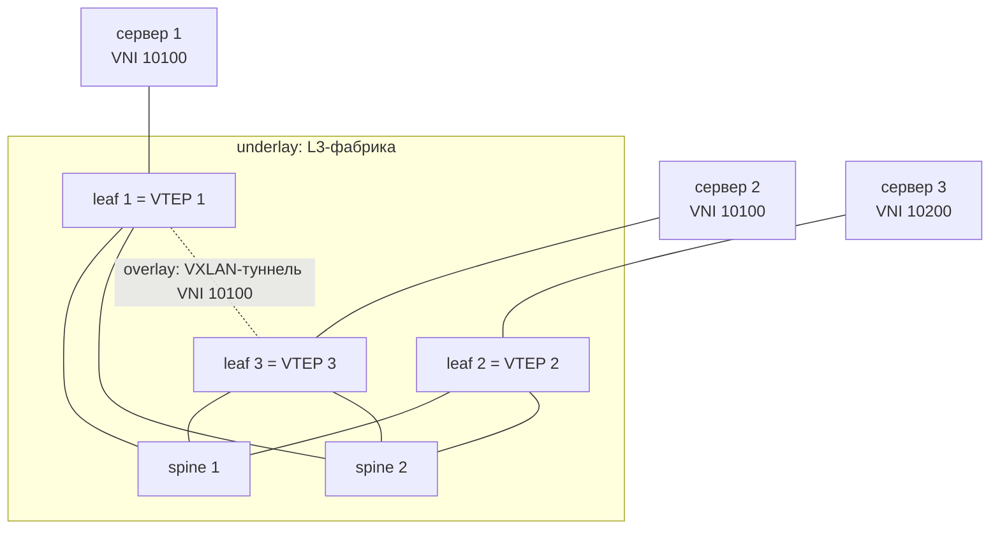

# VXLAN и EVPN

## Формат кадра [1:06:09](https://www.youtube.com/watch?v=hW8YoPG8NMc&t=3969s)

> [!note] **VXLAN** (Virtual eXtensible [[Топологии сетей|LAN]], [[RFC]] 7348) — туннель, который везёт кадр Ethernet целиком внутри [[Протокол UDP|UDP]]-датаграммы
> Порядок на проводе: внешний Ethernet → внешний [[IP-адрес и маска подсети|IP]] → UDP → заголовок VXLAN → исходный кадр → [[Кадр Ethernet|FCS]] внешнего кадра [1:07:17](https://www.youtube.com/watch?v=hW8YoPG8NMc&t=4037s). Порт назначения UDP — 4789, выделенный [[Порты и сокеты|IANA]]

![[Кадр VXLAN поверх IPv4.png]]

### Заголовок VXLAN [1:07:47](https://www.youtube.com/watch?v=hW8YoPG8NMc&t=4067s)

Восемь байт: 8 бит флагов, 24 бита reserved, 24 бита **VNI** (VXLAN Network Identifier, идентификатор сегмента, он же VNID) и ещё 8 бит reserved [1:08:19](https://www.youtube.com/watch?v=hW8YoPG8NMc&t=4099s). Из флагов осмыслен один — I, он обязан быть 1 и говорит, что VNI действителен. Кадры с разными VNI друг друга не видят: VNI для VXLAN — то же, что номер [[VLAN и стандарт 802.1Q|VLAN]] для 802.1Q

### Для провайдера это обычный UDP [1:09:24](https://www.youtube.com/watch?v=hW8YoPG8NMc&t=4164s)

Снаружи — IP отправителя и получателя, [[Протокол UDP#Заголовок [1 05 57](https //www.youtube.com/watch?v=HxGsA6Ps-T8&t=3957s)|UDP-порты]], и больше ничего особенного: транзитная сеть маршрутизирует датаграмму, не заглядывая внутрь. Вложенный кадр несёт свои [[MAC-адресация|MAC]]-адреса, свой IP-заголовок и сегмент, а [[Кадр Ethernet#Контрольная сумма и молчаливый отброс [12 14](https //www.youtube.com/watch?v=wQhMAl--_r0&t=734s)|FCS]] в конце относится к внешнему кадру[^fcs]

[^fcs]: Лектор [1:09:56](https://www.youtube.com/watch?v=hW8YoPG8NMc&t=4196s) говорит, что у инкапсулированного кадра есть своя контрольная сумма. По RFC 7348 (раздел 5, рисунок 1) FCS исходного кадра в VXLAN **не передаётся**: VTEP отбрасывает её при инкапсуляции, а после декапсуляции вычисляет заново для выходного порта. Проверку целостности на пути несёт FCS внешнего кадра на каждом линке

### Накладные расходы и MTU

Поверх IP [[MTU и фрагментация|MTU]] underlay-сети VXLAN над IPv4 добавляет внешний IPv4 20 + UDP 8 + VXLAN 8 + внутренний Ethernet-заголовок 14 = **50 байт**; с внутренним тегом 802.1Q — 54, над IPv6 — 70

VTEP не имеет права фрагментировать VXLAN-пакеты, поэтому RFC 7348 требует поднять [[MTU и фрагментация#MTU линка [1 04 26](https //www.youtube.com/watch?v=l9F567JS-5o&t=3866s)|MTU]] underlay так, чтобы вошёл полный кадр: для стандартных 1500 байт внутри — не меньше 1550. В дата-центрах на фабрике обычно сразу ставят jumbo-кадры около 9000 байт

## L2 поверх L3 [1:09:56](https://www.youtube.com/watch?v=hW8YoPG8NMc&t=4196s)

> [!note] **VTEP** (VXLAN Tunnel End Point) — устройство, на котором терминируется VXLAN-туннель [1:10:26](https://www.youtube.com/watch?v=hW8YoPG8NMc&t=4226s)
> Оно упаковывает кадры из своих портов в UDP и распаковывает чужие. Адрес VTEP — это [[IP-in-IP и GRE#Tunnel endpoints [55 38](https //www.youtube.com/watch?v=hW8YoPG8NMc&t=3338s)|tunnel endpoint]] во внешнем IP-заголовке

Возьмём ту же картину, что с [[IP-in-IP и GRE#Два офиса через сеть провайдера [51 59](https //www.youtube.com/watch?v=hW8YoPG8NMc&t=3119s)|двумя офисами]]: провайдер даёт только L3-маршрутизацию. Если R1 и R2 работают как VTEP, две части сети клиента соединяются по L2 так, будто между их коммутаторами проложили кабель. Кадр отсюда без изменений пролетает через L3-инфраструктуру и приходит получателю [1:11:26](https://www.youtube.com/watch?v=hW8YoPG8NMc&t=4286s)

### Родственные технологии [1:11:57](https://www.youtube.com/watch?v=hW8YoPG8NMc&t=4317s)

Задачу "L2 через L3" решали и до VXLAN: **xconnect** и **AToM** (Any Transport over [[VRF|MPLS]]) у Cisco, **L2TP** (Layer 2 Tunneling Protocol) и L2TPv3, его предшественник **L2F** (Layer 2 Forwarding) от Cisco. Той же цели внутри L2-сети оператора служит [[QinQ и VLAN translation|QinQ]]. VXLAN выделился тем, что нашёл себе место в дата-центрах [1:12:27](https://www.youtube.com/watch?v=hW8YoPG8NMc&t=4347s)

## VXLAN в дата-центре [1:12:27](https://www.youtube.com/watch?v=hW8YoPG8NMc&t=4347s)

Современная фабрика ЦОД (центра обработки данных) — [[Топология дата-центра Clos|Clos-топология]] из L3-коммутаторов spine и leaf: каждый leaf соединён с каждым spine, leaf-ы и spine-ы между собой не соединены, серверы подключены к leaf-ам — одним линком, [[Агрегация каналов|port-channel]] или к двум разным leaf-ам сразу [1:13:27](https://www.youtube.com/watch?v=hW8YoPG8NMc&t=4407s). Внутри фабрики чистая маршрутизация, [[Протокол STP|spanning tree]] там нет [1:13:57](https://www.youtube.com/watch?v=hW8YoPG8NMc&t=4437s)

А серверам, подключённым к разным leaf-ам, часто нужна L2-связность — например, чтобы виртуальная машина переехала на другой хост, не меняя адреса. Тогда leaf-коммутаторы работают как VTEP и растягивают VXLAN через фабрику [1:14:30](https://www.youtube.com/watch?v=hW8YoPG8NMc&t=4470s)

### Underlay и overlay [1:15:00](https://www.youtube.com/watch?v=hW8YoPG8NMc&t=4500s)

> [!note] **Underlay** (подлежащая сеть) — транспортная сеть, поверх которой идут туннели; **overlay** (наложенная сеть) — сеть, построенная из этих туннелей
> Underlay — фабрика ЦОД или сеть провайдера, топология у неё может быть любой. Overlay — растянутые по ней VXLAN-сегменты. Кадр сервера инкапсулируется на одном VTEP, летит через L3, декапсулируется на другом — и серверы уверены, что сидят в одном Ethernet-домене [1:16:04](https://www.youtube.com/watch?v=hW8YoPG8NMc&t=4564s)

### ECMP и порт отправителя [1:16:37](https://www.youtube.com/watch?v=hW8YoPG8NMc&t=4597s)

В L3-фабрике ни один линк не заблокирован, как было бы в spanning tree: работает [[Расчёт подсетей и VLSM#Автоматическая суммаризация [1 05 48](https //www.youtube.com/watch?v=oOFuvP3JxUM&t=3948s)|ECMP]], и трафик одновременно идёт по всем равноценным путям

Балансировка раскладывает трафик по [[Агрегация каналов#Балансировка по линкам [55 35](https //www.youtube.com/watch?v=3S93uq63zlg&t=3335s)|хешу заголовков]], а у всех VXLAN-пакетов между двумя VTEP одинаковы IP-адреса и порт назначения. Разнообразие даёт **порт отправителя**: VTEP вычисляет его хешем от заголовков вложенного кадра, RFC 7348 рекомендует брать его из [[Порты и сокеты#Диапазоны портов [1 09 12](https //www.youtube.com/watch?v=HxGsA6Ps-T8&t=4152s)|динамического диапазона]] 49152–65535

Разные потоки попадают в разные значения хеша и разъезжаются по разным путям и по разным физическим линкам port-channel [1:17:08](https://www.youtube.com/watch?v=hW8YoPG8NMc&t=4628s), а пакеты одного потока идут одним путём и не переставляются

### Underlay не знает про overlay [1:18:08](https://www.youtube.com/watch?v=hW8YoPG8NMc&t=4688s)

Underlay-сети хватает ограниченного набора маршрутов — до адресов VTEP — и минимума функций. Какие угодно сервисы, сегменты и адресация клиентов строятся в overlay, и поддерживает ли их underlay, неважно [1:18:38](https://www.youtube.com/watch?v=hW8YoPG8NMc&t=4718s)

## Чем VXLAN лучше VLAN [1:19:09](https://www.youtube.com/watch?v=hW8YoPG8NMc&t=4749s)

VXLAN — аналог и расширение VLAN, но не VLAN

| Признак | VLAN | VXLAN |
|---|---|---|
| Транспорт между площадками | Ethernet и провайдер, умеющий пробросить [[VLAN и стандарт 802.1Q#Trunk [15 06](https //www.youtube.com/watch?v=eC3UwwTFCbg&t=906s)\|trunk]] | любая IP-связность [1:19:41](https://www.youtube.com/watch?v=hW8YoPG8NMc&t=4781s) |
| Номер сегмента | 12 бит, [[VLAN и стандарт 802.1Q#Ограничение 4096 [19 56](https //www.youtube.com/watch?v=eC3UwwTFCbg&t=1196s)\|около 4000]] | 24 бита, $2^{24}\approx16{,}7$ млн [1:20:42](https://www.youtube.com/watch?v=hW8YoPG8NMc&t=4842s) |
| Резервные линки | блокирует spanning tree | работают все, ECMP |
| Накладные расходы | 4 байта тега | 50 байт |

4000 номеров кончились, когда в ЦОД пришло много клиентов и каждый захотел много сегментов [1:20:11](https://www.youtube.com/watch?v=hW8YoPG8NMc&t=4811s)

## Как VTEP узнаёт, куда инкапсулировать [1:21:12](https://www.youtube.com/watch?v=hW8YoPG8NMc&t=4872s)

У VTEP есть таблица "MAC-адрес → VTEP". Пришёл от сервера 1 кадр с MAC сервера 2 — VTEP находит в таблице IP удалённого VTEP, ставит его получателем во внешний заголовок и отправляет в сторону одного из spine [1:21:42](https://www.youtube.com/watch?v=hW8YoPG8NMc&t=4902s). Вопрос в том, откуда таблица берётся. Моделей две [1:22:46](https://www.youtube.com/watch?v=hW8YoPG8NMc&t=4966s)

### Flood-and-learn [1:22:46](https://www.youtube.com/watch?v=hW8YoPG8NMc&t=4966s)

> [!note] **Flood-and-learn** — VTEP рассылает неизвестное всем соседним VTEP и учится на ответах, как [[Хаб, мост и коммутатор#Обучение моста [55 11](https //www.youtube.com/watch?v=wQhMAl--_r0&t=3311s)|обычный мост]], только "порт" в его таблице — IP удалённого VTEP
> 1. Сервер S1 знает IP сервера S2, но не его MAC, и шлёт [[Протокол ARP|ARP-запрос]]
> 2. VTEP 1 инкапсулирует широковещательный запрос и рассылает всем соседним VTEP [1:23:16](https://www.youtube.com/watch?v=hW8YoPG8NMc&t=4996s)
> 3. Каждый VTEP смотрит на VNI: есть у него такой сегмент — отдаёт запрос в свои порты, нет — отбрасывает [1:23:48](https://www.youtube.com/watch?v=hW8YoPG8NMc&t=5028s)
> 4. S2 отвечает. VTEP-ы по пути запроса и ответа запоминают, какой MAC за каким VTEP, и следующий кадр от S1 к S2 VTEP 1 сразу шлёт на VTEP 2 [1:24:19](https://www.youtube.com/watch?v=hW8YoPG8NMc&t=5059s)

Рассылать приходится **BUM-трафик** (Broadcast, Unknown unicast, Multicast) — всё, для чего у VTEP нет единственного адресата, как у [[Хаб, мост и коммутатор#Flooding и старение записей [1 01 56](https //www.youtube.com/watch?v=wQhMAl--_r0&t=3716s)|flooding]] в обычном коммутаторе. RFC 7348 доставляет его двумя способами:

- **multicast в underlay**: каждому VNI сопоставлена [[Типы адресации|multicast-группа]], VTEP-ы вступают в неё по [[Протокол ICMP|IGMP]], а дерево доставки строит **PIM** (Protocol Independent Multicast). Одна отправка — и копию получают все VTEP этого сегмента
- **head-end replication** (ingress replication): underlay не умеет multicast, и VTEP сам шлёт отдельную unicast-копию каждому VTEP из списка, заданного руками или полученного по EVPN

### EVPN [1:24:50](https://www.youtube.com/watch?v=hW8YoPG8NMc&t=5090s)

> [!success] **EVPN** (Ethernet [[IP-in-IP и GRE|VPN]], RFC 7432) — VTEP-ы анонсируют друг другу известные им MAC- и IP-адреса по [[Классификация протоколов маршрутизации#IGP и EGP|BGP]], и рассылать ARP наугад больше не нужно
> BGP оказался расширяемым: кроме IPv4-префиксов он давно возит IPv6, VPNv4 и VPNv6 для [[VRF|L3VPN]] в [[VRF#MPLS у реальных провайдеров [20 32](https //www.youtube.com/watch?v=nhHfMoZoevI&t=1232s)|MPLS-сетях]] — и ещё одно расширение переносит MAC-адреса [1:25:21](https://www.youtube.com/watch?v=hW8YoPG8NMc&t=5121s). Между VTEP-ами поднимаются BGP-сессии, и каждый сообщает: "за мной устройства с такими MAC и такими IP" — фактически раздаёт ARP-записи [1:26:24](https://www.youtube.com/watch?v=hW8YoPG8NMc&t=5184s). VTEP 1 заранее знает, за каким соседом S2, и сразу инкапсулирует в нужную сторону [1:26:55](https://www.youtube.com/watch?v=hW8YoPG8NMc&t=5215s)

Технически это семейство адресов [[VRF#MP-BGP [21 02](https //www.youtube.com/watch?v=nhHfMoZoevI&t=1262s)|MP-BGP]] [[VRF|L2VPN]] EVPN ([[VRF|AFI]] 25, [[VRF|SAFI]] 70). Для VXLAN как транспорта EVPN описан в RFC 8365. Основные типы маршрутов:

| Тип | Название | Что анонсирует |
|---|---|---|
| 2 | MAC/IP Advertisement | MAC хоста, опционально его IP и VNI — замена обучению по флуду |
| 3 | Inclusive Multicast Ethernet Tag | "я VTEP сегмента с таким VNI" — из этих анонсов собирается список для head-end replication |
| 5 | IP Prefix (RFC 9136) | IP-префикс целиком — маршрутизация между сегментами внутри overlay |
| 1, 4 | Ethernet Auto-Discovery, Ethernet Segment | подключение сервера к двум leaf-ам сразу |

Раз VTEP знает пары MAC–IP из маршрутов типа 2, на ARP-запрос сервера он может ответить сам, не выпуская его в фабрику, — это **ARP suppression**

BGP-сессии в реальных фабриках строят не каждый с каждым, а через **route reflector** (RR) [1:25:52](https://www.youtube.com/watch?v=hW8YoPG8NMc&t=5152s): внутри одной [[Классификация протоколов маршрутизации#IGP и EGP|AS]] BGP не передаёт дальше маршруты, полученные от своих, и без RR понадобилась бы полная сетка сессий. Route reflector — роутер, которому разрешено такие маршруты переотражать клиентам; в Clos эту роль обычно отдают spine-ам

> [!info] Лектор оговаривается, что сети ЦОД даны совсем на пальцах: задача — общее представление и словарь для дальнейшего чтения [1:26:55](https://www.youtube.com/watch?v=hW8YoPG8NMc&t=5215s)
