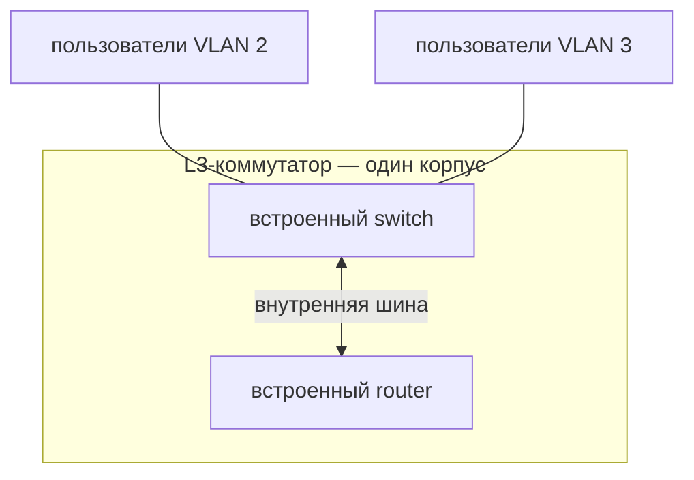
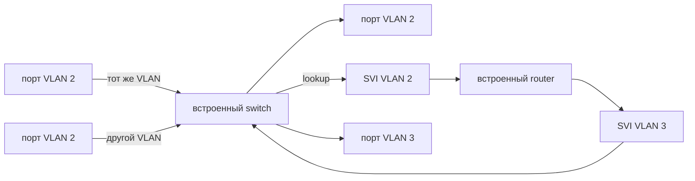

# L3-коммутаторы и SVI

## Коммутатор и роутер в одном корпусе [22:32](https://www.youtube.com/watch?v=3S93uq63zlg&t=1352s)

> [!note] **L3-коммутатор** (L3 switch) — коммутатор, совмещённый с маршрутизатором в одном корпусе
> Внутри — как бы два устройства: обычный коммутатор и встроенный маршрутизатор, соединённые внутренней шиной. Раньше в курсе граница была чёткой — [[Хаб, мост и коммутатор|коммутатор]] это L2-железка, [[Сетевое оборудование по уровням#Маршрутизатор [38 58](https //www.youtube.com/watch?v=PHgnSnlxmLk&t=2338s)|маршрутизатор]] — L3; L3-коммутатор специально размывает эту границу

### Интерфейс встроенного роутера [24:07](https://www.youtube.com/watch?v=3S93uq63zlg&t=1447s)

> [!note] **SVI** (Switch Virtual Interface) — интерфейс встроенного роутера, смотрящий в конкретный [[VLAN и стандарт 802.1Q|VLAN]]; в [[Интерфейс командной строки|CLI]] — `interface vlan <N>`
> [[VLAN и стандарт 802.1Q|VLAN]] — сущность канального уровня, SVI — сущность **сетевого**: это интерфейс встроенного роутера, а не самого коммутатора. SVI ничем не хуже обычного L3-интерфейса — на нём настраивают [[IP-адрес и маска подсети|IP]], вешают access-list, включают протокол динамической маршрутизации, поднимают и гасят его командой

### Маршрутизация между VLAN внутри одной коробки [25:12](https://www.youtube.com/watch?v=3S93uq63zlg&t=1512s)

Трафик внутри одного VLAN коммутируется встроенным коммутатором и уходит в нужный порт как обычно. Трафик между VLAN поднимается на встроенный роутер через его SVI, маршрутизируется и возвращается в коммутатор уже с меткой другого VLAN

Отдельный внешний маршрутизатор для этого не нужен

## Router-on-a-stick против встроенного роутера [26:49](https://www.youtube.com/watch?v=3S93uq63zlg&t=1609s)

До L3-коммутаторов межвлановую маршрутизацию делал внешний роутер, подключённый к L2-коммутатору одним [[VLAN и стандарт 802.1Q#Trunk [15 06](https //www.youtube.com/watch?v=eC3UwwTFCbg&t=906s)|транком]] — схема известна как **router-on-a-stick**. На физическом интерфейсе роутера заводят по **саб-интерфейсу** (субинтерфейсу) на каждый VLAN, и каждый саб-интерфейс снимает и навешивает [[VLAN и стандарт 802.1Q#Формат тега 802.1Q [16 44](https //www.youtube.com/watch?v=eC3UwwTFCbg&t=1004s)|тег 802.1Q]] своего номера — как будто это отдельный физический интерфейс в своей сети

Разница — в пропускной способности:

| Схема | Аплинк между switch и router | Суммарная скорость межвлановой маршрутизации |
|---|---|---|
| L2-коммутатор на 24 гигабитных порта + router-on-a-stick на 1 Гбит | один физический линк, общий на все VLAN | ограничена этим одним линком — **1 Гбит/с на всех** |
| L3-коммутатор на 24 гигабитных порта | внутренняя шина, выходить некуда | **скорость среды** (wire speed): 2 пользователя — 2 Гбит/с, 4 — 4 Гбит/с, 10 — 10 Гбит/с |

Для router-on-a-stick маршрутизация между VLAN всегда идёт через один и тот же линк-бутылочное горлышко, сколько бы гигабитных портов ни было на самом коммутаторе. У L3-коммутатора уходить наружу незачем — трафик между VLAN не покидает корпус, и для современного оборудования коммутация и маршрутизация одинаково дёшевы

## ASIC против процессора [30:05](https://www.youtube.com/watch?v=3S93uq63zlg&t=1805s)

> [!warning] L3-коммутатор — не полная замена роутеру
> Коммутацию и маршрутизацию L3-коммутатор делает отлично, а всё, что требует процессора — плохо. Классическая катастрофа: поднять [[Классификация протоколов маршрутизации#IGP и EGP|BGP]] на L3-коммутаторе и залить в него full view — таблицу с сотнями тысяч префиксов

Вся скорость L3-коммутатора — от **ASIC**[^asic] (Application-Specific Integrated Circuit, специализированная интегральная микросхема): всё, что в неё выгружено, обрабатывается параллельно и быстро; всё, что не выгружено, идёт через слабый процессор коммутатора медленно. Поиск в таблице маршрутизации внутри ASIC ускоряет [[Заголовок IPv6|TCAM]] — аппаратная память для поиска по таблице за одну операцию

[^asic]: ASIC и связанное деление на [[VRF#Разделение по плоскостям [17 21](https //www.youtube.com/watch?v=nhHfMoZoevI&t=1041s)|control plane и data plane]] — data plane L3-коммутатора выгружен именно в ASIC, а не в процессор общего назначения

[[Статический и динамический NAT|NAT]] и BGP full view требуют как раз процессорной обработки — отсюда правило: L3-коммутатор заменяет роутер там, где нужна быстрая коммутация и маршрутизация, но не там, где нужна тяжёлая обработка на control plane

## Routed port [34:18](https://www.youtube.com/watch?v=3S93uq63zlg&t=2058s)

Часть портов L3-коммутатора, а иногда и все, настраиваются в одном из двух режимов:

- **L2-порт** (`switchport`) — обычная коммутация в пределах VLAN
- **routed port** (`no switchport`) — физический порт в режиме L3: IP настраивается прямо на нём (`interface gigabitethernet 1/0/24`), а не на `interface vlan N`

Внутри routed port всё равно реализован как выделенный служебный VLAN и SVI, но администратору он виден как обычный L3-интерфейс — деталь реализации коммутатора его не касается

## L3-коммутаторы на агрегации [32:10](https://www.youtube.com/watch?v=3S93uq63zlg&t=1930s)

Сегодня на [[Трёхуровневая кампусная топология|агрегации/дистрибьюции]] стоят коммутаторы, и это именно L3-коммутаторы: доступ остаётся L2, агрегация и ядро — L3. Их можно использовать и как L2 (тогда подсети терминируются ближе к ядру), и как L3 (тогда подсети терминируются прямо на агрегации) — граница из [[Трёхуровневая кампусная топология#Где обрывается L2 [1 25 35](https //www.youtube.com/watch?v=b4WWXd9Uu0k&t=5135s)|предыдущей заметки]] определяется именно этим выбором

Порты вниз, на коммутаторы доступа, и порты между двумя L3-коммутаторами агрегации обычно остаются L2 — образуется петля, которую гасит [[Протокол STP|STP]]; аплинки к ядру настраивают в L3-режиме
