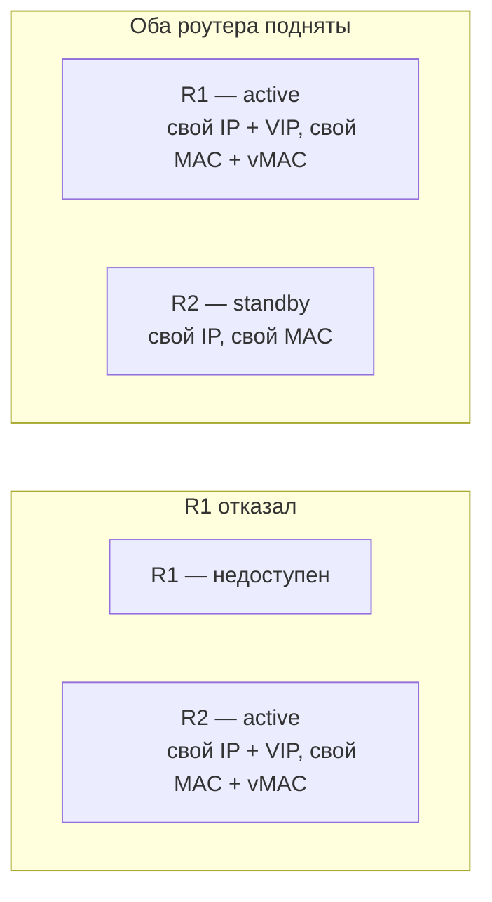
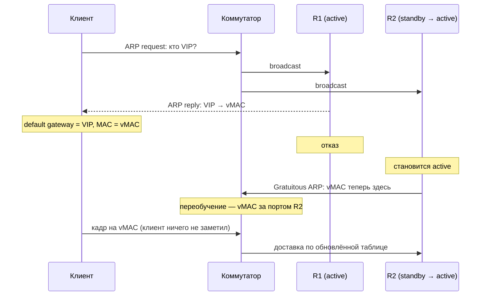
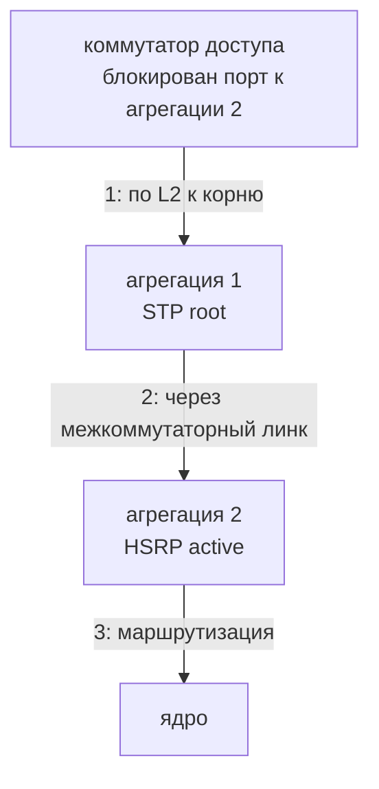

# Резервирование шлюза

## Протоколы резервирования первого хопа [05:23](https://www.youtube.com/watch?v=3S93uq63zlg&t=323s)

> [!note] **FHRP** (First Hop Redundancy Protocol) — не протокол, а название семейства протоколов, резервирующих устройство, которое служит [[Таблица маршрутизации#Решение на хосте-отправителе [10 20](https //www.youtube.com/watch?v=l9F567JS-5o&t=620s)|default gateway]] для сегмента
> Роутеры одной группы общаются друг с другом и отслеживают состояние соседа

| Протокол | Кто выпустил | Открытость |
|---|---|---|
| **HSRP** (Hot Standby Router Protocol) | Cisco, придуман до появления стандартного решения | проприетарный, [[RFC]] 2281 описывает только v1 |
| **VRRP** (Virtual Router Redundancy Protocol) | появился позже | стандартный (RFC 5798 — v3), идейно похож на HSRP, но **несовместим** с ним |
| **GLBP** (Gateway Load Balancing Protocol) | Cisco | проприетарный |

На оборудовании Cisco можно выбрать любой из трёх; на другом вендоре — VRRP либо проприетарный протокол этого вендора [07:27](https://www.youtube.com/watch?v=3S93uq63zlg&t=447s). Дальше в заметке — механика HSRP; у VRRP она устроена так же с точностью до терминологии, различия отмечены по ходу

GLBP решает ту же задачу иначе: вместо одного активного шлюза для всех клиентов раздаёт им **разные виртуальные [[MAC-адресация|MAC]]**, и трафик от разных клиентов сразу уходит на разные физические роутеры — балансировка нагрузки без ручной раскладки по [[VLAN и стандарт 802.1Q|VLAN]]

## Active, виртуальный адрес и ARP [07:27](https://www.youtube.com/watch?v=3S93uq63zlg&t=447s)

### Active и standby [07:27](https://www.youtube.com/watch?v=3S93uq63zlg&t=447s)

HSRP настраивается на интерфейсе, смотрящем в сторону пользователей: на обоих роутерах — одна и та же **standby-группа** (номер + опции, команда `standby` в Cisco IOS). Роутеры обнаруживают друг друга, устанавливают соседство и выбирают роли — **active** обрабатывает пользовательский трафик, **standby** ждёт своей очереди. У VRRP та же пара ролей называется **master** и **backup**

### Виртуальный IP и виртуальный MAC [08:29](https://www.youtube.com/watch?v=3S93uq63zlg&t=509s)

> [!success] Поверх собственных [[IP-адрес и маска подсети|IP]] и MAC каждого роутера живёт общая для группы виртуальная пара
> Администратор настраивает только **виртуальный IP** (VIP) — он не назначается ни одному интерфейсу как собственный. Виртуальный [[MAC-адресация|MAC]] (vMAC) выбирать не нужно: он берётся из зарезервированного блока и зависит только от номера группы. Активный роутер обрабатывает трафик и на свой собственный адрес, и на виртуальный

| Параметр | HSRPv1 | HSRPv2 | VRRP |
|---|---|---|---|
| Транспорт | [[Протокол UDP\|UDP]] 1985 | UDP 1985 | IP-протокол 112 (не UDP) |
| Multicast-адрес | 224.0.0.2 | 224.0.0.102 | 224.0.0.18 |
| Виртуальный MAC | `0000.0C07.AC{группа}` | `0000.0C9F.F{группа}` | `0000.5E00.01{VRID}` |
| Приоритет по умолчанию | 100 | 100 | 100 |
| Preempt по умолчанию | выключен | выключен | включён[^preempt-default] |

[^preempt-default]: RFC 5798 явно фиксирует `Preempt_Mode` по умолчанию `True`; RFC 2281 такого значения для HSRP не задаёт вовсе, но Cisco IOS по умолчанию preempt держит выключенным. Лектор [16:47](https://www.youtube.com/watch?v=3S93uq63zlg&t=1007s) говорит про preempt как про общую опцию, не уточняя разницу между протоколами — раздел ниже

### ARP видит только активного [11:05](https://www.youtube.com/watch?v=3S93uq63zlg&t=665s)

На клиенте в качестве default gateway прописан **виртуальный** IP — все клиенты сегмента настраиваются одинаково. [[Протокол ARP|ARP-запрос]] о нём широковещательный, его получают оба роутера группы, но отвечает только активный — и отдаёт в reply **виртуальный** MAC, не собственный

После смены ролей новый active рассылает [[Proxy ARP и разновидности ARP#Gratuitous ARP [1 00 35](https //www.youtube.com/watch?v=1XavYjeAaog&t=3635s)|gratuitous ARP]] с виртуальным MAC в поле отправителя, чтобы коммутаторы [[Хаб, мост и коммутатор#Обучение моста [55 11](https //www.youtube.com/watch?v=wQhMAl--_r0&t=3311s)|переобучились]] — тот же MAC теперь виден за другим портом

Для клиента переключение полностью прозрачно: он использовал VIP и vMAC до отказа, использует их же и после — какой физический роутер стоит за ними, ему не важно

## Обратный трафик идёт по маршрутизации, а не по FHRP [15:15](https://www.youtube.com/watch?v=3S93uq63zlg&t=915s)

FHRP управляет только исходящим из сегмента направлением. Трафик из ядра вниз возвращается по обычной маршрутизации — ядро знает про сегмент через [[Классификация протоколов маршрутизации#IGP и EGP|IGP]], а не через standby-группу

> [!warning] "Роль переехала — и всё" — типичная забытая деталь
> При отказе интерфейса роутер должен перестать анонсировать в IGP соответствующий префикс. Не настроил это — трафик из ядра продолжит идти на роутер, у которого доступа к подсети уже нет: виртуальный IP переехал, а физический маршрут в ядре — нет

## Preempt и preempt delay [16:47](https://www.youtube.com/watch?v=3S93uq63zlg&t=1007s)

При подъёме сети идут выборы ролей по приоритету — чем он выше, тем вероятнее стать active. **Preempt** решает, что происходит, когда в сеть позже приходит роутер с ещё более высоким приоритетом: включён — он перехватывает роль сразу; выключен — ждёт, пока действующий active не откажет сам

**Preempt delay** — задержка перед перехватом, отсчитывается от момента появления роутера в сети. Нужна, когда из ядра прилетает много префиксов и [[Классификация протоколов маршрутизации#IGP и EGP|IGP]] должен сойтись: без задержки новый active перехватит трафик раньше, чем построит таблицу маршрутизации, и будет его дропать. Величину задержки считают из времени полной сходимости IGP

## Ручная балансировка по VLAN [19:53](https://www.youtube.com/watch?v=3S93uq63zlg&t=1193s)

Standby-группа привязана не к роутеру целиком, а к интерфейсу или [[L3-коммутаторы и SVI|саб-интерфейсу]]. На физическом интерфейсе создают саб-интерфейсы, каждому назначают VLAN, и на каждом независимо настраивают свою группу

Один и тот же роутер может быть active для одних VLAN и standby для других — так вручную распределяют нагрузку между двумя маршрутизаторами. При отказе роутера все его активные группы переезжают на второй разом

## Согласование HSRP-active со STP-root [40:10](https://www.youtube.com/watch?v=3S93uq63zlg&t=2410s)

Когда на агрегации стоит пара [[L3-коммутаторы и SVI|L3-коммутаторов]], на неё накладываются сразу два независимых протокола выбора роли — HSRP и [[Протокол STP|STP]]

Если active по HSRP оказался не тем же устройством, что [[Протокол STP#Выборы корневого моста [46 53](https //www.youtube.com/watch?v=eC3UwwTFCbg&t=2813s)|root]] по STP, трафик от клиента идёт не туда: сначала по L2 до чужого коммутатора агрегации, затем через inter-switch линк до действительно активного, и только потом в ядро — путь вдвое длиннее необходимого, а межкоммутаторный линк несёт трафик со всех коммутаторов доступа разом

> [!important] Правило проектирования: active по HSRP = root по STP
> Тогда трафик идёт доступ → агрегация → маршрутизация → ядро, а линк между коммутаторами агрегации не задействуется вовсе
