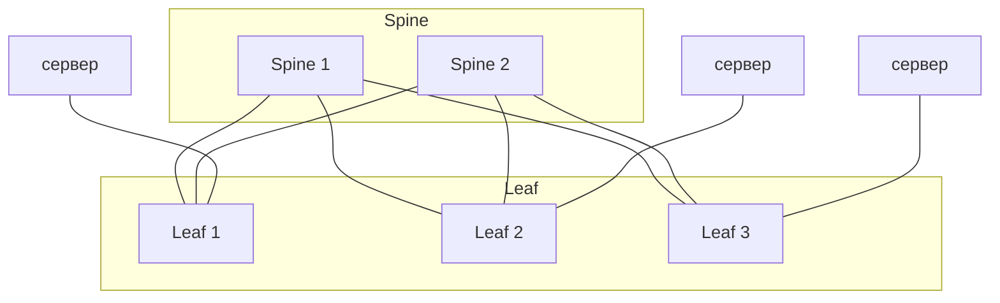

# Топология дата-центра Clos

## East-west вместо north-south [66:37](https://www.youtube.com/watch?v=3S93uq63zlg&t=3997s)

В [[Трёхуровневая кампусная топология#Профиль трафика  80/20 и north-south [63 26](https //www.youtube.com/watch?v=3S93uq63zlg&t=3806s)|кампусе]] профиль трафика 80/20 — наружу и локально. В дата-центре соотношение обратное: **20% наружу, 80% внутри**. Причина не в том, что "сервера сами себя смотрят" — на один пользовательский запрос обрабатывается множество внутренних транзакций: фронтенд-сервер отдаёт страницу, обращается к серверу авторизации, тот — к серверу динамического контента, тот подгружает видеопоток, и только после всей цепочки пользователь получает ответ

Отсюда терминология: в кампусе преобладает **north-south** трафик (пользователи ↔ сеть), в дата-центре — **east-west** (сервер ↔ сервер) [68:11](https://www.youtube.com/watch?v=3S93uq63zlg&t=4091s). Именно east-west трафик и продиктовал дата-центрам архитектуру, отличную от [[Трёхуровневая кампусная топология|трёхуровневой кампусной]]

## Spine и leaf [69:13](https://www.youtube.com/watch?v=3S93uq63zlg&t=4153s)

> [!note] **Clos**-топология[^clos] — двухуровневая фабрика из **spine** и **leaf**: серверы и любые конечные устройства подключаются к leaf, каждый leaf соединён с **каждым** spine
> Leaf-ы между собой напрямую не соединяются, spine-ы между собой — тоже. Вся связность — только через полный двудольный [[Графы#^graph|граф]] leaf ↔ spine

[^clos]: Топология названа в честь Charles Clos — в 1953 году он описал в Bell System Technical Journal неблокирующую многокаскадную коммутационную сеть для телефонии ("A Study of Non-Blocking Switching Networks"). В дата-центрах прижилась двухуровневая версия его схемы

### Предсказуемость в два хопа [70:16](https://www.youtube.com/watch?v=3S93uq63zlg&t=4216s)

От любого сервера до любого другого — максимум **2 хопа**: leaf → spine → leaf. Неважно, к каким leaf подключены отправитель и получатель — путь всегда одной и той же длины, в отличие от трёхуровневой кампусной топологии, где путь зависит от того, на каком коммутаторе доступа сидят оба узла и совпадает ли он с их точкой выхода в ядро

## Масштабирование фабрики и ECMP [71:21](https://www.youtube.com/watch?v=3S93uq63zlg&t=4281s)

| Чего не хватает | Что добавляют | Эффект |
|---|---|---|
| портов для подключения серверов | leaf-коммутаторы | больше портовой ёмкости, каждый новый leaf цепляется ко всем существующим spine |
| производительности фабрики | spine-коммутаторы | вдвое больше spine — вдвое больше равнозначных путей между любыми двумя leaf (было 2, стало 4) и вдвое больше пропускной способности |

Множественность равных путей задействует [[Расчёт подсетей и VLSM#Автоматическая суммаризация [1 05 48](https //www.youtube.com/watch?v=oOFuvP3JxUM&t=3948s)|ECMP]] — балансировку по путям одинаковой стоимости. Именно она прогоняет east-west трафик в объёмах на порядки больше, чем позволила бы обычная трёхуровневая топология

> [!tip] Сколько spine нужно — вопрос oversubscription ratio
> **Oversubscription ratio** leaf-коммутатора — отношение суммарной полосы портов вниз, к серверам, к суммарной полосе портов вверх, к spine. Соотношение 1:1 — **non-blocking fabric**, все серверы теоретически могут говорить одновременно на полной скорости; 3:1 экономит аплинки ценой возможной конкуренции за них при пиковой нагрузке
>
> Лектор эту величину не называет, но именно ею на практике считают, сколько spine и с какими линками нужна фабрике

## Типы leaf [73:53](https://www.youtube.com/watch?v=3S93uq63zlg&t=4433s)

Leaf-коммутаторы специализируются по назначению:

| Тип | Что к нему подключено |
|---|---|
| **Compute leaf** | серверы |
| **Transport leaf**[^border] | точки входа/выхода фабрики — внешние линки, маршрутизаторы, подключения к пользователям |
| **Service leaf** | специализированное оборудование: firewall, балансировщики нагрузки, оптимизаторы трафика |

[^border]: У других вендоров и в документации ту же роль часто называют **border leaf**; лектор [73:53](https://www.youtube.com/watch?v=3S93uq63zlg&t=4433s) использует термин "transport leaf" — понятие то же, вход и выход трафика из фабрики

## Фабрика как underlay [1:12:27](https://www.youtube.com/watch?v=hW8YoPG8NMc&t=4347s)

Серверам, подключённым к разным leaf, иногда нужна L2-связность — например, чтобы виртуальная машина переехала на другой хост, не меняя адреса. Как её растягивают поверх чисто L3-маршрутизируемой фабрики — leaf в роли [[VXLAN и EVPN|VTEP]], инкапсуляция, [[VXLAN и EVPN#Underlay и overlay [1 15 00](https //www.youtube.com/watch?v=hW8YoPG8NMc&t=4500s)|underlay и overlay]] — в [[VXLAN и EVPN|разборе VXLAN]]
