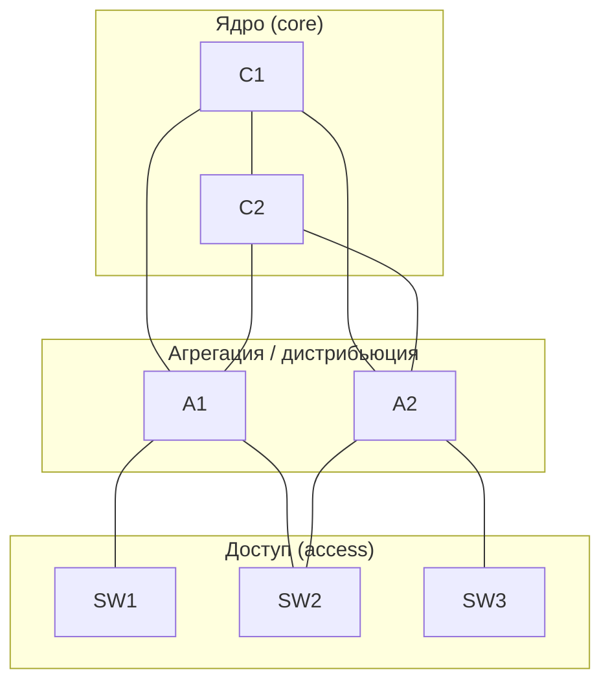

# Трёхуровневая кампусная топология

## Три уровня: доступ, агрегация, ядро [1:22:30](https://www.youtube.com/watch?v=b4WWXd9Uu0k&t=4950s)

[[Топологии сетей#Комбинированные топологии [82 16](https //www.youtube.com/watch?v=PHgnSnlxmLk&t=4936s)|Иерархическая звезда]], развёрнутая до трёх ярусов, получает роли и имена:

| Уровень | Задача | Типичное оборудование [1:26:09](https://www.youtube.com/watch?v=b4WWXd9Uu0k&t=5169s) |
|---|---|---|
| **Доступ (access)** | подключить максимум конечных узлов на невысокой скорости | коммутаторы; раньше FastEthernet, сейчас чаще гигабит |
| **Агрегация / дистрибьюция (aggregation/distribution)** | собрать трафик с нескольких коммутаторов доступа | интерфейсы быстрее и связность выше, чем на доступе, но не как в ядре |
| **Ядро (core)** | передать трафик между блоками сети максимально быстро | маршрутизаторы или [[L3-коммутаторы и SVI\|L3-коммутаторы]]; избыточные линки, часто [[Топологии сетей#Полносвязная и неполносвязная [80 42](https //www.youtube.com/watch?v=PHgnSnlxmLk&t=4842s)\|mesh]] [1:26:40](https://www.youtube.com/watch?v=b4WWXd9Uu0k&t=5200s) |

В ядре сложную фильтрацию и политики не применяют — только быструю пересылку; [[MTU и фрагментация|ACL]], QoS и прочая сложность остаются на нижних уровнях

> [!tip] У небольшой сети агрегация и ядро схлопываются в один уровень
> **Collapsed core** — распространённый дизайн: если сети не хватает масштаба для отдельных устройств ядра, те же коммутаторы агрегации выполняют и его функции. Двухуровневая топология (access + collapsed core) — норма для небольшого офиса, отдельное ядро появляется по мере роста числа блоков агрегации

## Где обрывается L2 [1:25:35](https://www.youtube.com/watch?v=b4WWXd9Uu0k&t=5135s)

Ядро — чистый L3, доступ — чистый L2, переход происходит "где-то" на агрегации. Чем сеть новее, тем дальше L3-домен спущен от ядра вниз; чем старее — тем он меньше и ближе к ядру[^age]

[^age]: Наблюдение лектора [1:25:35](https://www.youtube.com/watch?v=b4WWXd9Uu0k&t=5135s) о тренде проектирования, не жёсткое правило: граница L2/L3 — решение конкретной сети

[[VLAN и стандарт 802.1Q|VLAN]]'ы и подсети пользователей терминируются именно там, где обрывается L2 — на маршрутизирующем устройстве агрегации. Оно же играет для этих пользователей роль [[Таблица маршрутизации#Решение на хосте-отправителе [10 20](https //www.youtube.com/watch?v=l9F567JS-5o&t=620s)|default gateway]] [03:48](https://www.youtube.com/watch?v=3S93uq63zlg&t=228s)

## Единая точка отказа на агрегации [04:20](https://www.youtube.com/watch?v=3S93uq63zlg&t=260s)

Отказ устройства агрегации целиком или отказ его интерфейса разом отрезает от ядра одну или несколько подсетей. Агрегация отказоустойчивее доступа — два блока питания, иногда два [[VLAN и стандарт 802.1Q#Шасси как набор логических коммутаторов [07 50](https //www.youtube.com/watch?v=eC3UwwTFCbg&t=470s)|супервизора]] — но вероятность отказа не нулевая

Резервировать сам маршрутизатор целиком дорого и не всегда нужно — достаточно зарезервировать роль, которую он играет для пользователей: [[Резервирование шлюза|шлюз по умолчанию]]

## Профиль трафика: 80/20 и north-south [63:26](https://www.youtube.com/watch?v=3S93uq63zlg&t=3806s)

Современный кампус: около **80% трафика уходит наружу** — к сторонним сервисам и в интернет, **20% остаётся внутри** сети. Раньше было наоборот: интернет-каналы были узкие и дорогие, поэтому видеохостинги и файловые хранилища держали локально

Лектор иллюстрирует переменой на себе: лекция читается в институтской аудитории, но запись сразу уходит на YouTube — сторонний по отношению к вузу ресурс, и студент из общежития смотрит её оттуда же, добавляя трафик в те же 80%

Направление движения — преимущественно **north-south**: между пользователями и остальной сетью или интернетом [68:11](https://www.youtube.com/watch?v=3S93uq63zlg&t=4091s). У дата-центра профиль обратный — [[Топология дата-центра Clos|20% наружу и 80% east-west]] между серверами, и это меняет саму архитектуру фабрики
