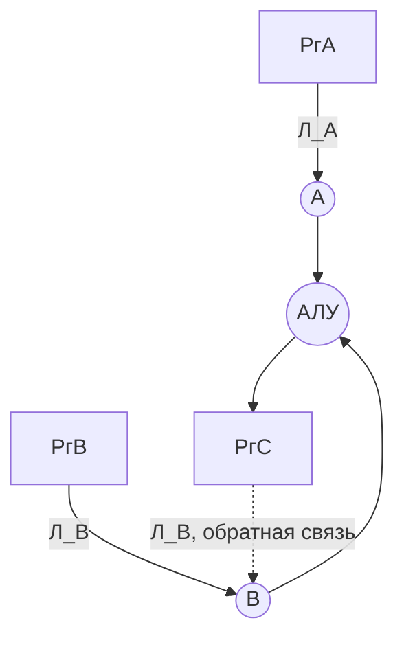
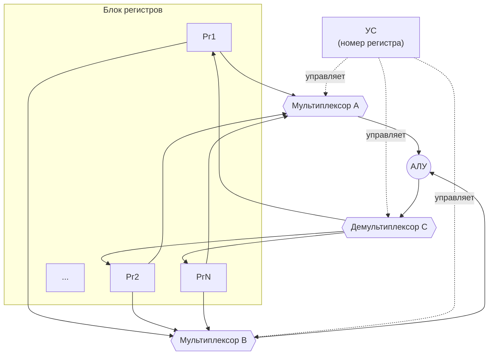

# Жёсткая и магистральная структура АЛУ

[[Арифметико-логическое устройство|АЛУ]] соединяется с регистрами процессора одним из двух способов

## Жёсткая структура

Комбинационные схемы жёстко закреплены между конкретными регистрами: вход $A$ соединён с регистром РгА через логическую схему Л_A, вход $B$ коммутируется схемой Л_B между регистром РгB и обратной связью с выходным регистром РгC, а результат всегда пишется в РгC

Никакой гибкости переназначения нет: чтобы АЛУ обработало данные из другой пары регистров, эти данные нужно сначала физически переместить в РгА/РгB

## Магистральная структура

[[Арифметико-логическое устройство|БОД]] и регистры взаимодействуют через общие магистрали (шины): [[Комбинационные схемы#Мультиплексор|мультиплексоры]] A и B выбирают в качестве операнда любой регистр Ргi блока регистров, а [[Комбинационные схемы#Демультиплексор|демультиплексор]] C записывает результат в любой выбранный регистр — управляющий сигнал (УС) во всех трёх узлах один и тот же номер регистра

Регистры Ргi блока регистров — это те же [[Регистры процессора|программно доступные регистры]] процессора

## Затраты времени на выполнение операции

$$T_{\text{жёсткая}} = t_в + t_{оп} + t_с \qquad T_{\text{магистральная}} = t_в + t_{оп} + t_с + t_{MUX} + t_{DMX}$$

| Обозначение | Смысл |
| --- | --- |
| $t_в$ | Длительность выборки операнда из регистра |
| $t_{оп}$ | Длительность самой операции |
| $t_с$ | Длительность сохранения результата в регистре |
| $t_{MUX}$ | Задержка мультиплексора |
| $t_{DMX}$ | Задержка демультиплексора |

Магистральная структура всегда медленнее жёсткой ровно на сумму задержек мультиплексора и демультиплексора — цена, которую платят за гибкость выбора операндов

> [!tip] Жёсткая структура быстрее, магистральная — удобнее для разработки
> Под жёсткую структуру неудобно программировать: приходится вручную и жёстко отслеживать, в каком регистре что лежит, и явно перемещать данные между регистрами по ходу вычислений. Магистральная структура снимает это ограничение ценой задержки мультиплексора и демультиплексора
>
> Отсюда практическое правило выбора: жёсткая структура — для специализированных решателей и специализированных микропроцессоров, где набор операций и связей известен заранее; магистральная — для универсальных процессоров широкого назначения, ориентированных на удобство средств разработки

Структура [[Цикл обработки машинной команды#Внутренняя структура процессора|АЛУ как элемента процессора]] в целом от выбора между этими двумя схемами не зависит — обе реализуют один и тот же набор [[Арифметико-логическое устройство#Минимальный набор операций|аппаратных операций]]
