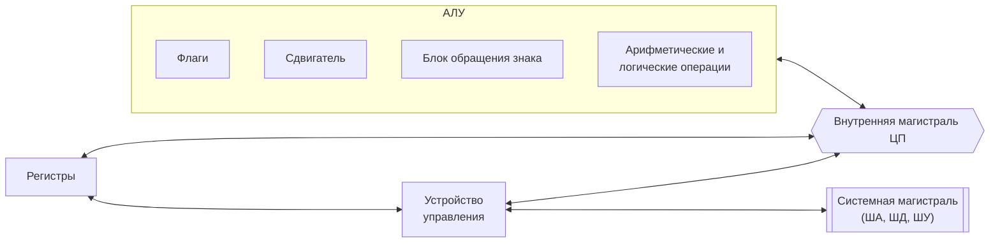
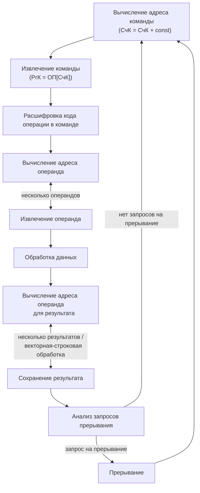
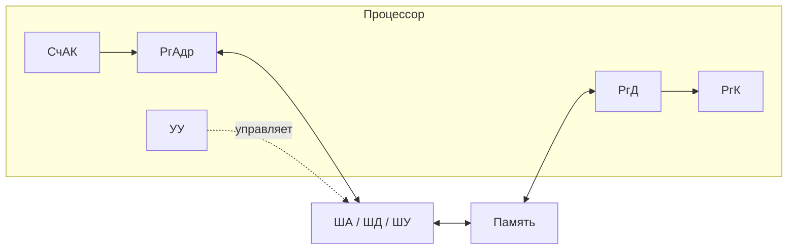

# Цикл обработки машинной команды

> [!note] **Цикл обработки команды** (ЦОК) — процесс обработки одной отдельной машинной команды
> Пять составляющих его операций: извлечение команды, интерпретация (расшифровка) команды, извлечение данных, обработка данных, запись данных

## Структурная и функциональная модель процессора

Одну и ту же аппаратуру процессора можно описывать двумя моделями:

- **Структурная модель** — элементы процессора и связи между ними, без разделения по роли
- **Функциональная модель** — те же связи, но разделённые на два вида: **информационные** (по ним движутся обрабатываемые данные) и **управляющие** (по ним движутся сигналы, задающие, что именно делать с данными)

## Внутренняя структура процессора

На [[Структура и архитектура компьютера#Структурная схема компьютера|предыдущем уровне детализации]] центральный процессор раскрывался только до регистров, [[Арифметико-логическое устройство|АЛУ]], устройства управления и внутренних шин между ними. Здесь та же структура детализирована до отдельных функциональных блоков:

**Флаги** — регистр кодов условий, единственный из [[Регистры процессора|регистров процессора]], формируемый самим процессором как признак результата последней операции: программист не может записать в него значение целиком, только считать состояние отдельных битов для организации циклов и условных переходов

**Сдвигатель** и **блок обращения знака** — отдельные от основного сумматора-компаратора блоки обработки данных внутри АЛУ, наравне с блоком арифметических и логических операций (детали структуры самого АЛУ — [[Жёсткая и магистральная структура АЛУ|дальше]])

## Развёрнутый цикл обработки команды

Восемь операций, разложенные по стадиям и связанные в замкнутый граф с двумя видами ветвлений — по числу операндов/результатов (векторная и строковая обработка) и по наличию запроса на прерывание:

На фазе извлечения команды все действия — чистые пересылки (регистр→регистр, регистр→шина), арифметики в этой фазе нет вообще; фаза обработки прерывания устроена так же просто: сохранить точку возврата в стек, загрузить адрес обработчика в счётчик команд

Обработка векторных и строковых операндов — малый внутренний цикл: вычислили адрес одного элемента, затем на каждом шаге цикла добавляют к нему смещение, равное длине операнда, чтобы получить адрес следующего — отсюда и оба ветвления "несколько операндов"/"несколько результатов" на графе выше

### Потоки данных

Схема одна и та же для фазы извлечения команды и для фазы прерывания — в обозначениях диаграммы это те же [[Регистры процессора#Регистры управления и состояния|регистры управления и состояния]], что и СчК, РгАОП и РгДОП: СчАК/РгАдр вычисляет и хранит адрес обращения к памяти, обмен с памятью идёт через ША (шину адреса), ШД (шину данных) и ШУ (шину управления) под управлением [[Устройство управления|УУ]], а РгД принимает слово из памяти

Различие — только в том, что происходит с полученным словом дальше: при извлечении команды оно грузится в РгК (регистр команд) и запускает расшифровку; при обработке прерывания загрузки в РгК нет вовсе — вместо неё сохраняется точка возврата и адрес обработчика передаётся в СчАК

## Принцип фон Неймана в основе цикла

Цикл обработки опирается на [[Принципы фон Неймана#^neumann-principles|принцип однородности памяти]]: команды и данные лежат в общей памяти и неразличимы без разметки, поэтому вычисление адреса команды и вычисление адреса операнда — на графе выше два формально одинаковых по механике, но разных по назначению шага
