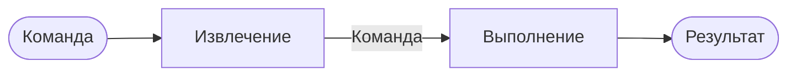
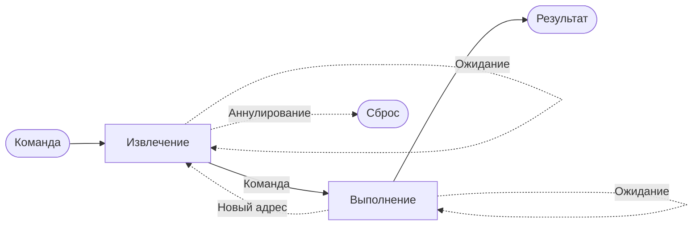
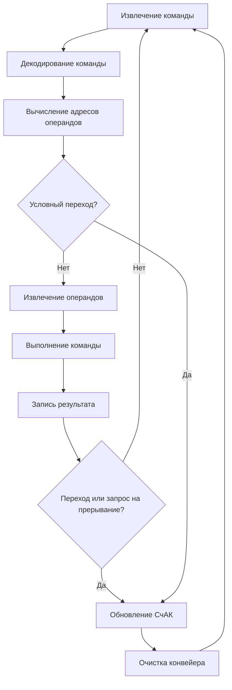

# Конвейер команд

> [!note] **Конвейер** разбивает [[Цикл обработки машинной команды|цикл обработки команды]] на $K$ независимых стадий на разных аппаратных ресурсах и перекрывает их во времени: пока одна команда на стадии выполнения, следующая уже проходит стадию извлечения
> В каждый момент времени одновременно обрабатываются до $K$ команд — не одна команда за раз, как без конвейера

## Принцип конвейера

Пока команда обрабатывается на блоке выполнения, блок извлечения уже загружает следующую машинную команду — оба блока заняты одновременно, а не последовательно

## Причины снижения производительности

Два источника простоя стадий (стр. 170): **дисбаланс длительностей** — выполнение обычно дольше извлечения — и **непредсказуемость адреса** следующей команды при условном переходе, пока он не выполнен:

Обе причины дают простой: **ожидание** — стадия ждёт данные для следующего шага, **аннулирование** — уже извлечённая по неверному предположению команда сбрасывается, когда стадия выполнения возвращает истинный **новый адрес** перехода

### Требования к эффективному конвейеру

Максимально возможное число независимых этапов и равная длительность каждого — постоянный такт конвейера $\tau=\text{const}$: чем ровнее стадии по времени, тем меньше самая медленная из них диктует простой остальных

## Числовой пример

6 этапов цикла обработки — извлечение команды (**ИК**), декодирование команды (**ДК**), вычисление адресов операндов (**АО**), извлечение операндов (**ИО**), выполнение команды (**ВК**), запись результата (**ЗР**) — и поток из 9 команд:

| Такт | 1 | 2 | 3 | 4 | 5 | 6 | 7 | 8 | 9 | 10 | 11 | 12 | 13 | 14 |
| --- | :-: | :-: | :-: | :-: | :-: | :-: | :-: | :-: | :-: | :-: | :-: | :-: | :-: | :-: |
| Команда 1 | ИК | ДК | АО | ИО | ВК | ЗР | | | | | | | | |
| Команда 2 | | ИК | ДК | АО | ИО | ВК | ЗР | | | | | | | |
| Команда 3 | | | ИК | ДК | АО | ИО | ВК | ЗР | | | | | | |
| Команда 4 | | | | ИК | ДК | АО | ИО | ВК | ЗР | | | | | |
| Команда 5 | | | | | ИК | ДК | АО | ИО | ВК | ЗР | | | | |
| Команда 6 | | | | | | ИК | ДК | АО | ИО | ВК | ЗР | | | |
| Команда 7 | | | | | | | ИК | ДК | АО | ИО | ВК | ЗР | | |
| Команда 8 | | | | | | | | ИК | ДК | АО | ИО | ВК | ЗР | |
| Команда 9 | | | | | | | | | ИК | ДК | АО | ИО | ВК | ЗР |

Без конвейера 9 команд по 6 тактов каждая — $6\times9=54$ такта последовательно. На конвейере загрузка (первые 6 тактов) выводит только первый результат, а дальше каждый такт завершается ещё одна команда — итог $6+(9-1)=14$ тактов

## Три вида рисков (конфликтов)

- **Структурный риск** — несколько команд одновременно претендуют на один и тот же аппаратный ресурс (например, оба обращения к одному регистру); исключается на этапе проектирования процессора, когда функциональная модель заранее распределяет ресурсы по тактам
- **Риск по данным** — следующая команда использует результат ещё не завершённой предыдущей. В таблице выше видно на что похож этот риск буквально: если команда 2 зависит от результата команды 1, а команда 1 пишет результат только на такте 6, тогда как команде 2 нужно извлечь операнды уже на такте 5 — данные ещё не готовы на такт раньше, чем требуются[^data-hazard]
- **Риск по управлению** — неоднозначность при выборке следующей команды из-за условного перехода — устранить программно нельзя, поскольку большая часть программ активно использует условные переходы; методы борьбы с ним — тема [[Предсказание переходов|следующей заметки]]

[^data-hazard]: Один из инструментов борьбы с риском по данным — [[Intel P6 и Motorola MPC604#Структура Intel P6|блок изменения последовательности команд (ROB)]] Intel P6: он не только запускает независимые команды на разные исполнительные блоки, но и "разводит" зависимые команды по тактам так, чтобы к моменту выполнения данные были готовы (лектор, 03.12.2024)

## Пример конфликта по управлению со штрафом

Команда 3 — условный переход на команду 15. Конвейер по инерции продолжает набирать команды 4–7 естественным порядком; на такте 8 обнаруживается ошибка предсказания, конвейер сбрасывается и загружается заново:

| Такт | 1 | 2 | 3 | 4 | 5 | 6 | 7 | 8 | 9 | 10 | 11 | 12 | 13 | 14 |
| --- | :-: | :-: | :-: | :-: | :-: | :-: | :-: | :-: | :-: | :-: | :-: | :-: | :-: | :-: |
| Команда 1 | ИК | ДК | АО | ИО | ВК | ЗР | | | | | | | | |
| Команда 2 | | ИК | ДК | АО | ИО | ВК | ЗР | | | | | | | |
| Команда 3 | | | ИК | ДК | АО | ИО | ВК | ЗР | | | | | | |
| Команда 4 | | | | ИК | ДК | АО | ИО | | | | | | | |
| Команда 5 | | | | | ИК | ДК | АО | | | | | | | |
| Команда 6 | | | | | | ИК | ДК | | | | | | | |
| Команда 7 | | | | | | | ИК | | | | | | | |
| Команда 8 | | | | | | | | ИК | ДК | АО | ИО | ВК | ЗР | |
| Команда 9 | | | | | | | | | ИК | ДК | АО | ИО | ВК | ЗР |

Команды 4–7 не доводятся до записи результата — они уже извлечены по неверному предположению и аннулируются

С такта 9 по такт 12 включительно ни одна команда не завершается — это и есть **штраф**: 4 такта простоя из-за неверно предсказанного перехода, прежде чем на такте 13 конвейер выдаёт первый результат заново загруженной ветки (команда 8 на схеме — это уже верно предсказанная 15-я команда программы, восстановленный конвейер просто продолжает нумероваться по инерции схемы)

## Алгоритм управления конвейером

И подтверждённый условный переход, и принятый запрос на прерывание ведут по одному и тому же пути — обновить счётчик адреса команды на новый адрес и очистить конвейер от уже извлечённых по инерции команд; обычное последовательное выполнение продолжается без этого шага

## Метрики производительности конвейера

Для потока из $N$ команд, конвейера с $K$ стадиями и тактом $\tau$:

$$
\boxed{T_K = (K + (N-1))\tau \qquad S = \frac{NK}{K+(N-1)} \qquad E = \frac{S}{K} = \frac{N}{K+(N-1)} \qquad P = \frac{E}{\tau} = \frac{N}{(K+(N-1))\tau}}
$$

где $T_K$ — время на конвейере (без конвейера — $NK\tau$), **ускорение** $S$ — отношение времени без конвейера ко времени с конвейером, **эффективность** $E$ — доля ускорения на одну стадию конвейера, **пропускная способность** $P$ — эффективность на единицу времени

### Числовой пример на тех же 9 командах

При $N=9$, $K=6$:

$$
S = \frac{9\cdot6}{6+8} = \frac{54}{14} = \frac{27}{7} \approx 3{,}86
\qquad
E = \frac{S}{6} = \frac{9}{14} \approx 0{,}64
\qquad
P = \frac{E}{\tau} = \frac{9}{14\tau}
$$

Лектор округляет то же ускорение до "почти в три раза", хотя точное значение $27/7\approx3{,}86$ ближе к четырёхкратному приросту

> [!tip] Ускорение не зависит от длительности такта
> $S$ определяется только длиной программы $N$ и числом стадий $K$ — сам такт $\tau$ в формуле ускорения сокращается. Абсолютные значения $S$, $E$, $P$ сами по себе не самоцель — они существуют для *сравнения*: одной программы на разных конвейерах или разных программ на одном конвейере, то есть как критерий выбора архитектуры или программы

Даже без единого изменения техпроцесса рациональная организация цикла в конвейер даёт здесь почти четырёхкратный прирост — для сравнения, [[Закон Мура|закон Мура]] обещает лишь удвоение производительности за счёт элементной базы раз в полтора года
