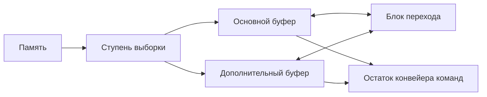
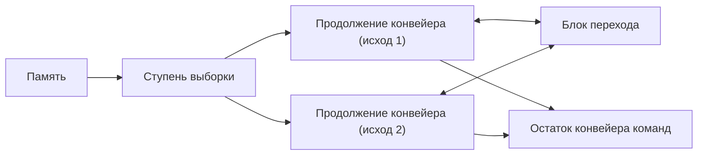
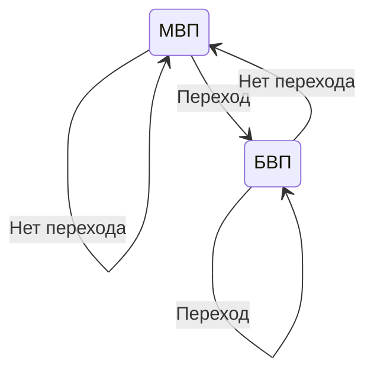
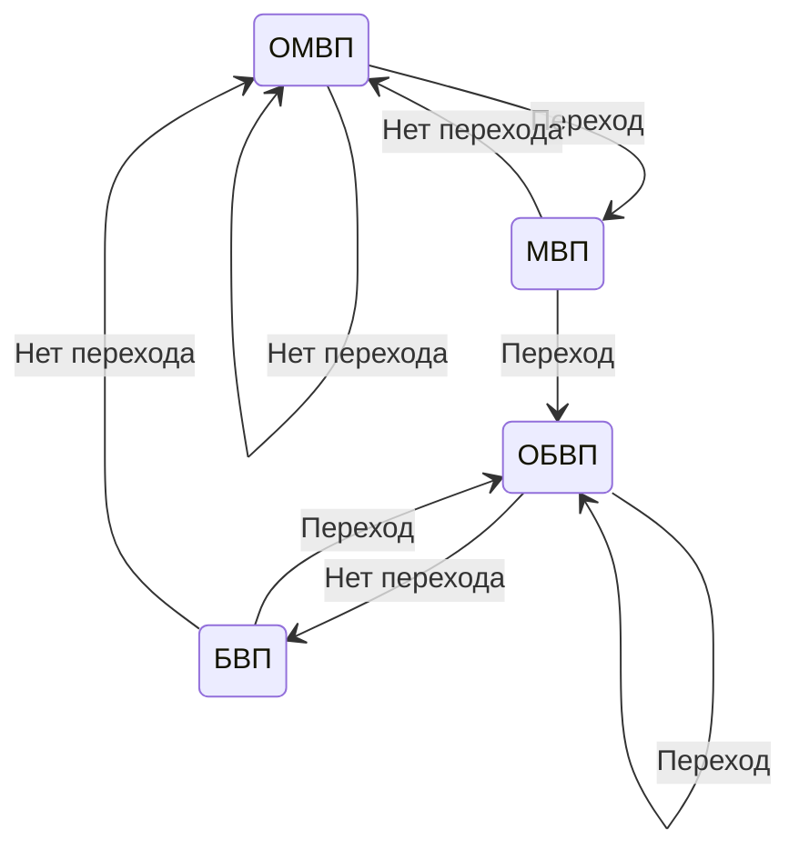

# Предсказание переходов

[[Конвейер команд#Три вида рисков (конфликтов)|Риск по управлению]] — единственный из трёх рисков конвейера, который нельзя устранить на этапе проектирования: адрес следующей команды после условного перехода неизвестен, пока переход не выполнен. Курс перечисляет методы от самых грубых (дублирование аппаратуры) до тонких (автоматы с памятью истории)

## Буферы предвыборки

Основной и дополнительный буфер получают из памяти **оба** потенциальных потока команд ещё до вычисления условия перехода:

Когда исход перехода становится известен, на конвейер коммутируется выход нужного буфера — работа, проделанная для другой ветки, просто отбрасывается

## Множественные потоки

Вместо буферизации команд дублируется сам конвейер — оба исхода перехода обрабатываются параллельно на разных аппаратных ресурсах:

> [!warning] Оба метода не масштабируются на вложенные переходы
> Условные переходы часто **вложены**, а на каждый уровень вложенности нужен свой комплект буферов или конвейеров — размножение ресурсов растёт быстрее, чем окупается эффект. Оба метода применялись на практике, но не стали основным решением

## Задержанный переход

Пока условный переход не выполнен, в освободившийся слот конвейера помещаются "полезные команды" — те, что не зависят от исхода перехода (их находит [[Конвейер команд#Три вида рисков (конфликтов)|блок изменения последовательности команд]]). Ограничение симметрично предыдущим методам: не всегда в программе есть независимый от перехода код для заполнения задержки, а сложность управления самим процессом сопоставима с потерями от риска, который он должен был устранить

## Предсказание перехода

До выполнения команды условного перехода делается предположение о наиболее вероятном исходе, и последующие команды поступают на конвейер уже в соответствии с этим предположением. **Статическое** предсказание — правило фиксировано и не меняется; **динамическое** — учитывает историю выполнения программы

### Автомат с двумя состояниями

**МВП** (малая вероятность перехода) и **БВП** (большая вероятность перехода) — состояние переключается по фактическому результату последнего перехода:

По сути это 1-битный предсказатель: следующее предсказание равно последнему фактическому исходу, а состояние — накопленное правило "предсказывать то же, что случилось в прошлый раз"

> [!tip] Это не бесполезный "пинг-понг" между состояниями
> Рассуждение о единичном изолированном переходе выглядит как случайное блуждание между МВП и БВП
>
> Но подавляющее большинство условных переходов в реальных программах — это **циклы**: обычный цикл по счётчику $N-1$ раз верно предсказывает "продолжить" и лишь один раз ошибается на выходе из цикла. Автомат почти всегда "застревает" в правильном состоянии и даёт высокую точность предсказания именно потому, что переходы на практике сильно коррелированы, а не случайны

### Автомат с четырьмя состояниями

Четыре состояния — **ОМВП** (очень малая вероятность перехода), **МВП** (малая), **БВП** (большая) и **ОБВП** (очень большая вероятность перехода):

Из "слабых" состояний (МВП, БВП) один и тот же фактический исход, что и текущее предположение, сразу насыщает автомат в противоположном крайнем состоянии (МВП/БВП → ОБВП за один шаг), а несовпавший исход возвращает в противоположную крайность (ОМВП)[^smith-diff]

Это сглаживает "дребезг" автомата с двумя состояниями на **вложенных** циклах: многоуровневая вложенность (характерно для работы с матрицами) резко повышает частоту ошибок на границах вложенных циклов, и промежуточные уровни вероятности снижают штраф на этих границах по сравнению с резким скачком МВП↔БВП

[^smith-diff]: Классический 2-битный насыщающийся счётчик из Хеннесси–Паттерсона (Smith counter) устроен иначе — линейной цепочкой из четырёх состояний, где каждый исход двигает счётчик ровно на одно состояние по цепочке (strongly-not-taken ↔ weakly-not-taken ↔ weakly-taken ↔ strongly-taken), с насыщением только на краях цепочки. Автомат этого курса вместо этого напрямую связывает "слабые" состояния с противоположной крайностью — переход из слабого состояния меняет предсказание сразу и полностью, а не постепенно ([Branch Prediction in Pentium](https://www.geeksforgeeks.org/branch-prediction-in-pentium/), GeeksforGeeks, для сверки с классической схемой)

> [!important] Методологический вывод лектора
> Программист, не задумывающийся о том, как алгоритм ляжет на конвейер, и выбирающий "решение в лоб" — глубокую вложенность условных переходов и циклов, — получает код, который конвейер физически не может эффективно предсказывать: производительность реализации падает независимо от корректности алгоритма

## Аппаратная реализация: BTB

**BTB** (Branch Target Buffer, буфер целевых адресов перехода) объединяет обе идеи выше в одну аппаратную структуру: кэш-подобная таблица по адресу команды перехода хранит историю переходов вместе с их **целевыми адресами** и подаёт предсказанный адрес прямо в блок выборки команд, не дожидаясь декодирования самой команды перехода

Именно такой блок уже встречался как часть структуры [[Intel P6 и Motorola MPC604#Структура Intel P6|Intel P6]] — там он формирует адрес следующей выбираемой команды при условном переходе, не раскрывая внутреннего устройства; в процессорах семейства Pentium BTB реализован как 4-канальный ассоциативный кэш на 256 записей[^pentium-btb]

Слайды курса структуру BTB не детализируют вовсе, только его роль в составе Intel P6 и MPC604

[^pentium-btb]: [The microarchitecture of Intel, AMD and VIA CPUs](https://www.agner.org/optimize/microarchitecture.pdf), Agner Fog — BTB Pentium на 256 записей с ассоциативностью 4
