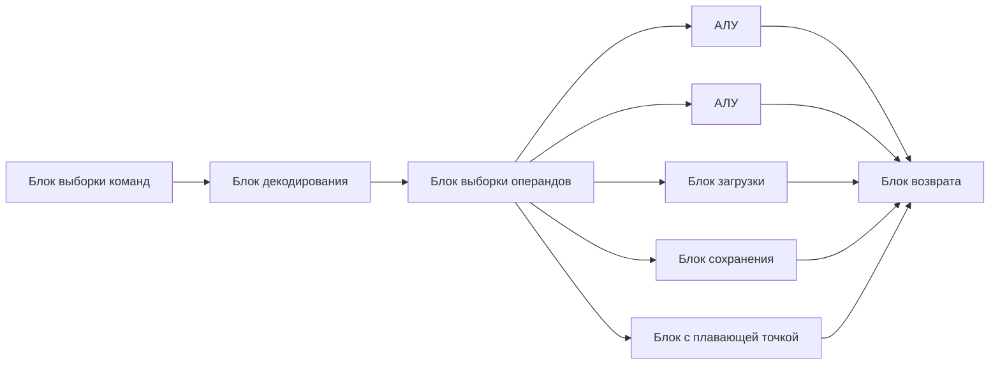

# Суперскалярные процессоры

Три независимых способа нарастить производительность [[Конвейер команд|конвейера]] сверх базовой схемы — раздробить стадии, продублировать конвейер целиком или продублировать только исполнительные блоки

## Суперконвейерная обработка

Каждый из 6 этапов [[Конвейер команд#Числовой пример|исходного цикла]] дробится на два подэтапа ([[Конвейер команд|ИК]] → ИК1+ИК2, [[Конвейер команд|ДК]] → ДК1+ДК2 и так далее) — конвейер из 12 полутактовых стадий вместо 6 тактовых. На тех же 9 командах:

| Полутакт | 1 | 2 | 3 | 4 | 5 | 6 | 7 | 8 | 9 | 10 | 11 | 12 | 13 | 14 | 15 | 16 | 17 | 18 | 19 | 20 |
| --- | :-: | :-: | :-: | :-: | :-: | :-: | :-: | :-: | :-: | :-: | :-: | :-: | :-: | :-: | :-: | :-: | :-: | :-: | :-: | :-: |
| Команда 1 | ИК1 | ИК2 | ДК1 | ДК2 | АО1 | АО2 | ИО1 | ИО2 | ВК1 | ВК2 | ЗР1 | ЗР2 | | | | | | | | |
| Команда 2 | | ИК1 | ИК2 | ДК1 | ДК2 | АО1 | АО2 | ИО1 | ИО2 | ВК1 | ВК2 | ЗР1 | ЗР2 | | | | | | | |
| Команда 3 | | | ИК1 | ИК2 | ДК1 | ДК2 | АО1 | АО2 | ИО1 | ИО2 | ВК1 | ВК2 | ЗР1 | ЗР2 | | | | | | |
| Команда 4 | | | | ИК1 | ИК2 | ДК1 | ДК2 | АО1 | АО2 | ИО1 | ИО2 | ВК1 | ВК2 | ЗР1 | ЗР2 | | | | | |
| Команда 5 | | | | | ИК1 | ИК2 | ДК1 | ДК2 | АО1 | АО2 | ИО1 | ИО2 | ВК1 | ВК2 | ЗР1 | ЗР2 | | | | |
| Команда 6 | | | | | | ИК1 | ИК2 | ДК1 | ДК2 | АО1 | АО2 | ИО1 | ИО2 | ВК1 | ВК2 | ЗР1 | ЗР2 | | | |
| Команда 7 | | | | | | | ИК1 | ИК2 | ДК1 | ДК2 | АО1 | АО2 | ИО1 | ИО2 | ВК1 | ВК2 | ЗР1 | ЗР2 | | |
| Команда 8 | | | | | | | | ИК1 | ИК2 | ДК1 | ДК2 | АО1 | АО2 | ИО1 | ИО2 | ВК1 | ВК2 | ЗР1 | ЗР2 | |
| Команда 9 | | | | | | | | | ИК1 | ИК2 | ДК1 | ДК2 | АО1 | АО2 | ИО1 | ИО2 | ВК1 | ВК2 | ЗР1 | ЗР2 |

Новая команда стартует каждый полутакт, а не каждый такт — 20 полутактов на 9 команд, то есть **10 полных тактов** вместо исходных 14: тот же результат даёт и [[Конвейер команд#Метрики производительности конвейера|формула метрик]] с $K'=12$ стадиями по $\tau/2$ каждая

> [!warning] Технология не нашла широкого практического распространения
> Выигрыш от сокращения числа тактов теряется на росте затрат на управляющую и коммутационную логику при дальнейшем дроблении стадий — теоретический эффект не окупает сложность реализации[^superpipe-fail]

[^superpipe-fail]: Лектор, 03.12.2024. Там же лектор дважды называет этот десятитактовый результат "суперскалярной обработкой", хотя по слайду 184 и по описанному механизму (дробление стадий на подэтапы) это суперконвейерная обработка — суперскалярная вводится курсом только ниже, на слайде 186, и устроена принципиально иначе (один общий конвейер плюс несколько исполнительных блоков, а не более мелкие стадии)

## Многоконвейерная обработка

Единый блок выборки извлекает из памяти сразу несколько команд и распределяет каждую по свободному из нескольких параллельных конвейеров:

Условие корректности — отсутствие конфликтов между конвейерами: если обе команды одновременно нацелены на общий ресурс, выигрыш от дублирования съедается их разбором

## Суперскалярная обработка

Один общий конвейер (выборка → декодирование → выборка операндов), но на стадии выполнения — сразу несколько независимых операционных блоков:

Стадия выполнения обычно самая долгая в цикле обработки команды, поэтому именно её распараллеливание на независимые сопроцессоры даёт наибольший выигрыш — тот же принцип уже виден в исполнительных блоках [[Intel P6 и Motorola MPC604|Intel P6 и MPC604]], оба процессора там суперскалярны, просто термин здесь вводится явно

## Структура Pentium MMX

![[Архитектура компьютеров Мосин.pdf#page=187&rect=358,24,700,339]]

Два командных конвейера: **U-конвейер** выполняет все целочисленные команды и команды с плавающей точкой, **V-конвейер** — только простые целочисленные команды и FXCH с плавающей точкой

| Особенность | Содержание |
| --- | --- |
| Набор команд | 57 дополнительных команд [[Арифметико-логическое устройство#Как граница смещалась у Intel\|MMX]] |
| Кэш-память | Удвоенный объём — по 16 Кбайт для данных и для команд каждый |
| Предсказание переходов | Улучшенная логика |
| Конвейеризация | Расширенная |

### Динамическое предсказание и приведение форматов при загрузке

Pentium MMX в этом курсе — первый массовый пример **динамического** предсказания переходов (а не статического, как в упрощённых схемах ранее): за счёт двух независимых конвейеров штрафы за неверное предсказание также сокращались

Загрузка операнда с плавающей точкой устроена спекулятивно: число, извлекаемое из памяти в одинарной (32 бита) или удвоенной (64 бита) точности, приводится к формату регистра [[Регистры процессора|FPU]] уже на этапе загрузки — параллельно с предыдущими командами, ещё до того как оно реально понадобится для вычислений

Это сокращает время, необходимое для последующих операций с плавающей точкой; если спекулятивная подготовка невозможна, конвейер простаивает в ожидании приведения формата
