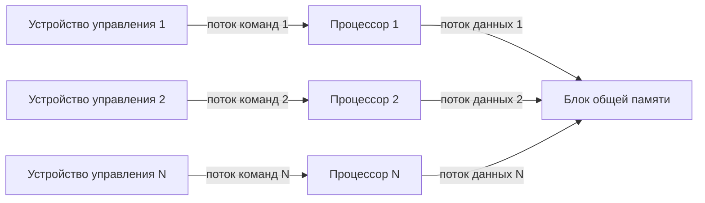
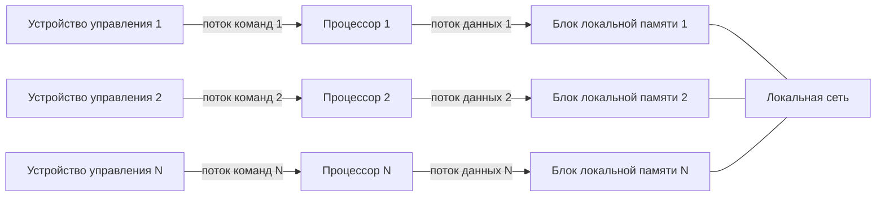
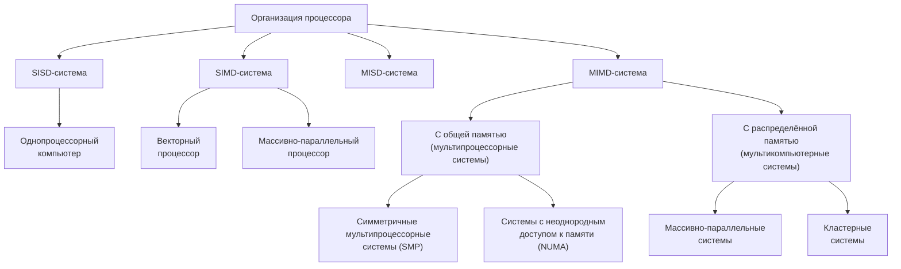
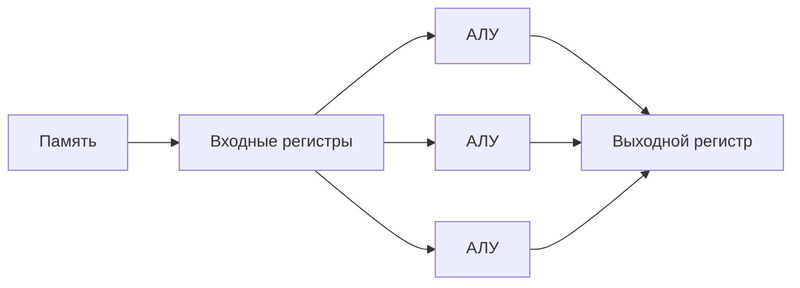

# Классификация Флинна

[[Конвейер команд|Параллелизм на уровне машинных команд]] — не единственный путь к росту производительности: если один процессор не даёт нужного прироста, задачу решает сразу группа процессоров или компьютеров. **Классификация Флинна** делит такие системы по числу потоков команд и потоков данных[^flynn1972]

[^flynn1972]: Флинн ввёл деление в [Flynn, M. J. Some Computer Organisations and Their Effectiveness. IEEE Transactions on Computers, 1972, C-21(9), 948–960](https://doi.org/10.1109/TC.1972.5009071)

## Четыре парадигмы

| Парадигма | Расшифровка | Поток команд | Поток данных |
| --- | --- | --- | --- |
| **SISD** | Single Instruction stream, Single Data stream | один | один |
| **SIMD** | Single Instruction, Multiple Data | один | много |
| **MISD** | Multiple Instruction, Single Data | много | один |
| **MIMD** | Multiple Instruction, Multiple Data | много | много |

### SISD

> [!note] Единственный процессор выполняет единственный поток команд над единственным потоком данных в единственном блоке памяти
> ```mermaid
> flowchart LR
>     CU["Устройство управления"] -->|"поток команд"| P["Процессор"]
>     P -->|"поток данных"| M["Блок памяти"]
>     M -->|"поток данных"| P
> ```

Представитель — классическая однопроцессорная система, полностью укладывающаяся в [[Принципы фон Неймана|принцип фон Неймана]]. Параллелизм на уровне машинных команд внутри одного процессора — [[Конвейер команд|конвейер]], [[Суперскалярные процессоры|суперконвейер, многоконвейерная и суперскалярная обработка]] — не выводит систему из категории SISD: параллельная обработка идёт исключительно внутри одного процессора, без привлечения дополнительных процессорных блоков

### SIMD

> [!note] Несколько **однородных** процессоров параллельно выполняют одни и те же команды единственного потока над разными потоками данных из своих блоков памяти
> ```mermaid
> flowchart LR
>     CU["Устройство управления"] -->|"поток команд"| P1["Процессор 1"]
>     CU -->|"поток команд"| P2["Процессор 2"]
>     CU -->|"поток команд"| PN["Процессор N"]
>     P1 -->|"поток данных 1"| M1["Блок памяти 1"]
>     P2 -->|"поток данных 2"| M2["Блок памяти 2"]
>     PN -->|"поток данных N"| MN["Блок памяти N"]
> ```

Однородность означает одинаковую партию/техпроцесс (максимально близкие электрические характеристики) и общую архитектуру — набор команд, форматы данных, способы адресации. SIMD остаётся **многопроцессорной**, а не многокомпьютерной системой: устройство управления и поток команд у неё один на всех процессоров, память у каждого процессора формально своя, но общая программа не даёт называть их независимыми компьютерами

Представитель — векторные вычислительные системы: **[[Арифметико-логическое устройство|MMX]]** и **[[Арифметико-логическое устройство|SSE]]** в [[Арифметико-логическое устройство#Как граница смещалась у Intel|Intel]] — это упакованная SIMD-обработка целочисленных и вещественных значений соответственно

### MISD

Множество потоков команд обрабатывают единственный поток данных. Полноценных коммерческих универсальных представителей парадигмы не существует; ближайшие интерпретации — узкоспециализированные **потоковые вычислители** (dataflow-архитектуры, где последовательность действий определяется готовностью данных, а не программой) и **самосинхронная схемотехника** (асинхронная логика без единого тактового генератора, где разные ветви вычислений срабатывают по мере готовности своих данных, с возможной рассинхронизацией скорости разных ветвей)[^misd]

[^misd]: Лектор, 09.12.2024. Обе темы полностью отсутствуют на слайдах курса

### MIMD

> [!note] Множество процессоров одновременно выполняют разные последовательности команд над разными данными
> Различают системы с общей памятью и системы с распределённой (локальной для каждого процессора) памятью, объединённые локальной сетью





Общая память или её отсутствие — водораздел, дающий два новых термина: если память общая, это одна вычислительная машина со многими процессорами — **многопроцессорная** система; если у каждого процессора своя независимая память, это несколько компьютеров, объединённых сетью, — **многокомпьютерная** система. Сеть без общей задачи не делает набор компьютеров параллельной системой: обязателен факт совместного решения одной задачи

## Дерево классификации многопроцессорных ВС



Ветвь MISD не разворачивается дальше: коммерческого представителя нет. Дальше по дереву: [[SMP и NUMA]] раскрывает обе ветви с общей памятью, [[MPP и кластерные системы]] — обе ветви с распределённой памятью

> [!warning] Два разных "массивно-параллельных" — не путать
> Дерево содержит два независимых листа с похожим названием: **массивно-параллельный процессор** — лист SIMD, один поток команд управляет матрицей однотипных процессорных элементов, ориентированных на обработку двумерных структур данных (в отличие от векторного процессора, работающего с одномерными векторами)
>
> **Массивно-параллельные системы** — лист MIMD с распределённой памятью, множество независимых компьютеров со стандартными микропроцессорами, каждый со своим потоком команд ([[MPP и кластерные системы|разобраны отдельно]]). Общее в названии — историческое: термин "massively parallel processor" исходно обозначал именно SIMD-машины вроде Connection Machine[^connection-machine], а к MIMD-кластерам стандартных микропроцессоров перекочевал позже

[^connection-machine]: [The Connection Machine, Computer History Museum](https://www.computerhistory.org/revolution/supercomputers/10/73) — CM-1 (1985) распределял данные по десяткам тысяч простых 1-битных процессорных элементов, работающих по единому потоку команд по схеме SIMD

## Векторный процессор

Слайды дают два варианта внутренней организации векторного [[Арифметико-логическое устройство|АЛУ]], оба — под одним и тем же листом SIMD на дереве классификации

### С конвейерным АЛУ


Каждая ступень векторного АЛУ отвечает за свою операцию — одна складывает, другая делит, третья умножает — и вся последовательность ступеней одновременно выполняет набор действий над потоком поступающих данных

### С несколькими АЛУ



Несколько независимых АЛУ обрабатывают данные параллельно — решение, ориентированное на суперскалярную обработку: каждый блок отвечает за своё законченное действие, и N устройств задействуются одновременно

> [!warning] Векторный процессор с конвейерным АЛУ — SIMD, а не SISD
> В записи лектор вводит обе схемы векторного АЛУ сразу после фразы "первый момент — это вот те самые SISD-системы", подавая их как продолжение рассказа о внутреннем параллелизме одного процессора[^vec-sisd-speech]
>
> Дерево классификации (стр. 195) относит векторный процессор однозначно к ветви **SIMD**, и это согласуется с оригинальной работой Флинна: там же векторный (**pipelined**) процессор наряду с **array**- и **associative**-процессором прямо перечислен как один из трёх подтипов SIMD[^flynn-simd-subtypes]. В заметке классификация — по дереву, а расхождение с устной подачей лектора зафиксировано здесь

[^vec-sisd-speech]: Лектор, 09.12.2024: "первый момент — это вот те самые SISD-системы... внутренняя организация может быть ориентирована на векторный процессор с конвейерным арифметико-логическим устройством" — по смыслу это не переклассификация векторного процессора, а общий тезис "устройство одного процессора тоже может быть ориентировано на параллельную обработку", после которого лектор переходит к SIMD-примерам как таковым
[^flynn-simd-subtypes]: Flynn, M. J. Some Computer Organisations and Their Effectiveness. [[IEEE]] Transactions on Computers, 1972, C-21(9), 948–960 — SIMD там подразделяется на array processor, pipelined processor и associative processor
