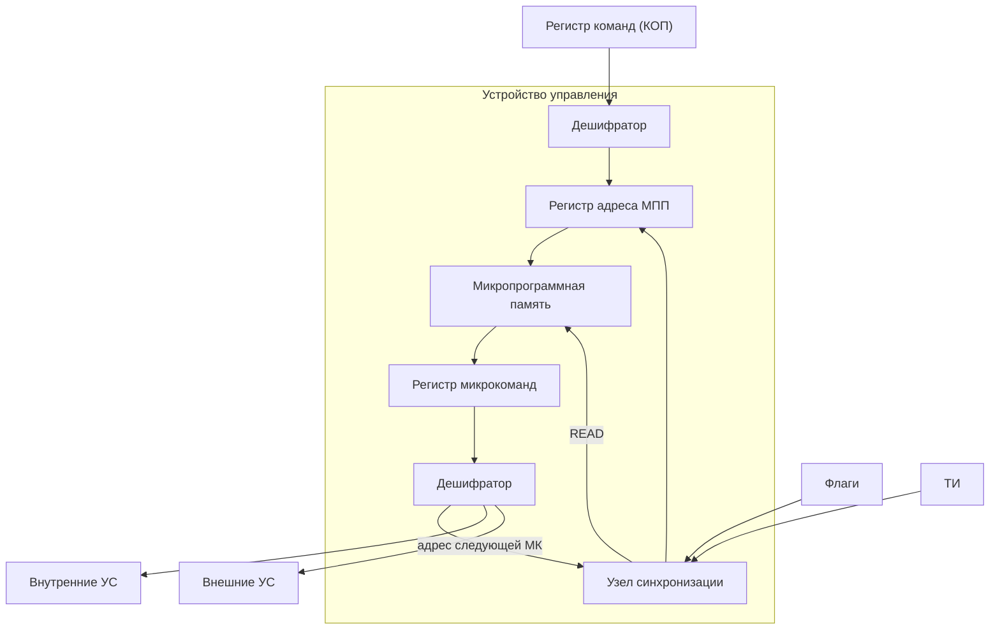

# Микропрограммное управление

> [!note] **МПУ** (микропрограммное управление, microprogrammed control) — способ построения [[Устройство управления|устройства управления]], при котором управляющие сигналы не вычисляет автомат, а берут готовыми из памяти
> Чтобы инициировать микрооперацию, достаточно активизировать её линию управления: логическая 1 — активное значение линии, 0 — пассивное. Микрооперации одного такта задаются **управляющим словом**, где каждый бит соответствует одной линии управления. Такое слово и есть [[Устройство управления#Выполнение программы как последовательность микроопераций|микрокоманда]] ([[Устройство управления|МК]])

> [!note] **Микропрограмма** — последовательность микрокоманд, реализующая определённую фазу цикла обработки команды
> Микропрограммы хранятся в **микропрограммной памяти** (**МПП**). Формирование управляющих сигналов сводится к последовательному извлечению микрокоманд из МПП и коммутации выходов регистра микрокоманд с линиями управления

Микропрограммы пишет разработчик процессора на этапе проектирования: своя микропрограмма у каждой фазы цикла — извлечения, декодирования, формирования адресов операндов — и у выполнения каждой машинной команды

Алгоритмы описываются сразу в терминах нулей и единиц управляющих сигналов, а поскольку МПП — память, новую машинную команду можно добавить новой микропрограммой, не перепроектируя и не перевыпуская кристалл. Это и снимает главный недостаток [[УУ с жёсткой логикой#Достоинства и недостатки|жёсткой логики]]

## Структурная организация

| Узел | Назначение |
| --- | --- |
| Регистр команд | Содержит поле [[Формат машинной команды IA-32#Код операции\|КОП]]; через дешифратор по КОП находится адрес микропрограммы этой команды — таблица "код операции → адрес" |
| **Регистр адреса МПП** | Содержит адрес следующей микрокоманды |
| МПП | Хранит весь набор микропрограмм |
| **Регистр микрокоманд** | Содержит текущую микрокоманду, загруженную из МПП |
| Дешифратор на выходе | Восстанавливает управляющие сигналы: поля микрокоманды обычно хранятся в компактной [[Форматы микрокоманд\|закодированной форме]] |
| Узел синхронизации | Загружает адрес в регистр адреса МПП и формирует сигнал чтения МПП |

## Формирование адреса следующей микрокоманды

В зависимости от значений флагов [[Арифметико-логическое устройство|АЛУ]] и кода условий в текущей микрокоманде адрес следующей формируется одним из трёх способов:

| Способ | Откуда адрес | Когда используется |
| --- | --- | --- |
| Следующая по порядку МК | Регистр адреса МПП + 1 | Чаще всего: естественный порядок следования микрокоманд внутри микропрограммы |
| Переход на новую микропрограмму | Поле адреса текущей МК | Нарушение естественного порядка: условные и безусловные переходы в микропрограммах, в том числе вызов подпрограммы |
| Переход на микропрограмму машинной команды | Адрес МПП, соответствующий КОП в регистре команд | Один раз за цикл обработки команды — сразу по окончании фазы извлечения, когда КОП уже декодирован |

Назначение второго и третьего способов на стр. 268 переставлено[^addr-swap]. Выбор средств управления последовательностью микрокоманд влияет на два базовых параметра [[Устройство управления|УУ]]: размер микрокоманды и время формирования адреса, то есть быстродействие. Для формирования адреса УУ анализирует содержимое текущей МК, состояние флагов и содержимое регистра команд

[^addr-swap]: На стр. 268 сказано, что второй вариант используют один раз в цикле по окончании фазы извлечения, а третий связан с условными и безусловными переходами. Источники адреса на стр. 267 говорят обратное: однократный переход после извлечения берёт адрес по КОП (третий вариант), а переход внутри микропрограммы — из поля адреса микрокоманды (второй). На записи 16.12.2024 лектор сам указал на это несоответствие

## Адресная информация в микрокоманде

По формату представления адресной информации способы делятся на три категории. Во всех трёх схемах мультиплексор выдаёт в регистр адреса МПП один из кандидатов, а блок анализа ветвления по флагам и полям микрокоманды вырабатывает сигнал "Выбор адреса"

| Формат | Поля | Кандидаты на адрес | Цена |
| --- | --- | --- | --- |
| С двумя полями адреса | [[Жёсткая и магистральная структура АЛУ\|УС]], Адр1, Адр2 | Адр1 (условие выполнено), Адр2 (не выполнено), адрес по КОП | Много разрядов под два адреса |
| С единственным полем адреса | УС, Адр | Адр, (регистр адреса) + 1, адрес по КОП | Второй адрес не хранится: при невыполнении условия действует естественный порядок |
| Переменного формата | Тип формата, затем либо УС, либо условие ветвления и адрес перехода | Адрес перехода, (регистр адреса) + 1, адрес по КОП | Экономнее всего по разрядам, но разряды типа нужно анализировать — дополнительная задержка, особенно когда проверяется группа разрядов |

### С двумя полями адреса

![[Архитектура компьютеров Мосин.pdf#page=271&rect=82,30,336,297]]

### С единственным полем адреса

![[Архитектура компьютеров Мосин.pdf#page=272&rect=82,30,336,297]]

### Переменного формата

Специальный разряд определяет вариант формата: в одном оставшиеся разряды — управляющие сигналы, в другом часть разрядов задаёт условие ветвления, а часть — адрес перехода. Микрокоманда, у которой назначение полей зависит от такого маркера, — [[Форматы микрокоманд#Классификация микрокоманд|косвенная]]

![[Архитектура компьютеров Мосин.pdf#page=273&rect=82,30,336,297]]

## Микропрограммная память в процессорах Intel и AMD

Современные универсальные процессоры Intel и AMD содержат микропрограммную память, хотя, работая с процессором, об этом обычно не задумываются. Микропрограммы разрабатывают сотрудники компаний, и при подготовке процессора к продаже они загружаются в МПП

Лектор подчёркивает, что эти "секретные алгоритмы" — тайна высочайшего уровня и пользователю недоступны, при том что без МПП процессор вообще не может работать: не будет устройства управления. Перезаписываемая МПП — это [[Форматы микрокоманд#Классификация микрокоманд|мягкие микрокоманды]]: обновление микропрограмм без замены аппаратуры

Секретно содержимое, но не механизм обновления: у Intel обновление микрокода загружается программно, через **MSR** (Model-Specific Register — служебный регистр конкретной модели процессора), и описано в открытой документации[^intel-ucode]

[^intel-ucode]: Лектор (запись 17.12.2024): МПП можно перепрограммировать "используя определённые внешние выводы", ссылок на которые в спецификациях нет. Intel документирует обратное: обновление микрокода загружает прошивка или [[Операционная система|ОС]] записью адреса блока обновления в MSR IA32_BIOS_UPDT_TRIG (79H) инструкцией WRMSR, а ревизию загруженного обновления читают из IA32_BIOS_SIGN_ID (8BH) — [Intel, Runtime Microcode Update Technical Paper, 356111-001, 2023](https://cdrdv2-public.intel.com/782715/356111-ucode-update.pdf). Обновление энергозависимо и заново загружается при каждом старте: "The microcode update is generally cleared by a warm reset"; точки загрузки — сам процессор по таблице FIT (Firmware Interface Table) до первой команды прошивки, ранний и поздний этап [[BIOS]], ОС — [Intel, Microcode Update Guidance](https://www.intel.com/content/www/us/en/developer/articles/technical/software-security-guidance/best-practices/microcode-update-guidance.html), со ссылкой на Intel Software Developer's Manual, Vol. 3A, "Microcode Update Facilities"
