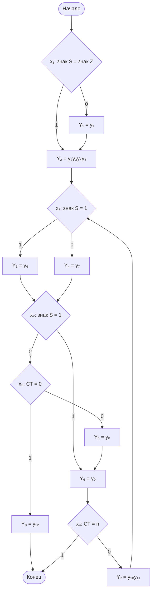
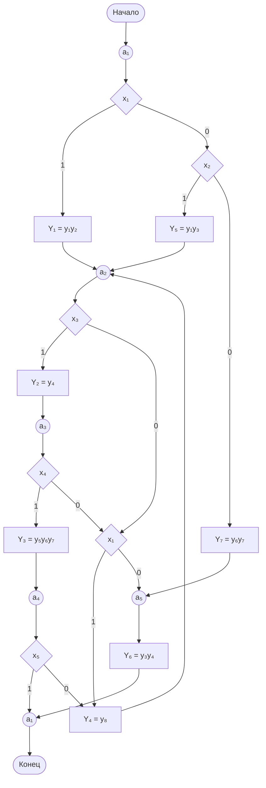
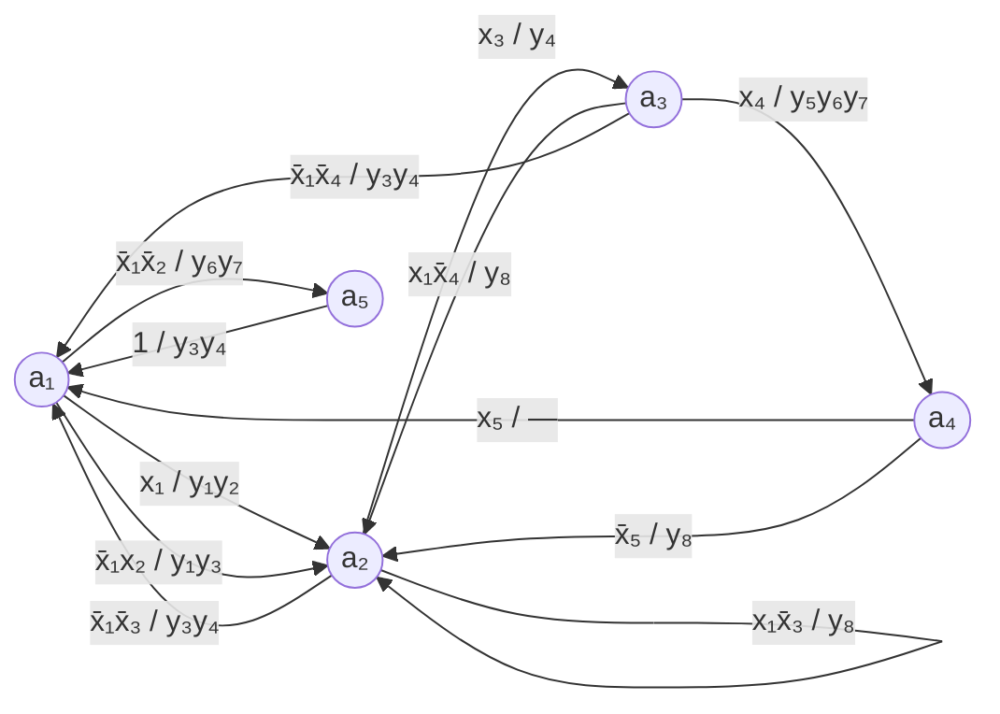

# Синтез автомата по ГСА

Алгоритмы выполнения машинных команд разрабатывает человек, и процессор "умеет" ровно то, чему его научили. Для [[УУ с жёсткой логикой|УУ с жёсткой логикой]] алгоритм записывают граф-схемой, по ней строят цифровой автомат, а автомат реализуют на триггерах и вентилях

## Граф-схема алгоритма

> [!note] **ГСА** (граф-схема алгоритма) — ориентированный связный граф, содержащий одну начальную вершину $A_0$, одну конечную вершину $A_к$ и произвольное конечное множество условных $P=\{p_1,\dots,p_F\}$ и операторных $A=\{A_1,\dots,A_G\}$ вершин
> Начальная и конечная вершины — "Начало" и "Конец": любой алгоритм начинается и гарантированно завершается. Операторная вершина — прямоугольник, условная — ромб с двумя выходами, помеченными 1 (условие выполнено) и 0 (не выполнено)

> [!summary] Условия корректности ГСА
> 1. Входы и выходы вершин соединены дугами, направленными всегда от выхода ко входу
> 2. Каждый выход соединён ровно с одним входом — неоднозначного продолжения нет
> 3. Любой вход соединён как минимум с одним выходом
> 4. Любая вершина лежит хотя бы на одном пути от начальной вершины к конечной
> 5. Один из выходов условной вершины может быть соединён с её собственным входом; для операторной вершины это недопустимо
> 6. В каждой условной вершине записан один элемент множества логических условий $X=\{x_1,\dots,x_L\}$; в разных условных вершинах элементы могут повторяться
> 7. В каждой операторной вершине записан оператор (микрокоманда) $Y_t=\{y_{t1},\dots,y_{tU_t}\}\subseteq Y=\{y_1,\dots,y_N\}$ — подмножество множества микроопераций; в разных операторных вершинах подмножества могут повторяться

Повторы разрешены потому, что одна и та же проверка (знак операнда) или одно и то же действие (инкремент счётчика) законно встречаются в разных местах алгоритма. Если во всех операторных вершинах стоят разные операторы, вершину $A_i$ отождествляют с её оператором и пишут $Y_i$ вместо $A_i$

### Функция перехода

Пусть из вершины $Y_i$ в вершину $Y_j$ ведёт путь только через условные вершины $p_{i1},\dots,p_{iR}$, а $e_{ir}\in\{0,1\}$ — метка выхода, по которому путь покидает $p_{ir}$. Пути соответствует конъюнкция

$$
\alpha_{ij}=x_{i1}^{e_{i1}}\cdots x_{iR}^{e_{iR}}=\bigwedge_{r=1}^{R}x_{ir}^{e_{ir}},\qquad x^0=\overline{x},\quad x^1=x
$$

где $x_{ir}$ — условие, записанное в $p_{ir}$. Если путей из $Y_i$ в $Y_j$ несколько, $H$ штук, **функция перехода** от микрокоманды $Y_i$ к микрокоманде $Y_j$ — дизъюнкция их конъюнкций:

$$
\alpha_{ij}=\bigvee_{h=1}^{H}\alpha_{ij}^{h}
$$

### Содержательная ГСА деления

При проектировании сначала рисуют **содержательную ГСА** — в вершинах записаны не абстрактные $x_l$ и $y_n$, а логические условия и микрооперации в предметных терминах; затем от неё переходят к абстрактной. Пример — операция деления $S/Z$ [[Деление целых чисел#Деление без восстановления остатка|без восстановления остатка]]: [[Арифметико-логическое устройство|АЛУ]] содержит сумматор $S$ с делимым, регистр $Z$ с делителем, регистр $Y$ для частного, счётчик тактов (**СТ**) и триггер переполнения (**ТП**)

| Условие | Смысл | Микрооперация | Смысл |
| --- | --- | --- | --- |
| $x_1$ | Знак $S$ = знак $Z$ | $y_1$ | Знак $Y$ := 1 |
| $x_2$ | Знак $S$ = 1 | $y_2$ | $Y$ := 0 |
| $x_3$ | СТ = 0 | $y_3$ | СТ := 0 |
| $x_4$ | СТ = $n$ | $y_4$ | Знак $Z$ := 0 |
| | | $y_5$ | Знак $S$ := 0 |
| | | $y_6$ | $S := S+Z$ |
| | | $y_7$ | $S := S+Z_{обр}$ |
| | | $y_8$ | $Y[n]$ := 1 |
| | | $y_9$ | СТ := СТ + 1 |
| | | $y_{10}$ | $S := L_1(S)$ |
| | | $y_{11}$ | $Y := L_1(Y)$ |
| | | $y_{12}$ | ТП := 1 |

$L_1$ — сдвиг влево на разряд, $Z_{обр}$ — обратный код делителя для вычитания

Отрицательный остаток после сложения — разряд частного 0, и $Y[n]$ не трогают; неотрицательный на первом же шаге (СТ = 0) означает, что нарушено условие $\lvert S\rvert<\lvert Z\rvert$, и [[Деление целых чисел|частное]] не помещается в разрядную сетку — переполнение

## Автоматы Мили и Мура

Содержательная ГСА — исходные данные для синтеза управляющего цифрового автомата. Автоматы бывают двух видов, и различаются они тем, когда формируется выходной сигнал:

> [!note] **Автомат Мили** (Mealy machine) выдаёт выходной сигнал при переходе из состояния в состояние, **автомат Мура** (Moore machine) — находясь в состоянии
> Для автомата с функцией переходов $q'=\psi(x,q)$ у автомата Мили выход $y=\varphi(x,q)$ зависит от входа и состояния, у автомата Мура $y=\varphi(q)$ — только от состояния[^tpu-def]

[^tpu-def]: Ю. Б. Буркатовская, Е. С. Веремеенко, [Теория автоматов](https://portal.tpu.ru/SHARED/t/TRACEY/Courses/theory/Tab_automata_textbooks/01.pdf), Томский политехнический университет, 2010, §1.3–1.4: "Выход автомата Мили зависит от входа и состояния, тогда как выход автомата Мура зависит только от состояния. Иначе говоря, для автомата Мили y = φ(x, q), для автомата Мура y = φ(q)"

В лекции синтез разобран на автомате Мили

## Синтез автомата Мили

Синтез идёт в два шага: по ГСА строят **отмеченную ГСА**, по ней — граф автомата

> [!summary] Правила разметки ГСА
> Входы вершин, следующих за операторными, отмечают символами $a_1, a_2,\dots$:
> 1. Символом $a_1$ отмечают вход вершины, следующей за начальной, и вход конечной вершины — единственный случай, когда одна метка стоит дважды
> 2. Входы всех вершин, следующих за операторными, должны быть отмечены
> 3. Вход вершины отмечают только одним символом
> 4. Входы различных вершин, кроме конечной, отмечают различными символами

Идя от метки $a_m$ к метке $a_s$ по направлению дуг, получают **пути перехода** — слова двух видов:

$$
a_m\,x_{m1}^{e_{m1}}\cdots x_{mR}^{e_{mR}}\,Y_t\,a_s\qquad\text{или}\qquad a_m\,x_{m1}^{e_{m1}}\cdots x_{mR}^{e_{mR}}\,a_1
$$

Путь начинается у метки, проходит условные вершины до первой операторной $Y_t$ и заканчивается меткой за ней. Метка, которая оказалась на пути до операторной вершины, путь не прерывает; без оператора путь бывает только к конечной вершине

> [!summary] Правила построения автомата Мили по ГСА
> 1. Найти все пути перехода. Если условие $x_r$ входит в путь несколько раз, оставляют одно вхождение
> 2. Путь, в который входят и $x_r$, и $\overline{x}_r$, не рассматривают: он не может быть активирован
> 3. Пути $a_m\,X(a_m,a_s)\,Y(a_m,a_s)\,a_s$ соответствует переход автомата из $a_m$ в $a_s$ под действием входного сигнала $X(a_m,a_s)$ с выдачей выходного сигнала $Y(a_m,a_s)$
> 4. Пути $a_m\,Y(a_m,a_s)\,a_s$ соответствует переход из $a_m$ в $a_s$ с выдачей $Y(a_m,a_s)$ без условий
> 5. Пути $a_m\,X(a_m,a_1)\,a_1$ соответствует переход из $a_m$ в $a_1$ с выдачей пустого оператора $Y_0$, не меняющего внутренних состояний
>
> Состояний у автомата столько, сколько меток на отмеченной ГСА. Для автомата, построенного по ГСА, всегда выполнено необходимое условие детерминированности: попарное произведение входных сигналов, вызывающих переходы из одного состояния, равно нулю — в каждый момент активен ровно один путь, и из начального состояния автомат всегда приходит в конечное

### Отмеченная ГСА

Пример лекции — абстрактная ГСА с условиями $x_1,\dots,x_5$ и микрокомандами $Y_1,\dots,Y_7$:

Путь из $a_2$ при $\overline{x}_3\overline{x}_1$ проходит метку $a_5$ транзитом: операторной вершины до неё нет, поэтому переход идёт дальше, через $Y_6$, в $a_1$. Именно на этом переходе лектор запутался при разборе графа и исправил условие на $\overline{x}_3\overline{x}_1$ с выходом $y_3y_4$

### Граф автомата

Подпись дуги — "входной сигнал / выходной сигнал". Из каждого состояния сигналы переходов попарно несовместны и в сумме дают 1: $x_3\lor x_1\overline{x}_3\lor\overline{x}_1\overline{x}_3=1$

### Обратная таблица переходов

Пять состояний кодируются тремя триггерами $Q_3Q_2Q_1$. Из восьми кодов используются пять, и выбор кодов произволен; обычно берут коды с меньшим числом единиц — это упрощает функции возбуждения

**Обратная таблица переходов** сгруппирована по конечному состоянию $a_s$. Для [[Триггеры (схемотехника)#Синхронный D-триггер|D-триггера]] следующее состояние равно входу $D$, поэтому сигнал возбуждения перехода — это просто единичные разряды кода $a_s$: переход $010\to001$ требует $D_1=1$, $D_2=D_3=0$

| $a_m$ | $K(a_m)$ | $a_s$ | $K(a_s)$ | $X(a_m,a_s)$ | $Y(a_m,a_s)$ | Возбуждение |
| --- | --- | --- | --- | --- | --- | --- |
| $a_2$ | 010 | $a_1$ | 001 | $\overline{x}_1\overline{x}_3$ | $y_3y_4$ | $D_1$ |
| $a_3$ | 011 | $a_1$ | 001 | $\overline{x}_1\overline{x}_4$ | $y_3y_4$ | $D_1$ |
| $a_4$ | 100 | $a_1$ | 001 | $x_5$ | — | $D_1$ |
| $a_5$ | 101 | $a_1$ | 001 | 1 | $y_3y_4$ | $D_1$ |
| $a_1$ | 001 | $a_2$ | 010 | $x_1$ | $y_1y_2$ | $D_2$ |
| $a_1$ | 001 | $a_2$ | 010 | $\overline{x}_1x_2$ | $y_1y_3$ | $D_2$ |
| $a_2$ | 010 | $a_2$ | 010 | $x_1\overline{x}_3$ | $y_8$ | $D_2$ |
| $a_3$ | 011 | $a_2$ | 010 | $x_1\overline{x}_4$ | $y_8$ | $D_2$ |
| $a_4$ | 100 | $a_2$ | 010 | $\overline{x}_5$ | $y_8$ | $D_2$ |
| $a_2$ | 010 | $a_3$ | 011 | $x_3$ | $y_4$ | $D_2D_1$ |
| $a_3$ | 011 | $a_4$ | 100 | $x_4$ | $y_5y_6y_7$ | $D_3$ |
| $a_1$ | 001 | $a_5$ | 101 | $\overline{x}_1\overline{x}_2$ | $y_6y_7$ | $D_3D_1$ |

Переход $a_1\to a_2$ при $\overline{x}_1x_2$ проходит микрокоманду $Y_5=y_1y_3$[^y1y3]

[^y1y3]: В таблице на стр. 259 в этой строке выходной сигнал $y_1y_2$. На отмеченной ГСА (стр. 255, 258) путь $a_1\overline{x}_1x_2$ ведёт через $Y_5=y_1y_3$, и на графе автомата (стр. 258) дуга подписана $y_1y_3\,\overline{x}_1x_2$. Выражение для $y_1$ на слайде от этой опечатки не зависит, а $y_2$ и $y_3$ по таблице слайда получились бы неверными

### Функции возбуждения и выходов

Функция выписывается по строкам таблицы, где она равна 1: каждой строке — терм "состояние $a_m$ и входной сигнал". Состояние раскрывается через выходы триггеров по коду: $a_1=\overline{Q}_3\overline{Q}_2Q_1$, $a_2=\overline{Q}_3Q_2\overline{Q}_1$, $a_3=\overline{Q}_3Q_2Q_1$, $a_4=Q_3\overline{Q}_2\overline{Q}_1$, $a_5=Q_3\overline{Q}_2Q_1$. Пример лекции:

$$
\begin{aligned}
D_3&=a_1\overline{x}_1\overline{x}_2\lor a_3x_4=\overline{Q}_3\overline{Q}_2Q_1\overline{x}_1\overline{x}_2\lor\overline{Q}_3Q_2Q_1x_4\\
y_1&=a_1x_1\lor a_1\overline{x}_1x_2=a_1(x_1\lor\overline{x}_1x_2)=\overline{Q}_3\overline{Q}_2Q_1(x_1\lor x_2)
\end{aligned}
$$

Последний шаг — поглощение $x_1\lor\overline{x}_1x_2=x_1\lor x_2$: на слайде скобка оставлена в виде $x_1\lor\overline{x}_1x_2$. Вся система по таблице:

| Функция | По состояниям | Через $Q$ |
| --- | --- | --- |
| $D_3$ | $a_1\overline{x}_1\overline{x}_2\lor a_3x_4$ | $\overline{Q}_3\overline{Q}_2Q_1\overline{x}_1\overline{x}_2\lor\overline{Q}_3Q_2Q_1x_4$ |
| $D_2$ | $a_1(x_1\lor x_2)\lor a_2(x_1\lor x_3)\lor a_3x_1\overline{x}_4\lor a_4\overline{x}_5$ | $\overline{Q}_3\overline{Q}_2Q_1(x_1\lor x_2)\lor\overline{Q}_3Q_2\overline{Q}_1(x_1\lor x_3)\lor\overline{Q}_3Q_2Q_1x_1\overline{x}_4\lor Q_3\overline{Q}_2\overline{Q}_1\overline{x}_5$ |
| $D_1$ | $a_1\overline{x}_1\overline{x}_2\lor a_2(x_3\lor\overline{x}_1)\lor a_3\overline{x}_1\overline{x}_4\lor a_4x_5\lor a_5$ | $\overline{Q}_2Q_1\overline{x}_1\overline{x}_2\lor\overline{Q}_3Q_2\overline{Q}_1(x_3\lor\overline{x}_1)\lor\overline{Q}_3Q_2\overline{x}_1\overline{x}_4\lor Q_3\overline{Q}_2x_5\lor Q_3\overline{Q}_2Q_1$ |
| $y_1$ | $a_1(x_1\lor x_2)$ | $\overline{Q}_3\overline{Q}_2Q_1(x_1\lor x_2)$ |
| $y_2$ | $a_1x_1$ | $\overline{Q}_3\overline{Q}_2Q_1x_1$ |
| $y_3$ | $a_1\overline{x}_1x_2\lor a_2\overline{x}_1\overline{x}_3\lor a_3\overline{x}_1\overline{x}_4\lor a_5$ | $\overline{Q}_2Q_1\overline{x}_1x_2\lor\overline{Q}_3Q_2\overline{Q}_1\overline{x}_1\overline{x}_3\lor\overline{Q}_3Q_2Q_1\overline{x}_1\overline{x}_4\lor Q_3\overline{Q}_2Q_1$ |
| $y_4$ | $a_2(x_3\lor\overline{x}_1)\lor a_3\overline{x}_1\overline{x}_4\lor a_5$ | $\overline{Q}_3Q_2\overline{Q}_1(x_3\lor\overline{x}_1)\lor\overline{Q}_3Q_2\overline{x}_1\overline{x}_4\lor Q_3\overline{Q}_2Q_1$ |
| $y_5$ | $a_3x_4$ | $\overline{Q}_3Q_2Q_1x_4$ |
| $y_6=y_7$ | $a_1\overline{x}_1\overline{x}_2\lor a_3x_4$ | $\overline{Q}_3\overline{Q}_2Q_1\overline{x}_1\overline{x}_2\lor\overline{Q}_3Q_2Q_1x_4$ |
| $y_8$ | $a_2x_1\overline{x}_3\lor a_3x_1\overline{x}_4\lor a_4\overline{x}_5$ | $\overline{Q}_3Q_2\overline{Q}_1x_1\overline{x}_3\lor\overline{Q}_3Q_2Q_1x_1\overline{x}_4\lor Q_3\overline{Q}_2\overline{Q}_1\overline{x}_5$ |

Внутри скобок применены поглощение и склейка: $x_1\lor\overline{x}_1x_2=x_1\lor x_2$, $x_3\lor x_1\overline{x}_3=x_1\lor x_3$, $x_3\lor\overline{x}_1\overline{x}_3=x_3\lor\overline{x}_1$. Столбец "через $Q$" дополнительно склеен по соседним кодам: $a_1\lor a_5$ под одним условием даёт $\overline{Q}_2Q_1$, $a_2\lor a_3$ — $\overline{Q}_3Q_2$, $a_4\lor a_5$ — $Q_3\overline{Q}_2$. $y_6$ и $y_7$ совпадают, поэтому схема формирует их одним выходом

> [!tip] Неиспользуемые коды 000, 110, 111 — безразличные наборы
> Автомат в них не попадает, если при сбросе триггеры устанавливаются в код $a_1$, поэтому значение функций на этих кодах можно доопределить как удобно
>
> Тогда каждое состояние опознаётся по двум разрядам: $a_1=\overline{Q}_3\overline{Q}_2$, $a_2=Q_2\overline{Q}_1$, $a_3=Q_2Q_1$, $a_4=Q_3\overline{Q}_1$, $a_5=Q_3Q_1$ — например, $y_1=\overline{Q}_3\overline{Q}_2(x_1\lor x_2)$, $y_5=Q_2Q_1x_4$, $D_3=\overline{Q}_3\overline{Q}_2\overline{x}_1\overline{x}_2\lor Q_2Q_1x_4$
>
> Об этой избыточности лектор и говорил: из восьми кодов занято пять, отсюда свобода и в выборе кодов, и в доопределении

Минимизация [[ДНФ, КНФ и импликанты#Задача минимизации [21 04](https //www.youtube.com/watch?t=1264&v=rJGU3-jRkDQ)|ДНФ]] как таковая — [[Сокращённая ДНФ и метод Нельсона|дискретная математика]], на картах — [[Комбинационные схемы#Минимизация картой Карно|карты Карно]]

### Реализация на D-триггерах

Три [[Триггеры (схемотехника)#Синхронный D-триггер|синхронных D-триггера]] хранят код состояния: по синхросигналу clk каждый устанавливается или сбрасывается по своему входу $D_i$, без синхросигнала хранит текущее значение. Комбинационная часть по выходам $Q_i$, $\overline{Q}_i$ и условиям $x_l$ вычисляет $D_1,D_2,D_3$ и выходные сигналы. На слайде показаны только $D_3$ и $y_1$:

![[Архитектура компьютеров Мосин.pdf#page=262&rect=112,25,458,305]]

Строго это уже не комбинационная, а последовательностная схема: выходы триггеров возвращаются на вход логики. Добавив выражения для всех $D_i$ и $y_n$, получают аппаратный автомат, формирующий [[Устройство управления|управляющие сигналы]] процессора и внешних устройств

> [!example]- Автомат Мили для ГСА деления
> Те же правила на [[Синтез автомата по ГСА#Содержательная ГСА деления|ГСА деления]] — построение не из лекции
>
> Метки: $a_1$ — вход $x_1$ и конца, $a_2$ — вход $Y_2$ (после $Y_1$), $a_3$ — вход первой $x_2$ (после $Y_2$ и $Y_7$), $a_4$ — вход второй $x_2$ (после $Y_3$ и $Y_4$), $a_5$ — вход $Y_6$ (после $Y_5$), $a_6$ — вход $x_4$ (после $Y_6$)
>
> Путь из $a_4$ при $x_2$ идёт в $Y_6$, минуя $Y_5$, и метку $a_5$ проходит транзитом
>
> | $a_m$ | $a_s$ | $X(a_m,a_s)$ | $Y(a_m,a_s)$ |
> | --- | --- | --- | --- |
> | $a_1$ | $a_2$ | $\overline{x}_1$ | $y_1$ |
> | $a_1$ | $a_3$ | $x_1$ | $y_2y_3y_4y_5$ |
> | $a_2$ | $a_3$ | 1 | $y_2y_3y_4y_5$ |
> | $a_3$ | $a_4$ | $x_2$ | $y_6$ |
> | $a_3$ | $a_4$ | $\overline{x}_2$ | $y_7$ |
> | $a_4$ | $a_6$ | $x_2$ | $y_9$ |
> | $a_4$ | $a_1$ | $\overline{x}_2x_3$ | $y_{12}$ |
> | $a_4$ | $a_5$ | $\overline{x}_2\overline{x}_3$ | $y_8$ |
> | $a_5$ | $a_6$ | 1 | $y_9$ |
> | $a_6$ | $a_1$ | $x_4$ | — |
> | $a_6$ | $a_3$ | $\overline{x}_4$ | $y_{10}y_{11}$ |
>
> Шесть состояний — снова три триггера. Два перехода $a_3\to a_4$ дают один и тот же код возбуждения, а разные выходы $y_6$ и $y_7$ выбирает условие $x_2$

## Автомат Мура

Для автомата Мура метки ставят иначе[^tpu-moore]: отметка $b_0$ — на дуге из начальной вершины и на дуге в конечную, а каждая операторная вершина получает свою отметку $b_t$

Состоянию $b_t$ приписан выход — микрооперации вершины $Y_t$, состоянию $b_0$ — пустое множество. Переход $b_j\to b_p$ под сигналом, равным дизъюнкции конъюнкций всех простых путей из $b_j$ в $b_p$, не содержащих других отметок, — так же, как [[Синтез автомата по ГСА#Функция перехода|функция перехода]] ГСА

Та же ГСА лекции даёт автомат Мура с восемью состояниями вместо пяти:

| Состояние | Выход | Переходы |
| --- | --- | --- |
| $b_0$ | — | $x_1\to b_1$, $\overline{x}_1x_2\to b_5$, $\overline{x}_1\overline{x}_2\to b_7$ |
| $b_1$ | $y_1y_2$ | $x_3\to b_2$, $x_1\overline{x}_3\to b_4$, $\overline{x}_1\overline{x}_3\to b_6$ |
| $b_2$ | $y_4$ | $x_4\to b_3$, $x_1\overline{x}_4\to b_4$, $\overline{x}_1\overline{x}_4\to b_6$ |
| $b_3$ | $y_5y_6y_7$ | $x_5\to b_0$, $\overline{x}_5\to b_4$ |
| $b_4$ | $y_8$ | $x_3\to b_2$, $x_1\overline{x}_3\to b_4$, $\overline{x}_1\overline{x}_3\to b_6$ |
| $b_5$ | $y_1y_3$ | $x_3\to b_2$, $x_1\overline{x}_3\to b_4$, $\overline{x}_1\overline{x}_3\to b_6$ |
| $b_6$ | $y_3y_4$ | $1\to b_0$ |
| $b_7$ | $y_6y_7$ | $1\to b_6$ |

> [!important] Автомат Мили экономнее по состояниям, автомат Мура — по логике выходов
> У Мили одно состояние соответствует входу вершины, куда сходятся выходы нескольких операторов ($a_2$ после $Y_1$, $Y_4$, $Y_5$), поэтому состояний у него, как правило, меньше, чем у эквивалентного автомата Мура. Зато выход Мура — функция одного кода состояния, без входных условий: $y_8=b_4$. Тот же принцип у [[Предсказание переходов#Автомат с четырьмя состояниями|автомата предсказания переходов]]: прогноз определяется одним текущим состоянием

[^tpu-moore]: Ю. Б. Буркатовская, Е. С. Веремеенко, [Теория автоматов](https://portal.tpu.ru/SHARED/t/TRACEY/Courses/theory/Tab_automata_textbooks/01.pdf), ТПУ, 2010, §1.4.1–1.4.2: отметки Мура "q0 ставится на дуге, исходящей из начальной вершины, и на дуге, заходящей в конечную вершину; отметки q1,…,qt ставятся около операторных вершин" (плюс отметки ждущих вершин, которых в ГСА лекции нет); "в общем случае число состояний в автомате Мили меньше, чем число состояний в эквивалентном ему автомате Мура". Переходы и выходы в таблице выше построены по этим правилам для ГСА лекции
