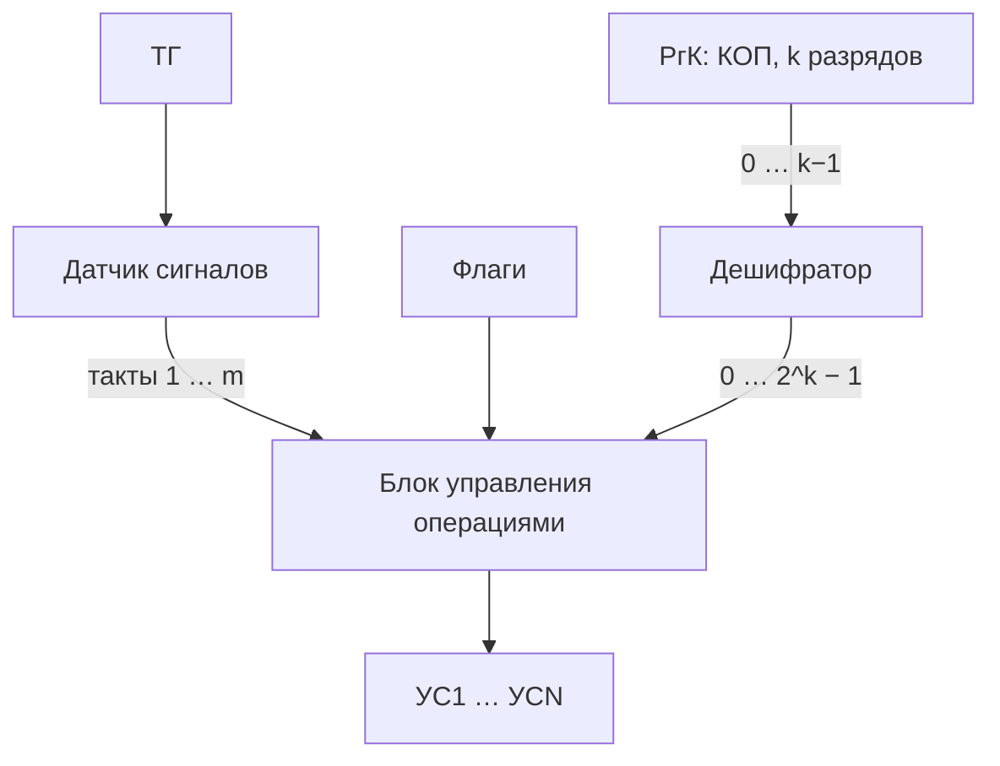

# УУ с жёсткой логикой

> [!note] **[[Устройство управления|УУ]] с жёсткой логикой** (hardwired control) — [[Устройство управления|устройство управления]] в виде конечного автомата, который формирует выходные управляющие сигналы в зависимости от текущего состояния и значений осведомительных входных сигналов
> Логика УУ записана не в памяти, а в самой схеме: система булевых выражений реализована вентилями и триггерами

## Структура

- **Датчик сигналов** — счётчик на выходе тактового генератора (ТГ): каждый синхроимпульс продвигает его на единицу, и активной становится одна из $m$ выходных линий — номер текущего такта. $m$ — число тактов, за которое выполняется самая длинная операция. Одного синхросигнала мало: чтобы решить, какой сигнал выставить, УУ нужно знать, какой по счёту идёт такт

  ![[Архитектура компьютеров Мосин.pdf#page=240&rect=70,35,410,193]]

- **[[Комбинационные схемы#Дешифратор|Дешифратор]] кода операции** декодирует [[Формат машинной команды IA-32#Код операции|КОП]] команды, находящейся в РгК, и возбуждает единицу ровно на одном из $2^k$ выходов — на шине, соответствующей этой операции
- **Блок управления операциями** вырабатывает управляющие сигналы `УС1`…`УСN` по значениям флагов, активному выходу дешифратора и номеру такта с датчика сигналов

## Пример синтеза сигнала C5

Фазу цикла хранят два триггера $P$ и $Q$ — это [[Устройство управления#Управление циклом обработки команды|регистр номера фазы]]: $PQ=00$ — извлечение, $01$ — косвенная адресация, $10$ — выполнение, $11$ — обработка прерывания. По [[Устройство управления#Управляющие сигналы циклов|таблице сигналов]] C5 (запись с выхода памяти в РгД) нужен на такте $T_2$ в фазе извлечения и на такте $T_2$ в фазе косвенной адресации:

$$
C_5=\overline{P}\,\overline{Q}\,T_2\lor\overline{P}\,Q\,T_2
$$

Если C5 нужен ещё и при выполнении некоторых команд, обращающихся к памяти, — скажем, на такте $T_3$, — добавляется терм фазы выполнения с сигналом $\mathrm{Op}$ соответствующего выхода дешифратора:

$$
\boxed{C_5=\overline{P}\,\overline{Q}\,T_2\lor\overline{P}\,Q\,T_2\lor P\,\overline{Q}\,T_3\,\mathrm{Op}}
$$

Так же строится выражение для каждого управляющего сигнала, и вся логика УУ становится системой булевых функций. Первые два терма склеиваются в $\overline{P}\,T_2$ — такие упрощения и есть [[ДНФ, КНФ и импликанты#Задача минимизации [21 04](https //www.youtube.com/watch?t=1264&v=rJGU3-jRkDQ)|минимизация ДНФ]], которой синтез занимается систематически: для простого процессора выражения можно выписать руками, для реального нужен формальный метод

## Этапы синтеза

1. Выбор типа логических и запоминающих элементов — базиса, в котором будет реализован управляющий автомат
2. Кодирование состояний автомата с учётом множества функций, реализуемых процессором, и сигналов управления операционного автомата — перечень управляющих сигналов и ресурсов [[Арифметико-логическое устройство|АЛУ]] должен быть известен
3. Синтез комбинационной схемы, формирующей выходные управляющие сигналы

Внутреннюю логику УУ описывают булевой функцией входных сигналов — системой логических функций — с последующей оптимизацией, чтобы аппаратная реализация требовала меньше элементов. Формальный путь от алгоритма к этой системе — [[Синтез автомата по ГСА|синтез автомата по граф-схеме алгоритма]]

## Достоинства и недостатки

| Достоинства | Недостатки |
| --- | --- |
| Максимальное быстродействие: схема работает на тактовой частоте процессора | Большое количество логических выражений и переменных в них: свой алгоритм нужен для каждой команды и каждой фазы цикла |
| Компактная аппаратная реализация: минимизированные выражения требуют минимума вентилей | С ростом сложности падает быстродействие: больше вентилей — больше задержка распространения по самому длинному пути, и тактовую частоту приходится понижать, чтобы все вентили успевали переключиться до следующего синхросигнала |
| | Расширение системы команд требует заново проектировать управляющий автомат |

> [!warning] Новая команда — новый цикл синтеза и новый кристалл
> Даже если аппаратура АЛУ и регистров не меняется, добавление одной команды требует новой [[Синтез автомата по ГСА|ГСА]], нового автомата и всей процедуры синтеза заново, а для уже выпущенного процессора — повторного изготовления всего устройства. Экономически это нецелесообразно, поэтому жёсткая логика получила наибольшее распространение в [[CISC и RISC|RISC-процессорах]] с минимальным набором команд простого формата, а [[CISC и RISC|CISC]] опираются на [[Микропрограммное управление|микропрограммное управление]]

Языки программирования на этом уровне не нужны: алгоритм описывается прямо в терминах пересылок и действий АЛУ, и каждому действию ставятся в соответствие управляющие сигналы
