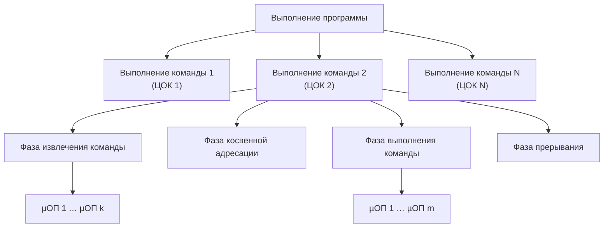
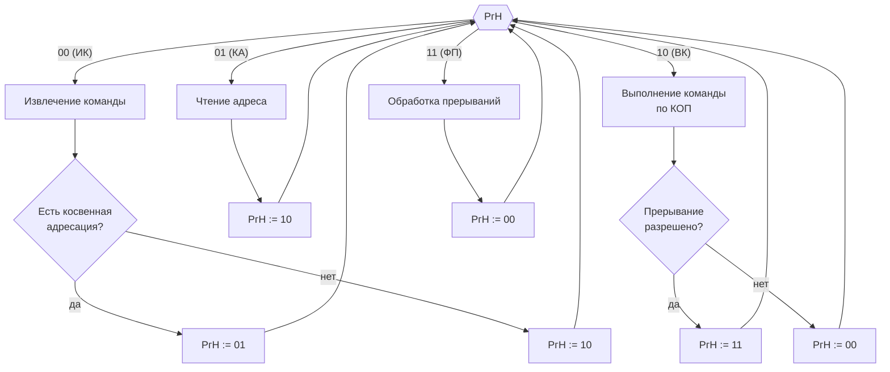

# Устройство управления

> [!note] **УУ** (устройство управления, control unit) — часть цифрового вычислительного устройства, формирующая последовательность управляющих сигналов, определённым образом распределённых во времени
> Процессор сам по себе ничего не вычисляет: всё, что он умеет, — интерпретировать поступающие сигналы управления. Лектор сравнивает УУ с нитями и рукой кукловода: зрителю кажется, что кукла движется сама, а движение складывается из того, за какую нить и когда дёрнули; кукловод здесь — программист

## Выполнение программы как последовательность микроопераций

Программа — последовательность машинных команд, каждая выполняется своим [[Цикл обработки машинной команды|циклом обработки команды]] ([[Цикл обработки машинной команды|ЦОК]]), цикл делится на фазы, фаза — на микрооперации:

> [!note] **Микрооперация** (µОП) — элементарная функциональная операция, выполняемая за один тактовый интервал и приводимая в действие управляющим сигналом
> Приставка "микро" означает, что операция очень проста и выполняется очень быстро. Виды микроопераций: пересылка данных между регистрами, передача данных из регистра на внешнюю магистраль, управление действием [[Арифметико-логическое устройство|АЛУ]] (подача кода операции, по которому на выход АЛУ назначается результат одного из его действий)

> [!note] **Микрокоманда** (МК) — совокупность микроопераций, выполняемых в одном такте
> Набор микроопераций одной фазы цикла образует [[Микропрограммное управление|микропрограмму]]

### Две задачи УУ

1. Организовать выполнение микроопераций в нужной последовательности
2. Сформировать управляющие сигналы, необходимые для каждой микрооперации, — гарантированно выставить их на шину управления в нужный момент

Первая задача не сводится ко второй. Если при извлечении команды сначала подать сигнал чтения памяти, потом выставить адрес, а потом скоммутировать шину данных, каждое действие по отдельности выполнится, но команда прочитана не будет: чтение срабатывает, только когда регистр с адресом уже скоммутирован с шиной адреса, а выход памяти — с шиной данных

## Микрооперации фазы извлечения команды

Схема обмена СчАК → РгАдр → память → РгД → РгК — та же, что в [[Цикл обработки машинной команды#Потоки данных|потоке данных цикла команды]], обозначения регистров — [[Регистры процессора#Регистры управления и состояния|сокращённые имена СчК, РгАОП и РгДОП]]. Фаза состоит из четырёх микроопераций:

1. РгАдр ← (СчАК)
2. РгД ← Память
3. СчАК ← (СчАК) + $I$
4. РгК ← (РгД)

$I$ — длина команды. Сгруппировать их в микрокоманды можно по-разному, слайд (стр. 228) даёт два варианта из трёх тактов:

| Такт | Вариант 1 | Вариант 2 |
| --- | --- | --- |
| 1 | РгАдр ← (СчАК) | РгАдр ← (СчАК) |
| 2 | РгД ← Память; СчАК ← (СчАК) + $I$ | РгД ← Память |
| 3 | РгК ← (РгД) | СчАК ← (СчАК) + $I$; РгК ← (РгД) |

> [!summary] Правила синхронизации и группировки
> Операции синхронизирует единый тактовый генератор, длительность каждого шага одинакова, каждая микрооперация укладывается в один такт. При группировке микроопераций в микрокоманду:
> 1. Сохраняется правильная последовательность действий: РгАдр ← (СчАК) обязан предшествовать чтению памяти, чтение в РгД — пересылке в РгК
> 2. Группировка не создаёт конфликта ресурсов: приращение СчАК не трогает ни РгД, ни РгК, поэтому уживается в одном такте и с чтением, и с пересылкой в РгК

## Управление циклом обработки команды

ЦОК состоит из четырёх фаз. Номер текущей фазы хранит двухразрядный **регистр номера фазы** (**РгН**): 00 — [[Конвейер команд|ИК]], 01 — косвенная адресация (КА), 10 — [[Конвейер команд|ВК]], 11 — обработка прерывания (**ФП** — фаза прерывания). В конце каждой фазы УУ записывает в РгН номер следующей:

Два разряда РгН — выходы двух триггеров $P$ и $Q$, и именно их значения вместе с номером такта входят в логические выражения [[УУ с жёсткой логикой#Пример синтеза сигнала C5|управляющих сигналов жёсткой логики]]

## Входы и выходы УУ

Проектирование УУ идёт в три стадии: определить базовые функциональные элементы процессора, составить перечень микроопераций, которые процессор будет выполнять, и определить, какие действия УУ организуют выполнение этой последовательности микроопераций. Для этого УУ получает на входе сведения о текущем состоянии системы и выдаёт сигналы, задающие её дальнейшее поведение:

| Направление | Сигнал | Назначение |
| --- | --- | --- |
| Вход | Тактовые импульсы (ТИ) | Синхронизируют все операции во времени |
| Вход | Поле [[Формат машинной команды IA-32#Код операции\|КОП]] регистра команд | Код операции определяет, какую последовательность микроопераций формировать |
| Вход | Флаги | Текущее состояние процессора и результат последней операции АЛУ |
| Вход | Сигналы шины управления системной магистрали | Запросы прерываний и подтверждения от внешних устройств |
| Выход | Внутренние управляющие сигналы | Пересылки между регистрами, запуск операций АЛУ |
| Выход | Сигналы на шину управления системной магистрали | Управление памятью и модулями ввода-вывода |

> [!important] УУ знает только исполняемую команду и свойства результата предыдущей
> Код операции приходит из РгК, признаки результата — из регистра флагов. К значениям обрабатываемых данных и полученных результатов УУ доступа не имеет

## Управляющие сигналы циклов

На схеме процессора каждый вентиль между узлами открывается своим сигналом $C_i$; [[УУ с жёсткой логикой|ТГ]] — тактовый генератор, Акк — аккумулятор, [[Жёсткая и магистральная структура АЛУ|УС]] — управляющие сигналы:

![[Архитектура компьютеров Мосин.pdf#page=235&rect=225,25,655,255]]

| Фаза | Такт | Микрооперация | Сигналы |
| --- | --- | --- | --- |
| Извлечение команды | $t_1$ | РгАдр ← (СчАК) | C2 |
| | $t_2$ | РгД ← Память | C5, Read |
| | $t_2$ | СчАК ← (СчАК) + $I$ | C3 |
| | $t_3$ | РгК ← (РгД) | C4 |
| Косвенная адресация | $t_1$ | РгАдр ← РгК(Адр) | C14, C8 |
| | $t_2$ | РгД ← Память | C5, Read |
| | $t_3$ | РгК(Адр) ← РгД(Адр) | C4 |
| Обработка прерываний | $t_1$ | РгД ← (СчАК) | C1 |
| | $t_2$ | РгАдр ← Адр_сохр | |
| | $t_2$ | СчАК ← Адр_п/прогр | |
| | $t_3$ | Память ← (РгД) | C12, Write |

На слайдах такты не проставлены: столбец тактов — разбиение из учебника Столлингса, с которым схема и нумерация сигналов слайдов совпадают[^stallings-table]

На фазе обработки прерывания РгД принимает содержимое СчАК — адрес возврата, который затем пишется в память по адресу Адр_сохр, а в СчАК грузится адрес обработчика Адр_п/прогр[^int-c1]. На такте $t_2$ фазы извлечения, кроме C5 и Read, нужен и C0 — выдача РгАдр на шину адреса[^fetch-c4]

C5 встречается в двух фазах и оба раза на втором такте — отсюда [[УУ с жёсткой логикой#Пример синтеза сигнала C5|пример синтеза выражения для C5]]

[^stallings-table]: W. Stallings, "Computer Organization and Architecture", 10th ed., Table 20.1 "Micro-operations and Control Signals" ([слайды издателя к главе 20](http://cs.unb.ca/~jnanjeky/teaching/cs2613/bookslides/content/Slides/CH20-COA10e.pdf)): Fetch — "t1: MAR ← (PC) C2; t2: MBR ← Memory, PC ← (PC) + 1 C5, CR; t3: IR ← (MBR) C4", Indirect — "t1: MAR ← (IR(Address)) C8; t2: MBR ← Memory C5, CR; t3: IR(Address) ← (MBR(Address)) C4", Interrupt — "t1: MBR ← (PC) C1; t2: MAR ← Save-address, PC ← Routine-address; t3: Memory ← (MBR) C12, CW". Сигналов C3 и C14 в таблице Столлингса нет, их добавил слайд

[^int-c1]: На стр. 236 и 243 первая микрооперация обработки прерываний записана как РгД ← РгК. Сохранять нужно адрес возврата из СчАК: на схеме стр. 235 вентиль C1 стоит на выходе СчАК, и в таблице Столлингса этот шаг — "t1: MBR ← (PC) C1"

[^fetch-c4]: В тексте стр. 235 для шага "чтение слова из памяти и приращение СчАК" перечислены C0, Read, C5 и C4. C4 — пересылка РгК ← (РгД), третий такт по таблице стр. 236; приращение СчАК там идёт сигналом C3

## Внутренняя магистраль процессора

АЛУ и все регистры процессора подключены к **единой внутренней магистрали**, а группы вентилей на входе и выходе каждого элемента открывают подключение по управляющему сигналу:

![[Архитектура компьютеров Мосин.pdf#page=238&rect=270,30,695,225]]

Достоинство — минимизация коммутационного пространства: вместо отдельных проводников между каждой парой узлов одна шина, меньше проводных путей и меньше площадь кристалла. Цена — на магистрали в каждый момент один источник, поэтому даже простое сложение раскладывается на пять тактов:

| Такт | Микрооперация |
| --- | --- |
| $t_1$ | РгАдр ← РгК(Адрес) |
| $t_2$ | РгД ← Память |
| $t_3$ | $Y$ ← (РгД) |
| $t_4$ | $Z$ ← (Акк) + ($Y$) |
| $t_5$ | Акк ← ($Z$) |

$Y$ и $Z$ — буферные регистры на входе и выходе АЛУ: второй операнд ждёт в $Y$, пока на магистрали стоит содержимое Акк, а результат ждёт в $Z$, пока освободится магистраль. Та же идея общей шины уже встречалась на уровне АЛУ — [[Жёсткая и магистральная структура АЛУ#Магистральная структура|магистральная структура]]

## Два подхода к реализации УУ

| Подход | Как формируются сигналы | Где применяется |
| --- | --- | --- |
| [[УУ с жёсткой логикой]] | Конечный автомат вырабатывает сигналы по текущему состоянию и значениям осведомительных входных сигналов | [[CISC и RISC\|RISC]] |
| [[Микропрограммное управление]] | Устройство выбирает из микропрограммной памяти микрокоманды с наборами управляющих сигналов в нужной последовательности и загружает их в регистр микрокоманд | CISC |
