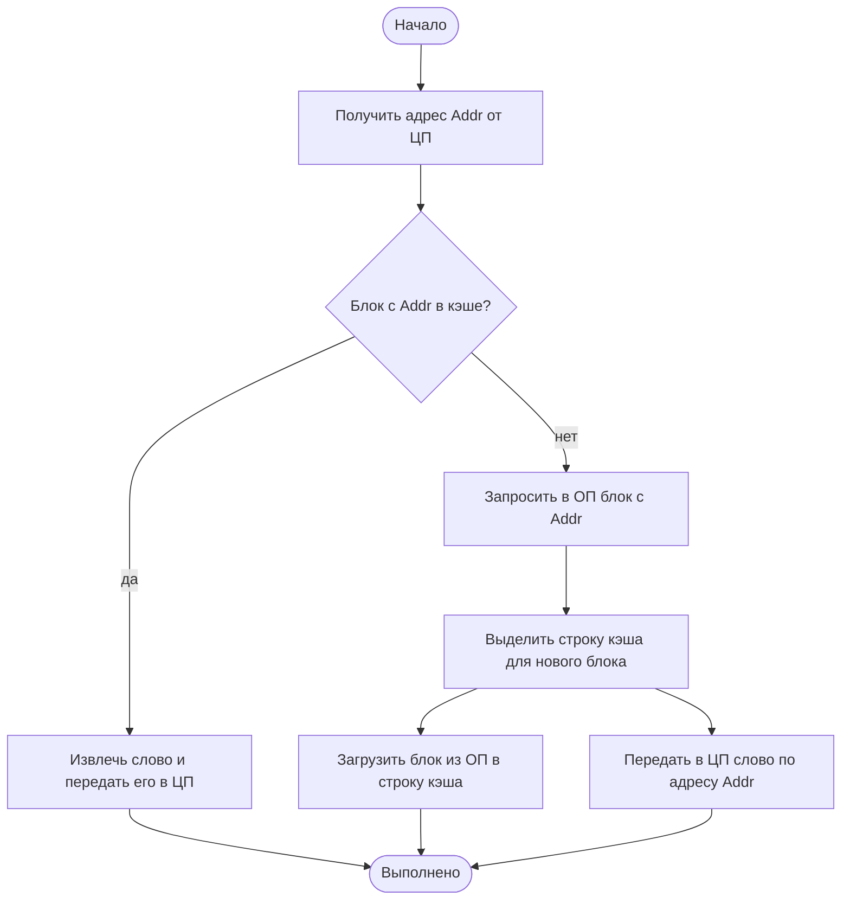

# Кэш-память

## Кэш как структурное решение

Производительность компонентов компьютера растёт неравномерно: процессор ускоряется, память отстаёт. Путей два — быстродействующая элементная база, эффект которой [[Тайминги и поколения DRAM#Задержка в наносекундах|ограничен]], и специальные структурные решения. Главное из них — кэш-память

> [!note] **Кэш-память** — промежуточная память между центральным процессором и оперативной памятью, недоступная программе: её нельзя адресовать машинными командами
> Слова передаются из [[Иерархия памяти|ОП]] в кэш и обратно, процессор получает слово из кэша

Кэшем управляет аппаратура процессора, а не программа и не операционная система[^cache-os]. Слово пишется именно "кэш", от французского cacher — прятать: тайник, а не cash, наличные[^etym]

[^cache-os]: В записи 23.12.2024 сказано, что работа с кэш-памятью — зона ответственности операционной системы. Intel описывает обратное: "The processor's caches are for the most part transparent to software. When enabled, instructions and data flow through these caches without the need for explicit software control"; системному [[Программное обеспечение|ПО]] оставлены редкие случаи согласования кэшей в многопроцессорных системах и инструкции-подсказки PREFETCHh и CLFLUSH — [Intel 64 and IA-32 Architectures Software Developer's Manual, Vol. 3A, 253668-092US, June 2026](https://cdrdv2.intel.com/v1/dl/getContent/671190), 14.1 "Internal Caches, TLBs, and Buffers"

[^etym]: [Online Etymology Dictionary, "cache"](https://www.etymonline.com/word/cache) — "1797, 'hiding place,' from French Canadian trappers' slang, 'hiding place for stores and provisions' (1660s), a back-formation from French cacher 'to hide, conceal'"

## Структура

| Память | Организация | Объём |
| --- | --- | --- |
| **Оперативная** | $2^n$ слов с адресами $0…2^n-1$, логически разбитых на блоки по $K$ подряд идущих слов | $M=\frac{2^n}{K}$ блоков |
| **Кэш** | $c$ **строк**, в каждой **тег** и $K$ слов данных | $c\ll M$ строк |

Длина строки кэша равна длине блока ОП: прочитанный из ОП блок целиком ложится в одну строку. Тег — старшие разряды адреса, по которым видно, какой блок ОП сейчас лежит в строке; адресов у строк кэша нет, строку находят [[Характеристики ЗУ и типы ПЗУ#Произвольный и ассоциативный доступ|ассоциативным поиском]] по тегу. У процессоров Intel строка кэша — cache line — занимает 32 или 64 байта[^intel-l1]

[^intel-l1]: [Intel SDM, Vol. 3A, 253668-092US](https://cdrdv2.intel.com/v1/dl/getContent/671190), Table 14-1: L1 Data Cache — "Intel Core i7, Intel Core 2 Duo, Intel Core Duo, Intel Core Solo, Pentium M and Intel Xeon processors: 32-KByte, 8-way set associative, 64-byte cache line size", у P6 — "32-byte cache line size"; 14.2 "Caching Terminology": "the processor reads an entire cache line into the appropriate cache (L1, L2, L3, or all). This operation is called a cache line fill", "the processor can read the operand from the cache instead of going back to memory. This operation is called a cache hit"

## Алгоритм чтения слова

Нашли блок — **кэш-попадание** (cache hit), процессор сразу читает слово. Не нашли — **кэш-промах** (cache miss): цикл обращения удлиняется, слово читается из ОП, и её блок загружается в строку кэша — Intel называет это заполнением строки, cache line fill[^intel-l1]. Две последние операции на схеме идут параллельно

## Объём кэша

- **Дорог** — хранение бита в кэше обходится дороже всего после регистров
- **Достаточный, а не максимальный** — нужен объём, поддерживающий нормальную работу процессора, а не равный ОП
- **Чем больше объём, тем сложнее схема и медленнее работа**: строк больше, а искомый тег сравнивается с тегами всех строк одновременно — схема сравнения разрастается, и выигрыш от кэша съедается
- **Конструктивные ограничения** — кэш процессорный, а площадь кристалла не безгранична

## Методы отображения

**Отображение** — правило, по которому блок ОП помещается в строку кэша и по которому его там ищут. Во всех иллюстрациях слайдов блок состоит из четырёх слов $W_{4j}…W_{4j+3}$ — это значение для примера, в общем случае слов $K$

Адрес слова в ОП — $s+w$ разрядов: младшие $w$ разрядов задают номер слова в блоке ($K=2^w$), старшие $s$ — номер блока $j$ из $2^s$

### Прямое отображение

За каждым блоком ОП закреплена фиксированная строка кэша:

$$\boxed{i=j\bmod m}$$

где $i$ — номер строки кэша, $j$ — номер блока ОП, $m=2^r$ — число строк кэша. Номер блока делится на два поля: младшие $r$ разрядов — номер строки, старшие $s-r$ — тег

| Тег | Номер строки | Номер слова |
| --- | --- | --- |
| $s-r$ | $r$ | $w$ |

![[Архитектура компьютеров Мосин.pdf#page=318&rect=289,22,706,301|420]]

Номер строки выбирает ровно одну строку, и схема сравнения сверяет один её тег со старшими разрядами адреса: совпали — "есть в кэш", номер слова выбирает слово в строке; не совпали — "нет в кэш"[^slovo]

- **Плюс** — простота реализации: при всей навороченности схемы сравнивается один тег
- **Минус** — неэффективное использование строк. Блоки, номера которых дают одинаковый остаток по модулю $m$, конкурируют за одну строку: если программа обращается к данным с шагом, кратным $m$ блокам, одни строки постоянно заменяются, а другие простаивают

[^slovo]: На схемах стр. 318, 320 и 323 строки кэша подписаны "Слово 0", "Слово $j$", "Слово $M-1$". В текстах тех же слайдов и на стр. 314 это строки, в каждой $K$ слов, и их $m$, а не $M$ — $M$ на стр. 314 обозначает число блоков ОП

### Ассоциативное отображение

Любой блок ОП может быть загружен в любую строку кэша: жёсткая связь строки и блока разорвана. Тег — все старшие $s$ разрядов адреса, т.е. весь номер блока

| Тег | Номер слова |
| --- | --- |
| $s$ | $w$ |

![[Архитектура компьютеров Мосин.pdf#page=320&rect=289,22,707,301|420]]

Чтобы найти слово, тег адреса одновременно сравнивают с тегами всех строк

- **Плюс** — нет жёсткой связи номеров строки и блока, строки используются полностью
- **Минус** — сложная схема управления. Сравнивать нужно со всеми строками, и чем их больше, тем сложнее схема сравнения. Номер строки больше не вычисляется сам: при промахе нужно решить, какую строку занять, т.е. вести для строк таймеры или счётчики и выбирать кандидата [[Кэш-память#Алгоритмы замещения строк|алгоритмом замещения]]

### Множественно-ассоциативное отображение

**Множественно-ассоциативное**, или **секционированное ассоциативное**, отображение: кэш делят на $V$ секций по $k$ строк

$$\boxed{m=V\cdot k,\qquad i=j\bmod V}$$

где $i$ — номер секции. Между секциями отображение прямое — секция вычисляется, внутри секции ассоциативное — блок $j$ может лечь в любую строку секции $i$. Схема управления анализирует три поля адреса: номер секции из $d$ разрядов задаёт одну из $V=2^d$ секций, тег из $s-d$ разрядов вместе с ним определяет один из $2^s$ блоков ОП[^tag-sd]

| Тег | Номер секции | Номер слова |
| --- | --- | --- |
| $s-d$ | $d$ | $w$ |

![[Архитектура компьютеров Мосин.pdf#page=323&rect=292,22,707,301|440]]

Сравнивать приходится только $k$ тегов своей секции, а не все $m$: схема сравнения и управление проще, чем у чисто ассоциативного, а строки используются гибче, чем при прямом

> [!tip] Оба других метода — крайние случаи множественно-ассоциативного[^extremes]
> - $V=m,\ k=1$ — в секции одна строка: **прямое отображение**
> - $V=1,\ k=m$ — одна секция на весь кэш: **ассоциативное отображение**

[^tag-sd]: На стр. 322 сказано: "Поле тэга длиной $s$ битов и # секции определяют один из $2^s$ блоков ОП". Тег и номер секции вместе дают $s$ разрядов, значит, сам тег — $s-d$ разрядов, как и подписано на схеме стр. 323

[^extremes]: В записи 23.12.2024 сказано, что при одной секции получается прямое отображение, а при $V=m$ — тоже прямое. При $V=1$ отображение ассоциативное, как на стр. 323 и по формуле: одна секция без вычисления номера, любая строка кэша

### Разбор адреса

> [!example] Адрес $3A7D_{16}$ в трёх методах
> ОП на $2^{16}$ слов, блок из $K=4$ слов, кэш на $m=16$ строк. Тогда $w=2$, $s=14$, $r=4$
>
> $$3A7D_{16}=\underbrace{0011\,1010\,0111\,11}_{j\ =\ 3743}\ \underbrace{01}_{\text{слово } 1}$$
>
> | Метод | Поля адреса | Куда смотреть |
> | --- | --- | --- |
> | Прямое | тег $0011101001_2=233$, строка $1111_2=15$, слово 1 | Строка $3743\bmod 16=15$: совпал ли её тег с 233 |
> | Ассоциативное | тег $3743$ из 14 разрядов, слово 1 | Все 16 строк: есть ли тег 3743 |
> | Множественно-ассоциативное, $V=4$, $k=4$, $d=2$ | тег $001110100111_2=935$, секция $11_2=3$, слово 1 | Четыре строки секции $3743\bmod 4=3$: есть ли тег 935 |
>
> Проверка: $233\cdot 16+15=3743$, $935\cdot 4+3=3743$
>
> Блок $j=15$ (адреса $003C_{16}…003F_{16}$) при прямом отображении тоже попадает в строку 15 с тегом 0. Если программа попеременно обращается к адресам $003C_{16}$ и $3A7D_{16}$, каждое обращение — промах с заменой строки 15, хотя остальные 15 строк могут пустовать. В множественно-ассоциативном кэше оба блока попадают в секцию 3 с разными тегами и помещаются в ней одновременно

> [!example]- Реальный кэш: L1 данных Intel Core i7
> 32 КБ, 8-way set associative, строка 64 байта[^intel-l1]. Строк $\frac{32\cdot 2^{10}}{64}=512$, секций $V=\frac{512}{8}=64$, $k=8$. Адресуемая единица — байт, поэтому номер байта в строке занимает $w=\log_2 64=6$ разрядов, номер секции $d=\log_2 64=6$ разрядов, а всё остальное в адресе — тег. Каждое обращение сравнивает 8 тегов своей секции вместо 512

## Алгоритмы замещения строк

При ассоциативном и множественно-ассоциативном отображении на промахе нужно выбрать, какую строку освободить под новый блок

| Алгоритм | Кандидат на замену | Что хранит схема |
| --- | --- | --- |
| **LRU** (Least Recently Used) | Строка, к которой процессор дольше всего не обращался | Таймер обращений |
| **[[FIFO]]** | Строка, загруженная раньше всех — очередь | Порядок загрузки |
| **LFU** (Least Frequently Used) | Строка, к которой процессор обращался реже всего[^lfu] | Счётчик обращений |

> [!question]- Чем LRU отличается от LFU, если обе выбирают "редко нужную" строку?
> LRU меряет **время**: "дольше всего" — у строки таймер с момента последнего обращения. LFU меряет **частоту**: "реже всего" — у строки счётчик обращений. Гибкость ассоциативных методов оплачивается структурной сложностью — для каждой строки нужно вести таймер или счётчик

[^lfu]: На стр. 324 у LFU — строка, "к которой реже всего не обращался процессор": лишнее "не" переворачивает смысл, и так же сказано в записи 23.12.2024. Least frequently used — строка с наименьшим числом обращений

> [!example] Три алгоритма на одной последовательности
> Ассоциативный кэш на 3 строки, обращения к блокам $A, A, A, B, C, B, D, A, C$. В столбцах — содержимое строк после обращения, промах отмечен ✗
>
> | № | Блок | FIFO, в порядке загрузки | LRU, от давнего к недавнему | LFU, блок и счётчик |
> | --- | --- | --- | --- | --- |
> | 1 | A | A ✗ | A ✗ | A1 ✗ |
> | 2 | A | A | A | A2 |
> | 3 | A | A | A | A3 |
> | 4 | B | A B ✗ | A B ✗ | A3 B1 ✗ |
> | 5 | C | A B C ✗ | A B C ✗ | A3 B1 C1 ✗ |
> | 6 | B | A B C | A C B | A3 B2 C1 |
> | 7 | D | B C D ✗, вытеснен A | C B D ✗, вытеснен A | A3 B2 D1 ✗, вытеснен C |
> | 8 | A | C D A ✗, вытеснен B | B D A ✗, вытеснен C | A4 B2 D1 |
> | 9 | C | C D A | D A C ✗, вытеснен B | A4 B2 C1 ✗, вытеснен D |
> | Промахов | | 5 | 6 | 5 |
>
> На шаге 7 FIFO и LRU выгоняют A — самый старый по загрузке и по последнему обращению, хотя к нему обращались чаще всех, и на шаге 8 платят промахом. LFU помнит частоту и A оставляет
>
> На шаге 8 LRU вытесняет C, к которому обращались раньше, чем к B, а FIFO — B, загруженный раньше C; следующим нужен C, и FIFO здесь просто повезло. Ни один алгоритм не лучше всегда — результат зависит от последовательности обращений

## Размер блока ОП

Длину блока при проектировании можно выбрать любой, но от неё зависит длина строки кэша

- При фиксированной физической ёмкости кэша большие блоки уменьшают число строк, и каждая строка обновляется чаще — больше промахов, а каждая замена удлиняет обращение
- С ростом блока каждое дополнительное слово всё дальше от затребованного, и вероятность, что оно понадобится процессору в ближайшее время, падает: четверть, а то и половина прочитанного может так и не пригодиться — её читают и хранят вхолостую

Выбор размера блока — минимаксная задача: не тратить лишних ресурсов и при этом сохранить выигрыш от [[Иерархия памяти#Почему иерархия работает|пространственной локальности]]
